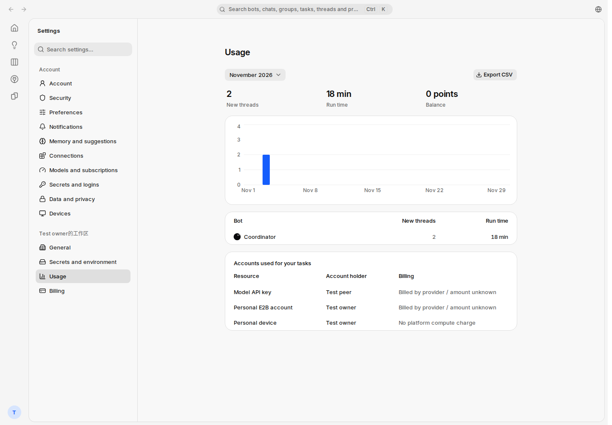
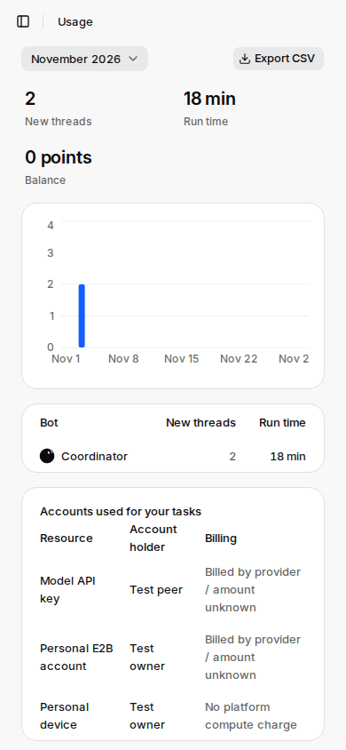
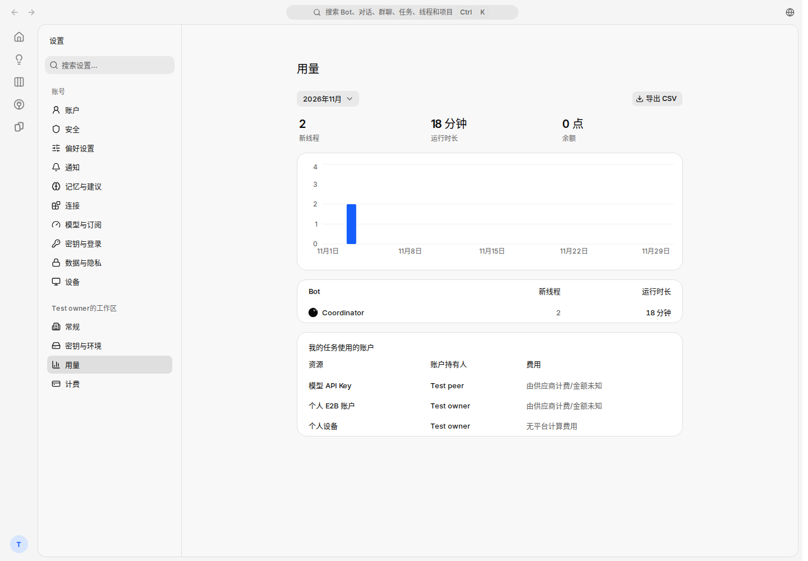
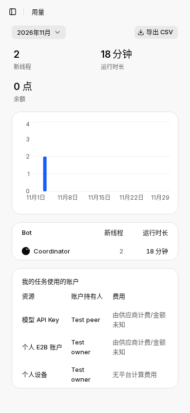

# Execution account usage: local production visual review

Source checkout: `70b210ed4060334546283dc20951ac8b22501ce3` (includes layout fix `d144771` and isolated CI fixture fix `70b210e`).

- `next build` completed with exit 0, then `next start -p 3106`. No browser test suite ran.
- Official Chrome for Testing 156.0.8078.80, headless shell; no `playwright install`.
- Disposable loopback PostgreSQL: `mikka_identity_ui2_e2e`, initialized with repository migrations and ordinary test-account environment bootstrap.
- Authentication used `acquireTestAccounts`: ordinary sign-up/sign-in endpoints followed by get-session verification. No fabricated session.
- Real `/api/settings/usage` returned HTTP 200 and three frozen account rows: shared model API key, personal E2B and personal device.
- Display metadata was synthetic, using real `freezeExecutionIdentity`; no provider or model invocation, and no external charge.
- Captures were audited with `auditEvidence`; fixture rows and normal sessions were cleaned after capture.
- The PNG originals remain in the remote isolated checkout under the same relative directory. These WebP copies are lossless.

| Locale | Viewport | Card width | Table width | Observation |
| --- | --- | --- | --- | --- |
| zh-CN | 1440 × 1000 | 688 | 686 | Complete content; no crop |
| en | 1440 × 1000 | 688 | 686 | Complete content; no crop |
| zh-CN | 390 × 844 | 342 | 340 | Natural wrapping; all billing text visible |
| en | 390 × 844 | 342 | 340 | Natural wrapping; all billing text visible |

## Review outcome

Account holder is separate from Billing. Model and E2B rows explicitly say provider billed / amount unknown; the device row says no platform compute charge. The original English mobile table was 536px wide in a 342px card; the fixed layout is 340px and fully readable.

Remote command logs: `/tmp/identity-ui-final-build.log`, `/tmp/identity-ui-final-screenshots.log`. Both commands exited 0.

## Archived screenshots

### en-1440

### en-390

### zh-CN-1440

### zh-CN-390

