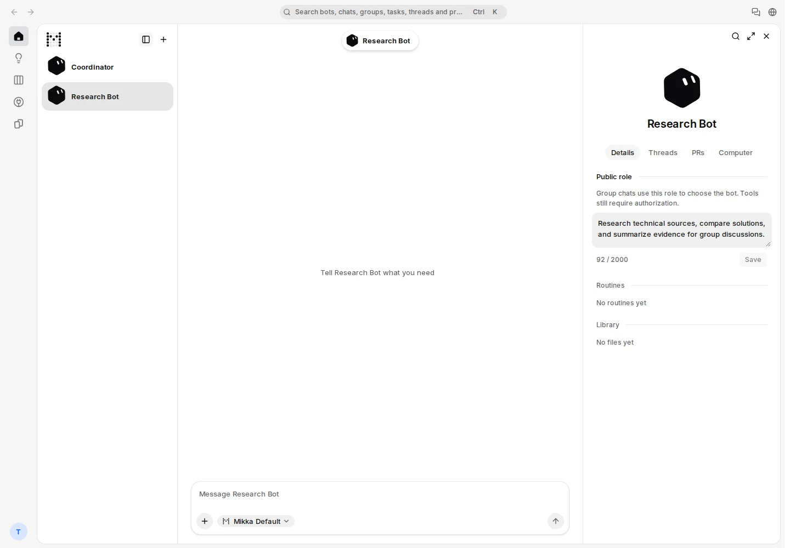
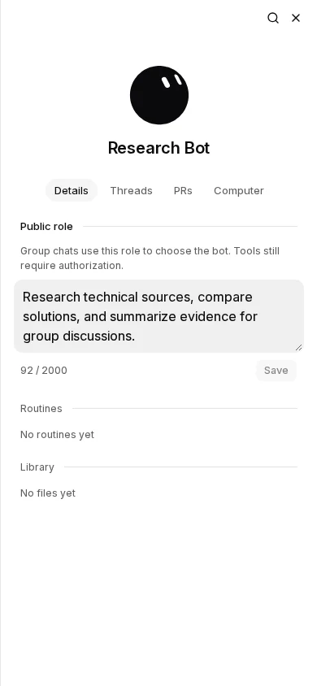
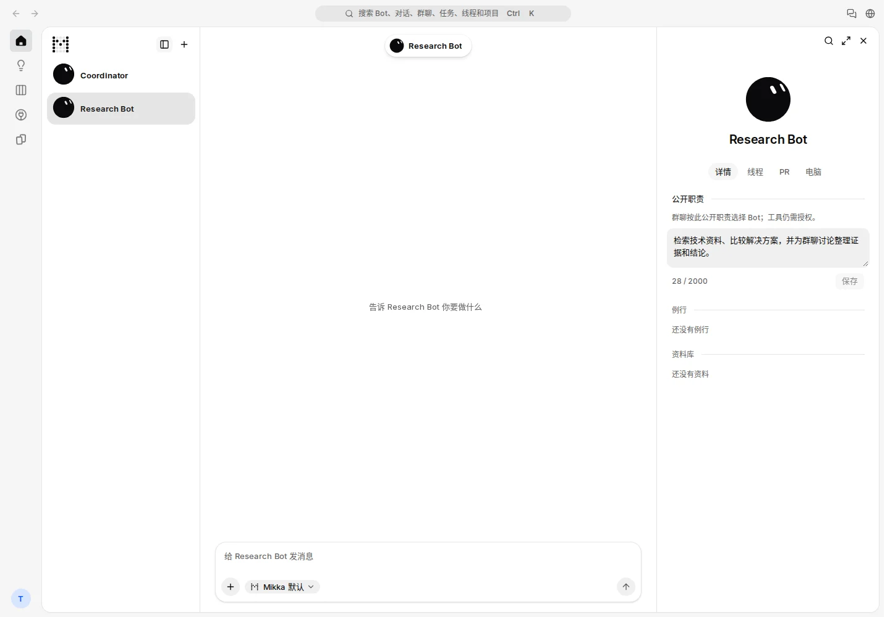
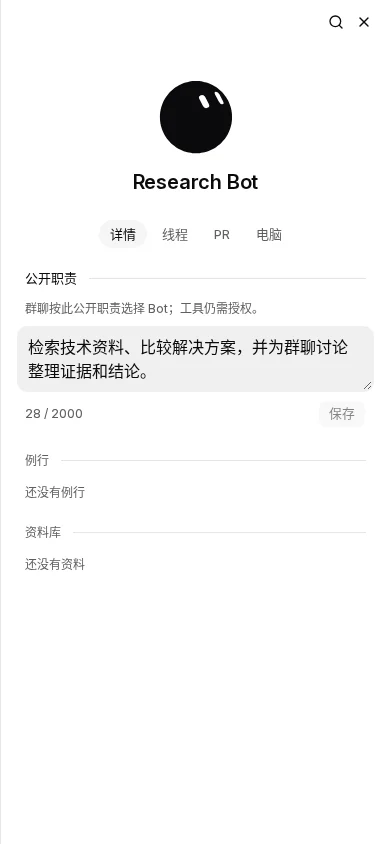

# Bot public role — production screenshot review

Implementation: `e95e90d391d81ef57037a0f3710569fba0ea7031`, branch `fix/bot-public-role-ui`.
The editor, context panel, owner GET/PATCH API, update helper and translations are byte-identical in integrated `bbda9fd1727f9cae2a8d03d2e9a8a9a2922d5a87`.

Environment: isolated Cloud Linux, PostgreSQL 17, Node 24.22.1, pnpm 10.34.3, local origin `http://localhost:3108/mikka`, database `mikka_public_role_ui_e95_e2e`. `next build` and `next start`, no dev screenshot. TestAccountPool obtained owner and peer sessions through normal application signup/signin. No provider credentials, model prompts or browser test suite were used.

## Review

| User task | Before | After |
| --- | --- | --- |
| Find and edit a Bot's public responsibilities | API only; missing UI entry | Bot › Details › Public role |
| Understand who uses the description | No visible role field | Explicit group-routing and tool-authorization description |
| Clear a role or discard an edit | No UI | Empty value can be saved; Cancel restores the stored value |
| Recover from save/load errors | No UI | Load retry; save error retains the draft |
| Edit on a phone | No UI | Same editor in the existing full-width details panel |

All four required screenshots were visually inspected. Labels, text, count and Save fit; input uses the existing filled Textarea, controls use shared Button/Field primitives. At 390 px, page width is 390 and the field ends at x=374. No horizontal overflow, clipped copy or missing control was observed. R-51's scoped owner editor exception and the component registry are documented with the implementation. The surrounding accepted panel layout is preserved; no new page or navigation surface was added.

### English — desktop

### English — 390 px

### Chinese — desktop

### Chinese — 390 px

## Verification

- `tsrs --noEmit`: exit 0.
- Targeted oxlint: exit 0.
- i18n and copy checks: exit 0.
- UI/interaction policy: 0 errors.
- `git diff --check`: exit 0.
- Production build command `cmd_4971a63a976040bf8b99f520c0cc`: exit 0.
- API/screenshot command `cmd_0aeffb2f7a8a4ef695b31bf1c648`: exit 0.
- Owner role PATCH and readback passed; empty clear passed; 2,000 characters accepted; 2,001 rejected without changing the saved role; peer GET/PATCH both 404; owner response contains no private instructions.
- `review.json` records the exact revision and layout measurements. This proves the editor's public endpoint and rendering; it is not a new model-routing execution claim.

The initial temporary capture script incorrectly tried to register an API-generated Bot ID as a pre-reserved fixture. The existing registry rejected it; no guard was changed. That temporary setup error was corrected before the successful capture. Root's subsequent cleanup constraint prohibits SQL fixture deletion in any further capture round; this completed round is not repeated.
