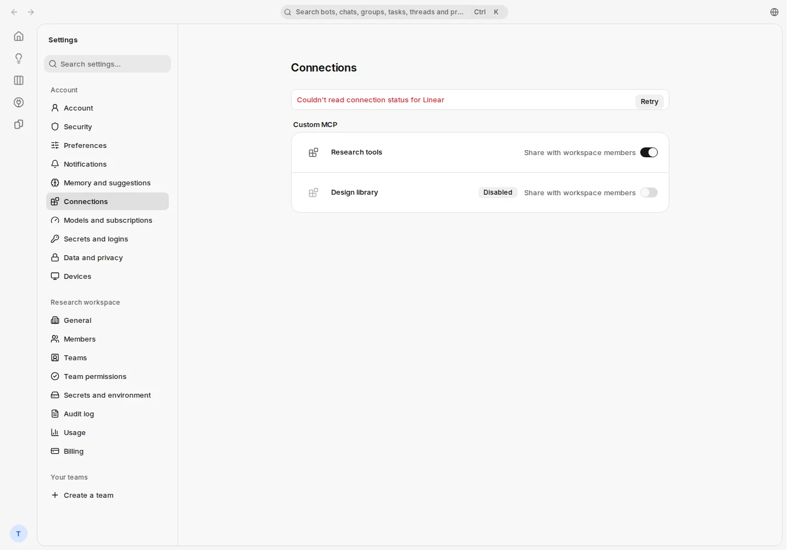
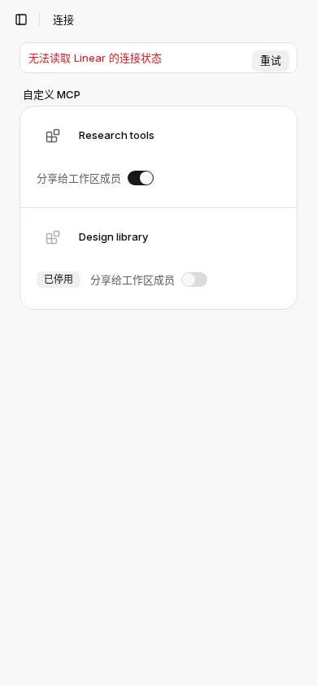
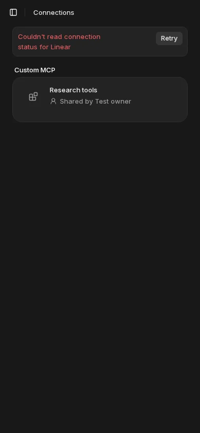
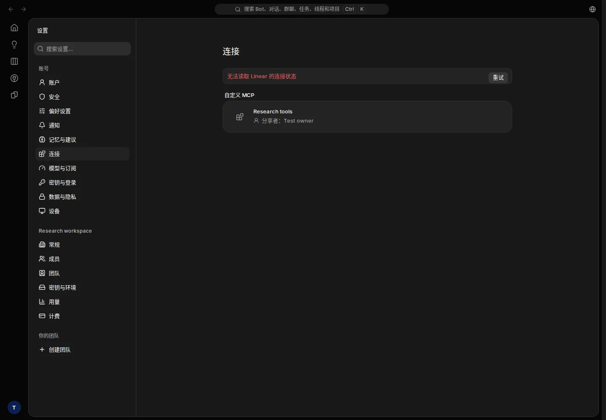
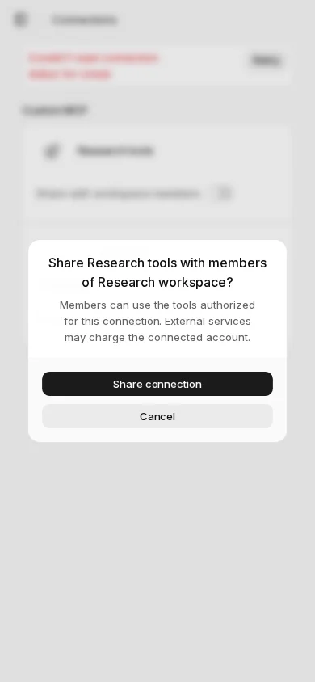

# Shared MCP Settings — PR #1186 visual and API evidence

## Fixed versions and environment

- Application build: `5d85ee0a7f3382a6b8d5ba89fbcbb66e7f9b1795`, tree `1f7c0d07d7d5bd78311524feb889283a2601e632`.
- Published composition: `ae381fb994cfd5635f414afee36e6c16a25908bc`, tree `319a150836cbbabaf35e5c6fcf713131c168053a`.
- All nine UI, localization and design files from this change are byte-identical between the built version and the published composition; only unrelated integration and package-script changes followed the build.
- Owned Cloud Linux sandbox, Node 24.22.1, pnpm 10.34.3, isolated PostgreSQL database `mikka_mcp_ui_5d85_e2e`, normal TestAccountPool signup/signin. Local production build and normal application pages at `http://localhost:3110/mikka`.
- Build command `cmd_fd5a801025fe4cbdbca413c139fc`: exit 0. Capture command `cmd_1ebd77a7b144498fb9096e240a60`: exit 1 at account release (`ACCOUNT_DIRTY`).

## Outcome boundaries

The normal HTTP assertions completed: owner-created team, peer invitation and acceptance without sending email, personal-workspace sharing unavailable, invisibility before sharing, share readback, hidden peer endpoint/credentials, non-owner revoke rejected with 404, revocation and re-sharing. Both created MCP connections and the team were deleted through normal application operations. Read-only verification found no remaining fixture connection/workspace and no active lease.

The overall capture driver did **not** pass: the account pool quarantined the lease as `ACCOUNT_DIRTY` during release. The exact residual classification is recorded in `review.json`. Quarantine and all account, origin, environment and database guards remain intact. No SQL row cleanup was used. Earlier failed temporary harness attempts remain separately quarantined and are not presented as successful runs.

The owner reviewed all five images, and the root agent independently inspected each image on 2026-11-04. MCP controls, attribution, disabled states, localization, light/dark themes and narrow-screen confirmation render without horizontal overflow or clipped controls. The real unconfigured Linear-status error banner was deliberately retained. Screenshots contain synthetic fixture names only; no passwords, cookies, private endpoints or provider credentials appear.

This evidence performs zero model calls and zero external MCP calls. The independent real PostgreSQL/SDK HTTP fixture tests cover actual MCP execution authorization; these screenshots do not claim a real Gmail or third-party MCP provider acceptance.

## Screenshots

### Owner, English, 1440 px, light

### Owner, Chinese, 390 px, light

### Member, English, 390 px, dark

### Member, Chinese, 1440 px, dark

### Owner confirmation, English, 390 px, light

Image dimensions, byte counts, SHA-256 hashes, functional assertions and cleanup details are recorded in `review.json`.
