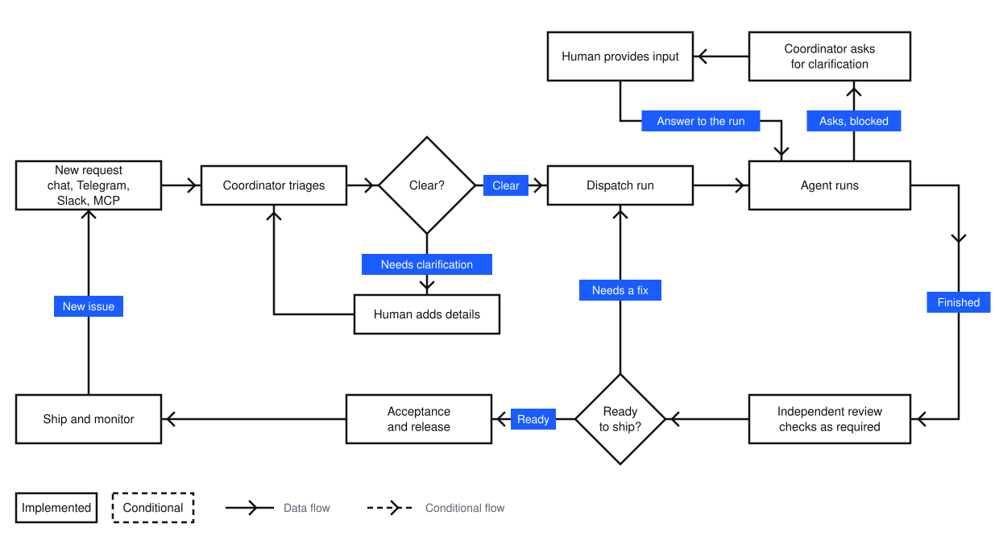

<div align="center">

<picture>
  <source media="(prefers-color-scheme: dark)" srcset="public/brand/mikka-icon-dark.svg">
  
</picture>

# Mikka

### The AI lead for ambitious work.

Every agent, from laptop to cloud, working as one team.

[Open Mikka](https://app.aspectlylabs.com/mikka) · [Documentation](https://aspectlylabs.com/mikka/docs) · [Quickstart](https://aspectlylabs.com/mikka/docs/quickstart)

[](LICENSE)
[](https://linux.do)

**English** · [简体中文](README.zh-CN.md)

</div>

Mikka organizes work for Claude Code, Codex and supported Cursor runners, with bots that coordinate tasks and agents that execute them.

Describe a task to a bot. Mikka dispatches coding work to agents on your Mac, Linux machine, SSH server or an eligible cloud sandbox, then brings their progress, questions and results back into one place. Use it in the web, macOS or iOS app.

## Get started

**Mikka Cloud.** [Open the app](https://app.aspectlylabs.com/mikka), create an account and start using Mikka. Follow the [Quickstart](https://aspectlylabs.com/mikka/docs/quickstart) to get set up.

**Self-hosted server.** Mikka can run on your own Linux host with Docker and PostgreSQL. Follow the [self-hosting guide](docs/self-hosting.md) to configure credentials, download the matching Compose file and start the server:

```sh
docker compose up -d --wait
```

The Compose deployment starts the Mikka server and PostgreSQL; it does **not** install a separate copy of the official UI. Connect an official client to your server. See [Client and source availability](#client-and-source-availability) before choosing self-hosting.

**Already use Claude Code?** Connect Mikka as an MCP server:

```sh
claude mcp add --transport http mikka https://app.aspectlylabs.com/mikka/api/mcp
```

This registers Mikka in Claude Code and uses browser-based OAuth sign-in. You need access to the Mikka server; the command does not install the Mikka daemon or run a coding task. See the [MCP guide](docs/mcp.md) for other clients and tools.

## What Mikka does

- **Coordinates work.** The built-in Coordinator and bots you create turn requests into tasks, clarify ambiguous instructions and dispatch work to coding agents.
- **Runs where your work lives.** Connect your own computers and SSH servers through the Mikka daemon, or use a configured cloud execution environment. Eligible parallel coding runs use isolated Git worktrees or task sandboxes.
- **Keeps work reviewable.** Follow task progress, answer agents' questions, inspect run results and review eligible pull requests through Factory's checks and acceptance flow.
- **Provides cloud desktops.** On configured Mikka Cloud accounts, bots can use a desktop you can watch, take over and hand back. Direct E2B access uses the owner's own key.
- **Works with existing tools.** Reach Mikka from Claude Code or Codex through MCP, or from Telegram and Slack. Connected-app actions respect the relevant permissions and approval policy.
- **Bring your own subscriptions.** Use your existing Claude or ChatGPT/Codex subscription with supported coding agents. Model API keys are also supported where applicable.
- **Supports personal and team work.** Tasks, bots and activity can be organized across personal and team workspaces, with access controls for connected resources.

Availability depends on deployment configuration, connected services and feature flags. Planned work is tracked in [GitHub Issues](https://github.com/alexj11324/Mikka/issues), not represented here as shipped functionality.

## How it works

1. **Describe the work.** A bot turns your request into a task and asks for clarification when needed.
2. **Dispatch an agent.** Mikka selects a configured execution location and starts the coding run.
3. **Follow along.** The agent reports progress or questions; you can respond when it needs input.
4. **Review the result.** Factory applies the checks required for the task, sends failed work back for fixes and presents eligible code changes for acceptance. An authorized acceptance can merge the PR using your connected GitHub account.

<picture>
  <source media="(prefers-color-scheme: dark)" srcset="docs/assets/task-flow-dark.svg">
  
</picture>

For definitions of bots, agents, tasks, threads and runs, see the [glossary](docs/design/glossary.md).

## Client and source availability

Mikka has one official UI across its web, macOS and iOS clients. Those clients can connect to Mikka Cloud or a self-hosted server.

This public repository includes the server, daemon, native mobile source and much of the web UI code. **Official web and desktop builds also use private UI components** that are not distributed here. A build from the public source alone is therefore **not the complete official web or desktop UI**. The self-hosted image serves installation status, sign-in and authorization pages. Open the official client, choose **Change** under the server name, and enter the HTTPS address shown by your installation.

Read [UI source boundaries](docs/ui-overlay.md) and [self-hosting](docs/self-hosting.md) for what can be built, deployed and connected. Source implementation and production availability are verified separately under the [acceptance policy](docs/acceptance.md).

## Development

The repository uses Node.js 24.x and pnpm 10.34.3. To install dependencies and run the source checks in a prepared development environment:

```sh
pnpm install --frozen-lockfile
pnpm check
```

For a runnable local environment with an isolated PostgreSQL database, follow the [cloud Linux bootstrap](docs/local-bootstrap.md) and [development workflow](docs/dev-workflow.md). Do not commit credentials; the project uses Infisical for development secrets.

**Core stack:** React, Vite, Hono/Nitro, Vercel AI SDK and Workflow, PostgreSQL/Drizzle, Electron, Expo and the Mikka daemon. See the [documentation index](docs/README.md) for architecture, integrations, CI, deployment and runtime details.

## Documentation

- [Quickstart](https://aspectlylabs.com/mikka/docs/quickstart) — get started with the official app.
- [Self-hosting](docs/self-hosting.md) — run your own server and connect clients.
- [MCP integration](docs/mcp.md) — operate Mikka from other agents and tools.
- [Documentation index](docs/README.md) — architecture, setup, security and operations.
- [Contributing](CONTRIBUTING.md) and [AGENTS.md](AGENTS.md) — contribution and coding-agent rules.

## Open source and licensing

The public source is licensed under [AGPL-3.0-only](LICENSE). Modified versions offered as network services are subject to the AGPL's source-availability obligations. Third-party components retain their own licenses; see the [third-party notices](packages/daemon/THIRD_PARTY_NOTICES.md).

Commercial licenses are available from Aspectly Labs at [legal@aspectlylabs.com](mailto:legal@aspectlylabs.com). Contributors retain copyright in their work and grant the additional licensing rights described in [CONTRIBUTING.md](CONTRIBUTING.md#license).

## Acknowledgements

<p>
  <picture>
      <source media="(prefers-color-scheme: dark)" srcset="docs/assets/openai-mark-dark.svg">
      
    </picture>
  <strong>OpenAI · Codex for Open Source</strong>
</p>

Mikka is proudly developed with support from the [Codex for Open Source](https://openai.com/form/codex-for-oss/) program.

A heartfelt thank-you to OpenAI and the Codex team for providing Mikka's maintainer with six months of ChatGPT Pro access. This support gives us more room to explore ambitious ideas, improve engineering and user experience, and give back to the open-source community.

Mikka is an independent open-source project and is not affiliated with or endorsed by OpenAI. The OpenAI name and logo are trademarks of OpenAI.

## License

Mikka is copyright © 2026 Aspectly Labs and licensed under
[AGPL-3.0-only](LICENSE). Third-party components keep their own licenses; see
[`packages/daemon/THIRD_PARTY_NOTICES.md`](packages/daemon/THIRD_PARTY_NOTICES.md).

Commercial licenses for use without the AGPL's obligations are available from
Aspectly Labs: [legal@aspectlylabs.com](mailto:legal@aspectlylabs.com).

If you run a modified version of Mikka as a network service, the AGPL requires
you to offer its users the source code of your version.

## Contributing

Contributions are welcome. Read [`CONTRIBUTING.md`](CONTRIBUTING.md) first.
Contributors keep the copyright in their work and license it under
[AGPL-3.0-only](LICENSE); by submitting it they also allow Aspectly Labs to
offer it under other terms, including commercial licenses. There is no form to
sign. The terms are in [`CONTRIBUTING.md`](CONTRIBUTING.md#license).
