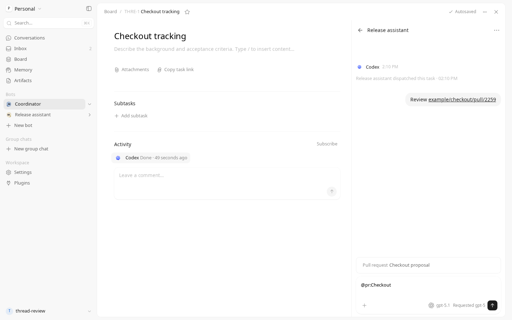
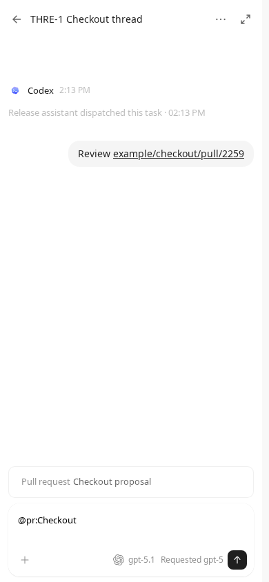
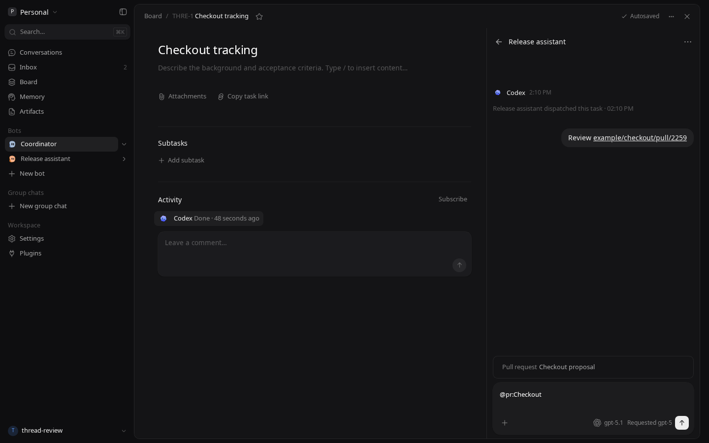
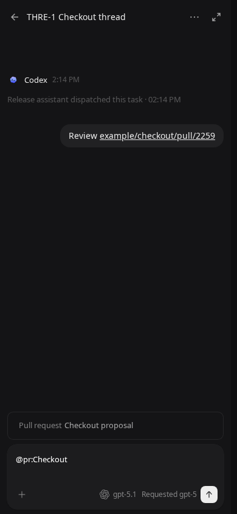

# Composer model provenance and references

The official Web renderer signed in using local Better Auth against a disposable PostgreSQL 17 workspace. The native source API returned a recorded requested model of gpt-5 and a separately recorded observed model of gpt-5.1. In each viewport and theme the composer displayed both, the previously sent pull request had its exact link, and selecting a task, a conversation and a pull request inserted the corresponding recognized marker into the draft. Screenshots were taken with the pull request picker open. The task and thread references used local authorized workspace records. The repository link is synthetic and was not opened. No provider was called.

| Desktop | Mobile Web |
| --- | --- |
|  |  |
|  |  |
