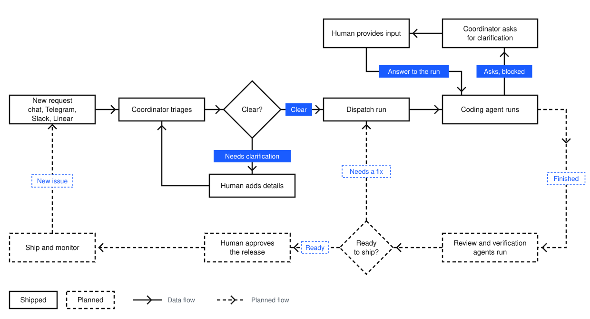
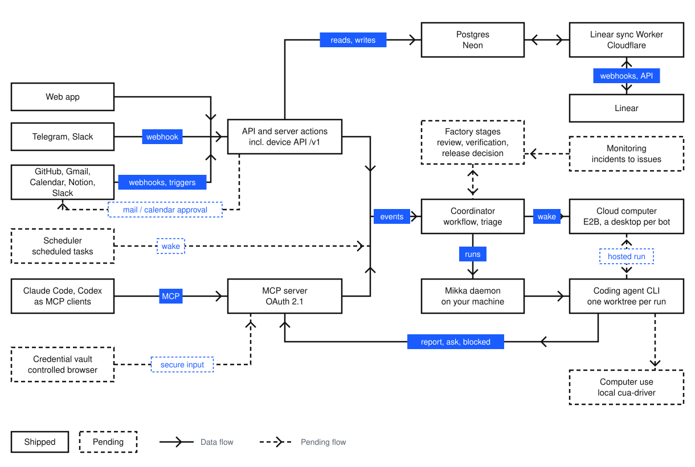

<div align="center">

<picture>
  <source media="(prefers-color-scheme: dark)" srcset="public/brand/mikka-icon-dark.svg">
  
</picture>

# Mikka

### The AI lead for ambitious work.

Every agent, from laptop to cloud, working as one team.

[](https://github.com/alexj11324/Mikka/actions/workflows/ui-policy.yml)
[](LICENSE)
[](https://linux.do)

[Open Mikka](https://app.aspectlylabs.com/mikka) · [Docs](https://aspectlylabs.com/mikka/docs) · [Quickstart](https://aspectlylabs.com/mikka/docs/quickstart)

**English** · [简体中文](README.zh-CN.md)

</div>

Mikka coordinates the coding agents you already use as a single team. Describe
what you need to a bot in natural language. The bot plans the work and hands
each task to Claude Code, Codex or Cursor. Tasks run on your
own machines. A cloud computer for each bot is in early access, behind a flag.

You can follow each task in real time, step in when a decision is needed, and
review the results.

## How Mikka works

- **Bots coordinate. Threads execute.**
  - A bot chats with you, plans the work and hands it out. It does not do the
    work directly.
  - Each piece of work runs in a **thread**: one work run with its own name,
    usually tied to a task. One bot can run many threads at once.
  - The full definitions are in the [glossary](docs/design/glossary.md).
  - A **harness** is the execution layer, not another bot. Every bot chats on Mikka's AI SDK / Workflow harness (the Coordinator harness); dispatched coding work uses the daemon's Claude Code, Codex or Cursor CLI harness. The retired standalone Agent chat is available only as read-only history.

- **The Coordinator and your own bots.**
  - The Coordinator is the built-in bot. It is long-running: it wakes when a
    run ends, a task changes state, or a worker asks a question, decides the
    next step, and notifies you only when your input is required. It raises
    matters from your connected apps at most five times a day.
  - You can create more bots, each with its own name, shape and colour. Every
    bot chats on the Coordinator harness with its own chat, memory and
    threads. That harness is separate from the CLI harnesses that execute
    dispatched coding threads.

- **Asks before it guesses.**
  - When a request is unclear, the Coordinator asks you for the missing details
    in chat before it dispatches a run.
  - While a run works, its agent can ask a question or report that it is
    blocked. The Coordinator puts the question to you with its options, never
    answers for you, and sends your answer back to the run.

- **Runs on your own machines.**
  - The Mikka daemon connects your Mac, Linux machine or server.
  - It starts work through the CLI harnesses you have already installed and signed in
    to, so your existing plans and settings apply.

- **Recovers from failures.**
  - Each run holds a lease, and the daemon checkpoints work in progress while
    the run works. If a machine goes offline mid-run, another of your machines
    with the same repository and harness takes the run over from the latest
    checkpoint. If none can, Mikka retries the run in the same worktree and
    session instead of starting over.

- **Fits into your existing tools.**
  - Tasks sync both ways with Linear, other agents can operate Mikka through
    MCP, and a Telegram message or a Slack mention reaches the Coordinator.

### How a task moves

<picture>
  <source media="(prefers-color-scheme: dark)" srcset="docs/assets/task-flow-dark.svg">
  
</picture>

The solid path ships today. A finished run reports its result in chat. The
dashed loop is the planned Factory process: independent review and verification
([#193](https://github.com/alexj11324/Mikka/issues/193)), a fix run when a check fails, release approval by a person
([#194](https://github.com/alexj11324/Mikka/issues/194)), and monitoring that turns incidents into issues
([#195](https://github.com/alexj11324/Mikka/issues/195)). Systematic routing of ambiguous requests is tracked in
[#192](https://github.com/alexj11324/Mikka/issues/192).

## What Mikka does today

- **Turns requests into runs.** The Coordinator dispatches runs for your tasks
  and decides whether each new task belongs to the workspace or to you. You can
  change the assignment in one click. Letting the Coordinator create and update
  tasks itself is built but behind a switch that is off by default.
- **Lets you create bots.** The left column lists the Coordinator and the bots
  you create. Each bot has its own chat, with unread markers.
- **Makes progress visible.** A dispatched thread appears in the chat as a card
  that follows the run; open it to see the thread's own conversation. Workers
  report progress, ask questions and flag blocks through Mikka's MCP tools,
  and the Coordinator triages each one.
- **Keeps threads private.** On a workspace task, teammates see whose thread it
  is, its status and its time, but not its instructions, transcript or result.
- **Cites its sources.** Replies show the tasks, runs and web pages they draw
  on as chips you can open. Bots can search the web when they need current
  information.
- **Hands back Artifacts.** A bot can deliver a document or an HTML page as an
  Artifact, with versions and a share link.
- **Acts in connected apps with your approval.** Bots read Gmail, Google
  Calendar, Notion and Slack. Sending an email or creating or changing a
  calendar event waits as a pending action until you approve it.
- **Keeps tasks in one place.** Tasks show on a board and a list, with
  relations, activity history and per-person task numbers. They sync both ways
  with Linear. ⌘K searches bots, older chats, tasks and projects.
- **Decides what needs you.** Mikka rates notifications from GitHub, Linear,
  Notion and Gmail by what it costs to ignore them. Urgent matters go to the
  Coordinator, which interrupts you at most five times a day; the rest wait in
  Suggestions. A daily briefing arrives in the Coordinator chat after 08:00 in
  your time zone.
- **Plugins and skills.** One page lists your connected apps and lets you
  browse public agent skills.
- **Works from other tools.** Operate Mikka from Claude Code or Codex through its
  [MCP server](https://aspectlylabs.com/mikka/docs/mcp), or reach the
  Coordinator from Telegram or Slack.
- **Supports teams.** Workspaces, members, invitations and teams, with email,
  Google and GitHub sign-in.
- **Bilingual interface.** The app is available in English and Simplified Chinese.

In early access, behind a flag or switch:

- **Cloud computer.** Each bot gets its own cloud desktop. You can watch it live,
  take control and hand it back; it sleeps when idle and keeps its disk. Bot
  actions on the desktop ask for approval in a chat card.
- **Your own subscriptions.** Connect a ChatGPT (Codex) or Claude subscription in
  Settings, so bots and runs can use your own plan.
- **Memory of you.** Mikka reads rated notifications for facts about you, merges
  them nightly, and shows them in Memory, where you can correct or delete each
  one.
- **Mobile app.** An iOS app in [`apps/mobile`](apps/mobile), built around the
  Coordinator chat, with suggestions, threads, tasks, settings and push
  notifications.

## What we're building

Work in progress is tracked in
[GitHub issues](https://github.com/alexj11324/Mikka/issues), mirrored from
Linear (`MIK-xx`).

| Area | Planned | Tracking |
| --- | --- | --- |
| **Cloud computer** | The per-bot desktop above is in early access. Next: each cloud thread on a machine of its own, hosted coding threads turned on for everyone, and web sub-agents that browse for a bot, each in its own browser. | [#172](https://github.com/alexj11324/Mikka/issues/172), [#342](https://github.com/alexj11324/Mikka/issues/342) |
| **Computer use on your machines** | Agents operate apps on your own computer, with the same approvals in chat as the cloud computer: allow once, deny, or allow for the rest of the run. | [#147](https://github.com/alexj11324/Mikka/issues/147) |
| **Group chats** | Multiple bots and people in one chat, with turn-taking, @ mentions and a status bar showing who is working. | [#105](https://github.com/alexj11324/Mikka/issues/105) |
| **Factory** | An end-to-end delivery process: one run per task at a time, durable stage state, independent review and verification threads, and human release approval based on recorded evidence. | [#191](https://github.com/alexj11324/Mikka/issues/191)–[#195](https://github.com/alexj11324/Mikka/issues/195) |
| **Scheduled tasks** | Bots run tasks at a set time or on a recurring schedule and report the results in chat. Today only the daily briefing runs on a schedule. | [#179](https://github.com/alexj11324/Mikka/issues/179) |
| **Connected apps** | More actions behind your approval, such as in Notion and Slack. | [#177](https://github.com/alexj11324/Mikka/issues/177) |
| **Proactive suggestions** | A nightly research run that turns your deadlines and interests into a few suggestion cards a day, which start a task when tapped. | [#350](https://github.com/alexj11324/Mikka/issues/350) |
| **Secure credentials** | Agents request credentials through a secure form. A vault holds them, and a controlled browser uses them only for approved actions. | [#180](https://github.com/alexj11324/Mikka/issues/180) |
| **Usability** | Onboarding, fuller ⌘K search, and a knowledge base. | [#129](https://github.com/alexj11324/Mikka/issues/129), [#131](https://github.com/alexj11324/Mikka/issues/131), [#134](https://github.com/alexj11324/Mikka/issues/134) |

## Connect your agents

### Operate Mikka through MCP

Mikka is an MCP server (Streamable HTTP, OAuth 2.1). Add it to Claude Code:

```sh
claude mcp add --transport http mikka https://app.aspectlylabs.com/mikka/api/mcp
```

Claude Code completes sign-in in your browser. Agents can then read and modify
tasks, dispatch runs and update the Coordinator's memory. Other clients and the
full tool list are in the [MCP docs](https://aspectlylabs.com/mikka/docs/mcp).

### Run coding harnesses on your own machine

The daemon in [`packages/daemon`](packages/daemon) detects the coding harness CLIs on
the machine and runs threads through them:

| Execution harness | CLI it looks for |
| --- | --- |
| Claude Code | `claude` |
| Codex | `codex` |
| Cursor | `cursor-agent` or `agent` |

Each run uses its own git worktree, so parallel threads stay isolated.

## Architecture

<picture>
  <source media="(prefers-color-scheme: dark)" srcset="docs/assets/architecture-dark.svg">
  
</picture>

The web app, the iOS app, Telegram, Slack and MCP clients all reach the same
Next.js application on Vercel. Events such as a finished run, a worker
question or a rated notification go to the Coordinator, a durable workflow
that triages each event and decides the next step. Every bot runs on the same
workflow, each with its own chat, memory and inbox.

Runs execute on your machines. The daemon registers the device, claims runs
through the device API, and starts the agent CLI in a dedicated git worktree.
It sends checkpoints during the run so another device can take the run over.
The agent reports progress, questions and blocks through Mikka's MCP worker
tools.

In early access, a bot's cloud computer is an E2B sandbox running the same
daemon and a desktop you can view through noVNC. A Go subscription worker in
[`packages/subscription-worker`](packages/subscription-worker) holds the
sign-in for subscriptions you connect, with the secrets kept in Infisical.

Linear sync runs in a Cloudflare Worker that exchanges changes with Postgres
through a durable inbox and outbox. A second Worker triggers the daily
briefings and hourly reconciliation of notifications.

Dashed boxes and lines in the diagram mark parts that were planned when it was
drawn. Two have shipped since: handoff between machines
([PR #201](https://github.com/alexj11324/Mikka/pull/201)) and, in early access, the cloud computer
([#317](https://github.com/alexj11324/Mikka/pull/317)); connected-app actions with approval
([#177](https://github.com/alexj11324/Mikka/issues/177)) are partly done. Still planned: the Scheduler
([#179](https://github.com/alexj11324/Mikka/issues/179)), Factory stages ([#191](https://github.com/alexj11324/Mikka/issues/191)–[#194](https://github.com/alexj11324/Mikka/issues/194)), Monitoring
([#195](https://github.com/alexj11324/Mikka/issues/195)), local computer use ([#147](https://github.com/alexj11324/Mikka/issues/147)) and the credential vault
([#180](https://github.com/alexj11324/Mikka/issues/180)).

## Built with

| Layer | Stack |
| --- | --- |
| App | Next.js 16, React 19, Tailwind CSS 4, shadcn/ui, ReUI |
| Mobile | Expo and Expo Router (React Native) in [`apps/mobile`](apps/mobile) |
| Bots | Vercel AI SDK; every bot, including the Coordinator, is a durable loop on [Vercel Workflow](workflows/coordinator) |
| Triage | Rules first, then a model call through Vercel AI Gateway with a monthly cost cap |
| Data | Postgres on Neon, Drizzle migrations in [`drizzle/`](drizzle) |
| Auth | Better Auth, with email, Google and GitHub sign-in and an OAuth 2.1 server for MCP |
| Integrations | GitHub and Linear webhooks; Composio for Gmail, Google Calendar, Notion and Slack; Cloudflare Workers for Linear sync and scheduled briefings; Vercel Chat SDK for Telegram and Slack; Firecrawl for web search |
| Cloud computer | E2B sandboxes with a noVNC desktop (early access) |
| Subscriptions | A Go worker in [`packages/subscription-worker`](packages/subscription-worker), with secrets in Infisical (early access) |
| Execution harnesses | The Mikka daemon selects a Claude Code, Codex or Cursor CLI adapter for each work thread |

## Repository layout

```text
app/                 # Next.js routes, server actions and API (MCP, webhooks, daemon /v1)
components/          # React UI
lib/                 # Domain logic: coordinator, issues, artifacts, attention, computer, MCP, auth
workflows/           # Durable workflows (the Coordinator and Slack)
apps/mobile/         # iOS app (Expo)
packages/daemon/     # Local daemon and CLI execution harness adapters
packages/protocol/   # Types shared by the server and the daemon
packages/config/     # Shared configuration
packages/subscription-worker/  # Go worker for connected subscriptions
cloudflare/          # Cloudflare Workers for Linear sync and scheduled briefings
drizzle/             # Database migrations
messages/, i18n/     # English and Simplified Chinese strings
tests/               # Unit, acceptance and Playwright tests
docs/                # Engineering and design docs
```

## Development

Mikka is developed against cloud Preview deployments, not a local server.
Builds, type checks and end-to-end tests run in CI, and each pull request gets
its own Preview URL. Credentials live in Infisical Cloud; never commit them or
store them in a local `.env` file.

Install dependencies and run the checks that do not require a server:

```sh
pnpm install
pnpm check
```

`pnpm check:ci` is the full CI gate: `check`, plus the production build,
performance tests and Playwright tests.

Start with these documents:

- [`AGENTS.md`](AGENTS.md): the rules every contributor and coding agent follows.
- [`docs/design/README.md`](docs/design/README.md): read before any design,
  spec or UI work.
- [`docs/design/glossary.md`](docs/design/glossary.md): what bot, thread and
  chat mean.
- [`docs/acceptance.md`](docs/acceptance.md): how a change is accepted on a
  Preview.
- [`docs/review-checklist.md`](docs/review-checklist.md): complete before
  presenting UI to others.

## Get access

Mikka is in early access. Email
[mikka@aspectlylabs.com](mailto:mikka@aspectlylabs.com) for an invite, then
follow the [Quickstart](https://aspectlylabs.com/mikka/docs/quickstart).

## License

Mikka is licensed under [AGPL-3.0-only](LICENSE). Third-party components keep
their own licenses; see
[`packages/daemon/THIRD_PARTY_NOTICES.md`](packages/daemon/THIRD_PARTY_NOTICES.md).

If you run a modified version of Mikka as a network service, the AGPL requires
you to offer its users the source code of your version.

## Contributing

Contributions are welcome. Read [`CONTRIBUTING.md`](CONTRIBUTING.md) first.
Contributions are made under the project's [AGPL-3.0-only](LICENSE) license;
no separate contributor agreement is required.
