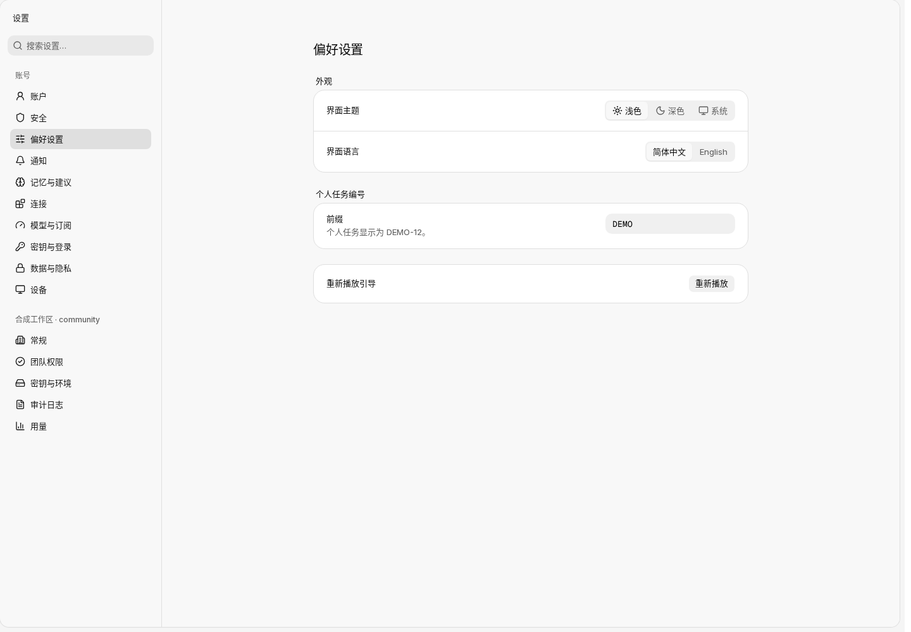
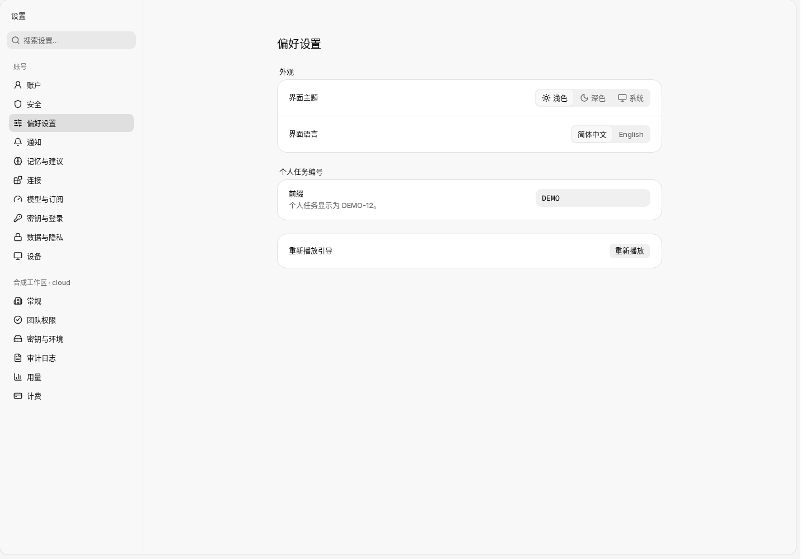
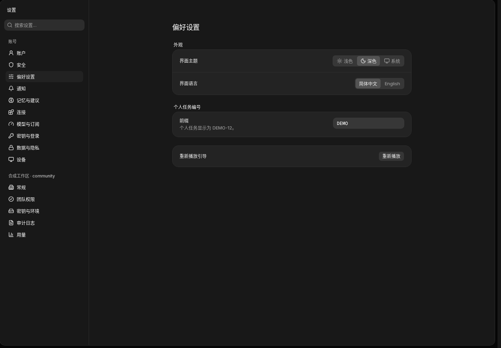
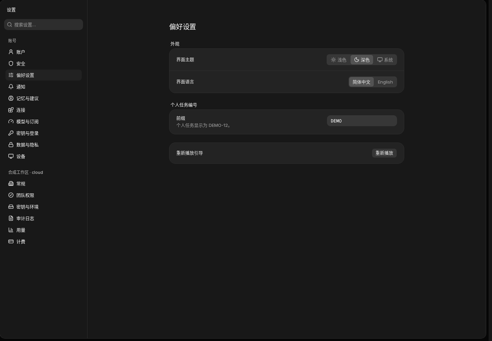

# Community settings UI visual evidence

**Synthetic GET records · visual evidence only · not yet reviewed.**

Source: [d46a044bb9619ddec5490da9218e9ef0245cc125](https://github.com/alexj11324/Mikka/commit/d46a044bb9619ddec5490da9218e9ef0245cc125) · [CI run](https://github.com/alexj11324/Mikka/actions/runs/42498490288)

Existing production SettingsView, SettingsSidebar and Preferences with synthetic workspace GET records. No real account, OAuth, billing, save, URL redirect or runtime acceptance.

[Gallery](index.html) (download with the PNGs for the grid) · [Capture manifest](evidence.json) · [Build manifest](build.json)

## synthetic-zh-CN-light-community-settings.png

## synthetic-zh-CN-light-cloud-settings.png

## synthetic-zh-CN-dark-community-settings.png

## synthetic-zh-CN-dark-cloud-settings.png

