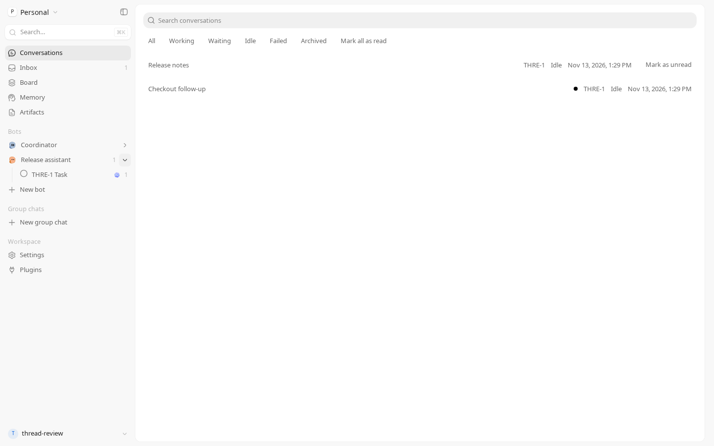
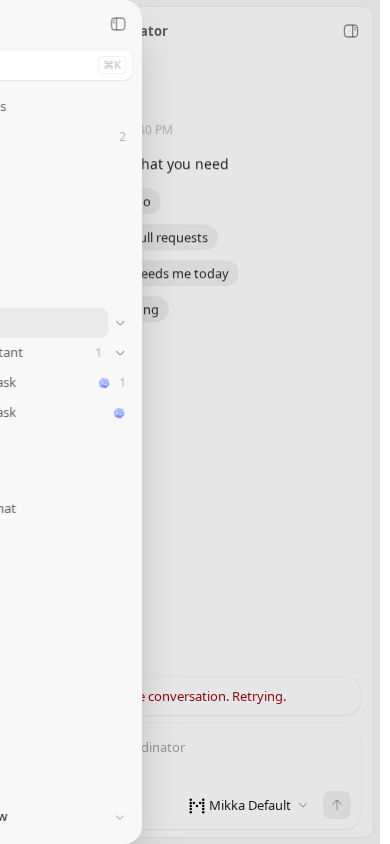
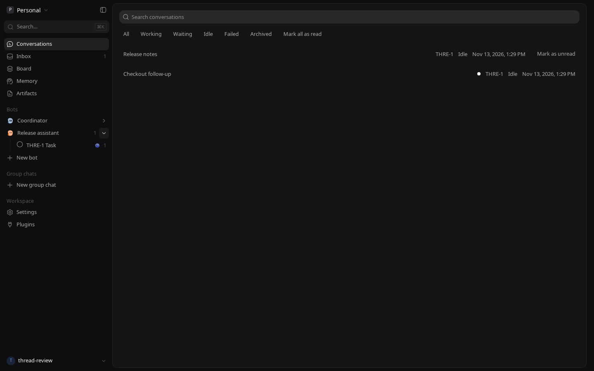
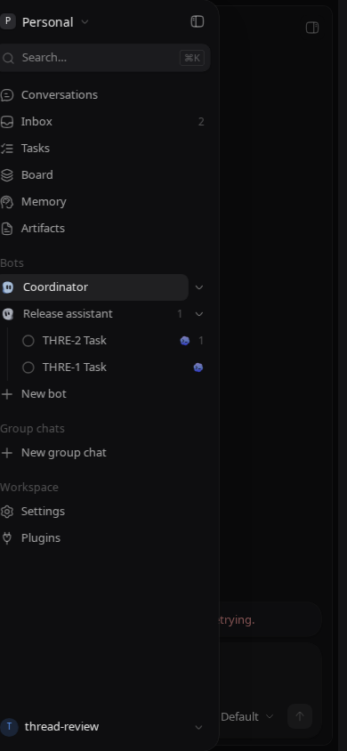

# Independent conversation unread sidebar verification

Public #2268 and private #132 were built together at the exact commits in the manifest. The official Web renderer signed into a disposable local Better Auth account using its real source API and PostgreSQL 17. For each theme and viewport an authorized bulk-read mutation succeeded and two authorized unread mutations reset two separate task conversations. Expanding the Bot displayed a total of 2 and one unread on each task. Opening one thread at its end sent the read acknowledgement (HTTP 200). Reloading the inbox showed 1 on the Bot and 1 on its remaining unread child. The page was captured after that reload.

| Desktop 1440×900 | Mobile Web 390×844 |
| --- | --- |
|  |  |
|  |  |
