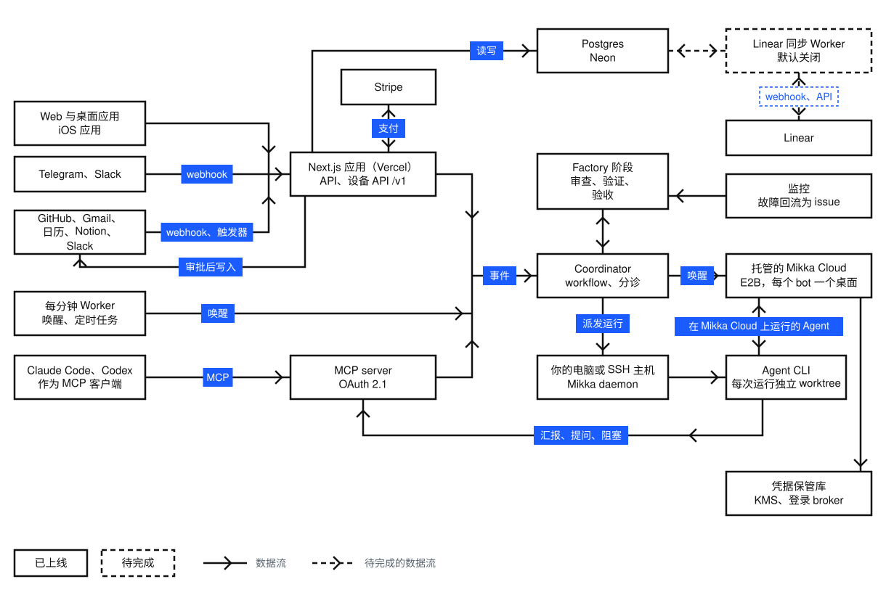

<div align="center">

<picture>
  <source media="(prefers-color-scheme: dark)" srcset="public/brand/mikka-icon-dark.svg">
  
</picture>

# Mikka

### 为大事而生的 AI lead。

从本地到云端，所有 Agent 协作如一。

[](https://github.com/alexj11324/Mikka/actions/workflows/ui-policy.yml)
[](LICENSE)
[](https://linux.do)

[访问 Mikka](https://app.aspectlylabs.com/mikka) · [文档](https://aspectlylabs.com/mikka/docs) · [快速入门](https://aspectlylabs.com/mikka/docs/quickstart)

[English](README.md) · **简体中文**

</div>

Mikka 将分布在你的电脑、远程服务器与云端基础设施上的 AI agent 连接成一个协同工作的团队。向 Bot 描述需求，它会为已连接设备上的 Claude Code、Codex 和 Cursor 安排编码任务。每个 bot 还有一台云端桌面，你可以查看、接管和交还。

在网页、macOS 桌面应用或 iOS 应用中，于同一个地方跟进进展、回应问题并审阅结果。

## 部署自己的服务器

先部署 [Docker 服务器](docs/self-hosting.md)，再用官方 App 连接服务器地址。
镜像提供 API、实时推送、daemon 网关、定时调度、数据库迁移以及自带模型凭据的能力。
默认网页入口提供服务器信息，并保留官方客户端登录、授权与账号确认所需的页面。

Mikka 只有一套界面，就是官方网页、桌面和 iOS App，可以连 Mikka Cloud，也可以连你自己的服务器。
源码里还留着一个旧的内置工作区界面，默认关闭（设置 `MIKKA_COMMUNITY_UI=1` 可打开），它不是第二套设计。
付费 UI 组件的源码与构建产物不进入此公开仓库或镜像。

## 产品与源码边界

此仓库包含后端、原生移动端和界面的大部分网页代码。官方 Web 与桌面构建还会通过 [UI slot](docs/ui-overlay.md) 引入私有的 `mikka-hosted-ui`；没有它的构建只要求能编译（[只有一套界面](docs/design/decisions/2026-11-08-2133-one-ui.md)）。以下能力说明对应这些源码路径，发布与外部服务结果按[运行时验收](docs/acceptance.md)记录。

已接受的界面以任务为列表入口，在任务内打开执行过程，并把同一任务的执行串成一段对话。原生移动端源码已实现这一结构。此仓库里的默认 slot 仍保留线程列表和分别打开每次运行的方式；实际发布的是官方构建，需要独立、绑定版本的发布证据。参见[任务导航决定](docs/design/decisions/2026-11-07-2045-tasks-only-threads-inside.md)和[任务对话决定](docs/design/decisions/2026-11-07-2300-one-conversation-per-task.md)。

## 工作方式

- **Bot 负责协调，Agent 负责执行。**
  - Bot 与你对话，制定计划，并将编码任务派发给你电脑上的 Agent。
  - 编码工作关联一个**任务**。**线程**是该工作的运行链，串起继续、重试和续接的运行。一个 bot 可以同时派发多个任务的工作。
  - 完整定义参见 [术语表](docs/design/glossary.md)。
  - **Agent** 是完成线程工作的执行者：Claude Code、Codex 或 Cursor，运行在一台**电脑**上（你的电脑、SSH 服务器或 Mikka Cloud）。Bot 不是 Agent：所有 bot 都通过 Mikka 的 AI SDK / Workflow 循环（即 Coordinator 的循环）处理对话和工具。旧的独立 Agent 聊天已退役，历史记录仅供查看。让 Coordinator 本身跑在 Claude Code 或 Codex 上（[#312](docs/architecture/native-coordinator.md)）是已废弃的方案：代码保留但保持关闭，不要启用。

- **Coordinator 与你自建的 bot。**
  - Coordinator 是内置的 bot，常驻运行。当运行结束、任务状态变更或 worker 提出问题时，它会被唤醒并决定下一步操作，需要时向你提问。来自已连接应用的事项，由 Decision 模型在防失控预算内判断打扰时机。
  - 你可以创建更多 bot，并为每个 bot 设定名称、形状和颜色。每个 bot 都和 Coordinator 运行在同一个循环上，拥有各自的对话、记忆和派发的任务，并把编码工作交给 Agent。

- **先确认，再执行。**
  - 派发之前，Coordinator 会把不清楚的需求交回给你，在对话中或以选项卡片的形式确认。
  - 运行过程中，worker 可以提出问题或报告阻塞。线程会等待你的回复，你的回答会送回该运行。

- **运行在你自己的设备上。**
  - Mikka daemon 可连接你的 Mac、Linux 主机或服务器。桌面应用也可以通过 SSH 把 daemon 安装到服务器上。
  - Daemon 按需安装自己管理的固定版本 Claude Code 和 Codex，并使用选定的订阅或模型凭据执行工作。

- **故障后自动恢复。**
  - 运行使用租约和仓库 checkpoint。符合恢复条件的运行可在另一台在线设备上重试，该设备需要提供所需的 Agent 运行能力，并能访问对应仓库。

- **融入现有工具。**
  - 其他 agent 可通过 MCP 操作 Mikka；在 Telegram 中发消息或在 Slack 中 @ 提及，即可联系 Coordinator。与 Linear 的双向同步已经完成，但处于关闭状态。

### 任务流转

<picture>
  <source media="(prefers-color-scheme: dark)" srcset="docs/assets/task-flow-zh-dark.svg">
  
</picture>

Factory 按任务所需选择分诊、方案、实现和审阅等阶段。检查未通过时回到修复，监控可以开出后续 issue。符合条件的代码候选通过验收页确认后，使用你已连接的 GitHub 账号合并 pull request。发布由已配置的目标和部署开关控制。

## 产品能力

- **将需求转化为任务和运行。** Coordinator 在所选工作区中创建、更新带编号的任务，并将工作派发给 Agent。
- **任务短标题。** 小模型在任务创建后写出短标题。你自己改过的标题优先。
- **自建 bot。** 左栏列出 Coordinator 和你创建的 bot。每个 bot 都有独立的对话、未读标记和动画头像。
- **完整呈现执行过程。** 派发卡片连接工作及其状态。已接受的任务界面打开任务，并把同一任务的执行串成一段对话。Worker 通过 Mikka 的 MCP 工具汇报进度、提出问题或报告阻塞。你可以回复或停止自己发起的工作。
- **用图表和卡片回复。** Bot 使用 OpenUI 组件回复：柱状图、折线图、面积图、环形图和径向图，表格、统计数字、任务和运行标签，以及包含选项、开关、滑块和日期范围的问题卡片。
- **线程内容仅自己可见。** 在工作区任务上，同事只能看到线程的归属人、状态和时间，看不到指令、对话记录或结果。
- **注明信息来源。** 回复中引用的任务、运行记录和网页以可点击的标签形式展示。需要最新信息时，bot 可以搜索网页。
- **交付「Artifact」。** Bot 可以将文档或 HTML 页面作为「Artifact」交付，支持版本记录和分享链接。
- **通过 Factory 交付。** 分诊与澄清、审阅、检查未通过时的修复运行、以运行截图作为证据、以你的身份合并 pull request 的验收页，以及开出后续 issue 的监控。
- **在已连接应用中操作。** Bot 可以提出邮件、Google 日历、Notion 和 Slack 操作，遵守连接权限和适用的审批策略。
- **统一管理任务。** 任务支持看板和列表两种视图，包含关联关系和活动记录。每个任务在创建时就有编号：工作区任务用团队前缀（AL-12），个人任务用个人前缀（ALEX-12）；任务的分支和 PR 都带这个编号。⌘K 可搜索 bot、群聊、任务和项目。社区界面还保留线程搜索结果。
- **判断哪些事需要你。** Mikka 按「置之不理的代价」为来自 GitHub、Linear、Notion 和 Gmail 的通知评级。Coordinator 和 Decision 模型判断紧急程度与打扰时机，其余事项留在「建议」中。符合条件的每日简报在你所在时区 08:00 之后发送，空简报不展示。
- **新手引导。** 首次打开时引导你创建第一个 bot 并连接订阅，可以在 设置 › 偏好设置 中重新播放。
- **使用自己的订阅和 key。** 在 设置 › 模型与订阅 中连接 ChatGPT（Codex）或 Claude 订阅，或添加模型服务商的 API key。受支持的订阅可以回复 bot 对话，并在本地或云端机器上运行编码任务。原生编码 CLI 使用为该运行选定的订阅或 API 凭据，并直接连接服务商。
- **插件。** 插件商店列出应用，并可搜索公开的 Agent 技能。设置 › 连接列出已连接应用和自定义 MCP server，支持由所有者控制的工作区共享。已安装技能可通过 API 管理，并加入 Coordinator 指令。连接继续遵守所有者和工作区权限。
- **群聊。** Web 与移动端可以使用自己的 bot 创建群聊，发送带 @ 提及的消息并阅读回复。未点名 bot 时，由后端判断哪些 bot 应该参与。
- **应用内设置。** 设置在应用窗口内打开，包含账户、安全、偏好、通知、记忆、连接、模型、已保存的登录、隐私和设备等分区；工作区管理员另有通用、成员、团队、权限、密钥、审计日志、用量和计费。
- **计费。** 托管模型（Mikka 默认）按工作区创建者提供 20 条消息试用，由该创建者创建的所有工作区共同计数，并受平台限额控制。验卡通过 Stripe Checkout 完成，每张卡只向验卡人的个人工作区发放一次 1 美元免费额度。购买的工作区点数也可支付托管用量，充值通过 Stripe Checkout 完成。使用自己的订阅、设备和 E2B key 无需银行卡。
- **管理设备。** 设置 › 设备列出你的电脑。移除在线设备时会同时卸载其 daemon。
- **支持从其他工具调用。** 可在 Claude Code 或 Codex 中通过 [MCP server](https://aspectlylabs.com/mikka/docs/mcp) 操作 Mikka，也可通过 Telegram 或 Slack 联系 Coordinator。
- **支持团队协作。** 提供工作区、成员、邀请和团队管理，在服务商配置完成后支持邮箱、Google 和 GitHub 登录。邮箱登录另有 kill switch。
- **桌面应用。** 适用于 Apple Silicon 的 macOS 应用，在半透明窗口中渲染同一套界面，通过系统浏览器登录，在 Dock 和系统通知中提示等待中的运行，并从 GitHub Releases 自动更新。它还可以通过 SSH 添加 `~/.ssh/config` 中的服务器。应用图标是分层的 Liquid Glass 图标，在 macOS 26 上有默认、深色、着色和透明四种外观。
- **iOS 应用。** 位于 [`apps/mobile`](apps/mobile)，使用原生的 Bot、任务、建议、设置和搜索标签，支持任务对话与推送通知。原生发布和 OTA 交付使用移动端 workflow。
- **云端电脑。** 每个 bot 在 Mikka Cloud 上拥有自己的桌面，直接 E2B 路径使用该桌面所有者的个人 key。在「电脑」标签中可以实时查看、接管和交还控制权；你接管期间桌面自动化暂停，空闲时自动休眠并保留磁盘数据。Bot 可以在其中启动网页分身，每个分身使用独立的浏览器，桌面操作遵守适用的授权策略。编码任务遵循选定的执行位置，每个云端任务使用独立的 sandbox，两次运行之间暂停。
- **已保存的登录。** 网页分身可以请求安全登录卡片，凭据 broker 将已保存的凭据填入绑定的浏览器页面。云端存储使用 AWS KMS 信封加密，你可以在设置中删除已保存的登录。
- **定时任务。** Bot 可以创建提醒、任务快照和只读 agent 任务，在指定时间或按周期运行。
- **双语界面。** Web 和桌面端支持英文与简体中文，原生移动端源码使用简体中文标签。

以下功能由默认关闭的开关控制：

- **关于你的记忆。** 部署和个人画像开关都开启后，Mikka 从已评级的通知中提取信息，从本地时间 04:00 起每天合并一次，并在「记忆」中展示，每一条都可以修改或删除。

## 开发路线

Coordinator 的事件分诊通过具备视觉能力的 Decision 模型判断业务语义，提供图片时使用真实图像输入。你的消息直接进入需要处理的路径。分诊遵守已有 allow / ask / deny 策略，不能授予新的权限。参见[实现与验收规则](docs/acceptance.md)。

正在进行的工作在 [GitHub issues](https://github.com/alexj11324/Mikka/issues) 中跟踪。

| 方向 | 规划内容 | 跟踪 |
| --- | --- | --- |
| **云端电脑** | 由 Mikka 计费的算力。点数界面受源码中默认关闭的 `mikka-computer-billing` 控制。直接 E2B 路径使用运行所有者的个人 key。 | [#172](https://github.com/alexj11324/Mikka/issues/172) |
| **混合执行** | 你电脑上的 Agent 将构建、测试和开发服务器交给 Mikka Cloud 运行。 | [#572](https://github.com/alexj11324/Mikka/issues/572) |
| **插件** | 后续的已安装技能和工作区管理控制。设置 › 连接已提供自定义 MCP 列表和工作区共享控制。 | [#595](https://github.com/alexj11324/Mikka/issues/595) |
| **主动建议** | 每晚的后台调研，根据你的截止日期和兴趣每天生成少量建议卡片，点击即可开始任务。 | [#350](https://github.com/alexj11324/Mikka/issues/350) |

## 接入 agent

### 通过 MCP 操作 Mikka

Mikka 提供 MCP server（Streamable HTTP，OAuth 2.1）。在 Claude Code 中添加：

```sh
claude mcp add --transport http mikka https://app.aspectlylabs.com/mikka/api/mcp
```

Claude Code 会打开浏览器完成登录。登录后，agent 可以读取和修改任务、派发运行，以及更新 Coordinator 的记忆。其他客户端的接入方式和完整工具列表参见 [MCP 文档](https://aspectlylabs.com/mikka/docs/mcp)。

### Agent 在哪里运行：托管的 Mikka Cloud，或你自己的环境

和 CI 的托管 runner 与自托管 runner 一样，Agent 要么运行在 Mikka 托管的机器上，要么运行在你自带的机器上。

**托管的 Mikka Cloud。** Mikka 负责启动机器，空闲时休眠并保留磁盘。云访问按运行所有者配置，直接 E2B 运行时使用该所有者的个人 key。具体按所连接服务器提供的账号或云服务连接入口完成设置。独立的云端算力点数界面受 `mikka-computer-billing` 控制。

**你自己的环境。** 通过桌面应用或 daemon 接入你的电脑，或任何能通过 SSH 访问的服务器。Mikka 在上面安装 daemon，并把 Agent 派发过去。[`packages/daemon`](packages/daemon) 中的 daemon 报告受管运行时能力，并在首次使用时安装受支持的固定版本 Claude Code 和 Codex。

| Agent | 本地运行时 |
| --- | --- |
| Claude Code | Daemon 管理的固定版本 `claude` |
| Codex | Daemon 管理的固定版本 `codex` |
| Cursor | `cursor-agent` 或 `agent`，仅用于报告支持 Cursor 的运行设备 |

并行编码工作使用隔离的 git worktree，续接运行可以复用同一个 worktree。

## 架构

<picture>
  <source media="(prefers-color-scheme: dark)" srcset="docs/assets/architecture-zh-dark.svg">
  
</picture>

Web 应用、桌面和 iOS 应用、Telegram、Slack 和 MCP 客户端均接入部署在 Vercel 上的同一个 Hono/Nitro API。Web 与桌面复用由 Vite 构建的 React 界面。运行结束、worker 提问、已评级的通知等事件会发送给 Coordinator。Coordinator 是一个持久化 workflow，负责对每个事件进行分诊并决定下一步操作。所有 bot 都运行在同一个 workflow 上，各自拥有独立的对话、记忆和收件箱。

配置的 Cloudflare 设备网关通过 WebSocket 传递 live 失效通知和设备推送。自托管 Node 部署可以使用内置网关，由该安装的网关配置选择传输路径。

编码运行可以使用本地设备、SSH 服务器或任务独立的云端机器。Daemon 领取运行，并在独立的 worktree 中启动选定的 Agent CLI。运行根据任务和工作区偏好固定模型、凭据来源与执行位置，设备的参与调度开关继续生效（[执行设置](docs/execution-rules.md)）。符合恢复条件的掉线运行可通过仓库 checkpoint 在另一台兼容的在线设备上重试。Agent 通过 MCP worker 工具汇报进度、提出问题或报告阻塞。

每个 bot 在其所有者和工作区的 E2B bot 机器上拥有独立桌面显示，可通过 noVNC 查看。编码任务使用独立的任务机器，每个任务一台 VM，两次运行之间暂停和恢复。[`packages/subscription-worker`](packages/subscription-worker) 中的 Go worker 将已连接订阅的凭据保管在 Infisical 中。原生 Claude Code 与 Codex 接收选定运行所需的认证，使用普通 HOME、Git 和直连服务商的方式执行。原生仓库操作按授权准备 GitHub 凭据。

第三方任务 Secret 使用 [`lib/secrets`](lib/secrets) 中独立的交付策略。源码区分普通环境值、明确批准的直接暴露，以及绑定到一次运行的受保护 HTTP capability。受保护 Secret 缺少 HTTP 配置时会标记为不可用。部署后的保护效果需要按[凭据暴露决定](docs/design/decisions/2026-11-08-0240-credential-exposure-boundary.md)提供绑定版本的 canary 与运行时证据。已保存的网站登录使用独立的[凭据 broker](services/credential-broker)和 AWS KMS 路径。

托管的默认模型（Mikka 默认）通过 ZeroCat 的 OpenAI 兼容 API 调用，Vercel AI Gateway 作为回退，并按次计量；验卡和充值通过 Stripe Checkout 及其 webhook 完成。

Coordinator 唤醒、定时任务、运行恢复、账号删除和审计保留由状态变更启动的持久化到期计时器驱动。Cloudflare 维护 Worker 每分钟触发，仅在工作到期时发出请求。安全网对账、运行监控和简报检查每 15 分钟执行，订阅清理和通知对账每小时执行。每小时的画像检查从本地时间 04:00 起领取每位符合条件的人的每日合并。详见[定时调度与维护](docs/suggestions-cron.md)。Linear 同步使用另一个 Worker 和持久化的 Postgres inbox/outbox，按已接受的发布策略和 PostHog flag 保持关闭。

虚线框和虚线表示已关闭的 Linear 同步。

## 技术栈

| 层级 | 技术 |
| --- | --- |
| 应用 | Vite、Hono/Nitro、React 19、Tailwind CSS 4、shadcn/ui、ReUI，bot 回复使用 OpenUI |
| 桌面端 | [`apps/desktop`](apps/desktop) 中的 Electron 与 electron-updater（macOS，Apple Silicon） |
| 移动端 | [`apps/mobile`](apps/mobile) 中的 Expo 与 Expo Router（React Native），使用原生标签栏 |
| Bot | Vercel AI SDK；托管的默认模型走 ZeroCat，Vercel AI Gateway 作为回退；包括 Coordinator 在内的所有 bot 都是运行在 [Vercel Workflow](workflows/coordinator) 上的持久化循环 |
| 分诊 | 具备视觉能力的 Decision 模型判断事件语义，提供图片时使用真实图像输入，并遵守已有 allow / ask / deny 权限和机械检查 |
| 数据 | Neon 托管的 Postgres，Drizzle 迁移位于 [`drizzle/`](drizzle) |
| 认证 | Better Auth，支持邮箱、Google 和 GitHub 登录，邮箱注册使用 Cloudflare Turnstile，并为 MCP 提供 OAuth 2.1 server |
| 计费 | Stripe Checkout 与 webhook |
| Flag | PostHog |
| 集成 | GitHub 与 Linear 使用 webhook；Gmail、Google 日历、Notion、Slack 通过 Composio 接入；定时工作和 Linear 同步运行在 Cloudflare Worker 上；Telegram 和 Slack 基于 Vercel Chat SDK；网页搜索使用 Firecrawl |
| 云端电脑 | E2B sandbox 与 noVNC 桌面 |
| 凭据 | 使用 AWS KMS 的网站登录 broker、运行级任务 Secret 交付、明确批准的直接暴露兼容路径，平台密钥存放在 Infisical |
| 订阅 | [`packages/subscription-worker`](packages/subscription-worker) 中的 Go worker，密钥存放在 Infisical |
| Agent | Mikka daemon 为每个线程通过 CLI 适配器运行 Claude Code、Codex 或 Cursor |

现行构建、启动和回退操作见[共享运行时运维说明](docs/operations/web-runtime.md)。

## 目录结构

```text
app/                 # 共享页面、动作源码与 API handler（MCP、webhook、cron、daemon /v1）
components/          # React 界面组件
lib/                 # 业务逻辑：Coordinator、任务、计费、Factory、云端电脑、MCP、认证
workflows/           # 持久化 workflow（Coordinator、Slack、网页分身、线程机器、运行发布）
agents/              # 内置 bot 定义
apps/frontend/       # Web 与桌面共享的 Vite renderer
apps/api/            # Hono/Nitro 运行时与服务端兼容适配
apps/desktop/        # macOS 桌面应用（Electron）
apps/mobile/         # iOS 应用（Expo）
packages/daemon/     # 本地 daemon 和 Agent CLI 适配器
packages/protocol/   # 服务端、daemon 与桌面应用共用的类型定义
packages/config/     # 共享配置
packages/subscription-worker/  # 管理已连接订阅的 Go worker
services/credential-broker/    # 为保管库解密已保存的登录
cloudflare/          # 设备/live 传输、维护调度与 Linear 同步 Worker
drizzle/             # 数据库迁移
messages/, i18n/     # 英文与简体中文文案
tests/               # 单元、数据库和 API 验收测试，以及保留的浏览器 fixture
docs/                # 工程与设计文档
factory.yaml         # 经过审查的 Factory 定义
```

## 开发

开发和功能验收在云端 Linux 中进行，使用本地应用、真实的隔离 Postgres 数据库，必要时使用真实的 daemon。构建、类型检查和 API/CLI 验收在云端 Linux 中运行；CI 运行源码、daemon 和数据库检查。凭据统一存放在 Infisical Cloud，不得提交至仓库或写入本地 `.env` 文件。

使用 Node 24.x 和 pnpm 10.34.3。在新的云端 Linux 会话中，bootstrap 脚本会安装 PostgreSQL 17、迁移 `mikka_e2e`、安装 Node 和依赖，并准备 sandbox 工具。镜像中已有 Chromium 时会复用。详见[本地环境初始化](docs/local-bootstrap.md)。

```sh
eval "$(scripts/dev/bootstrap-local.sh)"
```

在已准备的会话中，使用以下命令安装依赖并运行源码检查。

```sh
pnpm install --frozen-lockfile
pnpm check
```

使用以下命令初始化隔离的测试数据库，并在 `http://localhost:3000/mikka` 启动 Vite 前端与 Hono/Nitro API。

```sh
pnpm test:e2e:setup
pnpm dev
```

桌面开发会构建内置的 Vite 界面，并向这个服务发送 API 请求。使用以下命令运行桌面外壳。

```sh
pnpm desktop:dev
```

在云端 Linux 开发过程中，运行 `pnpm typecheck`、`pnpm lint`，以及所改动部分的单元测试和数据库测试。普通功能验收遵循[运行时验收](docs/acceptance.md)中的 API/CLI 策略，UI 变更附上本地生产构建截图。`pnpm build` 编译应用和订阅 worker、检查类型，并执行数据库迁移；`pnpm start` 启动已编译的 Node 产物。

主 CI workflow 通过 Nx Core 选择受影响的源码、单元、daemon 和 PostgreSQL 检查，browser gate 保留所需检查名称。专项运行时 workflow 各自执行构建和浏览器检查。Web deploy workflow 在 GitHub runner 上构建 `main`，然后将预构建产物上传至 Vercel。详见[按依赖选择 CI 检查](docs/ci/incremental.md)和[Web 发布](docs/operations/web-deploy.md)。

### 其他测试驱动

以下驱动的前置条件超出默认的源码和数据库检查。它们使用的隔离应用和 daemon 环境在云端 Linux 中运行。

| 测试 | 需要 | 执行范围 |
| --- | --- | --- |
| `pnpm test:factory-http`（`tests/factory-{query,question,monitor-cycle}-http.test.ts`） | 生产构建（`pnpm build`），以及 `eval "$(bash scripts/dev/bootstrap-local.sh)"`（从一个随机生成的本地文件导出 `BETTER_AUTH_SECRET`）。运行器把其服务器的 `BETTER_AUTH_URL` 指向自己的 origin。在本地测试账号模式下，运行器会在回环地址的 `*_e2e` 数据库上为探针创建各自的非超级用户数据库角色（`factory192`、`factoryquestions192`、`factorycycle192`） | 需显式运行于已准备的隔离构建 |
| `pnpm test:test-accounts-http`（`tests/test-account-pool.http.test.mjs`） | 生产构建，以及用 `scripts/test-accounts/bootstrap.mjs` 注册的一次性测试环境 | 同样需要已准备的隔离构建 |
| `pnpm test:local-loop` 及其 `:mailbox`、`:cloud`、`:worker-mailbox` 变体 | `dev:local`、真实的 daemon、一个模型 API key；云端那一项还需要 E2B 模板 | 现有驱动需要 DeepSeek API key，且拒绝 CI 身份；订阅验收遵循[运行时验收](docs/acceptance.md) |
| `tests/byos-handoff-browser.test.mjs` | `/usr/bin/chromium` 上的 Chromium | 独立的 Linux 浏览器 fixture，不在 `pnpm test:byos` 中；HTTPS 目标在测试内拦截 |
| `packages/daemon/test/codex-contract.node-test.mts` | 官方 Codex CLI，通过 `CODEX_CONTRACT_BIN` 传入；没有时跳过 | 显式启用的合同探针，不在默认 daemon 测试命令中 |

建议首先阅读以下文档：

- [文档索引](docs/README.md)提供环境准备、架构、运维和设计文档入口。
- [`AGENTS.md`](AGENTS.md)：所有贡献者和 coding agent 须遵守的规则。
- [`docs/design/README.md`](docs/design/README.md)：进行任何设计、spec 或 UI 工作前必读。
- [`docs/design/glossary.md`](docs/design/glossary.md)：bot、线程与对话的定义。
- [`docs/acceptance.md`](docs/acceptance.md)：变更的验收流程。
- [`docs/dev-workflow.md`](docs/dev-workflow.md)：本地优先、按 issue 归属与合并，以及合并后的生产验收。
- [`docs/review-checklist.md`](docs/review-checklist.md)：向他人展示 UI 前须完成的检查项。
- [`apps/desktop/README.md`](apps/desktop/README.md)：桌面应用的运行与打包。

## 获取访问权限

Mikka 目前处于早期体验阶段。请发送邮件至 [mikka@aspectlylabs.com](mailto:mikka@aspectlylabs.com) 申请邀请，然后参照 [快速入门](https://aspectlylabs.com/mikka/docs/quickstart) 开始使用。

## 致谢

<p>
  <picture>
      <source media="(prefers-color-scheme: dark)" srcset="docs/assets/openai-mark-dark.svg">
      
    </picture>
  <strong>OpenAI · Codex for Open Source</strong>
</p>

Mikka 的开发得到了 [Codex for Open Source](https://openai.com/form/codex-for-oss/) 计划的支持。

衷心感谢 OpenAI 和 Codex 团队为 Mikka 的维护者提供六个月的 ChatGPT Pro 使用资格。这份支持让我们有更多空间探索有挑战性的想法、改进工程质量和用户体验，并回馈开源社区。

Mikka 是独立开源项目，与 OpenAI 不存在隶属关系，也未获得 OpenAI 官方背书。OpenAI 名称及标志均为 OpenAI 的商标。

## 许可证

Mikka 的版权归 Aspectly Labs 所有（© 2026），采用 [AGPL-3.0-only](LICENSE) 协议开源。第三方组件遵循各自的许可证，详见 [`packages/daemon/THIRD_PARTY_NOTICES.md`](packages/daemon/THIRD_PARTY_NOTICES.md)。

如需不受 AGPL 义务约束的商业许可，请联系 Aspectly Labs：[legal@aspectlylabs.com](mailto:legal@aspectlylabs.com)。

如果你将修改后的 Mikka 作为网络服务提供给他人使用，AGPL 要求你向这些用户提供所部署版本的源代码。

## 参与贡献

欢迎参与贡献，请先阅读 [`CONTRIBUTING.md`](CONTRIBUTING.md)。贡献者保留其作品的版权，并按 [AGPL-3.0-only](LICENSE) 授权；提交贡献即同意 Aspectly Labs 可以按其他条款（包括商业许可）提供这些贡献。无需另行签署任何文件，完整条款见 [`CONTRIBUTING.md`](CONTRIBUTING.md#license)。
