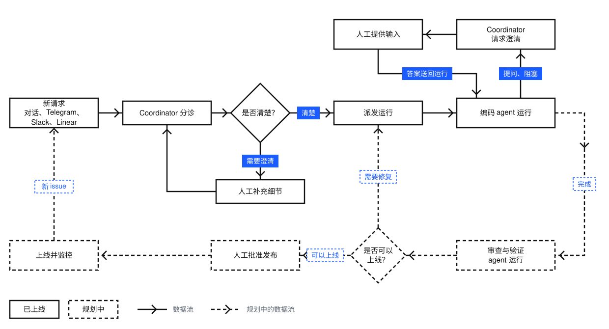
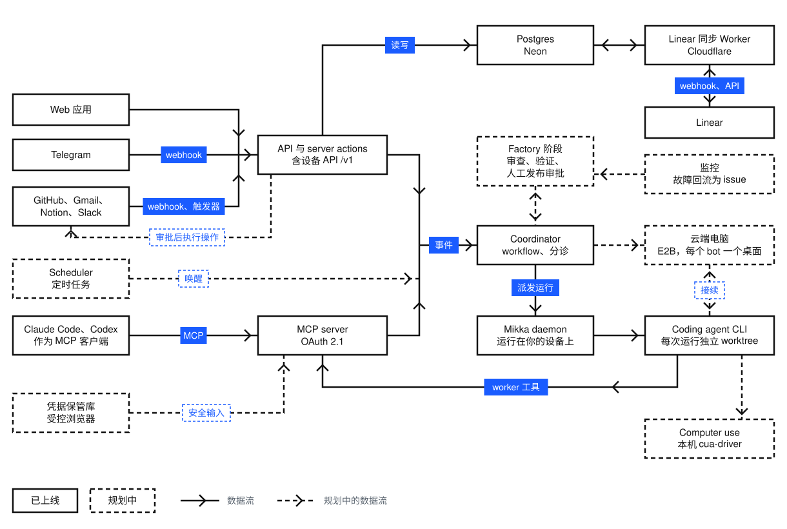

<div align="center">

<picture>
  <source media="(prefers-color-scheme: dark)" srcset="public/brand/mikka-icon-dark.svg">
  
</picture>

# Mikka

### 从需求到结果。

说清目标，由 Mikka 协调 Agent 与设备完成交付。

[](https://github.com/alexj11324/Mikka/actions/workflows/ui-policy.yml)
[](LICENSE)
[](https://linux.do)

[访问 Mikka](https://app.aspectlylabs.com/mikka) · [文档](https://aspectlylabs.com/mikka/docs) · [快速入门](https://aspectlylabs.com/mikka/docs/quickstart)

[English](README.md) · **简体中文**

</div>

Mikka 是面向个人生活与工作任务的开源 AI 助理。你描述想要的结果，必要时确认需求，然后验收交付物；Mikka 负责协调任务、Agent 与设备，不需要你亲自管理多个 Agent 会话。

**项目状态：** 当前处于早期体验阶段。仓库已经具备 Coordinator、任务、集成和本地执行基础设施；从需求到 PR 的完整自助闭环仍在 [#357](https://github.com/alexj11324/Mikka/issues/357) 中集成。云电脑与日常网页任务助手仍在开发。

## 从需求到结果

你只需要说明**要完成什么**，Mikka 负责组织**如何完成**。你不必在多个 Agent 会话之间来回切换、手动管理每一步。

1. **说明目标。** 与 Bot（包括内置的 Coordinator）对话，必要时先澄清要求、边界和授权。
2. **拆解并派发。** 工作以任务（issue）组织。编码工作由 Bot 派发成独立的**线程**，交给已连接设备上的执行 harness。
3. **只在必要时介入。** 线程汇报进度、问题与阻塞；你可以查看、回复或停止运行。需要审批的操作仍由你决定。
4. **验收交付物。** 结果和 Artifact 回到 Mikka。代码推送、GitHub PR 与对话结果汇总的完整闭环仍在 [#357](https://github.com/alexj11324/Mikka/issues/357) 中集成。

### 核心概念

| 概念 | 含义 |
| --- | --- |
| **Bot** | 与你对话的 AI 助理；Coordinator 是内置 Bot。通过隔离的浏览器分身处理网页任务的能力正在开发。 |
| **对话（Chat）** | 你与 Bot 或群聊的交流，不是一个独立任务。 |
| **任务（Task / Issue）** | 一项个人或工作区工作，可在不同阶段关联多个线程。 |
| **线程（Thread）** | Bot 派发的一次具名工作运行，通常负责编码等实际工作；线程不是另一个 Bot。 |
| **设备（Device）** | 执行线程的本地或远程电脑。Mikka 托管云电脑仍在开发。 |
| **Harness** | 执行引擎：Bot 对话和协调使用 Mikka 自有 AI SDK / Workflow，编码线程使用 CLI 编码 Agent。 |

术语以 [产品术语表](docs/design/glossary.md) 为准。旧版独立 Agent 聊天运行时已经退役，历史对话仍可只读查看。

### 任务流转

<picture>
  <source media="(prefers-color-scheme: dark)" srcset="docs/assets/task-flow-zh-dark.svg">
  
</picture>

这张图描述的是**目标流程，并不代表所有环节都已上线**。停止控制（[#336](https://github.com/alexj11324/Mikka/pull/336)）和基于检查点的跨设备接续（[#201](https://github.com/alexj11324/Mikka/pull/201)）已经合并。设备自助接入、任务工具、本地运行时、PR 交付与端到端验收仍在 [#357](https://github.com/alexj11324/Mikka/issues/357) 中集成。独立审查、验证、发布审批和监控属于后续规划（[#191](https://github.com/alexj11324/Mikka/issues/191)–[#195](https://github.com/alexj11324/Mikka/issues/195)）。

## main 分支已有能力

- **Coordinator 与 Bot 对话。** 基于事件的协调、需求澄清、来源引用与后续跟进。
- **任务管理。** 看板、列表、关联关系、活动记录、个人／工作区范围，以及与 Linear 的双向同步。
- **编码执行基础设施。** 连接设备的 daemon、独立 git worktree、线程进度与提问、停止控制、租约与周期检查点。中断的运行可交接给兼容的在线设备，但不能保证所有外部操作的副作用都能安全重放。
- **工具集成。** OAuth 2.1 / Streamable HTTP [MCP server](docs/mcp.md)、用于汇报与提交 Artifact 的 worker 工具、GitHub 与 Linear 集成、Telegram，以及按配置启用的第三方应用接入。
- **账号与界面。** Google / GitHub 登录、英文与简体中文界面，以及现有工作区协作基础能力。

这些是仓库中已经具备的能力，**不代表完整的自助上手体验已正式发布**。受环境配置、功能开关或未完成集成影响，部分功能可能尚未向所有早期用户开放。

## 正在开发

| 方向 | 目标 | 跟踪 |
| --- | --- | --- |
| **本地 MVP 闭环** | 连接设备、从对话创建任务、调用 Claude Code 或 Codex、验收结果并在授权后生成 PR。 | [#357](https://github.com/alexj11324/Mikka/issues/357) |
| **云端执行与网页任务** | 基于 E2B 的云基础设施：Bot 共用云端桌面与隔离的网页分身，每条云端编码线程使用独立机器。 | [#172](https://github.com/alexj11324/Mikka/issues/172)、[#342](https://github.com/alexj11324/Mikka/issues/342) |
| **主动式个人助理** | 对接入应用的事件进行优先级判断、个人记忆、主动建议与定时任务。 | [设计文档](docs/design/proactive.md)、[#179](https://github.com/alexj11324/Mikka/issues/179) |
| **自动化交付验证** | 审查与测试循环、保存验收证据，并在发布前获得人工批准。 | [#191](https://github.com/alexj11324/Mikka/issues/191)–[#195](https://github.com/alexj11324/Mikka/issues/195) |
| **经授权的外部操作** | 第三方应用写操作的明确授权和账户级安全凭据保管库。 | [#177](https://github.com/alexj11324/Mikka/issues/177)、[#180](https://github.com/alexj11324/Mikka/issues/180) |
| **移动端** | 基于 Expo / React Native 构建原生 App，优先发布 iOS。 | [`apps/mobile`](apps/mobile) |

开发进展见 [GitHub issues](https://github.com/alexj11324/Mikka/issues)。当前优先完成个人助理与端到端交付链路，企业专属功能暂缓扩展。

## 接入编码 Agent

### 通过 MCP 操作 Mikka

Mikka 提供 MCP server（Streamable HTTP，OAuth 2.1）。在 Claude Code 中添加：

```sh
claude mcp add --transport http mikka https://app.aspectlylabs.com/mikka/api/mcp
```

Claude Code 会打开浏览器完成登录。登录后，agent 可以读取和修改任务、派发运行，以及更新 Coordinator 的记忆。其他客户端的接入方式和完整工具列表参见 [MCP 文档](https://aspectlylabs.com/mikka/docs/mcp)。

### 在自有设备上运行编码 harness

[`packages/daemon`](packages/daemon) 中的 daemon 会检测设备上安装的编码 CLI，并可用对应适配器执行线程。自助设备授权与发布安装包仍属于 [本地 MVP 集成工作](https://github.com/alexj11324/Mikka/issues/357)：

| 执行 harness | 检测的 CLI |
| --- | --- |
| Claude Code | `claude` |
| Codex | `codex` |
| Cursor | `cursor-agent` 或 `agent` |

每次运行使用隔离的 git worktree。你可以沿用已登录的 CLI；Mikka 不要求用户另外管理一套模型 Provider。

## 架构

<picture>
  <source media="(prefers-color-scheme: dark)" srcset="docs/assets/architecture-zh-dark.svg">
  
</picture>

Web 应用、Telegram 和 MCP 客户端均接入部署在 Vercel 上的同一个 Next.js 应用。运行结束、worker 提问等事件会发送给 Coordinator。Coordinator 是一个持久化 workflow，负责对每个事件进行分诊并决定下一步操作。

运行在已连接设备上执行。Daemon 注册设备后，通过设备 API 领取运行，并在独立的 git worktree 中启动 CLI。Agent 通过 Mikka 的 MCP worker 工具汇报进度、提出问题或报告阻塞。租约和检查点支持将中断的运行接续到兼容的在线设备；托管云电脑和浏览器分身尚未普遍开放。

Linear 同步运行在 Cloudflare Worker 上，通过持久化的 inbox 和 outbox 与 Postgres 交换变更。

图中的部分虚线能力仍在规划：定时任务（[#179](https://github.com/alexj11324/Mikka/issues/179)）、Factory 审查和发布阶段（[#191](https://github.com/alexj11324/Mikka/issues/191)–[#195](https://github.com/alexj11324/Mikka/issues/195)）、云电脑（[#172](https://github.com/alexj11324/Mikka/issues/172)）、浏览器 computer use（[#147](https://github.com/alexj11324/Mikka/issues/147)）、经授权的第三方应用操作和凭据保管库（[#177](https://github.com/alexj11324/Mikka/issues/177)、[#180](https://github.com/alexj11324/Mikka/issues/180)）。跨设备接续（[#201](https://github.com/alexj11324/Mikka/pull/201)）已经合并。

## 技术栈

| 层级 | 技术 |
| --- | --- |
| 应用 | Next.js 16、React 19、Tailwind CSS 4、shadcn/ui、ReUI |
| Bot | Vercel AI SDK；Coordinator 是运行在 [Vercel Workflow](workflows/coordinator) 上的持久化循环 |
| 分诊 | 优先按规则处理，必要时通过 Vercel AI Gateway 调用模型，并设置每月费用上限 |
| 数据 | Neon 托管的 Postgres，Drizzle 迁移位于 [`drizzle/`](drizzle) |
| 认证 | Better Auth，支持 Google 和 GitHub 登录，并为 MCP 提供 OAuth 2.1 server |
| 集成 | GitHub 与 Linear 使用 webhook；Gmail、Google 日历、Notion、Slack 通过 Composio 接入；Linear 同步运行在 Cloudflare Worker 上；Telegram 基于 Vercel Chat SDK |
| 执行 harness | Mikka daemon，可检测 Claude Code、Codex 与现有的 Cursor CLI 适配器 |
| 移动端（开发中） | Expo / React Native，iOS 优先，代码位于 [`apps/mobile`](apps/mobile) |

## 目录结构

```text
app/                 # Next.js 路由、server actions 与 API（MCP、webhook、daemon /v1）
components/          # React 界面组件
lib/                 # 业务逻辑：Coordinator、任务、Linear 同步、MCP、认证
workflows/           # 持久化 workflow（Coordinator）
packages/daemon/     # 本地 daemon 和 CLI 执行 harness 适配器
packages/protocol/   # 服务端与 daemon 共用的类型定义
packages/config/     # 共享配置
cloudflare/          # 用于 Linear 同步的 Cloudflare Worker
drizzle/             # 数据库迁移
messages/, i18n/     # 英文与简体中文文案
tests/               # 单元测试、验收测试与 Playwright 测试
docs/                # 工程与设计文档
```

## 开发

Mikka 基于云端 Preview 部署进行开发，不在本地运行服务。构建、类型检查和端到端测试均在 CI 中执行，每个 pull request 都会生成独立的 Preview URL。凭据统一存放在 Infisical Cloud，不得提交至仓库或写入本地 `.env` 文件。

安装依赖并运行无需服务端的检查：

```sh
pnpm install
pnpm check
```

`pnpm check:ci` 为完整的 CI 检查，在 `check` 的基础上还包括生产构建、性能测试和 Playwright 测试。

建议首先阅读以下文档：

- [`AGENTS.md`](AGENTS.md)：所有贡献者和 coding agent 须遵守的规则。
- [`docs/design/README.md`](docs/design/README.md)：进行任何设计、spec 或 UI 工作前必读。
- [`docs/design/glossary.md`](docs/design/glossary.md)：bot、线程与对话的定义。
- [`docs/acceptance.md`](docs/acceptance.md)：变更在 Preview 上的验收流程。
- [`docs/review-checklist.md`](docs/review-checklist.md)：向他人展示 UI 前须完成的检查项。

## 获取访问权限

Mikka 目前处于早期体验阶段。请发送邮件至 [mikka@aspectlylabs.com](mailto:mikka@aspectlylabs.com) 申请邀请，然后参照 [快速入门](https://aspectlylabs.com/mikka/docs/quickstart) 开始使用。

## 许可证

Mikka 采用 [AGPL-3.0-only](LICENSE) 协议开源。第三方组件遵循各自的许可证，详见 [`packages/daemon/THIRD_PARTY_NOTICES.md`](packages/daemon/THIRD_PARTY_NOTICES.md)。

如果你将修改后的 Mikka 作为网络服务提供给他人使用，AGPL 要求你向这些用户提供所部署版本的源代码。

## 参与贡献

欢迎参与贡献，请先阅读 [`CONTRIBUTING.md`](CONTRIBUTING.md)。贡献的代码按照项目的 [AGPL-3.0-only](LICENSE) 协议授权，无需另行签署贡献者协议；贡献者保留其作品的版权。
