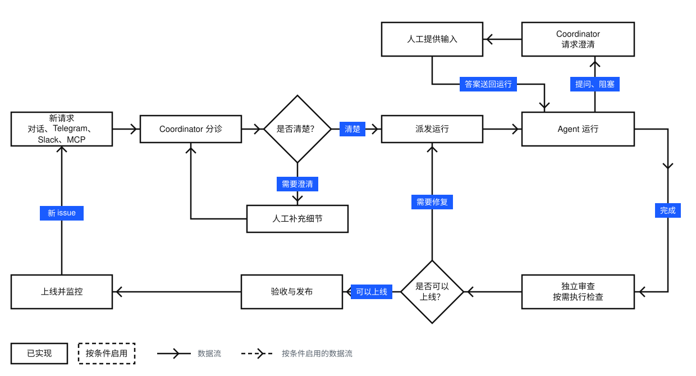

<div align="center">

<picture>
  <source media="(prefers-color-scheme: dark)" srcset="public/brand/mikka-icon-dark.svg">
  
</picture>

# Mikka

### 为大事而生的 AI lead。

从本地到云端，所有 Agent 协作如一。

[访问 Mikka](https://app.aspectlylabs.com/mikka) · [文档](https://aspectlylabs.com/mikka/docs) · [快速入门](https://aspectlylabs.com/mikka/docs/quickstart)

[](LICENSE)
[](https://linux.do)

[English](README.md) · **简体中文**

</div>

Mikka 为 Claude Code、Codex 和受支持的 Cursor 运行环境组织工作：Bot 负责协调任务，Agent 负责执行。

向 Bot 描述一个任务，Mikka 就能将编码工作派发给运行在 Mac、Linux 设备、SSH 服务器或符合条件的云端沙盒中的 Agent，并把进度、提问和结果汇总到同一个地方。你可以通过网页、macOS 或 iOS App 使用 Mikka。

## 开始使用

**Mikka Cloud。** [打开应用](https://app.aspectlylabs.com/mikka)，直接注册账号即可开始使用 Mikka。具体步骤参见[快速入门指南](https://aspectlylabs.com/mikka/docs/quickstart)。

**自托管服务器。** 你可以使用 Docker 和 PostgreSQL 在自己的 Linux 主机上运行 Mikka。数据库可以选择 Compose 自带的 PostgreSQL，也可以使用托管 PostgreSQL（**[推荐 Neon](docs/self-hosting.md#managed-postgresql-neon-recommended)**，但不强制）。按照[自托管指南](docs/self-hosting.md)下载匹配版本的 Compose 文件，并配置必要的私有凭证。

使用自带 PostgreSQL：

```sh
docker compose up -d --wait
```

使用 Neon：在私有 `.env` 中配置 pooled / direct 两条数据库连接 URL，然后运行 `docker compose -f docker-compose.neon.yml up -d --wait`。该模式不会启动本地 PostgreSQL 容器。

自托管部署**不会同时安装一份独立的官方界面**。请使用官方客户端连接你的服务器。选择自托管之前，请先阅读[客户端与源码范围](#客户端与源码范围)。

**已经在使用 Claude Code？** 可以将 Mikka 作为 MCP Server 接入：

```sh
claude mcp add --transport http mikka https://app.aspectlylabs.com/mikka/api/mcp
```

这条命令会在 Claude Code 中注册 Mikka，并通过浏览器完成 OAuth 登录。你需要有对应 Mikka 服务器的访问权限；该命令不会安装 Mikka Daemon，也不会直接启动编码任务。其他客户端与工具请参见 [MCP 指南](docs/mcp.md)。

## Mikka 能做什么

- **协调任务。** 内置 Coordinator 和你创建的 Bot 可以将需求转成任务、澄清不明确的指令，并将工作派发给编码 Agent。
- **在你的环境中执行。** 通过 Mikka Daemon 连接自己的电脑和 SSH 服务器，也可以使用已配置的云端执行环境。符合条件的并行任务使用独立的 Git Worktree 或任务沙盒。
- **让工作可追踪、可审阅。** 查看任务进度、回答 Agent 的问题、检查运行结果，并通过 Factory 的检查与验收流程审阅符合条件的 Pull Request。
- **提供云端桌面。** 在已正确配置的 Mikka Cloud 账号中，Bot 可以使用可实时查看、接管并交还控制权的云端桌面。直接使用 E2B 时，需要桌面所有者自己的 Key。
- **连接现有工具。** 通过 MCP 在 Claude Code 或 Codex 中操作 Mikka，也可以通过 Telegram 和 Slack 联系 Mikka。已连接应用中的操作遵循相应权限与审批策略。
- **使用你已有的订阅（Bring your own subscriptions）。** 可将现有 Claude 或 ChatGPT/Codex 订阅用于受支持的编码 Agent；适用场景下也支持模型 API Key。
- **支持个人与团队协作。** 通过个人和团队工作区组织任务、Bot 与活动，并控制已连接资源的访问权限。

具体能力取决于部署配置、已连接服务与功能开关。尚在规划的工作统一记录在 [GitHub Issues](https://github.com/alexj11324/Mikka/issues)，不在此列为已发布功能。

## 工作流程

1. **描述需求。** Bot 将请求转成任务，并在信息不足时向你确认。
2. **派发 Agent。** Mikka 选择已配置的执行位置并启动编码任务。
3. **跟进进度。** Agent 汇报进展或提出问题，你可以在需要时回复。
4. **审阅结果。** Factory 按任务要求执行检查，未通过的工作返回修复，符合条件的代码变更进入验收。经授权的验收可以使用你连接的 GitHub 账号合并 PR。

<picture>
  <source media="(prefers-color-scheme: dark)" srcset="docs/assets/task-flow-zh-dark.svg">
  
</picture>

Bot、Agent、任务、线程与运行的术语定义，请参见[术语表](docs/design/glossary.md)。

## 客户端与源码范围

Mikka 的官方网页、macOS 和 iOS 客户端使用同一套产品界面，可以连接 Mikka Cloud 或自托管服务器。

本公开仓库包含服务端、Daemon、原生移动端源码以及大部分网页 UI 代码。**官方网页与桌面构建还使用了未在此公开的私有 UI 组件**，因此仅使用公开源码构建，**无法得到完整的官方网页或桌面界面**。自托管镜像提供服务器状态、登录和授权页面。在官方客户端的服务器名称旁选择「更改」，输入自托管状态页显示的 HTTPS 地址，即可连接。

[UI 源码边界](docs/ui-overlay.md)和[自托管指南](docs/self-hosting.md)说明了可以构建、部署和连接的内容。源码实现情况与生产环境可用性需按照[验收规范](docs/acceptance.md)分别核验。

## 开发

项目使用 Node.js 24.x 和 pnpm 10.34.3。在已准备好的开发环境中安装依赖并运行源码检查：

```sh
pnpm install --frozen-lockfile
pnpm check
```

如果需要在隔离的 PostgreSQL 数据库上运行本地环境，请参见[云端 Linux 环境初始化](docs/local-bootstrap.md)与[开发流程](docs/dev-workflow.md)。不要提交凭证；项目开发密钥由 Infisical 管理。

**核心技术栈：** React、Vite、Hono/Nitro、Vercel AI SDK 与 Workflow、PostgreSQL/Drizzle、Electron、Expo，以及 Mikka Daemon。架构、集成、CI、部署与运行时细节请参见[文档索引](docs/README.md)。

## 文档

- [快速入门](https://aspectlylabs.com/mikka/docs/quickstart) — 开始使用官方 App。
- [自托管](docs/self-hosting.md) — 部署自己的服务器并连接客户端。
- [MCP 集成](docs/mcp.md) — 从其他 Agent 和工具操作 Mikka。
- [文档索引](docs/README.md) — 架构、安装、安全与运维。
- [贡献指南](CONTRIBUTING.md)与 [AGENTS.md](AGENTS.md) — 贡献规范和编码 Agent 的规则。

## 开源与许可

公开源码采用 [AGPL-3.0-only](LICENSE) 许可证。将修改后的版本作为网络服务提供时，需要遵守 AGPL 关于提供对应源码的义务。第三方组件保留各自的许可证；详见[第三方许可声明](packages/daemon/THIRD_PARTY_NOTICES.md)。

Aspectly Labs 同时提供商业许可，联系邮箱为 [legal@aspectlylabs.com](mailto:legal@aspectlylabs.com)。贡献者保留其贡献内容的版权，并授予[贡献指南](CONTRIBUTING.md#license)中说明的额外许可权利。

## 致谢

<p>
  <picture>
      <source media="(prefers-color-scheme: dark)" srcset="docs/assets/openai-mark-dark.svg">
      
    </picture>
  <strong>OpenAI · Codex for Open Source</strong>
</p>

Mikka 的开发得到了 [Codex for Open Source](https://openai.com/form/codex-for-oss/) 计划的支持。

衷心感谢 OpenAI 和 Codex 团队为 Mikka 的维护者提供六个月的 ChatGPT Pro 使用资格。这份支持让我们有更多空间探索有挑战性的想法、改进工程质量和用户体验，并回馈开源社区。

Mikka 是独立开源项目，与 OpenAI 不存在隶属关系，也未获得 OpenAI 官方背书。OpenAI 名称及标志均为 OpenAI 的商标。

## 许可证

Mikka 的版权归 Aspectly Labs 所有（© 2026），采用 [AGPL-3.0-only](LICENSE) 协议开源。第三方组件遵循各自的许可证，详见 [`packages/daemon/THIRD_PARTY_NOTICES.md`](packages/daemon/THIRD_PARTY_NOTICES.md)。

如需不受 AGPL 义务约束的商业许可，请联系 Aspectly Labs：[legal@aspectlylabs.com](mailto:legal@aspectlylabs.com)。

如果你将修改后的 Mikka 作为网络服务提供给他人使用，AGPL 要求你向这些用户提供所部署版本的源代码。

## 参与贡献

欢迎参与贡献，请先阅读 [`CONTRIBUTING.md`](CONTRIBUTING.md)。贡献者保留其作品的版权，并按 [AGPL-3.0-only](LICENSE) 授权；提交贡献即同意 Aspectly Labs 可以按其他条款（包括商业许可）提供这些贡献。无需另行签署任何文件，完整条款见 [`CONTRIBUTING.md`](CONTRIBUTING.md#license)。
