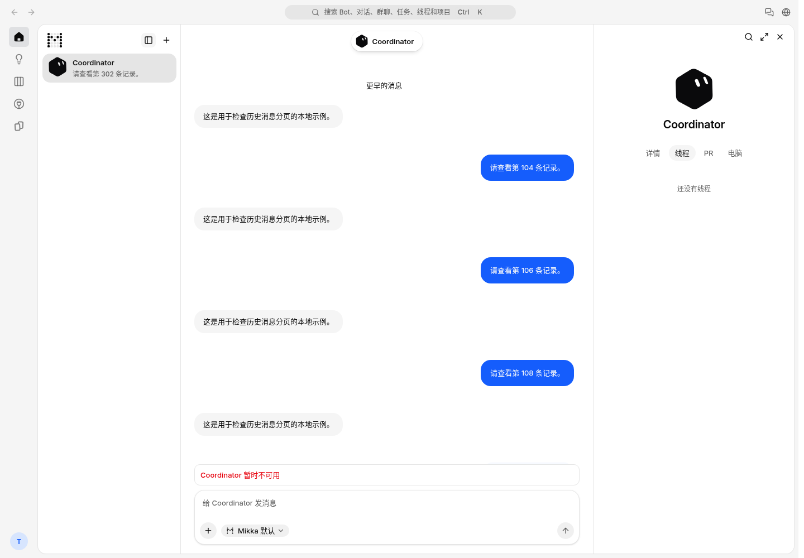
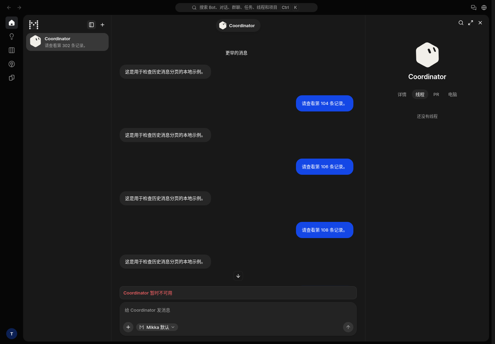

# Task and chat polling transfer

Branch: `codex/chat-task-egress-deltas`, based on `1c86309610446aacb30a02460ef3cd789c2dd58a`.

Production evidence at 2026-11-03 12:59 UTC still shows repeated task-list reads returning 100 rows. Neon reports 62,894,267 public-network bytes for 11:00–12:00 UTC (06:00–07:00 New York). This is before this optimization deployed. Query statistics identify continuing repeated reads, but do not attribute every billed byte to a particular query. Occurrence 10/10, impact 4/10, score 40.

The patch checks a database-side version before transferring an unchanged task list, polls it once a minute, and reads an overlapping chat tail by cursor when new messages arrive. Historical messages are requested separately. Existing streaming, model-context loading and local mutation refreshes remain in use. A changed prefix or a long reconnect gap requests a bounded recent snapshot.

## User tasks

| Task | Before | After | Review |
| --- | --- | --- | --- |
| Read recent messages | Latest 200 stored rows | Bounded latest page | Found |
| Read older messages | No history-page control here | “更早的消息” above the page | Found |
| Receive a new reply | Read the recent snapshot after a change | Merge the overlapping tail and new rows | Found |
| Recover from a disconnect | Replay streamed output | Resume acknowledged projected events; reset when masking policy changes | Found |
| Lose workspace access | Re-read authorized rows | Recheck access and invalidate the old snapshot | Found |

No existing recovery control is removed. The history control uses the existing ghost button, translations and message layout. No new Figma layout is introduced. The relevant copy and UI policy checks pass; remote task edits can take up to the 60-second polling interval to appear.

## Verification

After applying the patch to the above base, typecheck, full lint, 67 library unit tests, the coordinator-stream suite and real Postgres database regressions passed. Database regressions cover task deletion, profile edits, membership revocation, cross-user and cross-bot cursors, grouped tool results, pending input, earlier message edits and long reconnect gaps.

| Isolated fixture | Full read | Optimized read | Measurement |
| --- | ---: | ---: | --- |
| 30 tasks with ~369 KB stored bodies | ~21.7 KB | 1,520 B unchanged | Database socket bytes across pools |
| Chat with appended tool results | 65,185 B | 1,070 B delta | Serialized application JSON |

These are synthetic fixture measurements, not production savings. No database migration or production statistics reset is needed. Normal leased-session HTTP acceptance and a production build previously passed on the original patch; the PR records fresh build/HTTP checks for its current revision separately. No external model/provider call or browser test is claimed.

## Screenshots

These screenshots were captured at `http://localhost:3110/mikka/zh-CN` from the original patch's local production build on base `c23ff74f921b7951c5d7016c0e0967e3ce6e3e1f`. The UI changes applied cleanly to the newer base; conflict resolution preserved the new monitoring wrappers in Server Actions. Synthetic data only. The fixture has no configured model, so its existing Coordinator-unavailable state is expected.

| Light | Dark |
| --- | --- |
|  |  |
