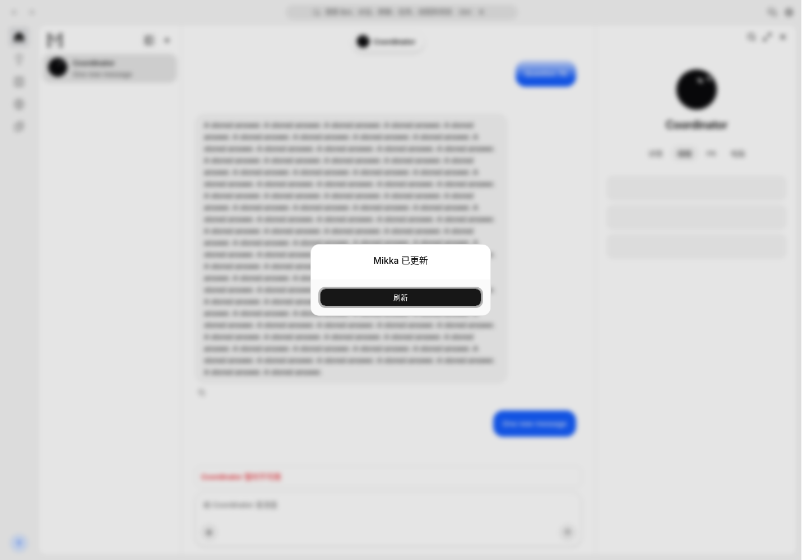
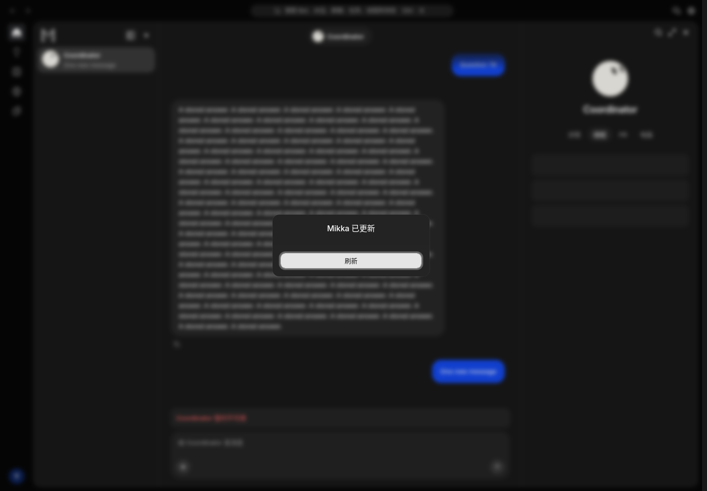
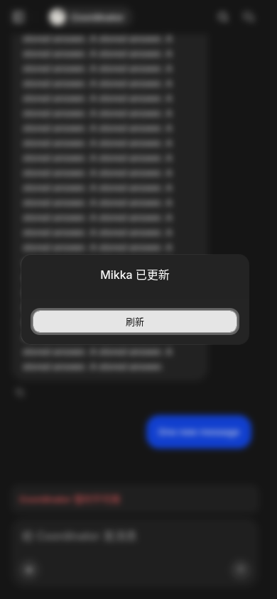

# Required refresh for stale web builds

Branch: codex/required-app-refresh. Local production build on base
6e8081033c13d0f71bf09c2fc8fe23c402e35e1b with the patch. Tested code diff SHA256:
0dee97555b52333ccb838fc9ab4c5113893d05e6a28e3624a132b1d6c60b807f.
Documentation and screenshots are added after this run; they do not change its runtime.

Alex explicitly requested a blocking update popup and pausing old app use.
The existing navigation-only check missed idle windows; old full task reads
continued after #1123. Occurrence10/10, impact4/10, score40. The public build
probe now runs once a minute, reusing its existing cache. A known mismatch
requires refresh, pauses SWR even when a hook supplies its own pause, and stops
same-origin application fetches. Version metadata stays accessible, unknown
versions stay usable, and page contents/drafts remain mounted. The native
minimum-binary update path and removed-server-action recovery are preserved.

This cannot add code to an already loaded old client. On 2026-11-03 at14:44Z,
old routing through the production domain was separately retired using Vercel's
Skew Protection threshold. Old deployment headers and query parameters were
verified to resolve to the current build; no deployment was deleted. Do not
claim this popup alone updated every old window or reduced billed traffic.

## User tasks and review

| Task | Before | After | Review |
| --- | --- | --- | --- |
| Leave a window open across a release | Only explicit navigation/action checks | Public build probe detects mismatch | Found |
| Continue using a known old page | Nonblocking toast; reads continue | Blocking refresh control; app fetches pause | Found |
| Keep composing during update detection | Draft in existing scoped session store | Content remains mounted; no routine forced reload | Found |
| Recover after metadata failure/offline | Unknown version | Same existing behavior; no false update block | Found |
| Use a narrow viewport | Toast action | One full-width refresh button in standard dialog | Found |

Review uses existing AlertDialog and Button with existing translated copy
(R-40/R-42). No new Figma layout or strings. The controlled dialog stays open
on dismissal and has one focusable recovery action. Reviewed light, dark and
390px captures from local `next build`/`next start`, with normal leased owner
session, synthetic chat fixtures and a synthetic newer `/api/version` response.
No browser tests ran. The background's no-model state is expected in this fixture.

## Verification

Full pnpm check passed before the final pause-composition adjustment. Fresh
checks after it: root lint, typecheck,9 build/request tests,19 chat/draft/guard
DOM tests and9 focus/SWR tests pass. The new override regression failed on the
previous implementation (2reads instead of1), then passed after composition.
Fresh production build and6 normal leased-session HTTP checks pass against
loopback isolated PostgreSQL `mikka_required_refresh_e2e` at
http://localhost:3110. HTTP checks include bounded history,304,unchanged
version,cursor delta and peer isolation. No production writes, external model
calls or credentials are in these artifacts. The PR's Git-linked CI is the
final gate for its final head.

| Light | Dark | Narrow |
| --- | --- | --- |
|  |  |  |
