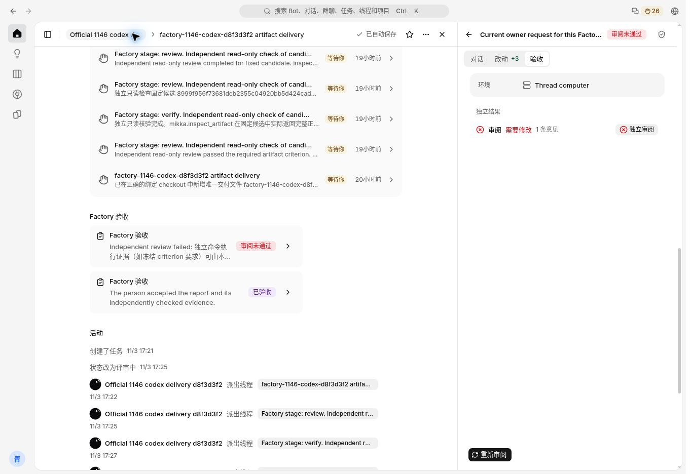

# Production check: retained failed review

- Production build: `7ba687a2508dc41ec54dacc09044e130947e719c` (Web deploy run `41831112166` succeeded; `/mikka/api/version` was verified against that merge commit).
- Screenshot file saved at `2026-11-04T12:57:23.283036+00:00`.
- Original Codex 390 task `9ea956ce-a604-4c2e-a724-fb04fa5a3c9b`, candidate `b251f0b5-3aa6-4e70-b57a-282161c969a1`, original producer `390deeb4-5e5b-487a-acb9-c2e53dc3f8e9`.
- Observed: the failed review remains in the Factory list; opening it shows the same producer's acceptance tab, failed-review badge, independent review entry, and **重新审阅** button.
- The retry has **not** been clicked in this observation. Production pending/running transitions and the new model/claim/Owner acceptance still need execution after the Flash-only background Decision prerequisite is resolved (issue #1210).
- The lower accepted card belongs to historical acceptance and is not evidence that the current failed candidate passed.
- PNG SHA-256: `bc7842e94d8f830bd9307b80f7074ec3053ab97b4a6b945f10a6bb1bedbcab1a`; bytes: `106514`.

