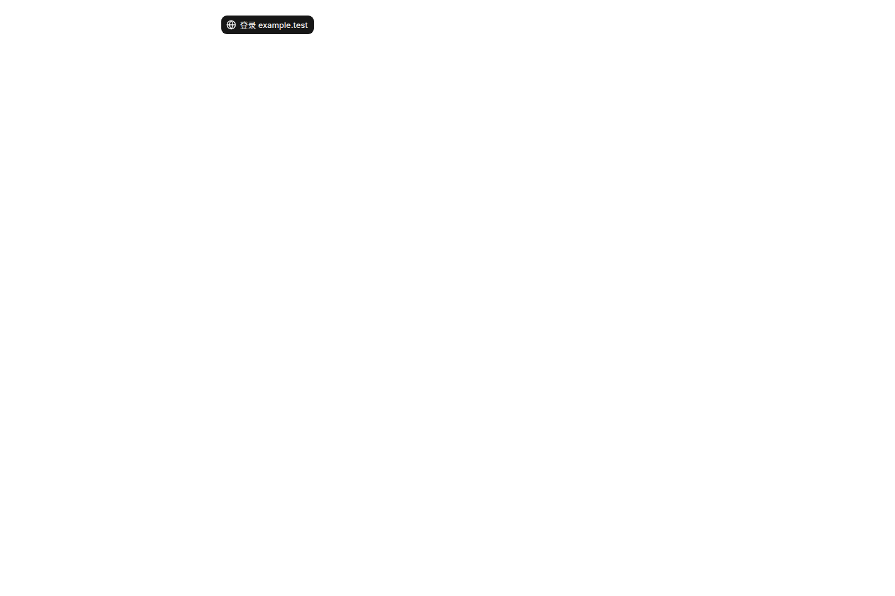
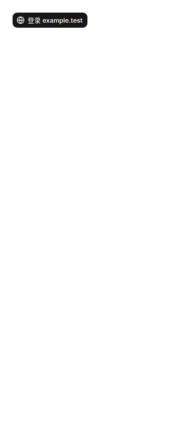
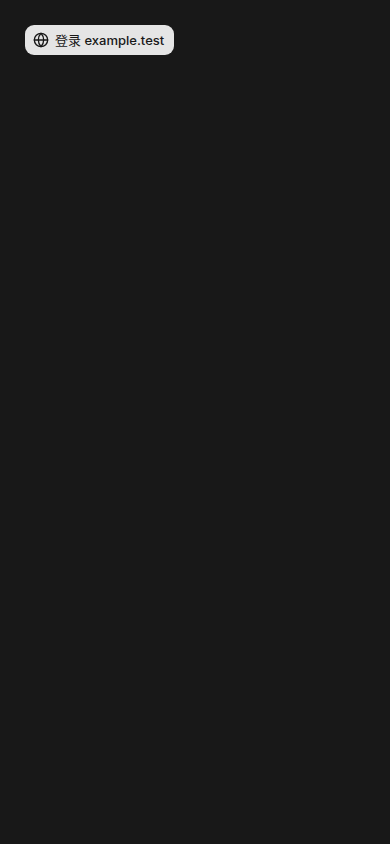
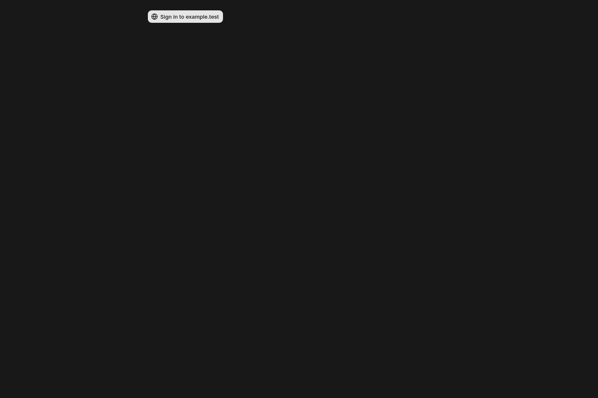
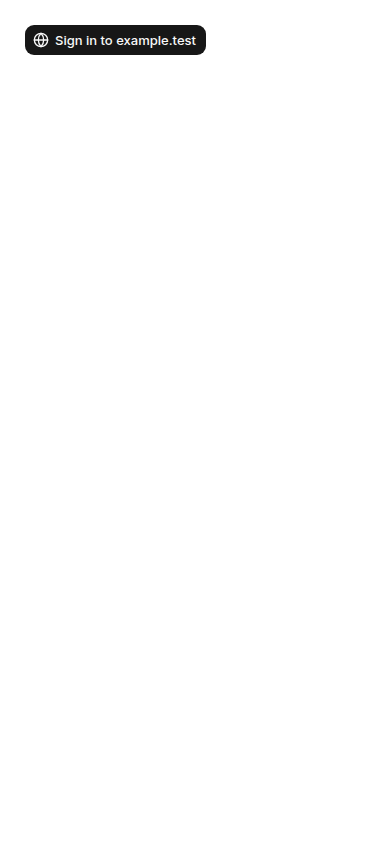
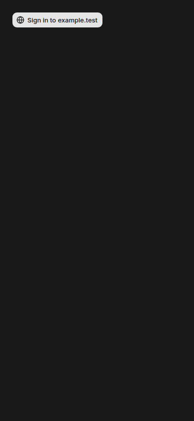

# Computer event incremental updates — local UI evidence

Application source: `2b70777c3205df12e60d14e0149f4a87c20db73a`  
Capture: **2026-11-04 16:17:30.908–16:17:36.389 UTC**  
Result: **8 screenshots and real background/foreground catch-up passed.**

This is isolated local production-build evidence for the existing SubagentLoginNeeds component. It does not claim production acceptance, a healthy external WebSocket, a real external website sign-in, paid model execution, or a fixed one-hour performance result. The source commit above remains the identity of these images even if the application branch later receives CI fixes.

## Environment and method

Docker Cloud Sandbox, Node 24.22.2, PostgreSQL 17.11, Google Chrome 157.0.8103.38, and Playwright 1.64.1. The app was built with `corepack pnpm build` (Next production build, type checking and migrations all exit 0) and served with `next start --hostname localhost --port 3202`. Its `/mikka/api/version` returned HTTP 200 and the exact source SHA.

A fresh loopback `*_e2e` database and immutable TestAccountPool descriptor `local-98cec78b-a07f-42b7-a8b3-2efe75ed4eee` bound the build and origin. Owner/peer accounts were leased through normal TestAccountPool sign-up/sign-in. The driver applied the helper's generated browser state, never logged credentials/cookies, and released the pair as dirty/quarantined with local fixtures retained. No production database or cloud task machine was used.

The preview reads the actual authenticated JSON route and real PostgreSQL events. Both initial `needs_you` events and the later `running` event were written through the actual `SubagentStore.update`. There is no API interception, fake event endpoint, mocked auth, injected visibility event, or browser test suite.

Chrome ran as a native headed process under Openbox/Xvfb. `connectOverCDP({ noDefaults: true })` used its default context without Playwright's automatic focus emulation. A real second tab was brought to the front. The driver asserted the captured page's actual `document.visibilityState` was `hidden`, committed the update, returned to the original tab and asserted it became `visible`.

The local gateway was deliberately unconfigured. The real ticket route returned HTTP 200 with all three values `url`, `protocol`, and `expiresAt` equal to null.

## Observed state and incremental read

| Observation | Recorded result |
| --- | --- |
| Initial two committed events | JSON HTTP 200, cursor `2`, both `needs_you` |
| UI deduplication | Exactly one sign-in control for the subagent |
| Real background state | `hidden` at 16:17:36.353Z |
| Foreground incremental read | HTTP 200, `after=2` → `cursor=3`, only event `3/running` |
| UI after catch-up | Sign-in control removed, at 16:17:36.389Z |
| Secret/cookie evidence audit | Passed for all 9 capture files |
| Driver syntax/lint | `node --check` and oxlint exit 0 |

The brief actual background interval proves foreground catch-up; it is not a one-minute background polling measurement.

## Screenshots and visual review

All eight raw PNGs were copied back with SHA-256 verification and reviewed individually. Chinese glyphs render correctly; English and Chinese text fit at 1440 and 390 pixels; light/dark contrast is clear. This component-only preview preserves the existing layout and copy. It is not a screenshot of the entire application.

| Locale / width | Light | Dark |
| --- | --- | --- |
| 中文 / 1440 × 960 | [Original](zh-login-1440-light.png) | [Original](zh-login-1440-dark.png) |
| 中文 / 390 × 844 | [Original](zh-login-390-light.png) | [Original](zh-login-390-dark.png) |
| English / 1440 × 960 | [Original](en-login-1440-light.png) | [Original](en-login-1440-dark.png) |
| English / 390 × 844 | [Original](en-login-390-light.png) | [Original](en-login-390-dark.png) |

### 中文桌面




### 中文手机




### English desktop




### English mobile




## Original driver failures retained

1. The first driver expected HTTP 503 when the gateway was absent. The real route contract is HTTP 200 with null ticket fields. This failed before browser launch. The driver was corrected; the application was unchanged.
2. The second driver created all eight images, but its strict background assertion failed: ordinary Playwright contexts force focus emulation and reported `visible` even with a native window minimized. This was not counted as catch-up success. The driver switched to the documented `noDefaults` connection with a native default context. A separate blank-tab diagnostic then observed real `hidden → visible` before the final capture.
3. The final capture used another fresh database/descriptor, passed all assertions and the evidence audit. Earlier database fixtures and failed logs were retained locally; no old descriptor SHA was edited and no result was relabelled.

## Files and reproduction

- [manifest.json](manifest.json): exact source, times, dimensions, PNG hashes, actual event reads, visibility and limits.
- [audit.json](audit.json): final credential/cookie evidence audit and driver completion.
- [c-preview-capture.mjs](c-preview-capture.mjs): screenshot-only driver, SHA-256 `f449cfa5c1c81061f21ccdc28e9a474dc9c74a563032cddf679f45b4840782ff`.

Copy the driver to `scripts/acceptance/c-preview-capture.mjs` in the exact application checkout. Create a fresh isolated TestAccountPool environment for that commit, build/start with matching environment variables and no external gateway/service keys, and run under Xvfb with Openbox:

```sh
node --import ./scripts/server-test.mjs --import tsx scripts/acceptance/c-preview-capture.mjs
```

The account/environment guards remain mandatory. This evidence branch contains documentation and capture files only; it is not an application deployment.
