# #1210 / #1449 — Owner 重新审阅当前交付物

> **追加记录（2026-11-06）：** 第二次正常重审已实际执行，但Factory review失败，新的verify尚未创建、Owner未接受；两项unverified和VM假设纠正见文末[production-attempt-02](#production-attempt-02)。以下旧摘要与历史章节保持首轮冻结原文。

> 截至本次生产尝试记录：#1449 已以82789正常合并并部署；23:14的唯一一次 Owner Retry review 未完成，23:22无新回执/attempt，原六项与最终接受仍未完成。官方快照和原源码纯回放复现额度准入阻断，原失败POST具体错误正文未捕获。下方原30张隔离UI截图保留实际6230 / 925 / 3f0版本；诊断#1462及其后续合并单列，未冒充生产验收通过。

这次修改让仍在 flow v1 验证阶段、或当前交付物尚未接受的 Owner，从已有 Factory 验收入口发起同一候选的重新审阅，再进行独立验证。此前结果保留。既有的接受、退回修改与检查恢复操作继续使用原有组件和权限。

## production-attempt-01：部署后的唯一一次正常重审，未完成验收

**本轮结果：#1449 已正常合并并部署；ALEX43 的单次正常 Owner「Retry review」没有完成，没有提交新的 recheck 回执或新的检查 attempt。** 以下生产记录与下方 30 张隔离 UI 截图分开解释。原六项合同、新的独立 review / verify、最终 Owner 接受仍未完成。[首次阻塞记录](https://github.com/alexj11324/Mikka/issues/1210#issuecomment-6672139719)和[后续调查记录](https://github.com/alexj11324/Mikka/issues/1210#issuecomment-6672295398)保留在 #1210。

### 实际发布与单次点击

| 时间（UTC）/ 对象 | 实际观察与证据 |
| --- | --- |
| #1449 的源码 CI 与合并 | PR head `79c3731ca819b3304efea0e8f98c936f4b28cd2b`；CI 实际检出 synthetic merge `0c59cd7d13cc1329ee69db78465328b0e4335eac` / tree `21e20c013e5b7859d8c4daf258fa11024aec5b34`。23:00 最终前置检查为 18 项：17 success、条件性 OIDC skipped。23:01:27 普通合并为 `82789ddf380841a4f3ea637d940005bbbd2cecdd`，parents `9cf06716dd576c2a5dba04c952e5f0fcaa998594` + `79c…`；合并树与该 synthetic tree 完整相同。[版本及合并/重跑回执的必要字段投影](production-attempt-01/deployment-actions-projection.json) |
| Web `42126327554`，attempt 1 | job `127591350656` 的 Go 模块下载在 23:02:41 遇到 `proxy.golang.org` 的 HTTP/2 peer `INTERNAL_ERROR`，应用 Next build 尚未开始，upload / public verify skipped。保留[失败记录](production-attempt-01/owner-82789-web-attempt1-failure.json)及[实际错误摘录](production-attempt-01/owner-82789-web-attempt1-error.log)。 |
| 同一个 Web run，attempt 2 | root 只执行一次正常 **rerun failed jobs**；job `127593222401` success，**23:11:47.7141975 READY**。[部署记录](production-attempt-01/owner-82789-deployed.json)及[构建/READY 原始摘录](production-attempt-01/owner-82789-web-attempt2-build-ready.log)。日志中的 `***` 是原 Actions 日志已有的掩码，不能用它重建完整 SHA。 |
| 23:12:38.458335 | root 对普通公开版本端点实际 GET 返回 HTTP 200，完整 build=`82789ddf380841a4f3ea637d940005bbbd2cecdd`；[完整公共版本响应](production-attempt-01/public-root-82789-ready.json)。这是本次 Owner 点击前的已部署版本。 |
| **23:14:03.905** | 正常登录的 Owner UI 只点一次 **Retry review**；先显示 Loading / disabled，随后显示 **Retry did not complete** 并恢复按钮。没有第二次点击，没有回答旧 verify 问题，没有接受交付物。[动作记录](production-attempt-01/root-recheck-ui-action.json)、[实际结果记录](production-attempt-01/root-recheck-ui-result.json)。 |
| 生产失败截图 | 浏览器当时实际显示并 emit 了失败画面，但保存的浏览器文件未同步到共享文件系统；有界五秒检查后对应文件仍不存在。[同步限制原件](production-attempt-01/screenshot-click01-sync-limitation.json)。**本页没有附上生产失败截图，也没有用隔离夹具截图替代它。** |

### 点击前后：只有只读采样，没有新的检查结果

点击前数据库时间为 **23:04:14.917–23:04:14.924**，点击后为 **23:22:03.184–23:22:03.192**。两次采样均使用只读事务与 5 秒 statement timeout。[前置响应](production-attempt-01/production-before-minimal-response.json)、[后置响应](production-attempt-01/production-click01-observation-response.json)、[前置采集时间](production-attempt-01/production-before-minimal-timing.json)、[后置采集时间](production-attempt-01/production-click01-observation-timing.json)保留实际返回；SQL 副本只遮去不影响阅读的 Owner 账户 ID，具体变换与原件 SHA256 见 [evidence-manifest.json](production-attempt-01/evidence-manifest.json)。

| 绑定或状态 | 点击后的实测结果 |
| --- | --- |
| 原任务 | `e42571e5-58f7-40e3-9418-c02ee8843fe6`；仍 `verify / waiting`、revision 13。issue `0b9e6f79-790b-4931-aa54-2f45f5d142de`。 |
| 同一交付候选 | candidate `2f338962-c690-4ba7-bc63-6c73a9de3acb`、原 attempt 和绑定均不变；权威 deliverable HEAD 仍 `d05417e7848871e511141e10a282ffb7998b0a79`。`candidateSha=null` 原样保留，未补造 SHA。 |
| 真实新动作 | `owner_candidate_recheck` 回执 0；position > 4 的新 attempt 0；active run / 有效 lease 0；最终接受记录 0。没有新的 review/verify run、SID、VM、工具 IO 或报告可用于六项验收。 |
| 原过期问题 | `31b87a5f-7be6-49e9-9031-126dd2144007` 仍 `waiting_user`、revision 2，expiry=`2026-11-05T20:15:32.526Z`；八个消费字段仍 NULL。 |
| 原父机 | `ipa60du803guuiqnyzqan` 仍 sleeping，lastActiveAt=`2026-11-05T14:48:42.215Z`。 |
| 前后逐项比较 | **48 个共同字段、0 差异**；完整字段表见[比较原件](production-attempt-01/production-click01-comparison.json)。旧报告指纹没有在这次后置投影中重查，不能声称后置读取再次证明了全部旧报告。 |

这些读回证明采样时没有可见的新提交结果；不证明 HTTP 请求没有执行，也不排除事务回滚。浏览器显示通用失败，原失败 POST 的精确 status / code / body 和实际封装 cause 没有被捕获。下面的额度结论来自另外取得的官方快照和源码回放，不能从通用 UI 文案直接推断。

### 官方额度快照与源码回放：可复现的准入阻断

四批最小只读投影按部署 `82789…` 的源码路径核对后执行；[总体观察](production-attempt-01/recheck-gates-observations.json)、[详细调查记录](production-attempt-01/recheck-gates-findings.md)与[固定源码分析](production-attempt-01/recheck-refusal-source-analysis.md)分别记录事实、判定链和边界。所选原始响应、执行 statements 与采集时间在本节目录中，完整选择和原路径见清单。没有为本证据执行新的查询、凭据 refresh 或模型调用。

| 批次 / 数据库时间（UTC） | 范围 | 实测结果 |
| --- | --- | --- |
| 01 / 23:27:51.977 | 冻结 native 绑定、订阅与模型选择 | 旧 review / verify 的 consumer、route、workspace、connection、epoch、model 均一致；原来源仍属 Owner；连接 connected、未 paused / removed、自有非共享；目录包含冻结 Haiku；profile / API-key 键 absent。[响应](production-attempt-01/recheck-gates-01-response.json) |
| 02 / 23:29:24.240 | automatic dispatch 与 runtime identity | producer、旧 review/verify 与当前 Bot runtime agent 一致；设备、工作区、ownership、desktop 和 runtime repo/candidate repository 一致；父机 sleeping、ready、device enabled。[响应](production-attempt-01/recheck-gates-02-response.json) |
| 03 / 23:31:10.038 | 官方订阅 quota 与精确模型目录 | exactOrderCandidateExists=true；quota 公共结构有效。官方快照的 **observedAt=23:14:06.758**，在单次点击后 2.853 秒；适用的全局 weekly **used=1**，reset=`2026-11-06T00:00:00.000Z`。five_hour used=0.04；另一个 model=fable 的 weekly used=0 不适用于冻结的 `claude-haiku-5-5`。[响应](production-attempt-01/recheck-gates-03-response.json) |
| 04 / 23:35:34.214 | 指定 source/model 的优先 health 拒绝 | selected permanent / transient 行均 **0**。这是当前投影，不能冒充点击当时的完整历史回放。[响应](production-attempt-01/recheck-gates-04-response.json) |

[root 的纯本地回放](production-attempt-01/root-quota-replay.json)使用上述 03 响应以及部署版原函数：两个阶段在本次 POST 数据库日志时刻均得 `exhausted`；到 23:31 的读取时刻已变旧，得 `checking`；**只把时钟推进到 reset、没有新的官方 provider 快照，仍是 `checking`，并非 available**。原始 `subscription-quota.ts` / `packages/protocol/src/subscription.ts` 在诊断补丁中未改动。

按部署源码，在没有更优先健康拒绝时，这个 exhausted 状态进入 `reason:'quota'` 的 credential / frozen-target 准入拒绝链。因此，这是与点击期间官方刷新一致、可按实际源码复现的明确阻断条件。**本次没有抓到失败 POST 的实际 quota 错误码或服务器封装 detail，不能将推导写成实测响应。** Membership 和其他后续事务门槛在发现该阻断后没有继续投影，也不声称已经通过。旧订阅、模型、候选与原问题均未被替换或放宽。

### 诊断补丁 #1462：实际红绿检查，单独记录合并版本

原失败请求没有留下足够的受控拒绝 cause 日志。诊断 [PR #1462](https://github.com/alexj11324/Mikka/pull/1462)在既有 POST `FactoryError` catch 中调用现有 `logCodedError`，附上已校验的 task UUID；HTTP status/body、权限、事务、订阅/模型选择和 UI 均不变。只新增有界 code/detail/cause name，不加入 reason、provider message、URL、凭据或 stack。它提高后续诊断能力，**不证明 ALEX43 重审已成功**。

| 项目 | 精确记录 |
| --- | --- |
| 源码身份 | source head `b1bee585e7f1c78b09fb8f80b8752227591b13f1` / tree `6a28852f5862e2b22495c55843f41dd7028a4465`，base `82789…`；本地实际 HEAD 仍为 base，staged tree 与远端 source tree 相等，不能把本地测试写成在远端 commit 对象上运行。[GitData 回执](production-attempt-01/diagnostic-gitdata-receipts.json)、[本地/远端源码绑定](production-attempt-01/diagnostic-source-binding.json) |
| 实际 red | 7 tests：6 pass / 1 fail；缺少有界诊断记录，实际 0、预期 1。[red 原始输出](production-attempt-01/diagnostics-red.log) |
| 实际 green | `http-list.test.ts` + `note-mask.test.ts`：**10 / 10**，fail / cancelled / skipped / todo 均 0。[green 原始输出](production-attempt-01/diagnostics-green.log) |
| 实际工具执行 | error-cause policy、polling policy、直接 `oxlint`、直接 `next typegen`、`tsrs --noEmit` 各 exit 0；[执行命令、退出与耗时](production-attempt-01/diagnostics-validation.json)。原始 actual 日志一并保留；空输出与成功退出分别记录，早期 pnpm wrapper 日志未作为 lint / typegen 成功证据。 |
| 独立审阅 | [固定 b1 / 6a288 的只读报告](production-attempt-01/diagnostic-independent-review.md)无阻断；审阅者未执行测试，不冒领 red/green。新增日志只覆盖进入 catch 的 POST FactoryError，前置显式拒绝与未封装异常不在这条新增日志分支内。 |
| source head 上的 CI | b1 的前置检查 18 项：17 success + 条件性 OIDC skipped；实际 synthetic `e8ad91f4…` 的 base 是82789、tree 是6a288。[时点/应用身份与最终合并投影](production-attempt-01/diagnostic-merge-projection.json) |
| 后续普通合并 | root 已正常合并为 **`0677fbff4c949c53b839706011af5ec77cdd1d24`** / tree **`4d234a44ec32bb1b28e8552b6dd0e44c2c7733b1`**，parents `b9e1b5b892132c758db601c681de1e559bb17956` + `b1…`。新 main #1460 的 16 个路径与本补丁两路径不交叉；实际 merge tree 与新 main 加两个已验证 blob 的独立计算相符。**旧 synthetic CI 没有测试这个新 merge tree。** 本节采样时 0677 的部署仍待 READY，未写成已部署，也没有在它上面再点重审。 |

### 证据发布边界

本节只选择本次发布、单击、只读状态、quota 和诊断红绿所需的记录；[清单](production-attempt-01/evidence-manifest.json)逐一给出来源、原 SHA256、发布 SHA256、字节数与变换。原日志摘录中的掩码保留；before/after SQL 仅将 Owner 账户 ID 替换为明确占位符；从大型 GitHub 回执抽出的必要字段标为 projection，完整原件哈希仍可追溯。[本次模式扫描](production-attempt-01/sanitization-audit.json)没有发现已列凭据模式；这不等同于证明不存在所有未知秘密类型。没有选择 token、cookie、原始 credentials、完整 provider 响应、完整 Vercel request trace 或生产会话文件。

原有 **30 张 PNG 的路径与内容哈希全部保持不变**，仍分别绑定 6230 / 925 / 3f0。它们已通过独立 evidence ref 的 `7cbe6552e57834f954a6cf7bae3692a6a7a86e47` 发布；本次只计划在该证据历史上追加记录，不改产品源码或 main，不触发构建、运行或最终接受。旧 UI6 草稿中的“79c CI 待收集”仅表示当时的收集进度，实际后续 CI / merge / READY 已在本节补齐。

## UI6 组合 3f0 / 79c：六张增量截图

主线 `3511b3927bc31bf66c52c97545d8ad0d4617c062` 的 #1457 在同一个验收面板加入报告版本绑定的决策区包装。普通 Factory 面板保留 Owner 重新审阅；approval 的底部现在同时显示“退回修改”和“验收”。因此在合并后的精确源码上重新检查该处，而不把历史 925 的界面或 CI 改标为新版本。17 个 Owner 路径中，除面板合并之外的 16 个 blob 与 925 逐字节相等；[源码绑定](increment-3f0/source-binding.json) 记录全部对象与父提交。

| 项目 | 实际结果 |
| --- | --- |
| 实际 checkout / source tree | `3f0daaf76f7c1da346275585bde806a3abd5a8ee` / `277259bbe1cb177abc6bf9866dffabf64fe51e0f` |
| 等树远端产品 head | `79c3731ca819b3304efea0e8f98c936f4b28cd2b`；完整 tree 相同，本地与远端 commit 身份分别记录 |
| 源码与 Happy DOM 检查 | 当前九个测试文件 **134 / 134**；fail / cancelled / skipped / todo 均 0。这不是 PostgreSQL 计数，也不是浏览器测试套件 |
| 类型检查与既有结果复用 | `next typegen`、typecheck 均 exit 0；`flow-view.test.ts` 未重跑，原 7/7 仍绑定 925；此前 133 项 PG 与 29 项 shared-handoff 检查未冒充本轮重跑 |
| 默认 production build | UTC **22:42:08.728098 → 22:44:26.264353**，**137.536398419 秒，exit 0**；最大 child RSS **10,157,500 KiB**，OOM kill **0→0**；[资源原件](increment-3f0/build-resource.json) |
| UI6 环境与来源 | 原隔离 Large 的新一次性 `mikka_owner_ui6_e2e`，正常 setup/bootstrap、租约注册及 session；`http://localhost:3107`；BUILD_ID **`vrJIGEXahx3S4XQF7Ao5C`**，Chrome `157.0.8103.38` |
| 实际过程 | `processes/proc-1793918511021397480-18`，exited / exitCode 0；脚本 UTC **22:41:51–22:44:41**；[过程与环境记录](increment-3f0/runtime-proof.json) |
| 六图时间及尺寸 | UTC **22:44:37.482–22:44:40.948**；六张390×844，三组 pageWidth=viewport=390；[metadata](increment-3f0/review.json) |
| 图片完整性与审计 | 六图及两个 metadata 文件的 SHA256 全部匹配 `files.json`；fixture 与 runner 审计均 passed；UI 包九文件、258,976 bytes，SHA256 `9e8793930f6ae86e26fbb293c6f26695d509a3683d82c187b18845417a6802b6` |
| 自审与独立复核 | [root 的6/6自审](increment-3f0/root-review.json)及[独立6/6逐图报告](increment-3f0/independent-review.md)均通过本次入口/动作呈现复核，无严重度3/4阻断 |
| 原始日志 | [33文件归档](increment-3f0/raw-evidence.tar.gz)，SHA256 `daa256a08a136f70a8fa5b5f4bd357cbde29cc24e6abc8eb0fff7f1120df9749`；[归档模式扫描](increment-3f0/archive-audit.json)无匹配 |
| 清理 | 正常释放租约、删除 UI6 专属数据库，PostgreSQL 明确 `server stopped`。root 的[DELETE响应](increment-3f0/cleanup-delete-response.json)为 `{}`，随后[平台GET读回](increment-3f0/cleanup-readback.json)为 HTTP404 / Sandbox not found，确认该临时资源已删除 |
| UI6 草稿时点的 CI 收集边界 | 当时尚未收集79c的最终CI；后续79c的实际CI、82789的正常合并与READY已追加在本页 production-attempt-01。下文42995的成功仍只属于历史版本 |

| 状态 | 3f0 的任务入口 | 3f0 的验收面板 |
| --- | --- | --- |
| waiting |  |  |
| approval |  | 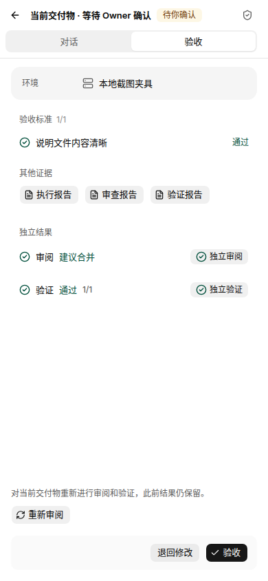 |
| expired |  |  |

approval 面板中，上方“重新审阅”和后果说明、底部并列的“退回修改”与黑色“验收”主按钮均完整位于首屏，没有重叠或裁切。与 UI5 的同名图逐项计算哈希：只有 approval pane 的字节改变，另外五张完全相同；每张仍有本轮真实采集记录，不把复用 blob 当作没有重新采集。

waiting / expired 的通用“线程”标题、过期夹具仍显示等待状态，以及入口中的既有英文摘要，都保留为呈现限制。这些正常加载后的静态图未点击重新审阅、退回修改或验收；不证明实际 POST、错误恢复、键盘操作、所有 Artifact 版本分支或 ALEX43 的生产六项验收。历史浅深桌面截图仍归属于6230，未改写为3f0重新截图。

## 历史组合 925 / 42995：增量验证与六张图

主线 #1454 在同一验收面板加入 detail 加载/错误门禁，v1 实际可达，因此普通合并后补这一组；#1439 的 v2/spec 窄栏布局不属于 ALEX43。本轮唯一冲突同时保留 Owner 重新审阅 footer 与主线 v2 flow guard/prop。17 个 Owner 路径的有序增删行与原补丁逐项相等，13 个非交叉 blob 字节相同；[源码绑定与逐项对照](increment-925/source-binding.json) 保留精确身份。

| 项目 | 实际结果 |
| --- | --- |
| 本地实际验证 commit / tree | `925245325fbff83ca1bd0579b819c3fcda397b2e` / `8c8415051e6da62f5940a4c6606f4e604e257b70` |
| 等树远端 PR head | `42995b9b1da5c14325fb5c4f7ed04859257e344f`；完整 tree 相同，commit 元数据/父历史身份按对照分别记录 |
| 源码与 Happy DOM 检查 | `test:factory-acceptance-ui` 124 / 124，`flow-view.test.ts` 7 / 7；均 fail/cancelled/skipped/todo=0；不是 PG 计数或浏览器测试套件 |
| 类型检查 | `next typegen`、typecheck 均 exit 0 |
| 默认 production build | UTC 22:21:58.816827 → 22:23:56.768799，117.952321958 秒，exit 0；最大 child RSS 10,101,468 KiB，oom_kill 0→0；[原始资源记录](increment-925/build-resource.json) |
| UI5 环境 | 新隔离Large，Node24.22.2 / pnpm10.34.3 / PostgreSQL17.11；正常bootstrap/browser install均exit0；[原件](increment-925/environment-proof.json) |
| UI5 来源 | `http://localhost:3107`，全新 `mikka_owner_ui5_e2e`，正常 bootstrap 与租约登录；BUILD_ID `5fcoXvNSEGL3A_vkblDOH`，Chrome `157.0.8103.38` |
| 六图时间 | UTC 22:24:08.634 → 22:24:12.031；每张390×844，三组pageWidth=viewport=390；[metadata](increment-925/review.json) |
| 逐图审阅 | root 6 / 6 自审；`prepare_final_ui_increment` 6 / 6 独立复核；均未发现阻断这条入口/动作的视觉问题 |
| 证据与清理 | fixture/runner audit passed；UI包SHA256 `eea7e503eb052fe80f1ad8daa53763b4c08c87f5b715e60a10430c8eeb895247`；整体22:21:41–22:24:12、exit 0，专属UI库删除、PG明确server stopped |
| 原始日志 | [33文件归档](increment-925/raw-evidence.tar.gz)，SHA256 `9b09798e1f7ebebfeb57d1db046db8def1383888dba850bf18b950ab47f0993c`；[归档模式扫描](increment-925/archive-audit.json) 无匹配 |
| 历史 head 42995 的 Git-linked CI | [CI42120382630](https://github.com/alexj11324/Mikka/actions/runs/42120382630)、[SSR42120382928](https://github.com/alexj11324/Mikka/actions/runs/42120382928)、[Browser占位门禁42120382809](https://github.com/alexj11324/Mikka/actions/runs/42120382809) 均success。22:27:21读回17项检查=16success+条件性OIDC skipped，四required均按head/app匹配success；[读回记录](increment-925/ci-42995.json) |

CI 实际检出的是 synthetic merge `f4fd9c09bd3de8c049831d13942ea7b1aa157538` / tree `7f42aa4d11bdc82cc589ca481fcf0023478ac1d7`，parents 为新 main `565c…` + PR head `42995…`。它不等于本地 UI 的 `8c841…`。后续 main 的只读仓库工具广告没有改动此 UI；真实 ALEX43 验收仍须按原六项使用 inspect_artifact 与原问答/命令回执，不能由新增 inspect_repository 替代。

| 状态 | 925 组合的任务入口 | 925 组合的验收面板 |
| --- | --- | --- |
| waiting |  |  |
| approval | 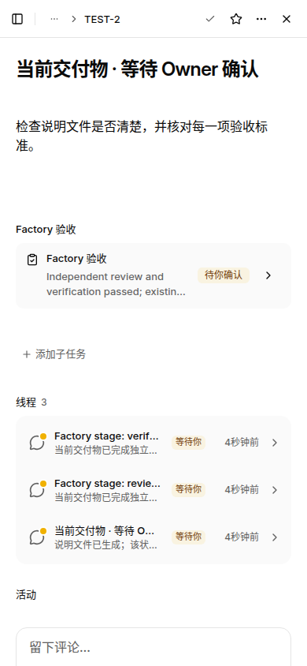 | 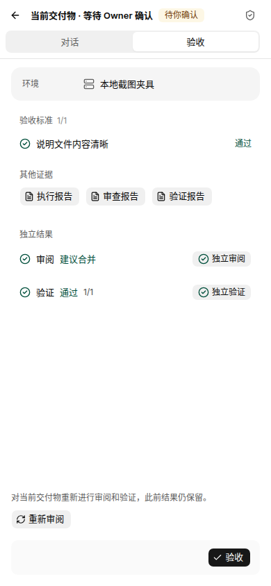 |
| expired |  | 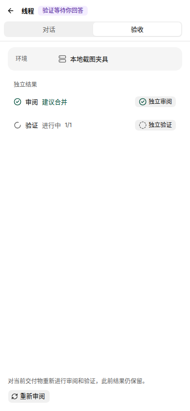 |

三种状态均正常出现验收入口与重新审阅按钮；approval 同时完整保留独立主验收按钮。approval、expired 两张 pane PNG 与旧 UI4 对应图片逐字节相等。waiting pane 本帧为通用“线程”标题；与 expired 相同，这是已记录的异步标题帧限制。图中未见横溢、遮挡或新增布局阻断，不能将静态截图写成加载失败、键盘操作、重审 POST 或生产模型验收通过。

旧18图继续精确归属于6230/f88，证明其浅深桌面与窄屏状态；没有把旧图改标成新组合。以下历史分版本证据保持原样，未重复运行未受影响的133个PG与29个shared-handoff检查。当时已准备独立证据提交，尚未发布引用；产品源码head为42995。之后历史和UI6证据统一收录为独立证据提交7cbe，并由root发布evidence引用；该证据提交所绑定的产品source head为79c。随后实际82789部署与生产尝试另见本页新增章节。独立证据提交避免纯证据追加重复全量CI。

## 首轮18图（6230）的版本与证据来源

| 项目 | 精确记录 |
| --- | --- |
| PR | [#1449](https://github.com/alexj11324/Mikka/pull/1449)，Owner recheck |
| 原始远端 Owner head | `d5fec6ebb6b444901ebb3f2f18ceab70fcf66a5e` |
| 本轮验证分支 | `verify/1210-owner-only-81c` |
| 本轮本地源码提交 | `6230e75351a41bfd6c4586166d0718b572380983` |
| 本轮完整源码树 | `f88bdd57e33e703000c9ac1bfccce028c1bb3e14` |
| 等树的远端 source merge | `e8254c39949269d33e7328982392ce4905344e4b`；只创建 Git 对象，截图前未更新 PR ref |
| 已整合主线 | `81c05e18bc087c6a08e1dd23bb323bd3f6e7cf55`，包括 #1445 原生回答来源和 #1444 approved-plan handoff |
| 构建环境 | 同一隔离 Large，Linux；Node.js `24.22.2`、pnpm `10.34.3`、PostgreSQL `17.11` |
| UI origin / DB | `http://localhost:3107`；UI4 使用独立一次性 `mikka_owner_ui4_e2e`，正常 bootstrap 与 `review.json` 一致 |
| production build | 正常 `pnpm exec next build`，exit 0；UTC `2026-11-05T21:33:41.628311` → `21:35:43.220271`，`121.592099931` 秒；UI4 复用同一 build |
| BUILD_ID | `lrEwhvgNnbrYc6ZHalF2l`；`ui-reused-build-id.txt` 与 `review.json` 相同 |
| 构建资源 | `peakChildRssKiB=10032508`（最大子进程 RSS，非整机用量）；`oomKillBefore=0`、`oomKillAfter=0`、`oomKillDelta=0` |
| build 轮原始归档 | `round-6230-build/raw-evidence.tar.gz`，SHA-256 `90f54e2a43987a94c24ff06fe91524ec6ab69cce51b6ba6fbd57b74c90d63d17`；该轮 build 成功、首次 capture 失败的原件保留 |
| 浏览器与截图时间 | Chrome `157.0.8103.38`；UTC `2026-11-05T21:56:32.499Z` → `21:56:46.392Z`，各组时间见 `review.json` |
| 图片包 | 18 PNG + `review.json` + `evidence-audit.json` + `files.json`，共 21 文件、1,580,559 bytes；archive SHA-256 `fb6aa203b1ba7468474cd2f9eaf2fc74d5f13ebb40674831007cd4de6dc2beaf` |
| 完整性与审计 | 独立重算 `files.json` 中 20 个内容文件的 SHA-256，全部相符；fixture 与四份 runner 审计结果均 `passed` |
| owning-agent 自审 | root 18 / 18 原尺寸 PNG，结论与以下独立审阅一致；未发现本次入口/动作的视觉阻断 |
| 逐图独立审阅 | 桌面 12 / 12：`final_integration`；手机 6 / 6：`ui_bootstrap_diagnosis`。两者各自审阅原图，不将分工合写成一个 reviewer 亲阅全部 18 图 |

两个本轮 source merge 的 commit SHA 不同，完整 tree 相同；截图和构建必须记录实际 checkout 的 `6230…`，不能改写成在 `e825…` 上运行。原始 Owner 的 17 个补丁路径 blob 均未改变，且真实 #1449 历史保留。#1448 的缓存实验不在最终树；`next.config.mjs` 保持主线版本。本页和截图应作为后续证据提交叠加在远端 source merge 上，最终 PR head 与 CI 另行记录。

## 原始证据索引

- [构建资源与实际退出](build-resource.json)、[源码/远端等树与原 Owner blob 对照](source-binding.json)。
- [UI4 历史原始日志归档](raw-evidence.tar.gz)：包含分阶段退出、正常账号 HTTP 状态、源码检查与 PostgreSQL 清理。
- [e0 真实 PostgreSQL / 类型 / lint 原始归档](round-e0/raw-evidence.tar.gz)。
- [6230 增量 PostgreSQL 与 production build 原始归档](round-6230-build/raw-evidence.tar.gz)：保留首次 capture 失败，不将整体进程改写为成功。
- [归档内容安全扫描记录](archive-audit.json)：原始归档经私钥、token 前缀、Authorization、Cookie、含密码数据库 URL、JWT 模式扫描，无匹配；该扫描不等同于证明不存在所有未知类型秘密。

## 设计依据与组件复用

按 `docs/design/README.md` 的来源优先级，本轮沿用当前主线已经运行的 flow v1 Factory 验收布局。没有为本次新增动作提供新的已接受 Figma frame，也不把代码里的历史 Figma 注释当成本次新增设计的验收依据。flow v2 的 `FactoryFlowCard` 与 Artifact 验收报告不在这次改动范围。

| 页面部分 | 复用实现 |
| --- | --- |
| 任务中的验收入口 | 既有 `FactoryAcceptanceRow`、`visibleAcceptance` / `candidateCheckState` |
| 验收面板 | 既有 `FactoryAcceptancePanel`、`FactoryAcceptancePane` |
| 当前候选、检查结果与证据 | `CandidateCard`、`ResultLine`、`CriterionEvidence`、`EvidenceViewer` |
| 重新审阅按钮与忙碌状态 | `components/ui/button.tsx` 的 `Button`、既有 `Spinner`、`RefreshCw` |
| 接受与退回 | 既有 `ApprovalBar`、`RejectNote` 分支未被替换；本次 approval 截图实际显示“验收”，不把图片当作所有退回权限分支的证明 |
| 任务页与浅深主题 | 主线任务页、共享中性色 token、现有响应式布局 |

本次没有新增通用组件。新增文案都在 `messages/zh-CN.json` 与 `messages/en.json`。按钮旁的“对当前交付物重新进行审阅和验证，此前结果仍保留。”位于动作 footer，说明同一候选、新检查及旧结果保留这三个直接影响选择的后果；删掉后会丢失按钮本身没有表达的信息。它不是面板标题下的说明副标题。桌面 reviewer 在六张 pane 中、手机 reviewer 在三张 pane 中均确认这段话和按钮完整位于视口内，未被内容区或底部栏遮挡。

## 从 Owner 任务出发的 walkthrough

“修改前”来自 `81c…` 与本轮 source tree 的代码比较，不伪称已取得前后两组运行截图。用户首先在任务正文中的 Factory 验收行查找当前交付物，再打开既有面板；这遵循主线任务页入口惯例和 R-89 的可发现性要求。

| 用户任务 | 修改前 | 修改后与待核对证据 |
| --- | --- | --- |
| 第一次遇到验证等待回答，希望重新检查当前交付物 | `verify / waiting` 没有可见验收入口；Missing，严重度 3 | 桌面 Found，严重度 0：首屏“Factory 验收”卡片及“验证等待你回答”标签清楚；打开后可见“重新审阅”及保留旧结果的后果 |
| 当前交付物已到接受阶段，Owner 发现旧 review 覆盖不足 | 有接受/退回操作，缺少同一候选重新审阅；Missing，严重度 3 | 桌面 Found，严重度 0：“待你确认”入口打开后，灰色“重新审阅”与下方主操作“验收”同时可见，层级不混淆 |
| 原验证问题已过期，但 Owner 仍需重新核对当前交付物 | 过期等待状态仍没有所需入口；Missing，严重度 3 | 桌面 Found，严重度 0：`expired` 夹具真实 Owner GET 返回 capability，入口与重新审阅可达。旧问题仍 `waiting_user` 且 `expiresAt` 已过期。图片不证明旧问题被回答、续接或改写，也不证明新增了过期专属提示 |
| 在浅色/深色桌面找到候选与动作 | 沿用同一主线布局；上述动作缺失 | 桌面 Found，严重度 0：浅深主题的卡片、结果、按钮和 footer 都可读；无新增明显白色细边、重叠或裁切 |
| 在 390px 手机浏览器完成同样查找 | 上述动作缺失 | 手机 reviewer 确认 Found，无严重度 3/4 阻断：三状态入口与 pane 动作完整，approval 主验收独立可见；三组 `layout.pageWidth=390`、`viewport=390` |
| 只查看结果，暂不开始新检查 | 原验收面板为读取操作 | 仅打开入口、查看面板不提交 recheck；本轮截图只执行这些操作 |
| 旧页面的 revision、候选、权限或活动执行已变化 | 不应从旧页面获得新执行授权 | 组件要求 list/detail/ledger/capability 的精确绑定一致；服务端 POST 再验权限和当前状态。图片只覆盖显示，拒绝与并发语义由版本明确的 PostgreSQL 测试证明 |

等待请求、错误、未知响应、权限失效与已有恢复动作仍由现有面板分支处理。18 图不覆盖这些状态的全部交互、键盘遍历或实际 recheck POST；不能把组件复用等同于完成了这些交互验收。

## 三状态、三布局、入口与面板：18 张图

每个状态都有 1440×1000 浅色、1440×1000 深色、390×844 浅色三组。每组先截任务中的入口，再打开现有验收面板截图。共 3 × 3 × 2 = 18 张，全部实际生成且 SHA-256 已核对；不包含手机深色截图。桌面 12 张、手机 6 张分别由两位独立 reviewer 逐图审阅。

### 验证等待回答（waiting）

| 布局 | 任务中的验收入口 | 验收面板 |
| --- | --- | --- |
| 浅色桌面 1440×1000 | 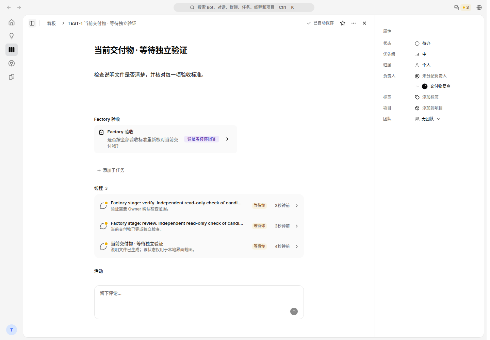 | 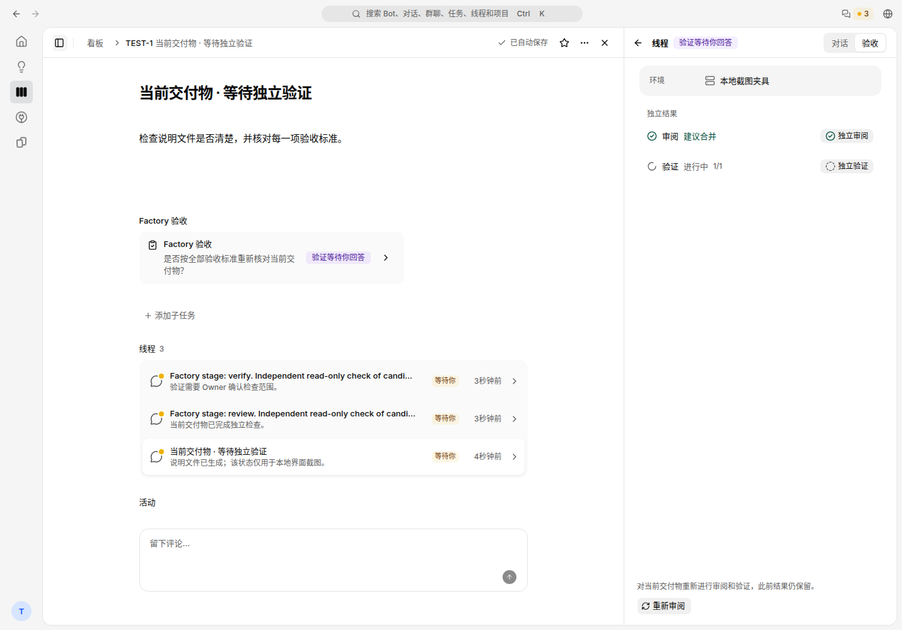 |
| 深色桌面 1440×1000 | 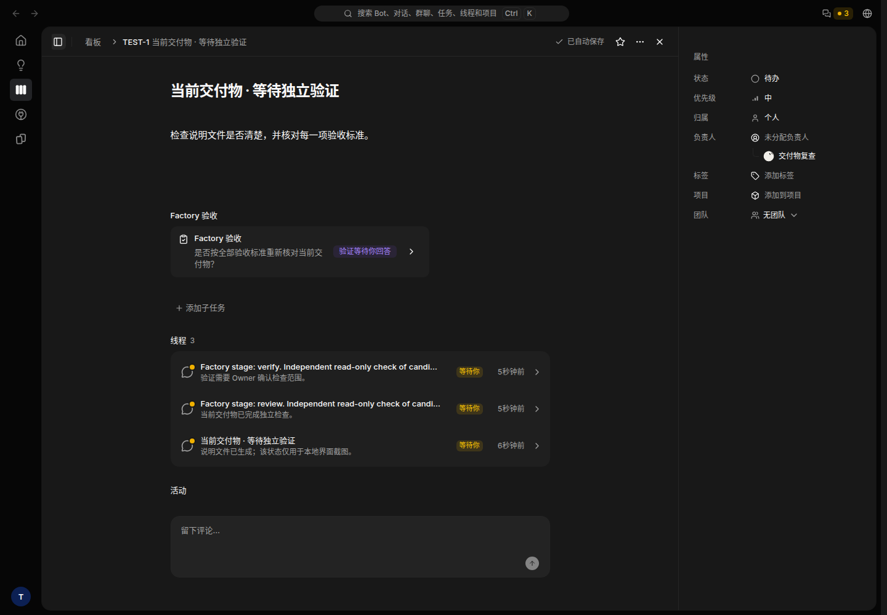 | 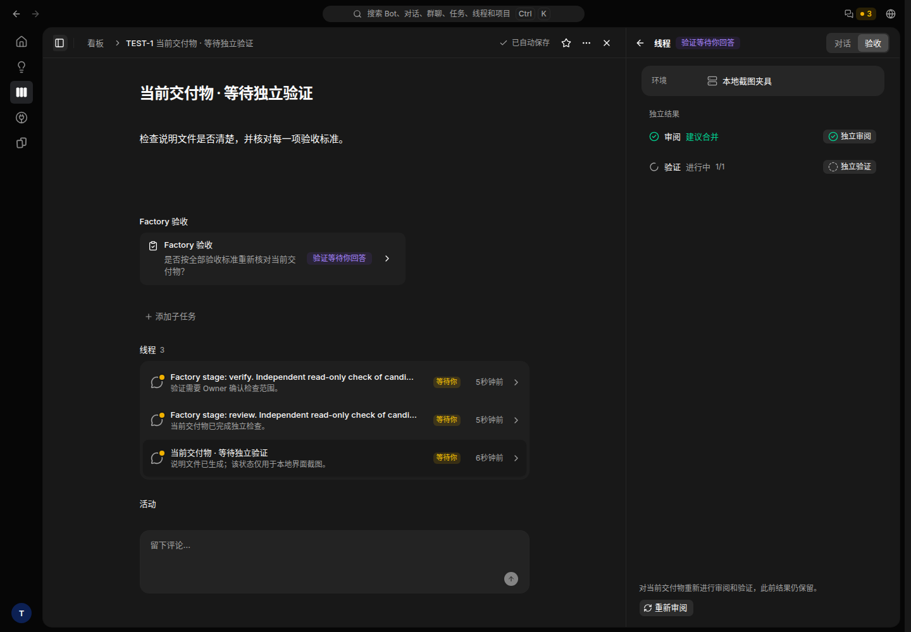 |
| 浅色手机 390×844 | 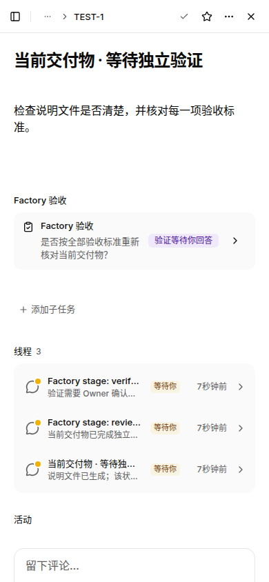 | 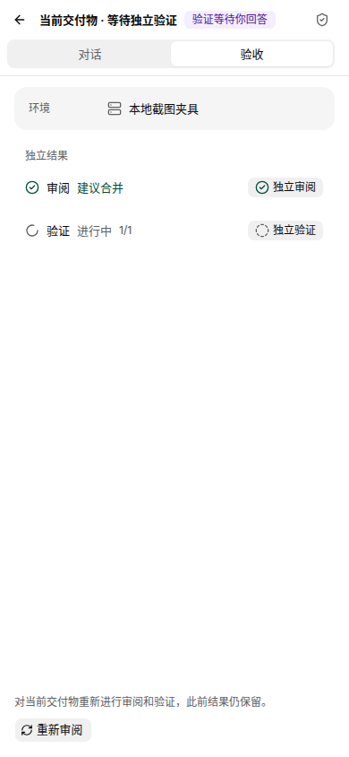 |

### 等待 Owner 接受（approval）

| 布局 | 任务中的验收入口 | 验收面板 |
| --- | --- | --- |
| 浅色桌面 1440×1000 | 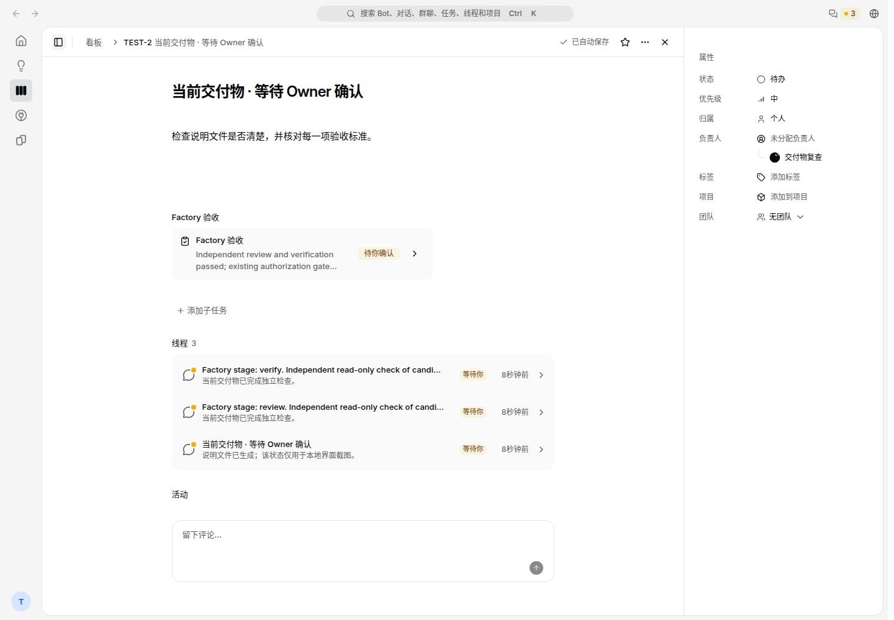 | 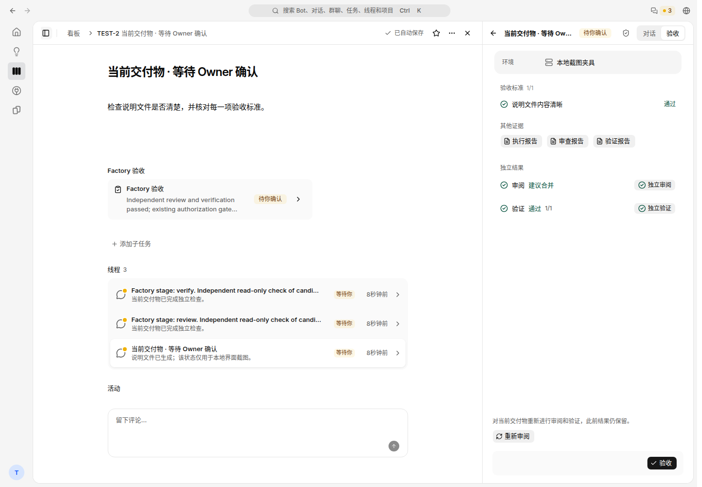 |
| 深色桌面 1440×1000 | 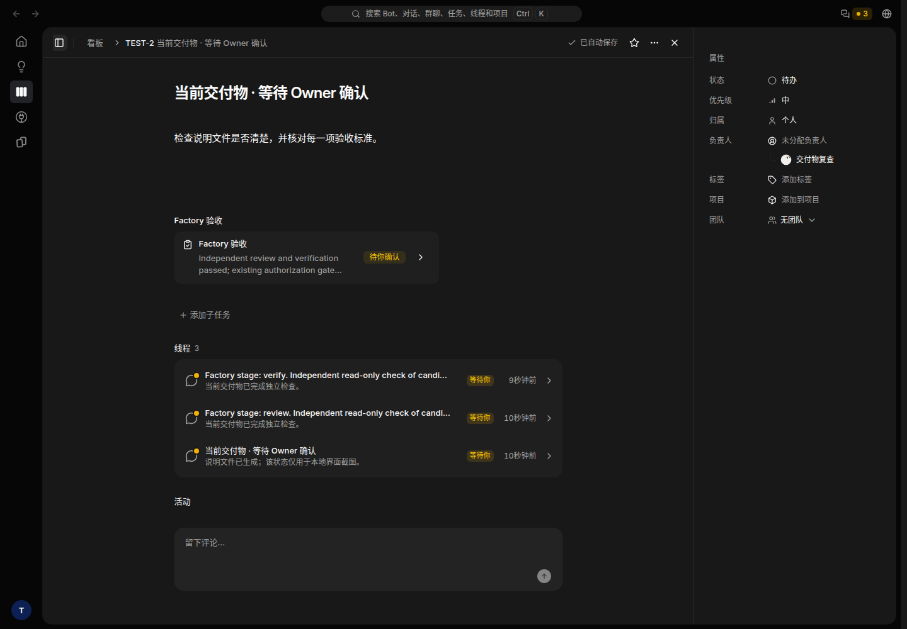 | 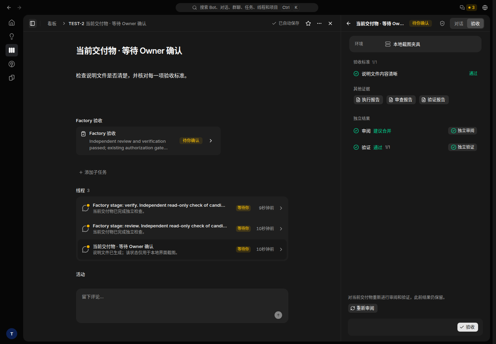 |
| 浅色手机 390×844 | 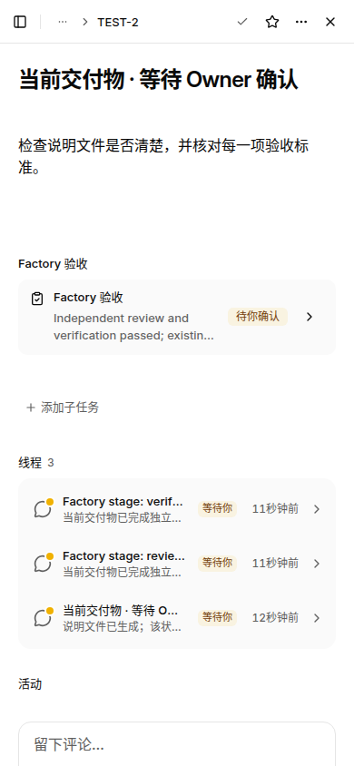 |  |

### 验证问题已过期（expired）

| 布局 | 任务中的验收入口 | 验收面板 |
| --- | --- | --- |
| 浅色桌面 1440×1000 | 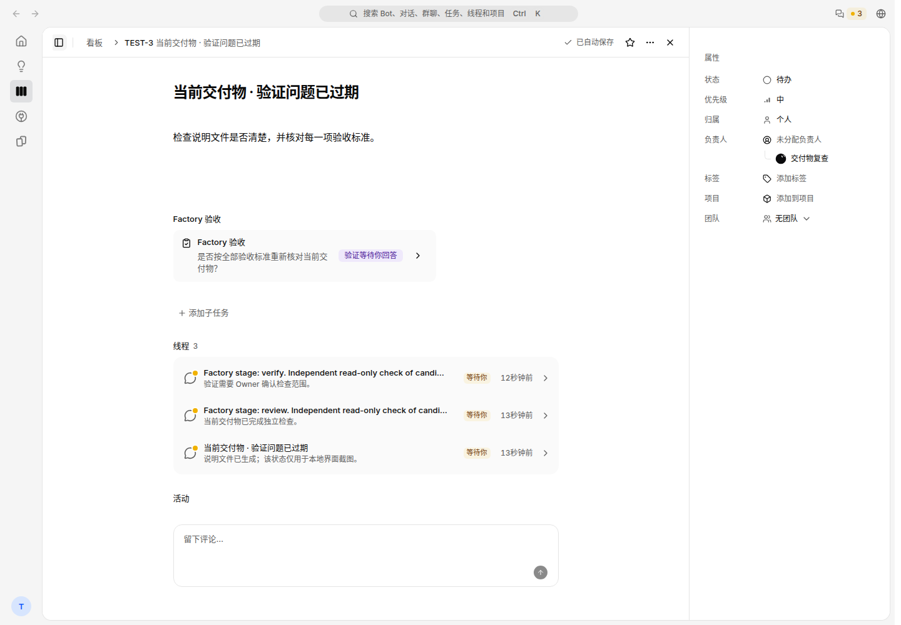 | 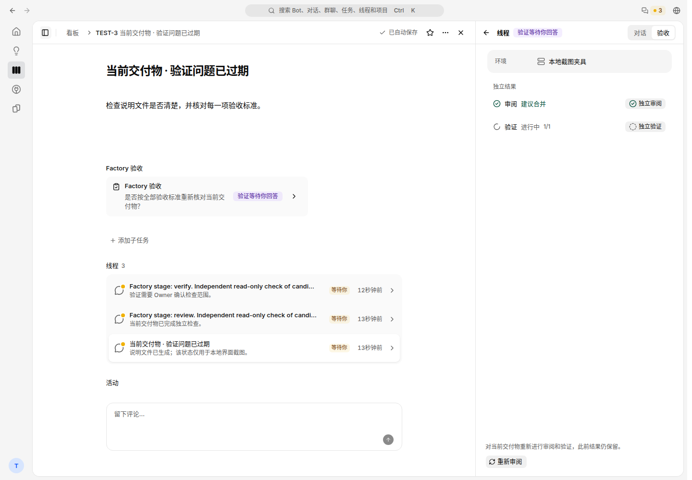 |
| 深色桌面 1440×1000 | 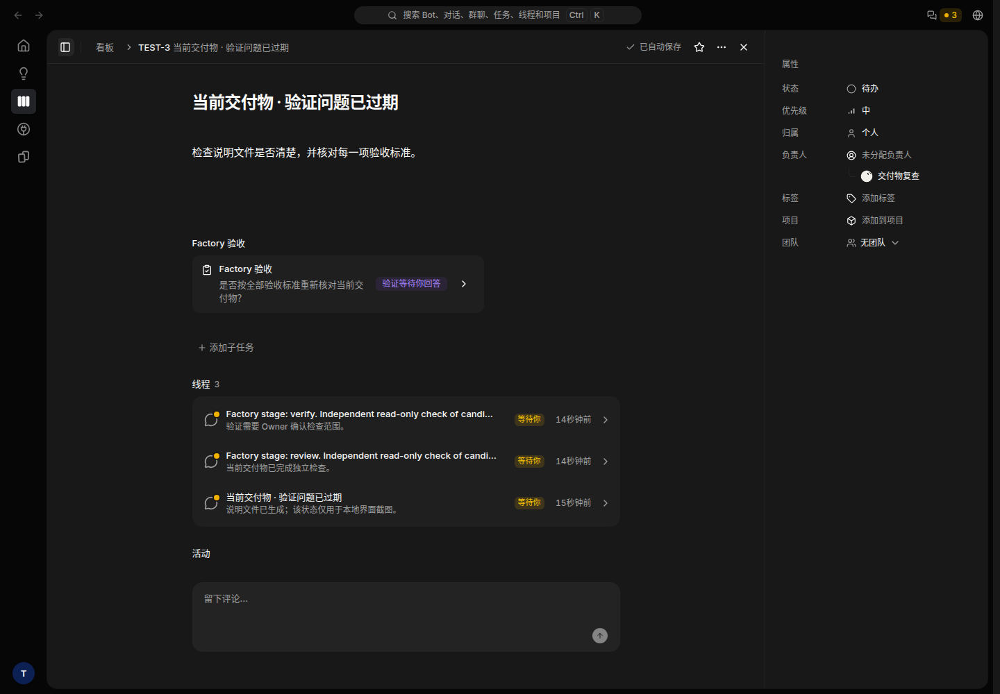 | 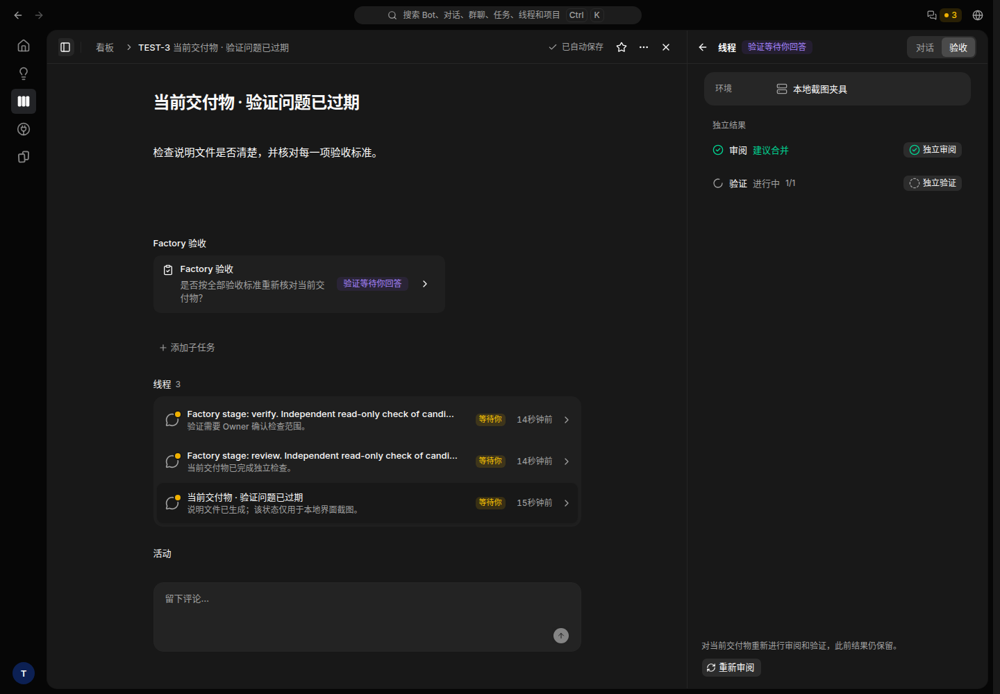 |
| 浅色手机 390×844 | 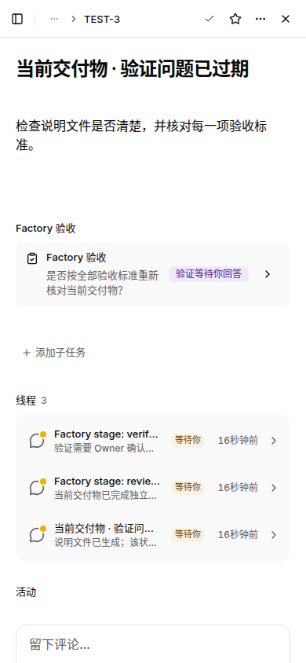 |  |

## 实际截图方法与隔离边界

本轮脚本使用仓库现有 `scripts/test-accounts/session.mjs` 的账户分配与租约，通过正常 email 注册/登录取得真实应用 session，使用 Owner 的 `storageState` 打开本地 production build。先由原 bootstrap 在全新一次性 UI 数据库核验环境身份与 freshness；没有替换认证/权限守卫、伪造 cookie 或跳过 lease 检查。

任务、订阅目录元数据、机器记录及已结束检查由一次性 UI 数据库中的合成业务夹具准备。运行队列/外部运行边界被明确禁止启动；脚本只打开“Factory 验收”，不点击“重新审阅”、接受或退回，不调用外部模型，不启动真实生产运行。模型名称是夹具元数据，不是一次 live subscription 验收。UI4 日志实际记录两名租约账户的 email sign-up、get-session、workspace、Coordinator read 和 `/mikka` landing 全部 HTTP 200；三个 Owner task GET 均 200，最后记录 18 张截图。HTTP 诊断只保留 method/path/status，不收集 cookie、请求体或响应体。

发布的材料只包含截图、无认证内容的版本/布局元数据与扫描结果；密码、cookie、会话文件、数据库连接串和原始网络记录不进入图片包。实际 `evidence-audit.json` 的 fixture 和四个 runner 扫描均 `passed`；扫描对象是当时的 18 PNG 与 `review.json`，随后加入审计和哈希清单。12 张桌面图人工检查未见凭据、cookie 或真实账户联系方式；手机原图由另一 reviewer 审阅。脚本最终按 dirty 释放夹具租约，成功删除本轮一次性 UI DB，并记录 PostgreSQL `server stopped`；整体 exit 0。

## 分版本记录的验证

| 实际源码 | 项目 | 已有实际结果 / 当前状态 |
| --- | --- | --- |
| `e0d1a11fb05798d636439127ef5d16a29d594eaa` / tree `2fae74c0d7414f66d8c8aa8bd48e19623101f124` | `lib/factory/profile-dispatch.db.test.ts` | 113 / 113，通过；0 fail / cancelled / skipped |
| 同一 `e0… / 2fae…` | `lib/factory/questions/execution-continuation.db.test.ts` | 17 / 17，通过；0 fail / cancelled / skipped |
| 同一 `e0… / 2fae…` | `tests/request-query-count.db.test.ts` | 3 / 3，通过；0 fail / cancelled / skipped |
| 同一 `e0… / 2fae…` | typegen、typecheck、lint | 各 exit 0 |
| 同一 `e0… / 2fae…` | UI bootstrap | exit 1：`ENVIRONMENT_DATABASE_NOT_FRESH`；未进入 build，不计为本轮构建失败或成功 |
| `6230e75351a41bfd6c4586166d0718b572380983` / tree `f88bdd57e33e703000c9ac1bfccce028c1bb3e14` | `tests/cloud-runtime-auto.db.test.ts` | 29 / 29，通过；0 fail / cancelled / skipped；全新 `mikka_owner_cross_e2e` 的正常 setup 和后续 drop 均 exit 0 |
| 同一 `6230… / f88…` | 全新 UI DB 正常 setup / bootstrap | `ui-create`、`ui-setup`、`ui-bootstrap-resume` 均 exit 0；bootstrap 返回精确 `6230…` 和本地 origin，freshness guard 未被绕过 |
| 同一 `6230… / f88…` | 默认 production build | exit 0，121.592 秒；详见本页资源记录 |
| 同一 `6230… / f88…` | 首次截图阶段 | `ui-capture` exit 1：`ACCOUNT_INITIALIZATION_FAILED`，发生在账户分配、业务夹具和图片生成之前；原失败日志保留 |
| 同一 `6230… / f88…`、同一 BUILD_ID | UI4 成功截图 | `ui4-capture` exit 0，18 PNG；`ui-evidence-audit`、`ui-package` 均 exit 0，源码前后检查一致，清理 exit 0 |
| UI6 当时的产品 PR head `79c…` | Git-linked CI 与 mergeability | 本稿UI6阶段尚未收集；后续精确head的CI、合并与部署事实已追加在production-attempt-01，不将历史42995版本CI计为79c通过 |

旧轮三组 PostgreSQL 合计 133 个测试，不能写成在新 `6230…` 上重跑过。#1444 实质交叉是 shared dispatch 的 approved-plan handoff，所以本轮增量运行 `cloud-runtime-auto.db.test.ts`；它并不是专门新增的“Owner 重新审阅且有 spec 历史”用例。原始 Owner 17 个补丁 blob 与 UI blob 都未改变，可按版本关联复用已有证据；最终组合仍以最终 PR CI 为门禁。

旧轮 bootstrap 的原因已确认：前三组数据库测试在原库留下用户记录，随后在同一库首次初始化账户环境，触发 freshness guard。正确恢复使用另外两个全新一次性数据库，分别承载交叉测试与 UI，不删除旧库用户来绕过 guard，不伪造环境 descriptor。此环境恢复不改产品源码。

build 轮进程 `proc-1793914403520338789-26` 于 UTC `21:33:23` 启动，整体 exit 1 来自截图前的账户初始化，不能把那一轮改写成通过，也不能把成功的 build 改写成失败。随后沿用同一构建，将 `next start -H localhost` 与认证/截图 origin `http://localhost:3107` 对齐，正常 landing 返回 200；又修正了外置夹具中一个 SQL 参数同时用于 UUID 和 text 的占位符，未改产品源码或认证守卫。

UI4 成功进程 `proc-1793915778968922370-45` 已实际 exited / exit 0；脚本时间为 UTC `21:56:19` → `21:56:47`。`ui4-source-before.log`、`ui4-source-after.log` 均为空的成功 `git diff --exit-code` 输出，脚本前后分别检查 exact HEAD 和 tree，`ui4-stages.log` 最后为 `complete`。截图沿用原 build，没有再次运行昂贵构建或把此前失败删除。

## 独立桌面视觉复核记录

reviewer 未编写产品 UI，按 `ux-heuristics` 和 `cognitive-walkthrough` 对 12 张原尺寸桌面图片分别审阅。任务限定为“Owner 在当前任务中找到验收入口，打开面板并识别同一候选的重新审阅动作”；不假设已经点击新检查或最终接受。截图内这条可见路径评级 10 / 10，最高严重度 0；没有需要先修复才能完成此路径的可见问题。该评分是专家检查结论，不是用户实验，也不是全产品可用性评分。

| 实际打开的文件 | 具体观察 |
| --- | --- |
| `waiting-light-1440-entry.png` | 任务标题、描述与首屏 Factory 验收卡片构成清楚路径；等待回答标签和右箭头可见 |
| `waiting-light-1440-pane.png` | 右栏已选“验收”；独立结果与 footer 的“重新审阅”完整可见，等待验证没有被显示为已通过 |
| `waiting-dark-1440-entry.png` | 深色卡片与背景能分辨；标题、等待标签、入口箭头清楚，无新增白色描边 |
| `waiting-dark-1440-pane.png` | 深色结果、后果提示与按钮均可读；footer 在底部视口内，无遮挡或重叠 |
| `approval-light-1440-entry.png` | 首屏入口显示“待你确认”，与等待回答状态区分；原有理由两行截断不遮挡状态和箭头 |
| `approval-light-1440-pane.png` | 验收标准、报告入口、独立结果完整；灰色“重新审阅”位于独立的主操作“验收”上方 |
| `approval-dark-1440-entry.png` | 深色中的待确认标签、任务标题和验收卡片可辨认；未见截断覆盖操作 |
| `approval-dark-1440-pane.png` | 灰色重审与浅色主验收按钮层级清楚，证据入口和结果可读，底部按钮没有出屏 |
| `expired-light-1440-entry.png` | 过期夹具仍显示可点击验收入口；标题标识过期夹具，实际状态标签保持“验证等待你回答” |
| `expired-light-1440-pane.png` | 入口打开后，重新审阅与保留旧结果提示完整可见；未将过期问题伪装为已回答或已通过 |
| `expired-dark-1440-entry.png` | 深色过期夹具入口、等待状态和导航箭头均可辨认；与浅色结构一致 |
| `expired-dark-1440-pane.png` | 深色 footer 可见，按钮无裁切，结果没有新增重叠；与等待状态采用同一主线布局 |

“问题已过期”来自夹具任务标题；现有状态标签仍显示“验证等待你回答”，结果行仍沿用“进行中”。因此这组图片证明过期问题存在时 Owner 仍能找到同候选重审入口，不证明 UI 已新增过期专属状态文案。截图中的英文线程名称与理由是原有宿主/夹具内容，不能用它们宣称全屏所有内容已做新的国际化整理。

按认知 walkthrough 的四问：Owner 能从任务中的验收块判断下一步；能看到卡片和箭头；打开后“重新审阅”及直接后果说明与目标相符；entry/pane 成对截图证明打开后的反馈清楚。重新审阅 POST、最终接受、错误恢复、键盘焦点和关闭返回行为不属于这些静态图片的完成证明。

### 另一 reviewer 的六张手机复核

`ui_bootstrap_diagnosis` 独立查看了以下全部 390×844 原图，并核对 PNG 尺寸、哈希与三组布局元数据。这里汇总其报告，桌面 reviewer 未将这些结论冒充自己的逐图观察。

| 手机文件 | 独立报告的观察 |
| --- | --- |
| `waiting-light-390-entry.png` | 入口与等待状态可见，无横向溢出或遮挡 |
| `waiting-light-390-pane.png` | 重新审阅按钮及保留旧结果说明完整在首屏底部 |
| `approval-light-390-entry.png` | 待确认入口可见，文字截断不覆盖动作 |
| `approval-light-390-pane.png` | 重新审阅与黑色“验收”主按钮分别可见，底部操作没有重叠 |
| `expired-light-390-entry.png` | 过期夹具的验收入口仍可达，未见横向溢出 |
| `expired-light-390-pane.png` | 后果提示和重新审阅完整可见；顶栏此帧显示既有“线程”fallback，状态仍为等待回答/进行中 |

手机 reviewer 未发现高严重度阻断。它同时指出一项截图局限：`expired` pane 的线程标题尚未完整载入。源码 `IssueThreadPanel` 使用 `listedName || detail?.name || t('title')` 的既有异步 fallback，采集只等待重新审阅按钮可见；因此不能据单帧宣称候选名称存在持久回归，也不能把该帧当作最终标题完整加载的证明。桌面 waiting/expired pane 同样可见通用“线程”标题，任务主标题仍留在旁边；本页保留这一观察，不将它隐藏为完整标题验收。

| 检查 | 当前结论 |
| --- | --- |
| 18 PNG 齐全、尺寸与 `review.json` 匹配，所有截图同一 BUILD_ID / checkout | 通过完整性检查：12 张 1440×1000、6 张 390×844；20 个内容文件哈希全部匹配 |
| R-89：三种状态的主入口可见，打开后能找到同候选重新审阅 | 桌面通过：三状态浅深主题均在首屏显示入口，六张 pane 均可见动作 |
| R-90：复用主线验收组件与共享 Button，没有重画近似组件 | 源码及桌面截图通过；没有新增通用组件 |
| R-40 / C-04 / C-08：后果提示有必要信息，且不替代具体按钮或状态 | 桌面通过：提示紧邻 footer 动作，说明同一候选与保留历史，不是标题副文案 |
| R-30 / R-31 / R-32 / R-33 / R-34：中性色、暗色边界、字级、圆角与状态可读性 | 桌面视觉通过，未见新增白色细边、重叠或裁切；不声称做了数值 WCAG 对比度测量 |
| R-84 / R-85 / R-86：沿用既有线程/交付物入口，不新增任务页问答框 | 本改动可见范围通过：使用既有验收面板，报告入口在验收面板，任务上没有新增问答输入框；未展开线程对话作额外验收 |
| R-87 / R-88：状态可辨认，主操作区的密度与有效面积合理 | 桌面通过：文字和状态颜色可辨，验收与重审层级清楚；稀疏的等待结果不妨碍 footer 操作 |
| 页面横向溢出 | 九组布局记录均 `pageWidth ≤ viewport`；桌面 1430 / 1440，手机 390 / 390 |
| 390px：动作 footer 可见、文字无裁切，触屏目标沿用共享 Button | 手机 reviewer 视觉通过：三状态 footer 完整，approval 两类动作分明；没有把静态截图当作实际触屏/键盘行为测试 |
| 首轮 Owner walkthrough 评级与未解决问题 | 桌面查找/打开/识别动作：Found，严重度 0；手机报告同样无严重度 3/4 阻断。通用线程标题的单帧加载局限已记录；实际提交另行验证 |

## 与生产验收的关系

本页隔离UI部分证明指定版本的入口与布局，以及另行列明的源码/数据库检查；新增production-attempt-01记录真实发布、单次正常Owner点击及其阻断。合成夹具内的“通过”结果不证明ALEX43的生产六项验收，也不证明真实独立review/verify已运行、已回答历史问题或已完成新检查。本轮实际读回没有新的检查回执，六项与最终Owner接受仍未完成。

三轮30张截图继续保留实际源码身份；3f0的源/Happy DOM检查、类型检查、构建、UI6审计、自审和独立逐图复核已有成功原件。79c随后通过CI、82789部署成功的原件已在新增章节补齐；23:14的真实重审未完成，额度准入阻断的来源与推导边界均保留。诊断补丁的测试与合并不能替代原六项及最终Owner接受。

## production-attempt-02

**第二次正常重审实际执行了新的 review，但 Factory 判定未通过。** 最后直接数据库观察为 **2026-11-06 00:05:21.017–00:05:21.029 UTC**：task=`review / failed`、revision=16；新 review attempt=`failed`，原生 run=`succeeded / submitted`。后者只表示运行成功提交了报告，不能写成 Factory 通过。**新 verify 尚未创建，最终 Owner 接受没有发生。** [最终状态](production-attempt-02/attempt02-status.json)、[实际 proof 响应](production-attempt-02/attempt02-proof01-response.json)及[失败调查](production-attempt-02/attempt02-blocker.md)保留这些不同层级的事实。

第一轮 `production-attempt-01` 的 47 个文件、全部历史 UI 原件和当时的 pending 叙述均原样保留。以下是后续事件；不会把后来 READY、额度刷新或新运行回写成第一轮点击已经成功。

### 后续部署与第二次点击的实际版本

| 发布或版本 | 已保存的实际证明 |
| --- | --- |
| 诊断 #1462 的最终合并 | `0677fbff4c949c53b839706011af5ec77cdd1d24` / tree `4d234a44ec32bb1b28e8552b6dd0e44c2c7733b1`。自身 main CI `42131188519` 实际 checkout 为0677并 success；它与旧 base82789 的 PR synthetic CI 分别记录。 |
| 0677 实际部署 | Web `42131188496` attempt1 success；deployment `dpl_C5mqNpPppuxu1F36mXpQZdHy1ntG` 于 **2026-11-05 23:47:39.309 READY**。[部署原件](production-attempt-02/diagnostic-0677-deployed.json)与[root 23:48:59.317058 的公开完整 SHA](production-attempt-02/public-root-diagnostic-0677-ready.json)。第一轮章节的“待 READY”属于23:45:32快照，仍然保留。 |
| 第二次点击前的生产版本 | 随后 #1461 合并为 **`1846002bec14c649e4bead67f136014141f4d133`** / tree `4cc40c5a1bd5c203a6dd0bbb6176ac883ce8101c`，第一 parent 就是0677。Web `42132342122` attempt1 success，deployment `dpl_4XFwJH7YCuoCsfSZ5XFGYuG1Bppn` **23:56:40.144 READY**。[部署与源码相关性必要字段投影](production-attempt-02/production-1846002-readiness-projection.json)。 |
| 点击前的公开版本读回 | root **23:58:58.218359** 的普通公开 GET 为 HTTP200、完整 build=`1846002bec14c649e4bead67f136014141f4d133`。[原始公开响应](production-attempt-02/public-root-before-click02.json)。本次实际点击版本记为1846002，不改标成0677。 |

源码 watcher 的既有审阅区分了 #1461 的 spec continuation 路径与本案 fresh acceptance check 路径；Owner recheck、quota 和相关准入文件的未变化范围保存在该投影中。部署完成只是本次操作的版本前置条件，不代表六项验收已经完成。

### 从点击前到失败判定的时间线

| 时间（UTC） | 实际观察与边界 |
| --- | --- |
| 2026-11-05 **23:59:30.230–23:59:30.234** | 点击前仍为原 `verify / waiting`、revision13；与23:04原始 before共有 **48字段、0差异**。旧问题八个消费字段NULL，recheck回执/新attempt/活动run/lease/接受记录均0，父机sleeping。该前置读取没有刷新额度。[before响应](production-attempt-02/attempt02-before-response.json)、[比较](production-attempt-02/attempt02-before-comparison.json)。 |
| 2026-11-06 **00:00:55.806** | root 刷新正常登录的 Owner UI 后，本轮只点一次 **Retry review**；累计两次正常Owner重审。最初为 Loading / disabled；没有回答旧verify问题，没有执行接受。[动作记录](production-attempt-02/root-recheck-ui-action-02.json)。 |
| **00:00:58.058** | 正常产品流程确实取得新官方 quota 快照：全局 weekly used=0，reset=`2026-11-13T00:00:00.000Z`；five_hour used=0.04。这个记录来自真实刷新，不能用时钟越过00:00替代。[sample01中两个冻结来源的quota原件](production-attempt-02/attempt02-sample01-response.json)。它只证明该时点的快照，不是未来额度保证。 |
| **00:00:58.332** | `owner_candidate_recheck` 回执 **`6c485476-b3b5-4d1e-a7e7-47865d34affa`** 已提交，绑定原revision13、原candidate/epoch和两个旧检查来源。旧verify问题正常变为expired / revision3，原expiry与八NULL保留；没有回答或续接该过期问题。 |
| **00:01:12.107** | UI显示Reviewing、新第4条线程Running、Review/Verify均In progress。**Verify文案不证明新verify已开始**；实际运行身份以后续数据库记录为准。[UI起始观察](production-attempt-02/root-recheck-ui-observation-02-start.json)。 |
| **00:01:18.681 → 00:01:20.406** | 第一次 `install_computer` 记录TimeoutError；同一durable工作流随后正常再次handoff，`providerContinuation=false`。这是内部重试，没有第二次本轮Owner点击。[必要runtime事件投影](production-attempt-02/attempt02-startup-events-projection.json)。 |
| **00:01:55.481–00:01:55.487** | sample01中task虽为review/running，原生run仍queued、SID/start/native claim/lease均NULL，thread machine=error；不能把这一帧计为已执行的独立审阅。[sample01响应](production-attempt-02/attempt02-sample01-response.json)。 |
| **00:02:11.746 → 00:02:17.934** | 先出现可选`preloaded.pid`缺失输出；随后00:02:17.019记录handoff finished / started=true，真实run startedAt=00:02:17.934，machine runningSince=00:02:17.011。源码有正常worker fallback，PID这一行不是独立的fatal证据；实际native claim证明本次启动后来恢复。[启动分类](production-attempt-02/attempt02-startup-classification.md)。 |
| **00:03:54.387** | sample02真实看到review运行中、新独立SID、原native binding、API claim=false、providerObservedModel=NULL；同任务artifact VM被复用，父机仍sleeping。[sample02响应](production-attempt-02/attempt02-sample02-response.json)。 |
| **00:04:03.483 / 00:05:21** | 原生run结束为succeeded/submitted；最后proof显示Factory review attempt failed、task review/failed revision16，**无新verify、active run=0、有效lease=0**。[实际proof](production-attempt-02/attempt02-proof01-response.json)。 |

原始采集时间与只读/5秒timeout记录分别保存为 `attempt02-before`、`sample01`、`sample02`、`proof01` 的 timing 文件；对应SQL发布副本只遮去Owner账户ID并标记不可执行。没有把内部启动重试、queued帧、UI状态或成功submit替代最终Factory判定。

### 新独立检查的固定身份及 VM 假设纠正

| 对象 | 本次实际值 |
| --- | --- |
| task / issue | `e42571e5-58f7-40e3-9418-c02ee8843fe6` / `0b9e6f79-790b-4931-aa54-2f45f5d142de` |
| 原candidate / epoch / 交付HEAD | `2f338962-c690-4ba7-bc63-6c73a9de3acb` / `4ad02e70-8015-5eac-87f4-a96fbd775d14` / `d05417e7848871e511141e10a282ffb7998b0a79`，与原交付绑定相同 |
| 新review attempt / run | position5，`f23b075b-992a-4e17-b891-1c462d4d3738` / `af4309f0-c48f-463a-8552-1b04c6e33595` |
| 新native SID | `0c6512df-0df0-460a-92d0-6aea0a963033`，不同于旧execute、producer、review和verify的SID；retryOf / continuesRunId / questionContinuation均NULL |
| 宿主记录的实际模型来源 | harness=`claude_code`，model=`claude-haiku-5-5`；native binding=`0e5edf2d-2653-475e-8693-b53ceafa7c11`，connection=`93b6ab23-900b-4e18-9ea0-baccf2d104ce` / revision2 / route=`claude_code_cli`；API claim=false；**providerObservedModel仍NULL** |
| 实际artifact VM | **`i773iwx0ulev7nvbomyyk`**，保留并转移同任务VM；**没有新建VM** |
| 父Bot runtime | `ipa60du803guuiqnyzqan`；00:05:21.029仍sleeping，lastActiveAt=`2026-11-05T14:48:42.215Z` |

**更正此前额外加入的VM假设：**原Takeover要求全新官方模板VM的对象是此前已完成的四个NEW tasks；A43要求的是新的独立SID、无retry/continuation绑定，并如实记录实际VM与父机状态。此前准备文档把它加强写成了“每个review/verify也必须新VM”，这不是A43原合同。源码的同任务sandbox保留/转移路径允许本次复用；既不能把它写成fresh VM，也不能以此新增验收阻断。[原错误准备文档完整历史副本](production-attempt-02/attempt02-pre-correction-preparation-README.md)保持原字节，仅作被更正的历史；[启动分类的纠正说明](production-attempt-02/attempt02-startup-classification.md)和[语义审阅](production-attempt-02/attempt02-review-semantic-audit.md)记录当前解释。

### 失败报告的两项 unverified 均保留

[新review报告原件](production-attempt-02/attempt02-review-report.json)有六条报告项目：四条passed、两条`passed:false / status:unverified`。**这些报告项目与原合同六项并非逐行同一组，不能概括成“原六项已通过四项”。** Factory最终failed没有被人工覆盖。两项缺口分别是：

1. **checker可见的模型来源证据不足。** 报告承认宿主记录Haiku/Claude Code，却因observedModel=NULL表示无法核实provider alias或订阅。数据库native claim确有原binding、connection、route/model与非API来源，但当时checker prompt的producerExecution只有runId/sessionId/status/model/harness/observedModel，没有把完整native claim投影给checker。因此不能指责模型已经拿到全部来源字段却忽略了它们；也不能填造非NULL alias。原合同要求原官方订阅和冻结模型，并未额外要求供应商回传alias必须非NULL。后续应补真实、绑定到producer的最小宿主来源事实，同时保留alias的观察限制。
2. **最终commit的完整changed-path范围尚未观察。** “只新增并交付目标文件”是原标准1的真实要求。新inspect_artifact实测了目标文件及其committed内容，却没有最终`054e64… → d05417…`的全部路径变化；提问前Git status只证明那个更早时刻的工作树。报告把最终commit仅目标文件列为unverified。原合同没有要求checker执行Bash或未授予的verify_command；现有inspect_repository也只提供HEAD、origin、当前工作树状态和目录，不提供commit比较。因此需要允许的只读scope证据，不能以working-tree clean或单文件hash冒充完整commit范围。

本轮实际工具索引只有 **ToolSearch → inspect_artifact → submit**；没有inspect_repository或git diff调用。[完整六条输入/输出索引](production-attempt-02/attempt02-tool-index.json)保持原样。模型报告中的不完整`run-chunk:bb...` placeholder没有被修补成真实ID，也没有计入有效证据；报告另有真实完整的BOM和三条Bash输出引用。这些引用瑕疵、两项unverified和已保存的failed结论均保留。[独立语义审阅](production-attempt-02/attempt02-review-semantic-audit.md)解释上述边界，不替代后续真实检查。

### 实际 artifact IO 与原六项的逐项边界

本轮只有新review的一对真实inspect_artifact IO：[完整输入/输出](production-attempt-02/attempt02-artifact-pairs.json)。input chunk=`d40371c8-e3c4-48d4-b081-cf30d849923f`、output chunk=`7b058789-b30c-4cee-b427-b1a4b4c720cf`，同一toolCallId=`toolu_01T3NDsmzMieqBZJuMAjpgXL`，seq9→10，时间 **00:03:20.643→00:03:21.354**。

| artifact字段 | 实际返回 |
| --- | --- |
| path | `mikka-question-recovery-cc-20261104-1237.txt` |
| expectedUtf8 / contentUtf8 | 均为完整`mikka-group-policy-v3\npath=claude-code\nstatus=ready\n`，包含最后LF |
| bytes / sha256 | 52 / `05767473d01dff511a6e38e59e8e3730f7e114283c2494c6b6ac48fadcb382a6` |
| head / committedSha256 | `d05417e7848871e511141e10a282ffb7998b0a79` / 与上述sha256相同 |
| Git及内容匹配 | contentMatchesGit=true，matchesExpectedUtf8=true，textUnavailable=null |

| 原合同项目 | 本次实际取得的证据和剩余边界 |
| --- | --- |
| 1. 仅目标文件，精确52B/UTF-8/LF/hash | 单文件完整内容与其Git绑定已实测；最终commit完整changed-path范围仍缺，保留unverified。 |
| 2. 提问前真实Bash创建/读取/bytes/hash/Git范围及退出 | 三对原始Bash输入/输出及exit0真实进入新host prompt，逐字段等于旧原件；它们属于原stopped/asked_human源run，不被说成本轮新执行。 |
| 3. 精确decision问题、结束执行并等待Owner | 真实ask_human输入/输出、宿主question/wait事件和原等待状态对应，lifecycleComplete=true；保留原事件身份。 |
| 4. 正常回答后同任务/SID继续，不重跑文件命令 | human answer、question_resume不可变回执及源/producer同SID对应；完整producer原生工具索引只有ToolSearch/submit。原生索引不是OS审计，不扩写成未观测副作用的绝对保证。 |
| 5. 两个新独立检查分别inspect_artifact | 新review这一对IO已实测；**新verify不存在，整体条款未完成**，不能复用旧verify替代。 |
| 6. 严格回执绑定的直接前驱及真实chunk/event引用 | 新review实际prompt中的三条questionCommandSources、问答/命令观察、source29/producer20 watermark对应原件；有效完整引用保留，placeholder不计入。未来新verify的同等证据仍不存在。 |

[宿主实际提示及冻结元数据](production-attempt-02/attempt02-host-evidence.json)、[生命周期观察](production-attempt-02/attempt02-lifecycle-observation.json)、[命令观察](production-attempt-02/attempt02-command-observations.json)与[独立逐项比较](production-attempt-02/attempt02-host-artifact-comparison.json)共同保留来源。审计比较 **131项、0差异**；按部署evidence.ts的canonical顺序复算digest与冻结值同为`5a197441091fb463a44997c7d73c10a307b5f1f89e42b8a239ab2967d1c637ea`。原sourceTools有三对Bash和一对ask_human：最新比较明确只计前三对为命令，第四对独立核对问题；不使用已被更正的旧计数结果。这些观察证明旧记录传入了新review，不能消除其failed或补造未发生的verify。

### 历史、采样边界与发布材料

[历史基线](production-attempt-02/attempt02-history-baseline.json)直接复制新失败review的状态、stopReason、SID、起止时间和原始reportFingerprint，字符串不按预期长度补齐或改写。四个原run的报告基线仍来自最后一次直接读取的 **2026-11-05 23:04:14.920**；本次没有再次查询旧报告，不能把保存的旧行称为本轮之后“全部未变”的新实测。旧verify问题最新直接观测为00:01:55.484：expired/r3，原expiry与八NULL保留；该时间也不冒充00:05重新查询。

发布选择及每个原/新SHA、字节数、变换说明见[本轮清单](production-attempt-02/evidence-manifest.json)。sample01响应与history-baseline各有一处Owner账户ID被替换为显式占位符；四份SQL中的同一账户ID也只作显式脱敏，原件哈希保留，发布副本标明不可执行。所有运行、回执、候选、native binding与来源字段保持原值。runtime只摘录这个run的初始超时、内部handoff、PID提示和最终handoff成功；不收录全量无关runtime/provider日志。完整部署日志只保留其既有证明中的原件哈希及必要摘录，不附凭据、cookie或会话文件。[扫描记录](production-attempt-02/sanitization-audit.json)列出实际模式检查及限制。

本轮没有新增可发布的生产截图；既有30PNG仍只证明各自隔离UI版本。独立审计自身的四次只读事务与root实际Owner点击、Mikka原生模型运行分别计数，不能把审计的`modelInvocations=0`说成本轮没有真实模型执行。此次记录固定第二轮失败事实；后续修复、下一次检查和最终接受均不包含在本轮完成声明中。

## production-attempt-03（2026-11-06，verify失败；01:39恢复后新取证）

**第三轮未通过，未发生Owner接受。** 环境恢复后的单次实际只读快照在 **2026-11-06 01:39:10.493–01:39:10.524 UTC** 读到原task为 **`verify/failed，revision22`**，activeRuns=0、activeLeases=0、acceptanceCount=0。pos6新review在Factory中记为passed，但其报告承认未独立核验完整ask_human summary；pos7新verify因未得到前一review的artifact IO，将原AC5记为false/unverified并在Factory中failed。两条原生run的`succeeded/submitted`只表示提交完成，不能据此认定原六项已充分通过。[本次快照公开投影](production-attempt-03/snapshot-013910.public.json)、[七份完整报告](production-attempt-03/seven-reports-013910.json)保留全部原始报告字段和数据库fingerprint字符串。

本节对应#1464产品source **`4e588871ac2211d2b6ee825d2a6c3a981efcada2`** 上的本轮操作。ALEX43仍使用原candidate `2f338962-c690-4ba7-bc63-6c73a9de3acb`、request epoch `4ad02e70-8015-5eac-87f4-a96fbd775d14`，交付HEAD **`d05417e7848871e511141e10a282ffb7998b0a79`**，producer基线 **`054e64ce6167427aecf937e6dc2410af677df32d`**。产品发布版本和候选仓库版本分别记录；后续修复或部署结论不纳入本轮失败事实。

### 原件恢复范围：已发表旧记录与01:39新快照分别归档

工作执行环境中断后，原未发布的75文件暂存、00:55/01:03设置与before原件、pending/running/proof02原响应，以及01:14终态原响应暂不可访问。这些文件没有被按记忆重建，也没有把01:39查询改标为旧时间。本节通过GitHub重新读取以下三条已发表评论，保留其id、URL、创建/修改时间和正文；正文与root恢复出的原发表正文一致，账户作者信息从公开副本省略。

| 已发表记录 | 记录的历史事实与当前可复核边界 |
| --- | --- |
| [6673850974，01:06:38发表](https://github.com/alexj11324/Mikka/issues/1210#issuecomment-6673850974) / [正文快照](production-attempt-03/issuecomment-6673850974.json) | 记录#1464最终发布、00:55真实双列表、正常UI移除额外Codex项及01:03恢复单一Haiku；记录当时204项比较无差异和01:05:31.043唯一一次Retry review。01:06的实际状态为pending、run/SID/native/VM均NULL。旧原始响应现不可访问，本次不声称重新完成204项比较；pending不当作已观察到native run。 |
| [6673951257，01:13:12发表](https://github.com/alexj11324/Mikka/issues/1210#issuecomment-6673951257) / [正文快照](production-attempt-03/issuecomment-6673951257.json) | 记录两阶段run/SID、实际工具证据与AC3/AC5缺口；01:10:44时task为verify/failed r22、Owner acceptance=0、activeRuns=0但还有1条未到期lease。记录review曾在01:07:32取得运行期VM样本，verify未取得running时点样本。该旧时点状态不被改写成01:39值。 |
| [6674105740，01:23:27发表](https://github.com/alexj11324/Mikka/issues/1210#issuecomment-6674105740) / [正文快照](production-attempt-03/issuecomment-6674105740.json) | 记录当时01:14终态采样、168项受保护字段比较无差异、activeRuns/activeLeases/acceptance均0，以及随后执行环境不可用。原01:14响应与比较文件没有恢复，本次不重做或冒领该168项结论。工作环境中断发生在生产verify失败之后，不能作为该失败的原因。 |

Root另从原会话内存恢复了#1464最终Vercel与runtime jobs连接器响应。新生产取证只执行了**一个有限只读事务**，含`SET TRANSACTION READ ONLY`、5秒statement timeout和16条限定作用域的SELECT；其数据库采样时间为01:39，而事务起止是01:39:09.035–01:39:10.609。[实际执行时间](production-attempt-03/recovered-read-timing.json)、[请求来源与语句哈希](production-attempt-03/recovered-request.public.json)、[结果索引](production-attempt-03/recovered-query-index.json)及[查询来源说明](production-attempt-03/query-provenance.json)分别保存。公开[SQL副本](production-attempt-03/recovered-read.public.sql)已脱敏并标为不可执行。

这次取证没有重跑Mikka任务、触发模型、执行浏览器动作或写生产数据。审计自身的`modelInvocations=0`不被扩写成本轮没有实际原生模型运行。完整原始MCP响应的SHA256为`fe082d3b2cefa20a70939517c779dc35563e1bd0773ce2306244b6fb2dbcd0aa`，144,546字节；公开文件是明确标注的必要数据投影，完整七报告、实际工具IO和宿主片段保持原字段值，无关设置组只保留哈希。

### #1464最终发布：实际恢复的响应与评论记载分开标注

[发布证明必要投影](production-attempt-03/pr1464-release.public.json)来自恢复出的原连接器响应，没有重新读取或操作生产部署/资源，也没有附带creator账号信息。

| 证明来源 | 可确认事实 |
| --- | --- |
| 恢复的Vercel原响应 | 最终deployment **`dpl_EBjybjtxVuG4PgRo8MxptkDhf1xP`**，target=production，state/readyState=READY；meta source为完整`4e588…`；原epoch毫秒字段换算为 **00:53:45.808 UTC READY**。这是本轮最终runtime-refresh部署。 |
| 恢复的最终jobs原响应 | official-runtime run **42138447076** 的test、check、validate、await-web与publish/deploy **5个jobs全部completed/success**；最后publish/deploy job为 **127635336258**。原响应没有独立保存的读取时刻，未补造该时间。 |
| 当时已发表的6673850974 | 记录source `4e588…` / worker **`7f6c48300157bef7f0a95e037e9a24adffe6f966`**、main CI **42138447104** 的12 jobs成功，以及root在 **00:54:31.382629 UTC** 单次普通公开GET返回HTTP200和完整4e588 build。原worker配对日志、main CI小片段和公开GET原件未恢复，本节将这些细节明确归于该已发表评论。 |

发布就绪是本轮正常点击的前置记录；本轮最终结果由下面的真实attempt、报告与工具证据确定。没有把首次Web READY替换成最终部署，也没有为恢复丢失材料而补造旧文件哈希。

### 正常UI设置恢复与唯一Retry：历史动作有回执，新设置按新时间采样

6673850974记录：00:55的`Factory 双订阅验收 1122`实际保存了原Haiku与额外Codex备用项；root通过正常UI移除额外项、恢复Claude Code首选，01:03:53.798独立读回单一原Haiku。该评论还记录当时其他设置、8个Bot聊天选择、9个Bot元数据、4个Profile记录不变。由于旧双列表和恢复后的原始响应现在不可访问，本节保留这项**历史报告**，不把它升级成当前已重新核验的前后相等结论。

**01:39的新设置实际值**是：Model order只有原`claude-haiku-5-5`订阅条目，preferredHarness=`claude_code`；三个未归档Profile均disabled，另一个已归档Profile也disabled。[当前设置公开投影](production-attempt-03/settings-013910.public.json)保留实际model-order条目和设置，其他8/9/4行数据组分别保留完整查询值的规范JSON哈希及必要行数。无关Bot名称、模型名和API-key引用ID不公开；查询本身未读取Profile正文或凭据。当前设置作为01:39新基线，未与丢失的01:03原件重新比较。

Root唯一一次本轮正常`Retry review`的历史点击时间为 **01:05:31.043 UTC**。01:39重新读到的不可变普通retry回执是 **`46d68fa6-95d6-44d6-9942-5dbb3a55cdbd`**，原createdAt **01:05:32.027 UTC**，request绑定task revision16；其历史resultTask仍为`review/pending revision17`，不改成现在的revision22。原owner recheck anchor **`6c485476-b3b5-4d1e-a7e7-47865d34affa`**亦保留。当前数据库计数是ownerRecheckCount=1、该起点后的普通retry/recheck control=1；这些计数不被解释为包含此前被拒绝、未落库的所有UI点击。

### 两个新阶段的真实身份与当前终态

以下起止时间是01:39读取到的历史run字段，`actualQueriedAt`另列于原件，不能把事件发生时间与取证时间混用。

| 阶段 | 实际run / SID | 原生与Factory结果 |
| --- | --- | --- |
| pos6 review | run **`4c609155-c3cb-4c1a-81cc-dfa85f26eadc`**；SID **`bcb2058a-8cfa-472f-a284-50bd70335ee9`**；attempt `d8dc17d0-a41d-4cea-9d0b-7b5ce4f34ef7` | 01:06:58.330–01:08:30.751；原生succeeded/submitted，Factory passed。报告AC3的未观察说明仍保留，不能由passed标签替代充分核验。 |
| pos7 verify | run **`0fad0e8b-1ea8-40b2-8e78-40b8b09a515a`**；SID **`e04b9ce3-533a-4875-abbc-a7518893e82d`**；attempt `8bd4fa88-5098-4e8d-818f-2de2afa84b5d` | 01:08:51.260–01:10:26.311；原生succeeded/submitted，Factory **failed**。报告原AC5为false/unverified。 |

这两个SID互异，且不同于此前五个run的SID；retryOf、continuesRunId、questionContinuation均NULL。两条新run实际native claim都仍使用原binding `0e5edf2d-2653-475e-8693-b53ceafa7c11`、connection `93b6ab23-900b-4e18-9ea0-baccf2d104ce` revision2、route=`claude_code_cli`、model=`claude-haiku-5-5`。API claim=false，providerObservedModel=NULL；没有把请求模型填成provider alias实际观测值。[当前审计投影](production-attempt-03/current-audit.public.json)及[独立离线字段核对](production-attempt-03/validation.json)保存上述检查。

本次机器终态读到review关联行ended且sandboxId=NULL，verify关联同task VM **`i773iwx0ulev7nvbomyyk`** 为paused；runningSince为NULL。历史评论记录review曾有运行期采样，但对应旧原响应未恢复；verify当时没有取得running时点数据库样本，这个限制继续保留。新终态不能被用来补造历史live-running或fresh VM观察。A43需要新的独立SID和无continuation；此前四个NEW任务的fresh VM要求与同task artifact VM复用分别处理。

父机 **`ipa60du803guuiqnyzqan`** 在本次读到sleeping、runtimeReady=true、deviceEnabled=true，lastActiveAt字段为 **2026-11-05T14:48:42.215Z**。旧verify问题在本次仍记录expired/revision3，八项答案或消费字段NULL。全部attempt=7、activeRuns=0、activeLeases=0、Owner acceptance=0；这些都是01:39时点的新实读值。

### 四对实际只读工具IO：完整文件与commit范围已取证

[完整工具输入输出](production-attempt-03/stage-tool-pairs-013910.json)来自本次查询保留的历史run chunks。两阶段各有一对`inspect_artifact`和一对`inspect_repository`，4对toolCallId唯一且input/output匹配、sequence递增；没有生成或修补任何chunk ID。

| 阶段/工具 | input → output chunk | 实际sequence与历史工具时间 |
| --- | --- | --- |
| review artifact | `91b51be7-1789-4feb-ae3d-d4e634ae1aff` → `2cda993a-6c02-494d-9630-133ae16986f4` | 9→10；01:07:39.909→01:07:40.242 |
| review repository | `48cc61f1-56a1-4b1f-974c-294586b8a311` → `a4ac1096-1ca9-4853-8c76-b67d6bf6eaf2` | 11→12；01:07:40.242 |
| verify artifact | `2486f42f-4a0a-4519-ac5e-f67213596f58` → `1648f633-fdaf-4870-8476-92cd714618fb` | 12→13；01:09:31.780→01:09:32.119 |
| verify repository | `917e6755-11ff-437b-97ff-899f70e60125` → `6a64a36d-fe2f-49cc-8f27-a605063fed81` | 14→15；01:09:32.119 |

两个artifact输入均带完整`mikka-group-policy-v3\npath=claude-code\nstatus=ready\n` expectedUtf8，输出保留完整contentUtf8；独立按实际UTF-8字节复算得到 **52 bytes、3个LF且含末行LF、无BOM**，SHA256为 **`05767473d01dff511a6e38e59e8e3730f7e114283c2494c6b6ac48fadcb382a6`**。两者head都为d054，committedSha256相同，contentMatchesGit=true、matchesExpectedUtf8=true、textUnavailable=NULL。

两个repository输入均为path=`.`、baseCommit=`054e64ce6167427aecf937e6dc2410af677df32d`。实际comparison到d054，完整changes只有 **`A mikka-question-recovery-cc-20261104-1237.txt`**，comparison/status/listing均truncated=false、工作树dirty=false。以上是已经存在的两阶段工具IO；新取证没有重跑这些工具或文件命令。

### 原六项的实际边界：两个报告缺口保持失败语义

| 原合同项目 | 本轮实际证据与剩余边界 |
| --- | --- |
| AC1：仅目标文件，精确52B/UTF-8/LF/hash | 两阶段actual artifact与完整committed scope均取得上述结果；两报告均记passed。 |
| AC2：提问前真实Bash创建、读取、字节/哈希、Git范围和退出 | 实际保存的host片段含原同次执行的三条提问前命令记录及真实chunk/receipt身份；它们作为历史输入保存，没有被称为本轮新执行。 |
| AC3：精确decision问题、如实summary、结束等待Owner | 原ask_human真实input/output现完整读出，含原560字符summary；两份检查报告却承认summary未独立核验，并仍把整项标passed。summary本来就是原AC3要求，这部分缺证与判定问题必须保留。 |
| AC4：正常回答后同任务继续，不重跑文件命令 | 实际host片段保留原human answer、question_resume回执和producer工具观察；本次只是读取现存历史记录，没有再次派发旧执行。 |
| AC5：两个独立检查各自实际inspect_artifact | 外部审计取得两阶段的真实IO，但verify当时报告没有收到前review的artifact输出，因此AC5仍是false/unverified；审计者现在能同时读到两对IO，不等于verify当时已获得它们。 |
| AC6：严格回执绑定的直接前驱与真实引用 | [当前宿主证据](production-attempt-03/host-evidence-013910.json)保留实际producer/native/API回执投影、lifecycle与提问前命令来源。恢复审计复算lifecycle digest与冻结值相同，为`5a197441091fb463a44997c7d73c10a307b5f1f89e42b8a239ab2967d1c637ea`，watermark为source29/producer20；绑定数据正确仍不能消除AC3/AC5缺口。 |

**AC3的原summary确实存在。** [历史原生ask_human完整输入输出](production-attempt-03/original-native-ask-013910.json)是在01:39重新读取的持久记录，其原input时间为 **2026-11-04 19:35:31.321 UTC**，input chunk=`f1ae824b-71cf-4dfc-89f9-6c4ca134b5d3`，output chunk=`fddaaa05-97f6-4227-9f8f-65f18ca998f8`；不是一次新问题或新生成的summary。两份实际hostEvidencePrompt片段的nativeQuestion都没有summary，且不含该summary全文。

hostEvidencePrompt的SQL范围是从“Host-recorded producer execution assignment”开始、到“Producing run report”之前的**片段**，并非完整prompt。这里关于summary缺失的判断限于该实际片段，加上两份报告自己明确承认未独立观察；不会据此断言历史真实summary不存在。问题在于检查器证据交付与充分性判断。

verify原报告把唯一false/unverified列在AC5，reason明确为自己的fresh检查通过、前review检查输出未进入输入。原report的`reviewVerdict="passed"`、`verify.status="not_run"`、`nextStep`等字段也一并保留；Factory实际结果以对应attempt/runs为准，不能挑选报告某个标签改判，也不能把模型原文提到Owner acceptance视为Owner已执行接受。

### 七份完整报告的新基线与发布保全

| position | run | Factory attempt | 原生状态 / stopReason | 本次数据库原始reportFingerprint |
| --- | --- | --- | --- | --- |
| 1 | `6658f0ef-d446-4d8f-813d-7b7734bb02f3` | waiting | stopped / asked_human | `0cead4fbbb809e52fb255fb69195e5a2` |
| 2 | `d5cc2bb2-eb0c-44cf-945d-31a0b9fe0a11` | passed | succeeded / submitted | `5062d38944649948b1340c430f289e03` |
| 3 | `6fc099f4-8f04-47b1-8be8-f95edd54fde0` | passed | succeeded / submitted | `b4929bfc76737566bc1deeabb5f75a34` |
| 4 | `f5269f72-0103-4d34-864a-0018c60195fc` | waiting | stopped / asked_human | `cf7aeb42f3ad41ca0e9c64bcd76309b0` |
| 5 | `af4309f0-c48f-463a-8552-1b04c6e33595` | failed | succeeded / submitted | `f5592902b28ecb8fb0576e97aa024063` |
| 6 | `4c609155-c3cb-4c1a-81cc-dfa85f26eadc` | passed | succeeded / submitted | `cb5e98c828706a2d29e17f3412615514` |
| 7 | `0fad0e8b-1ea8-40b2-8e78-40b8b09a515a` | failed | succeeded / submitted | `4042668ddd9c45cb9b21f703b66eeb52` |

[完整七报告](production-attempt-03/seven-reports-013910.json)与本次MCP结果中的七个report对象逐字段相同；原fingerprint不按预期长度补齐、不规范化、不用客户端哈希替换。[验证记录](production-attempt-03/validation.json)另列每份完整report的规范JSON SHA256，以便后续实际比较。七份报告构成新的01:39基线；这不冒称恢复了01:03/01:14丢失的前后比较。

[恢复审计报告](production-attempt-03/recovery-audit-report.md)、[公开投影边界](production-attempt-03/publication-notes.json)、[逐文件来源和变换清单](production-attempt-03/evidence-manifest.json)、[脱敏扫描](production-attempt-03/sanitization-audit.json)分别保留来源、必要字段选择、原/公开字节哈希与扫描限制。原件名称出现在审计报告中时指其恢复工作目录中的输入；实际公开文件与对应映射见publication-notes。

本节基于已发布证据commit **`a0318e023f27d4773ce7e60512cf6aa9e7f648b8`** 追加。原README全部61,380字节作为未改动前缀保留，其他143个历史文件的Git blob SHA、mode和path原样继承；30张历史PNG全部保留，且仍只证明各自隔离UI版本。此次没有新增可发布的生产截图，不把旧图当作第三轮生产画面。本节固定第三轮失败和新恢复取证的边界，Owner接受仍未完成。
