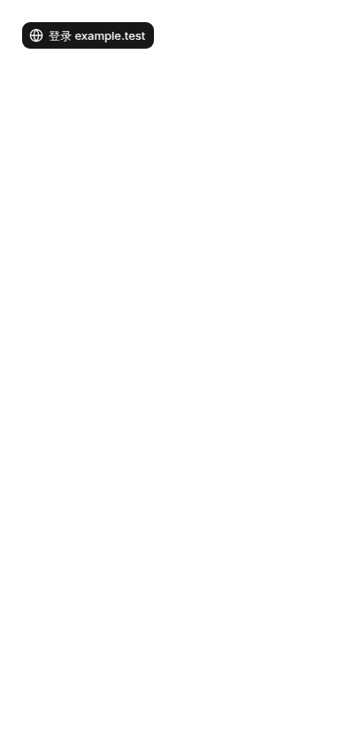
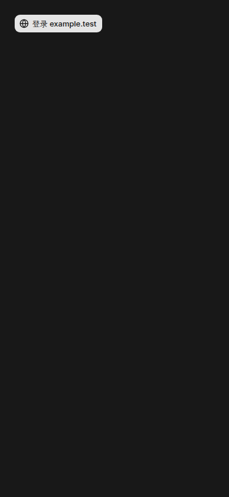
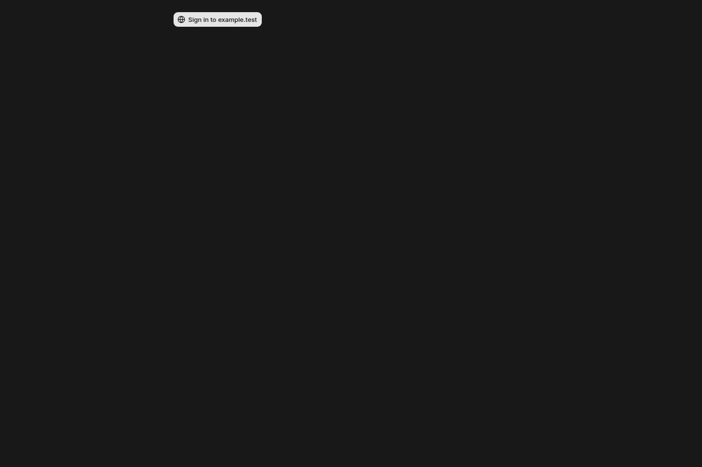
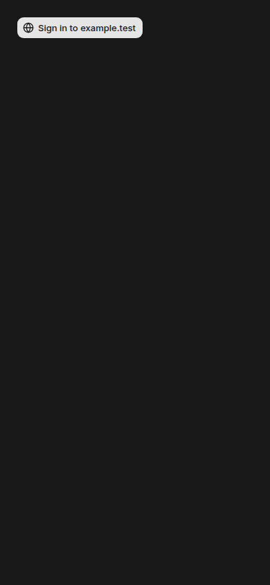

# #1231 Computer events — 520c397 本地构建与显示证据

本包固定应用提交 **`520c397e2f58cdc69dd5c6d75f6e8d83ffe2b103`**、Git 树 **`c342a69139192ce077a7738707aec788579c51e1`**。本轮实际生产构建、正常 TestAccountPool 认证、八张原图，以及真实浏览器前后台的游标补拉均通过。应用源文件未修改。

这是隔离本地证据。PR #1231 继续 draft；本包不证明生产 WebSocket、真实第三方登录、模型执行或正文要求的一小时性能验收，也不代替该提交的 GitHub CI 回执。

## 固定环境和实际执行

| 项目 | 记录 |
|---|---|
| 环境 | 已有 Vercel Cloud Sandbox，8 vCPU / 16 GiB，Linux |
| 应用 | 精确 checkout 520c397；构建前 HEAD、index tree、tracked/untracked 状态均检查 |
| Node / pnpm | 24.22.1 / 10.34.3（frozen lockfile） |
| PostgreSQL | 本机 PostgreSQL 17；唯一 loopback `mikka_c520_ui_29205cadff_e2e` |
| 临时角色 | `mikka_c520_ui_29205cadff`；随机真实密码，只在本进程/子进程环境及本机角色配置中使用 |
| 应用 origin | `http://localhost:3387`，Next production build + `next start` |
| TestPool | `local-24e8f208-5e93-42d5-b51b-71453ea8d8f1`，正常 Owner/peer 注册与登录 |
| 实际浏览器 | 原生 headed Chromium 156.0.8078.4、Playwright 1.64.1、独占 Xvfb |
| 认证/环境约束 | 未设置 CI；正常 attestation、origin、数据库身份与 exact build 约束保持 |
| Gateway | 本地未配置；真实 ticket GET 为 200，url/protocol/expiresAt 均 null |

新 worktree 的 `@mikka/protocol` 链接指向该 worktree 自己的 `packages/protocol`。第一次安装后的诊断误用了包未导出的 `@mikka/protocol/package.json` 路径，导致组合命令 exit1；pnpm 安装本身已成功。原始错误见 [preflight-diagnostic.json](preflight-diagnostic.json)，随后改用实际文件系统链接检查，没有改包的 export 或应用代码。

完整生命周期见 [runtime-manifest.json](runtime-manifest.json) 和原始日志：

| 阶段 | UTC | 退出码 |
|---|---|---|
| schema setup | 01:19:12.204–01:19:14.162 | 0 |
| TestPool bootstrap | 01:19:14.162–01:19:14.286 | 0 |
| production build（含迁移、Next 编译、类型检查） | 01:19:14.287–01:20:19.691 | 0 |
| 本地 `/api/version` 精确 SHA 核验 | 01:20:21.366 | 已匹配 520c397 |
| capture driver | 01:20:21.469–01:20:34.169 | 0 |

未修改原始应用 checkout；两个截图驱动位于应用目录外。没有调用 browser test runner、HTTP 拦截、伪造会话或可见性状态。

## 真实数据与前台补拉

预览沿用原组件 `SubagentLoginNeeds` → `CredentialLoginCard`，仅在本次本地服务启用既有 `MIKKA_CREDENTIAL_HARNESS` 入口。固定的 workspace/Bot/subagent 是明确的显示 fixture，没有云电脑，也不运行模型。Owner 是 TestAccountPool 正常认证产生的普通用户；真实 JSON 与 ticket 路由独立验证会话和 active workspace membership。

驱动在新的隔离数据库登记自有 Bot 资源，创建明确的 preview fixture 后，通过实际 `SubagentStore.update` 写入两条 `needs_you/login` 事件。API 返回这两条真实已提交事件，UI 只展示一个登录入口。它没有给浏览器提供伪造 JSON。

| 观察 | 实际记录 |
|---|---|
| 初始权威读取 | HTTP 200；2 条 `needs_you`；cursor `2` |
| 中文和英文页面 | 各读取实际 JSON；两条事件均去重为一张卡 |
| 真正后台状态 | `hidden`，2026-11-05 01:20:29.084Z |
| 触发方式 | 同一原生浏览器新建真实空白标签并置前；未注入 visibility 事件 |
| 后台期间的业务写入 | 实际 `SubagentStore.update` 提交 `running` 事件 |
| 回前台增量读取 | HTTP 200，`after=2` → `cursor=3`；仅事件 `3/running` |
| UI 结果 | 登录卡消失，01:20:29.122Z |

浏览器使用 `connectOverCDP({ noDefaults: true })` 的默认 context，避免普通 Playwright context 自动 focus emulation 把所有页面报成 visible。断言读取的是真实 `document.visibilityState`。这段约 38 毫秒的后台与补拉记录只证明接线和前台恢复，不能视为一分钟隐藏轮询测量，更不是一小时性能样本。

完整事件、时间、图片哈希、DOM 文本与环境限制在 [screenshots/manifest.json](screenshots/manifest.json)。

## 原图与视觉复核

下表链接均为原尺寸 PNG。八张图已逐一打开检查，且尺寸和 SHA-256 与 manifest 完全匹配。中英文完整可读，图标与文字不重叠，390 宽度无裁切，明暗主题对比清晰。root 于 01:24:28 UTC 独立核验八张原图哈希/尺寸，并通过两张拼版查看全部八图，结论见 [独立复核](INDEPENDENT-ROOT-REVIEW.md)。预览只展示既有登录入口，因此空白区域是组件预览的范围，不代表完整应用页面。

| 语言 / 尺寸 | 浅色 | 深色 |
|---|---|---|
| 中文 1440 × 960 | [原图](screenshots/zh-login-1440-light.png) | [原图](screenshots/zh-login-1440-dark.png) |
| 中文 390 × 844 | [原图](screenshots/zh-login-390-light.png) | [原图](screenshots/zh-login-390-dark.png) |
| English 1440 × 960 | [Original](screenshots/en-login-1440-light.png) | [Original](screenshots/en-login-1440-dark.png) |
| English 390 × 844 | [Original](screenshots/en-login-390-light.png) | [Original](screenshots/en-login-390-dark.png) |

| 用户任务 | 既有行为 | 本轮观察 |
|---|---|---|
| 看到子代理的登录请求 | 既有 CredentialLoginCard 登录入口 | 真实 JSON 读取后入口可见，Found / 严重度 0 |
| 同一子代理重复发请求 | 同一张卡 | 两条事件只展示一次，Found / 严重度 0 |
| 返回标签时获知子代理已继续 | 应移除旧登录入口 | 真后台/前台和增量读取后移除，Found / 严重度 0 |
| 输入第三方账号并实际登录 | 独立凭据流程 | 本轮未执行、未输入账号，不声称验收通过 |

本次没有设计新组件或改变文案/布局；R-90 复用和既有主线组件是视觉比较依据。没有新的 Figma 布局需要选择。确认了截图范围内的 R-30/31 对比、R-40 简洁文案和 R-42 中英文显示；复杂登录表单/OTP、权限拒绝和真实第三方登录没有由这八张入口截图覆盖。

## 保密、导出与清理

正常 TestPool 会话使用现有 helper 生成的私有 browser state。没有输出密码、cookies、原始认证响应、traces、HAR 或录屏。截图后先对截图目录执行现有凭证扫描，再对包含构建日志、驱动和截图的完整输出执行扫描：[full-evidence-audit.json](full-evidence-audit.json) 的 24 个文件通过已知凭证/cookie 检查。之后才清理私有材料。扫描不代替肉眼复核；八张原图也都已检查，没有凭证内容。

- 01:20:34.249Z：Next 和本任务 Xvfb 均退出；确认零 client backend 后，普通 DROP 本任务数据库，再 DROP 临时角色，catalog 均 absent。
- TestPool pair 按 dirty/quarantined 释放，不声称含 fixture 的账号可干净复用。随后整个自有数据库被删除，fixture 一并回收。
- 01:21:24.161Z：本任务私有 TestPool state 和 descriptor 目录移除。见 [private-cleanup.json](private-cleanup.json)。
- 未修改共享 PostgreSQL 权限、未停止共享沙盒或其他执行者进程，没有生产写入、模型调用或实际外部站点登录。

完整远端导出包 **52,415 bytes**，SHA-256 **`63b55c7b74374b878b20ef5e469b48810e1d104a498fe02a42059394c579ade8`**。本地解包后，原始 manifest 的全部 27 个文件逐个字节数、Git blob SHA-1、SHA-256 匹配；原始 `file-manifest.json` 自身不列入自己的清单。本说明和后续独立评审作为额外文本保存，不改原始回执。

## 后续

本轮截图和行为记录只属于 520c397，不挪用为其他提交的构建结果。PR #1231 的当前 CI、正文要求的固定一小时前后数据，以及合并后 Web deploy、公开 version、真实 Owner/三条模型路径与 Gateway 验收仍由对应主线流程处理。这里没有合并或部署应用。

Refs: #1212 (C), #1231, #1211.
