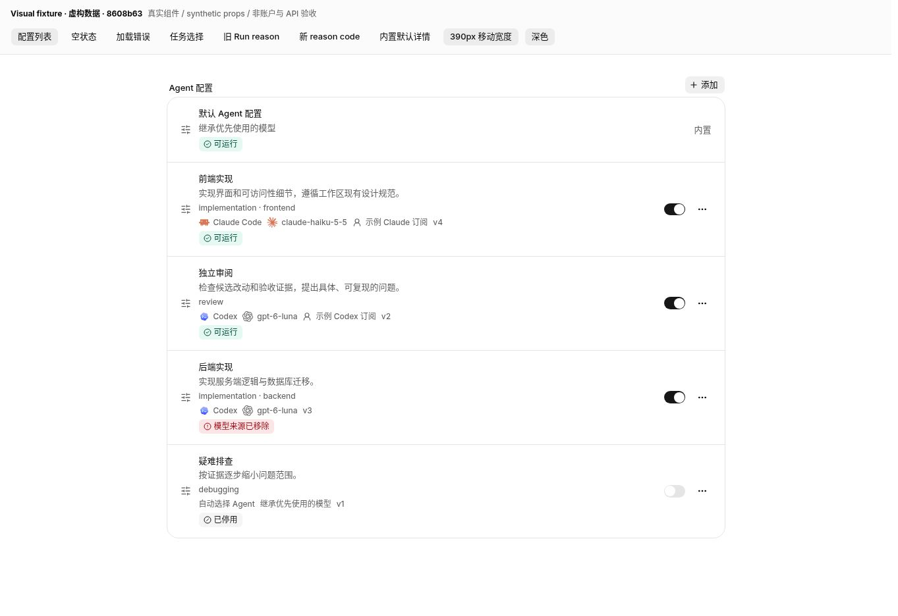
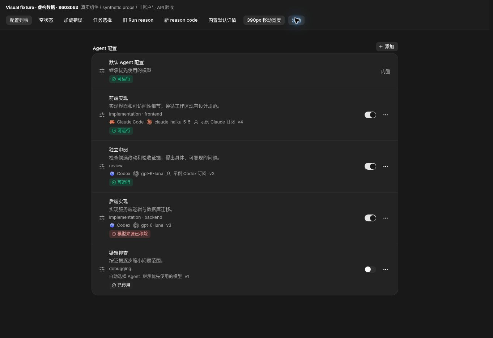
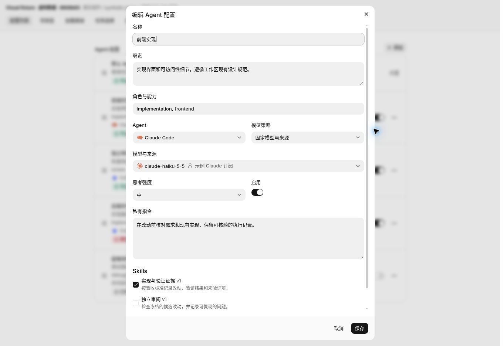
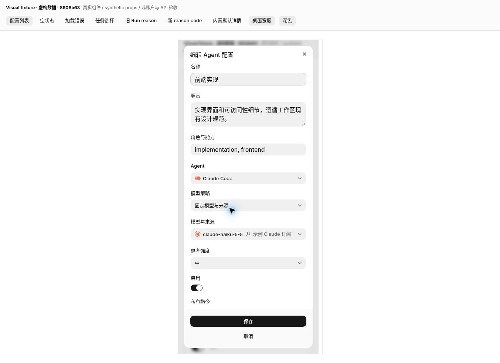
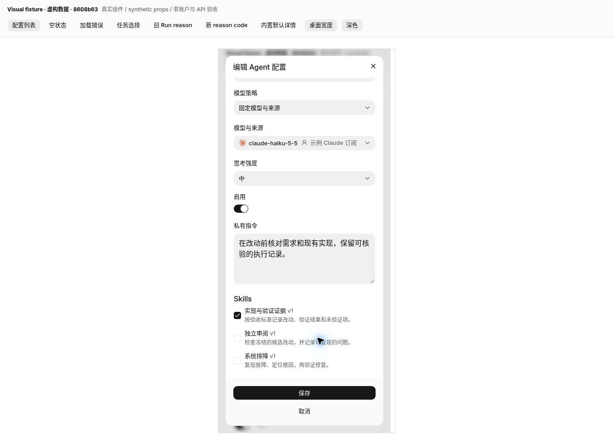
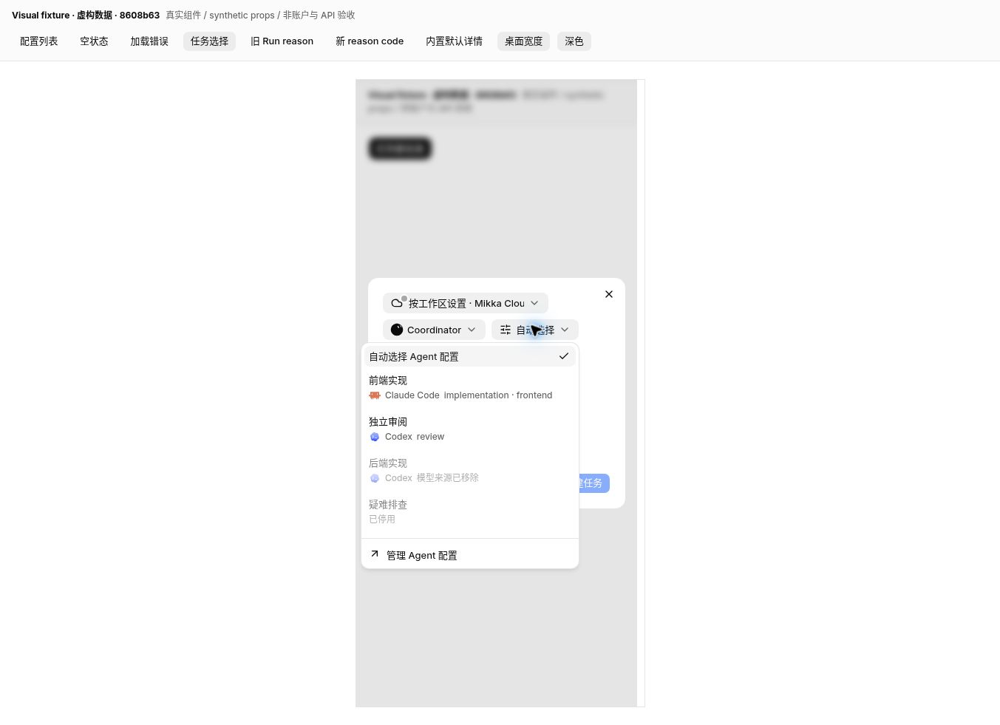
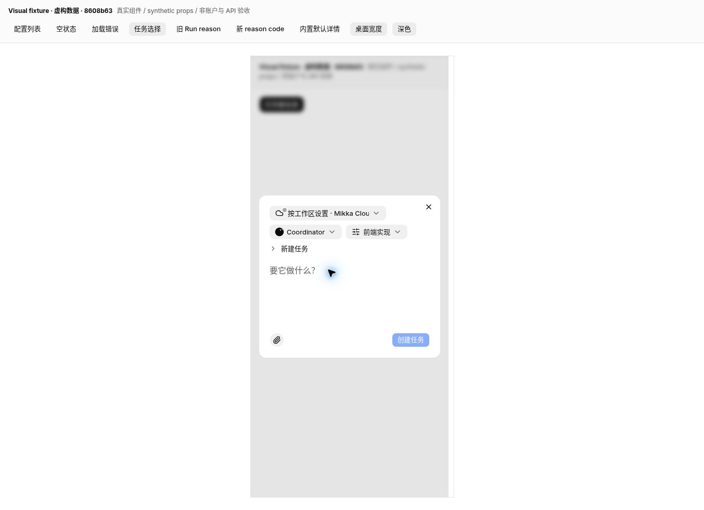
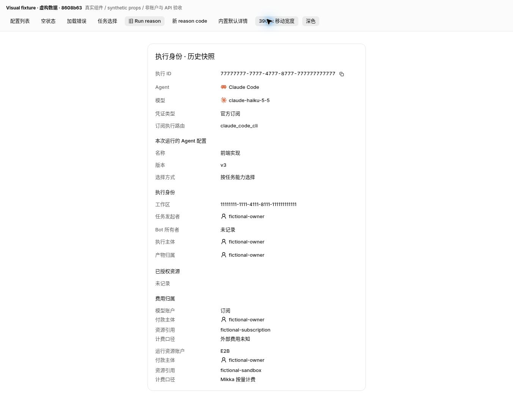
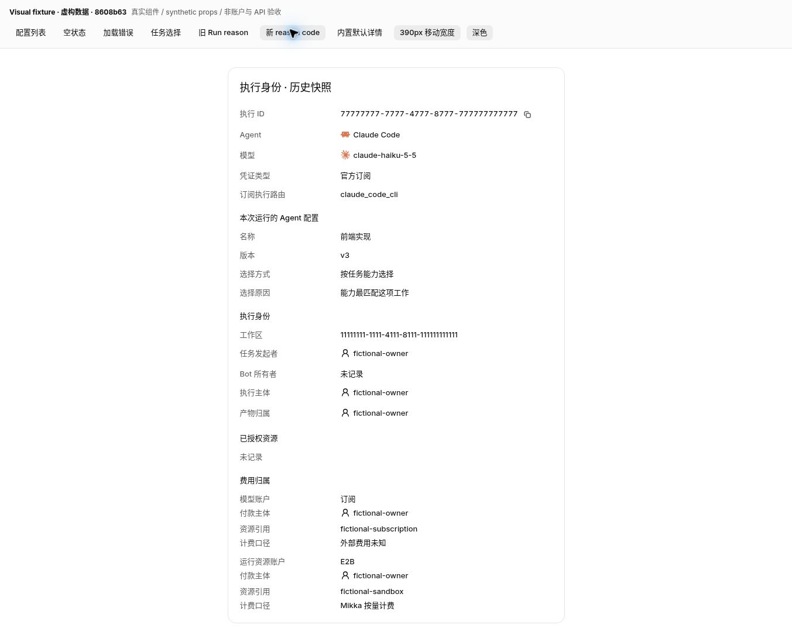

# PR #1313 · 8608b63 组件视觉检查

**结论：本轮指定的四组界面未见视觉阻断。** 本报告仅证明真实组件在合成数据下的渲染和手工交互，不证明登录、授权、真实 API、模型执行或生产验收。

- 源码：`8608b63f522e6bbb8db8fc0caac7f606f17cf218`；tree：`ff973ac99fea66a4d97a757c1475103363fb21c4`。两个构建前后源码均干净。
- 组件直接从 `/workspace/Mikka` 导入，使用实际生产样式、中文翻译与组件；未修改 tracked 产品代码。
- 临时独立项目：`/workspace/issue1284-visual`，使用 `pnpm exec next build` + `next start`，端口 3111；不依赖 3110、数据库或 TestAccountPool。
- 数据边界：Profiles/catalog/availability、Bot/运行位置、冻结 Run 身份均为虚构；SWR 返回合成值，依赖替身禁止账号、提交和写操作。没有调用真实模型。
- 桌面固定浏览器视口 **1363 × 936**。移动检查是该浏览器内 **390 × 848** 的 iframe 内容视口，外框含边框 392px；不是原生移动设备或粗指针测试。
- 首次 fixture build：`fxfe5Eos05LO05IyBFUCD`（2026-11-05T03:18:20.602Z → 2026-11-05T03:18:36.148Z）。
- 移动容器边框尺寸校正后的 fixture build：`m3pSOwiX1xaJ1hJ3_E9MY`（2026-11-05T03:21:53.991Z → 2026-11-05T03:21:57.784Z）。只改临时容器宽度；组件源文件相同。
- UI 源文件哈希目录摘要：`99b443a0f559a762bc3286355f434dbcc8faf8d09683a5526f7661d317529731`。逐文件与截图 SHA256 见同目录 JSON receipt。

## 手工检查结果

| 检查点 | 结果与边界 |
| --- | --- |
| 列表状态徽章 | 可运行、已停用、模型来源已移除都有图标、文字和共享状态颜色，浅/深色均可读。 |
| 编辑表单 | 固定来源字段、角色、思考强度、启用、私有指令与 Skills 都可见；移动端单列，表单可以纵向滚动，保存/取消栏保持可见；未提交保存。 |
| 新任务选择器 | 真实 NewTaskDialog；390px 中下拉完整，两个不可用项禁用并显示原因，管理入口可见；选择前端实现后 chip 更新，箭头与新建任务标题同组换行；未发起任务，未打开管理页。 |
| 旧 Run 兼容 | 合成旧快照保留 v3（列表为 v4），显示按任务能力选择，不渲染旧英文理由，也不重复一条中性理由。 |
| 新 reason code | capability_fit 渲染为中文“能力最匹配这项工作”；运行 Agent/模型与官方订阅字段保留。 |
| 证据限制 | 没有浏览器测试套件、真实账户写操作或生产 UI 操作。最终 Owner/API/CC→Codex 验收由主线记录。 |

## 截图

### 列表浅色：内置默认、可运行、已停用、来源移除

`1363 × 936` · build `fxfe5Eos05LO05IyBFUCD`

### 列表深色：共享状态颜色、图标、文字

`1363 × 936` · build `fxfe5Eos05LO05IyBFUCD`

### 桌面编辑：固定 Agent/模型/来源、角色、强度、私有指令、Skills

`1363 × 936` · build `fxfe5Eos05LO05IyBFUCD`

### 390px 编辑：单列字段与固定保存/取消栏

`1353 × 981` · build `m3pSOwiX1xaJ1hJ3_E9MY`

### 390px 编辑滚动：私有指令、Skills 与保存/取消栏

`1353 × 981` · build `m3pSOwiX1xaJ1hJ3_E9MY`

### 390px 新任务：真实标题行与展开菜单；不可用项禁用

`1353 × 981` · build `m3pSOwiX1xaJ1hJ3_E9MY`

### 390px 新任务：显式选中前端实现；箭头与标题一起换行

`1353 × 981` · build `m3pSOwiX1xaJ1hJ3_E9MY`

### 旧 Run：v3 冻结数据、按任务能力选择；旧英文 reason 不显示

`1353 × 1066` · build `m3pSOwiX1xaJ1hJ3_E9MY`

### 新 Run：capability_fit 显示中文“能力最匹配这项工作”

`1353 × 1098` · build `m3pSOwiX1xaJ1hJ3_E9MY`

## 后续版本复用核对

以下 SHA256 来自精确 `8608b63` Git blob；截图来源标记保持该 SHA，不改成后续 head。只有相关 UI、样式、翻译和 definition 字节相同才复用这些布局证据；后端/API/生产结果单独验收。

| 文件 | SHA256 |
| --- | --- |
| `components/coordinator/new-task-dialog.tsx` | `9eb91b10991d3880001dc8dc0a5b409b83276bd012bcc3ac20de1b024b5b6c2c` |
| `components/coordinator/task-profile-picker.tsx` | `39fde1614e269e25f09a45b1f585ee6492654b8407629c14d99304841eee8615` |
| `components/settings/factory-profiles-settings.tsx` | `d9f9b13d4fb01aff944bf4f8f9f7049199cf2ca65fae2058d1d2644aa415136e` |
| `components/settings/factory-profiles-data.ts` | `adaf9852b7bdfaeda3d2b68510e93f4fd1a607004a4ab054119c767ccd41452f` |
| `components/workspace/thread-execution-identity.tsx` | `b003c008afdf787f1faacdded487a1aab150f22ac53a3b705b31e8ad8c71e972` |
| `lib/factory/agent-profile-decision.ts` | `834a175af3dffa09dd94f33ece58e6cb50b72917cde356b7bf99d8a6af59d23d` |
| `lib/thread-execution-identity-view.ts` | `e76a523f06de06e73cf10c60045f7ad395dda7721025ea22d596d6b4b6ea9e39` |
| `messages/zh-CN.json` | `df177fd58c1c30178bf29727c8c887c7f628b030a328ee11bb9bc1232564cc98` |
| `app/globals.css` | `00ccc3f687f114aa3852579cf436944b76dc6a28995370306039b1313243136d` |
| `messages/en.json` | `aef8ad02c779d1ae7fe1135701889b5e6fca97fff539cd84826ad17f6e680dfc` |
| `lib/factory/agent-profile-definition.ts` | `60b8b053e680bd6a0d2584a09887fecda9d50e96142b1e2d82b026be117c5ae5` |

独立 3111 fixture 已停止，专属浏览器 tab 17 已关闭；未操作生产 tab 8。临时 fixture 源码和构建日志保留用于复现。
