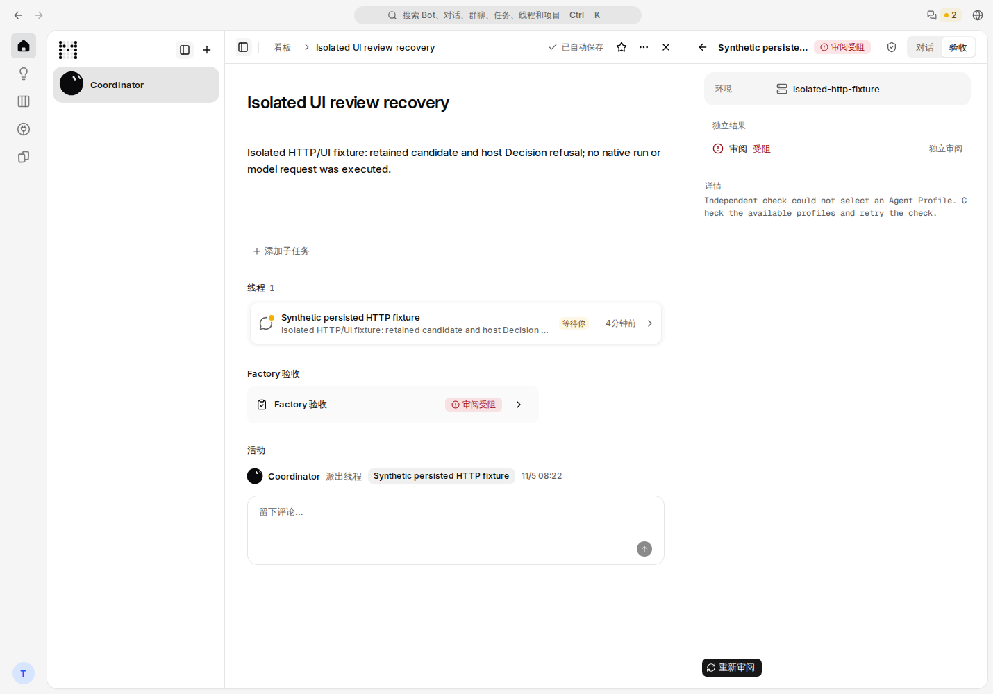
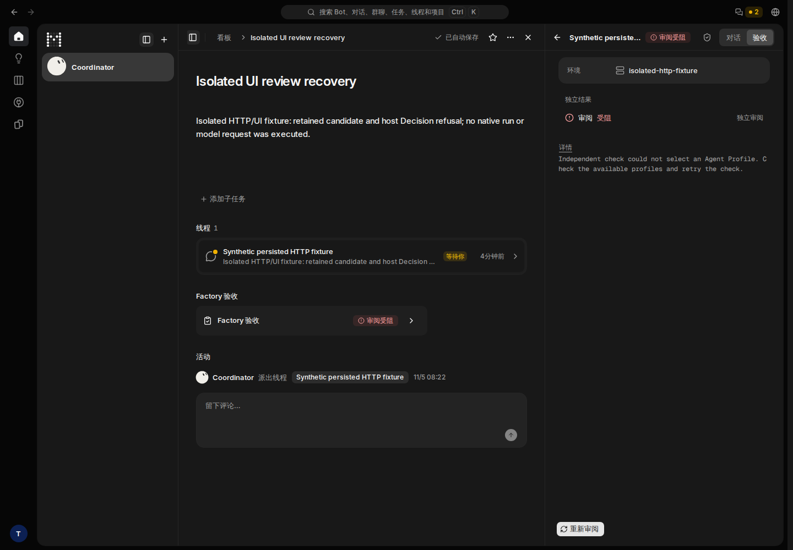
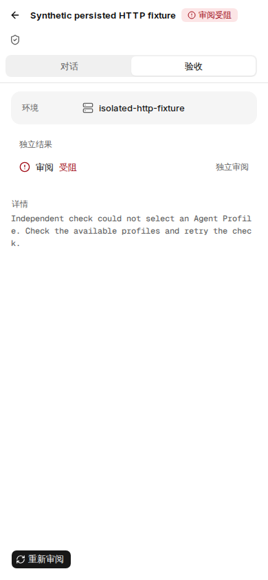
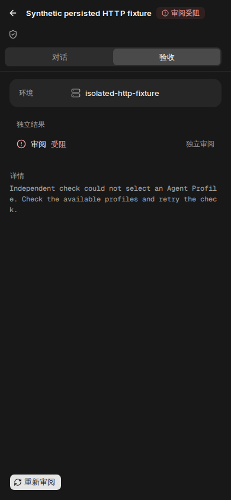

# #1284：Profile 诊断与独立审阅恢复

本页记录发布批次 [#1358](https://github.com/alexj11324/Mikka/pull/1358) 的隔离验证。当前提交 **5251a6bfeda13c2e6c300dfba5fa0841ee0e9f8a**，tree **d1397ffac0a07e2a8a62290a161839d44a2b0a97**。这里的测试和截图不代替真实生产订阅验收。

## 已验证结果

| 范围 | 真实版本与结果 |
| --- | --- |
| 当前 GitHub CI | 5251：17 success、1 预期 OIDC skip；[CI41994845571](https://github.com/alexj11324/Mikka/actions/runs/41994845571)。[完整检查与合并预览树](ci-5251.json) |
| 最新主线整合 | 实际在本地585c运行、与远端5251同树：136/136，0失败、0跳过；其中96真实PG＋40单元/严格claim夹具。types、lint、diff通过；[整合与清理收据](integration-536.json) |
| 当前完整构建 | exact5251，08:36:38–08:38:40 UTC，pnpm build exit0，严格Next服务attestation通过；[构建收据](build-5251.json) |
| 当前真实HTTP | exact5251，08:40:10–08:40:27 UTC，正常TestAccountPool登录与真实Next/session路由，51/51；两个独立fixture及会话均正常清理；[完整脱敏收据](http-5251.json) |
| 旧批次完整门禁 | exact42b：276/276、UI91＋thread44、types/lint/完整构建通过；[当时证据](source-42b/README.md)。这些结果没有改标为5251执行 |
| 旧批次真实HTTP | exact42b：51/51，HTTP与视觉fixture分开，未回写HTTP任务历史；[收据](http-42b.json) |
| 页面复核 | exact42b实际production build的1440×1000／390×844浅深色四图；[拍摄收据](ui-42b/capture-receipt.json)。36个相关文件与4个语言子树逐项核对后用于5251；[复用说明](ui-42b/visual-reuse-5251.json) |

34项completion数据库测试调用领域handleFactory，使用合成actor；它们不是Next/session正常HTTP。上表的51项真实HTTP包括27项Profile管理与24项恢复合同，单独经过正常登录、严格部署识别和监听端口。

## 恢复合同

真实HTTP确认：Owner可读取同一Task、候选与当前attempt；其他用户和匿名访问被拒绝。正常Retry保留候选，生成新pending attempt，revision增加1且Run仍为null；同事件重放保持同一回执，旧revision被拒绝，恢复提示随当前状态消失，没有重复Run。

这个pending回执仅表示接受恢复请求。后续由既有每分钟watchdog从同Task最近execute attempt取得producer/source，再执行真实Profile选择、授权和启动。仍可能遇到新的合法拒绝，必须在生产实际观察Review Run与结果；不能把HTTP 200或pending称为Codex已完成审阅。

## 实际页面截图

图中是明确标识的隔离合成数据，没有原生模型执行。浏览器只做正常页面导航和截图，没有运行浏览器测试套件或点击Retry。初次采集处于布局过渡，原文件另存；以下是等待实际原因正文可见、正常过渡结束后的稳定画面，未改CSS、隐藏元素或修图。

| 桌面浅色 | 桌面深色 |
| --- | --- |
|  |  |

| 手机浅色 | 手机深色 |
| --- | --- |
|  |  |

5251没有重新拍摄这些图。它保留画面涉及的验收面板、线程、Tabs、原因展示、样式和语言内容；新进入主线的New task Default选择器不在这些画面内，其自身证据归属#1355。

## 保留的失败与边界

- ALEX66原始首次claim拒绝原因仍未知。此批为拒绝补充闭集合诊断，不能用隔离测试通过宣称原生产根因已修。
- ALEX67的pre-Run Review Decision拒绝曾回滚完成事务。隔离回归验证了候选保留和局部阻断；真实生产恢复另行记录。
- source6f的严格模块夹具曾出现90项中5项失败；仅补入真实coded-error模块映射后通过，原失败保留。
- main7ca的daemon临时标记ENOENT与发布守卫拒绝独立保留；同SHA另一个job通过，但具体时序原因未确定，本批没有宣称修复它。
- 旧HTTP准备脚本的模块路径、UUID/text参数推断、只读入口误用均保留。改为现有正式runtime入口后通过，没有关闭产品迁移或授权守卫。最终5251的相同51项首次执行通过。

全部开发、复现、构建和隔离测试使用Docker Cloud Sandbox Large（8vCPU／16GiB）、Node24／PG17。各门禁仅清理自身隔离数据库、角色、fixture和会话，未操作生产数据库。临时备用实例仅bootstrap并已停止。

**API DeepSeek路径按Alex指示跳过：用户说明余额不足，本轮未检查余额或发送付费请求。** 本页不报告该路径通过。

## 生产验收状态

本证据编制时，5251尚待正常合并部署后的真实验收。后续须核对Vercel READY和公开serving commit，回到既有Owner的原任务，验证CC真实执行、Codex独立审阅、同一候选及Owner Accept，再完成显式Profile和版本/管理检查。#1284在这些功能验收完成前保持打开。

本目录只含脱敏结构化记录、日志哈希与真实页面图片；不含凭据、cookie、测试账号、生产私有指令或原始敏感日志。

