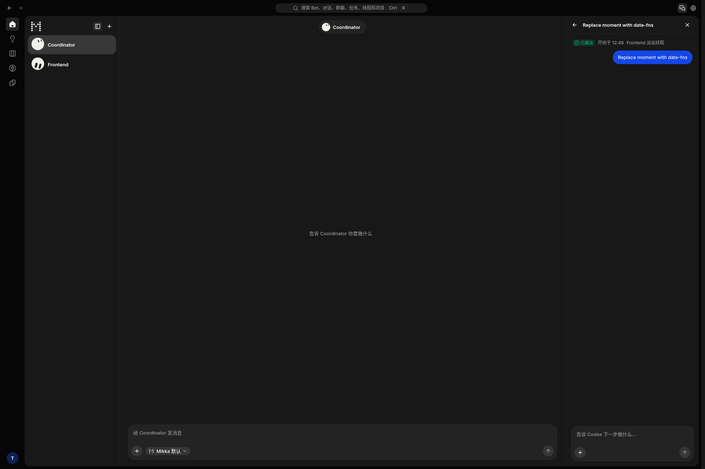
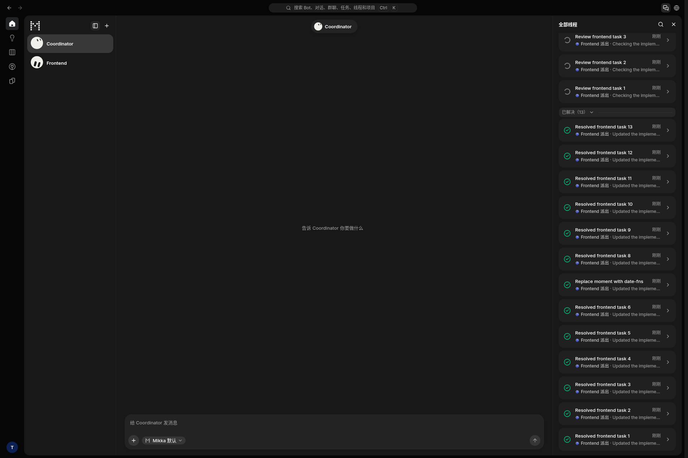

# Navigation state — local production screenshots

- Built revision: `a36c8e62` (the later rebase adds documentation only).
- Origin: `http://localhost:3000/mikka`.
- Runtime: Next.js 16.4.1, cloud Linux, PostgreSQL 17, disposable `mikka_e2e`.
- Identity: normal test-account allocator, owner/peer leases and normal Better
  Auth registration/session flow. Credentials and browser state are excluded.
- Review: resolved expansion, visible row order and scroll position match before
  and after reopening the list. The transcript keeps the shared composer.
- No new Figma layout: this is a behavior correction to the existing R-52/R-82
  screen. No copy, color or layout change is introduced.

| Saved list | Open thread | Returned list |
| --- | --- | --- |
|  |  |  |
