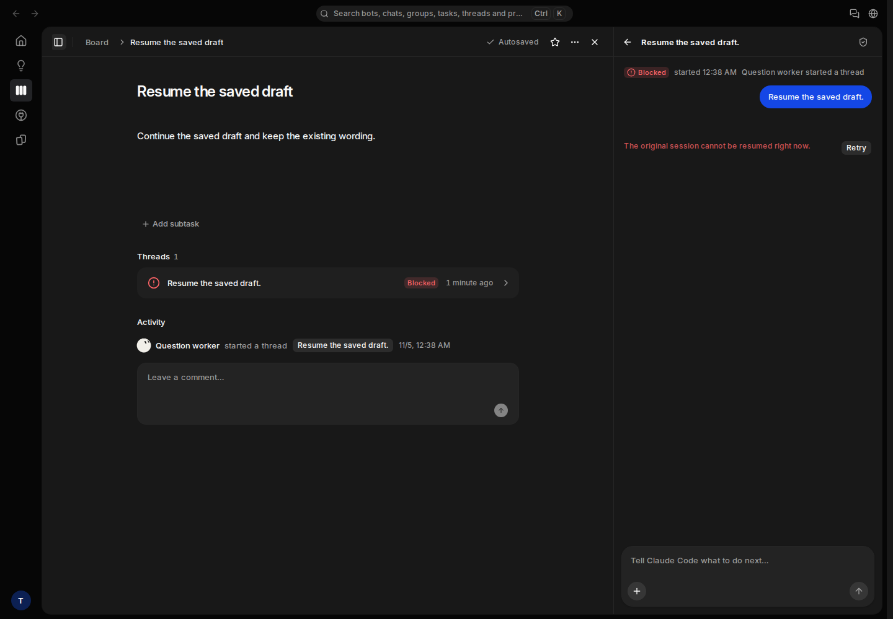
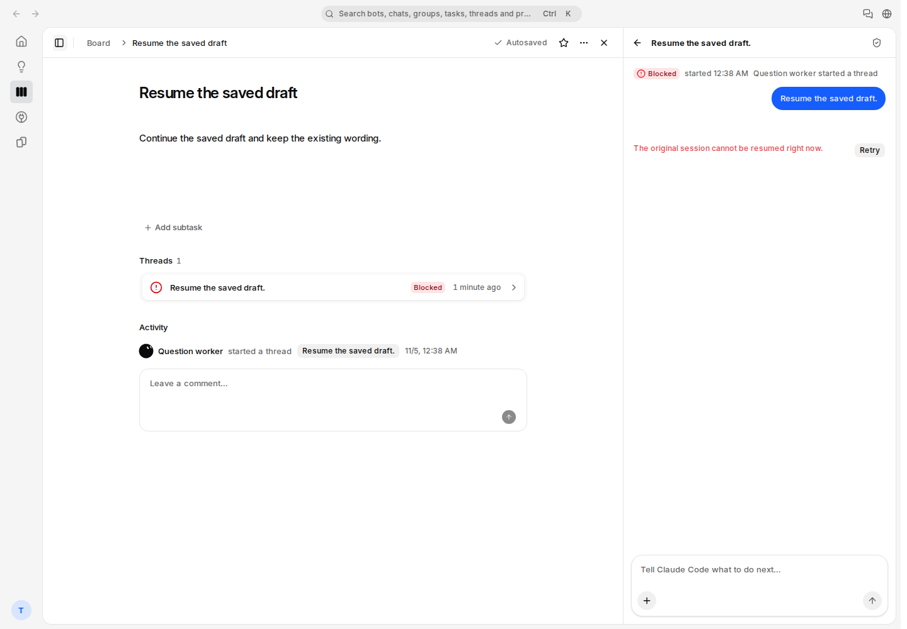
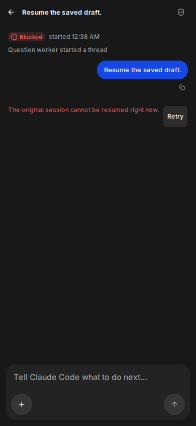

# #1225 · 原线程启动恢复审阅

> 本文保留当次版本的三路模型证据与失败。现行验收使用共享 SMOKE 账号，
> 官方 Claude Code 与 Codex 两条订阅路径独立记录。DeepSeek/API-key 路径
> 已退出合并及验收门槛，后续执行按 [验收指南](../../acceptance.md)。

**本地生产构建、正常账号/API、四张截图和清理审计均已完成。** 本页审阅源码为 `2a47d51e856f49a0a2e521319a137a55185507a1`；该提交的五个 CI 工作流全绿。独立负责人 root 已于 2026-11-05 约 00:45 UTC 逐张图审并签字通过；本页与图片提交后的新 head 仍须重新通过 required checks。这里没有把隔离 fixture 当成生产模型验收，也没有宣称完整 `pnpm test:local-loop` 已运行。

## 版本和环境

| 项目 | 实际证据 |
| --- | --- |
| Issue / PR | [#1225](https://github.com/alexj11324/Mikka/issues/1225) / [#1287](https://github.com/alexj11324/Mikka/pull/1287) |
| 分支 / 源码 | `fix/1225-question-wake-recovery` / `2a47d51e856f49a0a2e521319a137a55185507a1` |
| 源码 tree | `efdbdb696de1b2db134787fe9579ff1540079ddb` |
| 规则依据 | main `fc2d401b…` 的 [AGENTS.md](../../../AGENTS.md)、[review-checklist](../../review-checklist.md)、[设计来源优先级](../../design/README.md) 与 R-90 |
| 环境 | 唯一的 Docker Cloud Sandbox；Linux、8 CPU / 16 GiB；Node 24.22.1、pnpm 10.34.3、隔离 PostgreSQL 17 |
| 运行方式 | `pnpm build` → `pnpm exec next start`，origin `http://localhost:3110`；没有运行浏览器测试套件 |
| 生产构建 | exit 0，78,824 ms；Next build ID `ax91jSUdk8TQ40z-gNETM` |
| 版本回读 | `/mikka/api/version` 的 `build` 为完整源码 SHA `2a47d51e856f49a0a2e521319a137a55185507a1` |
| 本轮 UTC | 2026-11-05 00:37:03.179–00:38:41.103 |
| 身份和数据库 | 正常 `acquireTestAccounts` Owner/peer 租约及真实登录会话；runner 拥有的临时数据库/角色，原 attestation、origin、数据库身份和 lease 检查均保留 |
| 原始报告 | [capture/API/cleanup report](question-wake-report.json)、[build proof](question-wake-build-proof.json)、[evidence audit](question-wake-evidence-audit.json) |

真实问题是：Owner 的答复已提交，原 question child 在四次 handoff 失败后仍 queued、没有 claim，线程里没有恢复入口。发生 6/10 × 影响 7/10 = **42**。`33151162…` 的第一次实际图审又发现同一线程在列表显示 Running、详情显示 Blocked，发生 7/10 × 影响 4/10 = **28**；本 PR 已把安全 wake 投影移到列表与详情共用的读取入口。

修复复用同一个 child、原始 VM、原生 SID 和冻结模型，保留 Owner/workspace、epoch、attempt、取消、过期和 lease 边界。宿主最多自动尝试三代；换代前确认旧 workflow 已终止且原机器 lease 空闲。现有 Retry 只请求用户观察到的失败代，不重放答复、不新建 run/attempt、不换机器。运行在实际 claim 前仍保持 queued 和空 startedAt/SID。

## 用户走查：task | before | after

| task（用户目标） | before | after / 证据 |
| --- | --- | --- |
| 回答问题后继续原工作 | handoff 耗尽后一直恢复中，未 claim 且无下一步。**Present but insufficient，severity 3**。 | 已提交答复成为同一个 child 的持久启动意图；预算耗尽后显示 Blocked 和现有 Retry。宿主真实 PG 回归通过；外部原会话生产接续须在部署后单独验收。 |
| 从任务的线程列表判断是否还在工作 | `33151162…` 实际图中，列表 Running/旋转图标与详情 Blocked 矛盾。**Present but insufficient，severity 3**。 | 列表和详情共用 Owner-only wake receipt；两处均为 Blocked、无 Running/spinner。旧实现 red → 新实现 green；下方桌面三图直接确认。 |
| 从原链接或 child 直接链接找到失败原因 | 原 queued continuation 缺恢复入口；直接 child 没有根线程的 continuation 投影。**Missing，severity 3**。 | 两个链接都显示相同错误和 Retry，继续使用同一线程内容与组件。投影/action 回归及截图 1、2 通过。 |
| 在失败处重试一次，或误点两次 | 无正常恢复入口。**Missing，severity 3**。 | 既有 Retry 携带已观察的 generation；并发同代请求复用同一预约 child，陈旧代被拒绝。数据库和 action 回归通过；截图只证明入口可见，未点击 Retry。 |
| 避免把已提交答复再发成新任务 | 恢复中禁用普通 Send，却没有失败恢复动作。**Present but insufficient，severity 2**。 | 普通 Send 的 resuming guard 保留，恢复动作使用原 Retry；composer 保留既有布局和草稿逻辑，截图可见禁用发送。 |
| 取消、停止或问题过期后查看历史 | 停止与取消是已有执行边界。 | 不清除 stop/cancel/expiry；旧 epoch/attempt、错误 owner/receipt、失效原机器不启动。真实 PG 与 action 负向回归通过，不把历史 queued 伪称为成功。 |
| 另一账号尝试打开 Owner 私有线程 | 不应读取或恢复该线程。 | 正常 Owner 对原/child 均 200，peer 均 404；成员列表回归确认不会暴露 Owner wake receipt。无访问权 peer 的测试不等同于具备其他观看权限的成员 UI 走查。 |
| 首次遇到失败，或在窄屏找到下一步 | 必须离开线程寻找不绑定此 child 的 Computer Wake。**Missing，severity 3**。 | 原失败行的 Retry 在桌面和 390×844 触屏上下文首屏可见。明暗主题均可辨认；未另做键盘操作或真实触控点击验收。 |

## 组件复用（R-90）

按 [components.md](../../design/components.md) 和当前 main 既有线程 UI 核对。没有新增、重画或删除组件，也没有改变布局 token。布局基准为 [main-is-the-design](../../design/decisions/2026-11-01-0015-main-is-the-design.md)；本次没有新增 Figma frame，不声称存在未取得的对应 accepted frame。

| 屏幕部分 | 复用的既有组件 | 变化 |
| --- | --- | --- |
| 线程列表及状态 | `IssueThreads`、`ThreadStatus`、`ThreadStatusIcon` | 现有 `threadQuestionView` 获得与详情相同的安全 wake 字段。 |
| 原链接和直接 child 详情 | `IssueThreadPanel` / `ThreadPanel` | 使用原对话、状态和失败位置；不产生第二套线程 UI。 |
| Prompt、步骤和回复 | `ThreadSteps`、`PersonBubble`、`AgentMarkdown`、`MessageActions` | 保留原组件。 |
| 失败信息及恢复动作 | 原 `failureLine`、既有 shared `Button` Retry | 显示已核验失败，并传递该 generation；保留原尺寸、禁用和触屏规则。 |
| 输入和请求错误 | `ChatComposer`、`InputGroup` / `InputGroupTextarea`、`FieldError`、`useActionError` | 保留原输入与错误流程，不增加新的恢复表单。 |

用户文案复用 `Errors.threadRecoveryUnavailable`：中文“暂时无法恢复原会话。”、英文“The original session cannot be resumed right now.”；按钮复用 `IssueThreads.retry`。未新增 i18n 键。后台及 API 继续保存固定安全错误 `Original session could not start`，显示层本地化不改宿主错误记录。

## 四张实际截图

所有图片均来自上方 exact head 的本地生产构建，未编辑。四个 capture 均 `ready=true`、`pageErrors=[]`。桌面为 1440×1000；手机为 390×844，浏览器使用 `isMobile=true`、`hasTouch=true`，仅用于截图，没有点击恢复动作。

### 1. 原线程 · 深色桌面

列表和详情均为 Blocked；原任务说明正常，错误、现有 Retry 与底部 composer 完整可见。

### 2. child 直接链接 · 深色桌面

直接 child 链接显示同一安全失败和恢复入口；列表同样 Blocked，无持续运行图标。

### 3. 原线程 · 浅色桌面

浅色下两处状态、错误与按钮清楚，保持原线程组件外观。

### 4. 原线程 · 深色触屏上下文

失败文案和 Retry 首屏可见；触屏尺寸按钮与 composer 完整，无横向截断。此图不证明已经执行点击或恢复。

| 图片 | SHA-256 |
| --- | --- |
| `question-wake-origin-dark-desktop.png` | `3177b0940ced34556af3933489069dcc8d93d787fb5da00a3f69215a41e4b474` |
| `question-wake-child-dark-desktop.png` | `25ea2a3be65a0c3452764b0d09897c362ccb87b0ae34fd628f2be8b362733ed4` |
| `question-wake-origin-light-desktop.png` | `01c2e8d02c442de7fcdbbc01377f5bbed5819ca783635ecb481fe33b07cbbb88` |
| `question-wake-origin-dark-mobile.png` | `461bbfd040c9f101f5f75332ee57d5b01932d8baf7b624219fdecd9959587ea4` |

## 正常 HTTP、测试和清理

| 检查 | 实际结果 / 版本边界 |
| --- | --- |
| 宿主及 UI 回归 red | 旧宿主 14 项 / 11 pass / 3 fail，主失败为实际 wake 列表为空；旧 UI/action 21 项 / 16 pass / 5 fail；direct-child 16 项 / 15 pass / 1 fail；均 0 skip。 |
| 原宿主与答复回归 green | Docker v2 数据库/UI/actions 157/157；v3 定点 21/21；最终 thread-answer 25/25，均 0 skip；相关 API/CLI driver unit 11/11。最终 12 文件匹配 `274dd7…`，后续未改变此宿主实现。 |
| 列表一致性 red → green | 旧 `33151162…` 26 项 / 24 pass / 2 fail / 0 skip，主失败 running ≠ failed；新 `3a15e97b…` **26/26、0 skip**，typecheck/lint exit 0（00:32:45–00:33:01 UTC），产品源码与最终2a47相同。 |
| 最终 `pnpm test:issues` | exact `2a47d51e…`，**364/364 pass、0 fail/skip、exit 0**，00:35:43–00:36:11 UTC，13 文件 manifest 匹配；日志确认新增 action 回归实际执行。 |
| 最终源码 CI | 00:39:59 UTC 复核全绿：[CI](https://github.com/alexj11324/Mikka/actions/runs/41942248845)、[Analytics SSR](https://github.com/alexj11324/Mikka/actions/runs/41942248813)、[Browser gate](https://github.com/alexj11324/Mikka/actions/runs/41942248772)、[E2B custody](https://github.com/alexj11324/Mikka/actions/runs/41942248718)、[official runtime](https://github.com/alexj11324/Mikka/actions/runs/41942248591)。Source/core/integration/daemon/DB1–4/UI policy/required aggregate 均 success；OIDC 为正常条件跳过。 |
| 正常账号初始化 | 原 helper 完整通过；HTTP attestation 200；Owner/peer 的 workspace、Coordinator、landing 六次读取均 200。 |
| 原 run `1a12c02c-50d4-4d65-907f-81ea5ce11cdd` | Owner 200、peer 404，返回请求中的同一 run ID。 |
| child `5da1ba45-2cff-496a-a8b8-10b82a3bbd16` | Owner 200、peer 404，返回请求中的同一 run ID。 |
| 四图 / 错误 | 四张均 ready，无 page error；本轮 `completed=true`，evidence audit passed。 |
| 清理 | browser、fixture、lease、server、数据库连接、临时 DB 和角色共七项全通过；fixture 清理后、lease 释放后 ownedRows 差异均 `[]`，账号池回到 available。只清本轮数据，保留原校验。 |
| 证据提交后的最新 head | **待提交后重新验证**；上述 CI 仅对应源码2a47，不冒充未来证据提交的 CI。 |

正常线程 API 此处只证明身份、可读性及 peer 隔离。它按原移动端规则把 queued 映射为 running/active；这些字段不是 worker claim，也不是网页 wake failure 投影的证据。网页状态由四张实际截图与 action 回归共同确认。原始报告保持自动生成内容，人工图审另记于下节。

## 独立审阅

- `docker_ready`、`continuation_launch` 与 `acceptance_ui_audit` 已各自逐张打开全部原始 PNG；列表/详情一致性、原链接/child、主题和窄屏恢复入口检查未发现剩余相关视觉阻塞。
- 独立负责人 **root：图审通过，2026-11-05 约 00:45 UTC**。root 分别打开四张原 PNG，确认桌面列表/详情一致 Blocked，无 Running/spinner；主题可读、描述正常，手机错误/Retry完整、Send为灰态，仅含隔离fixture内容，无Owner生产信息。本次相关的 R-84/R-90组件复用、R-87状态区分、R-88密度、R-89首屏恢复入口及 R-10/31/33/40/42 UI/copy 检查通过，未留下 severity 3/4 的相关视觉问题。此范围无新产物入口或问题表单，不重做 R-85/86 所指全产品设计。
- 独立源码整合审阅已核对 GitHub 合成 merge `025f13494b9a07c6dbafd557b5e7a8fb82581585`（331→fc2）：question wake 与已上线 #1288 普通启动 lease 处理兼容。root 随后独审列表投影和 CI 接线增量，未发现具体整合阻塞。
- 未执行键盘导航/真实触控点击；也未通过截图 runner 点击 Retry。动作的同代幂等、原 machine/session、取消、Owner/epoch/attempt 边界由实际 action/PG 回归覆盖，真实模型接续由生产验收覆盖。

## 外部模型与生产验收边界

**整条外部模型 driver 未在隔离截图环境运行，未声明完整 `pnpm test:local-loop` 通过。** 隔离环境未提供真实订阅凭据；用户明确要求三条外部路径使用现有 Owner 的正常生产 UI。此次正常 HTTP/API、相关 API/CLI unit 和真实 PostgreSQL 结果已逐项记录，没有索要或导出生产订阅凭据。

| 独立路径 | 真实生产 run / claim | 结果和公开记录 |
| --- | --- | --- |
| API key · `deepseek-flash` | ALEX49 `488aefa9-4a2c-4375-8aba-c29d40b8f243`；外呼前预检 exit 0，实际 AgentStart，2026-11-04 23:18:16–23:18:35 UTC | **blocked：真实 HTTP402 / balance:payment_required**。显式模型未自动切换、无 replacement；不宣称产物成功。[记录](https://github.com/alexj11324/Mikka/issues/1225#issuecomment-6644911946) |
| 官方 Claude Code · `claude-haiku-5-5` | ALEX48 `530c389e-d32e-486a-884e-a66889c4dd1d`；实际 claim、执行、独立 review/verify | 正常 Owner **Accepted**；`official / claude_code_cli`，38-byte 文件与摘要一致。[记录](https://github.com/alexj11324/Mikka/issues/1225#issuecomment-6643071389) |
| 官方 Codex · `gpt-6-luna` | ALEX53 `e6559166-8f8d-47fb-87fa-2df794847226`；实际 claim、native 工具、独立 review/verify | 正常 Owner **Accepted**；`official / codex_cli`，37-byte 文件与摘要一致。[记录](https://github.com/alexj11324/Mikka/issues/1225#issuecomment-6644308953) |

真实402自动换源和后续任务跳过故障来源另有 [ALEX51 Accepted](https://github.com/alexj11324/Mikka/issues/1225#issuecomment-6644001699)、[ALEX54 Accepted](https://github.com/alexj11324/Mikka/issues/1225#issuecomment-6644728398) 证据。一个失败 run 不足以证明底层精确 HTTP 请求次数，本页不作该推断。

#1287 合并后仍须由负责人核对 Web deploy、生产 `/mikka/api/version`，再用真实 Owner 的新 question continuation 证明新的 claim、原会话接续与任务完成。历史 ALEX47 已被旧 watchdog 停止，保留为失败记录，不清其 stop 围栏，也不把它算为这次恢复成功。#1225 的最终关闭以生产实证、设置恢复和正常清理为准。
