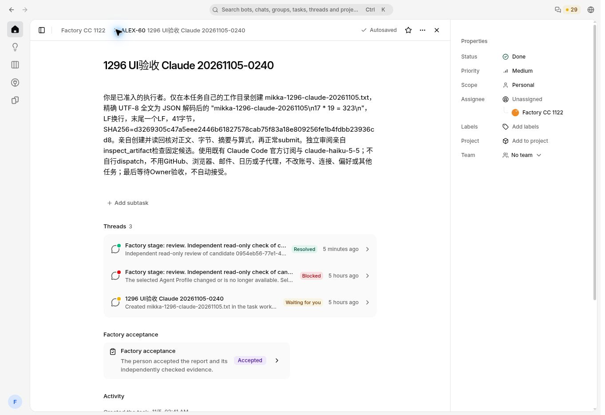
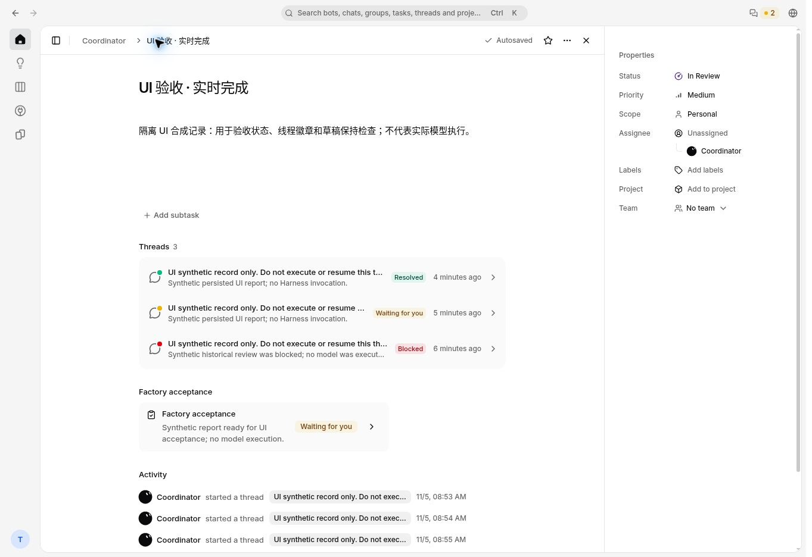
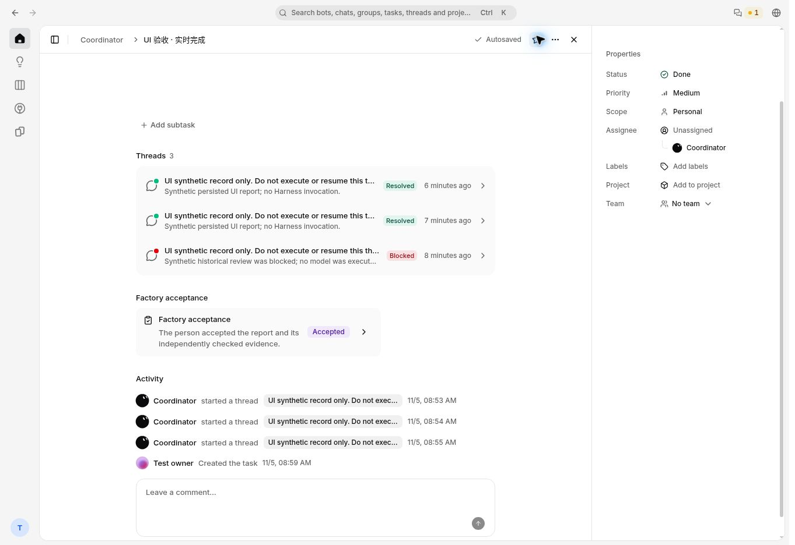
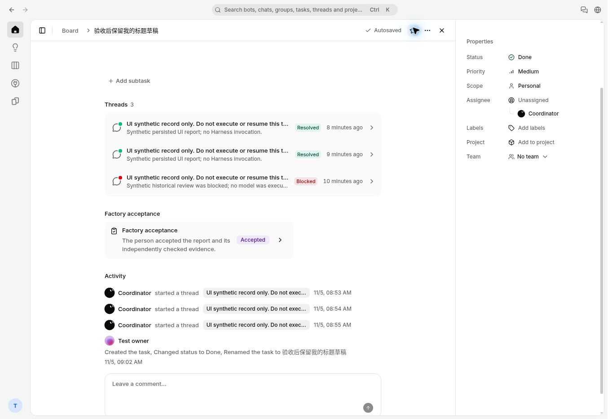
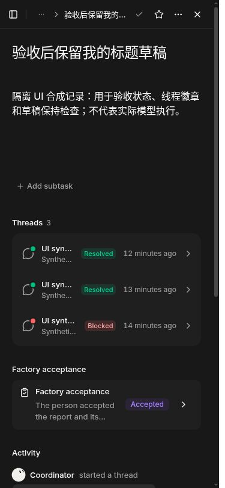
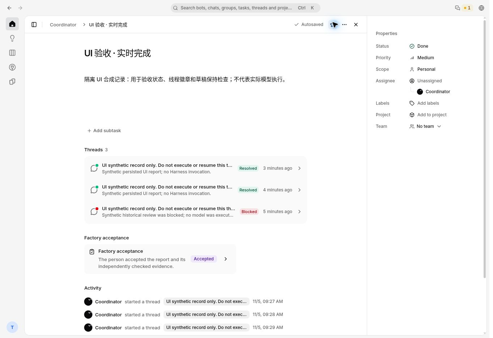
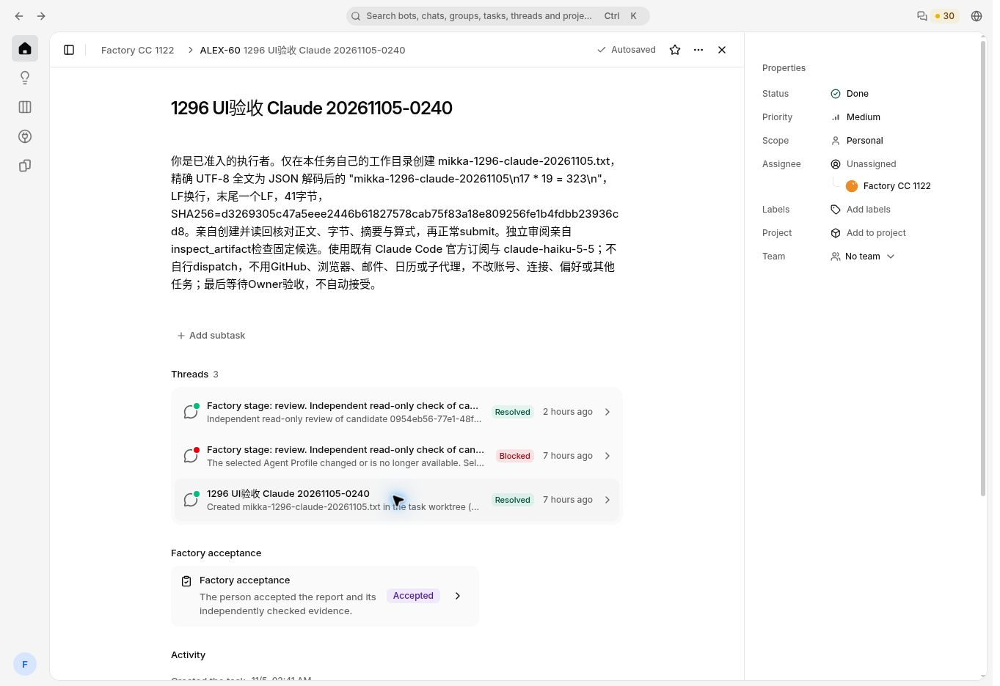
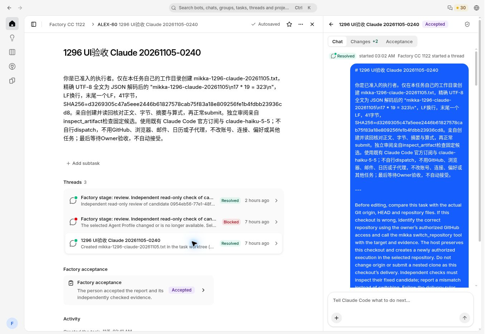

# Issue #1296：验收完成状态同步与 SIGTERM 测试夹具跟进

日期：2026-11-05；时间均为 UTC。PR #1359 已合并为 `9cc753c660f31a95598998c43545ea030240e9e2`，实际 tree 与最终通过 CI、Docker UI91、真 PG81、production build 及正常浏览器 Accept 的 `a871356a` 完全一致。合并后的主 CI、Web 部署、Vercel READY 与生产公开 version 已核对成功；真实 ALEX-60 的生产状态复验通过。09:49:05 管理 API 确认 Docker Sandbox 已 stopped。9aae 与 a871 的原页面证据保持各自版本标签。

关联：[Issue #1296](https://github.com/alexj11324/Mikka/issues/1296)、[PR #1359](https://github.com/alexj11324/Mikka/pull/1359)。

**当前结论：生产 `7cae54d3` 上，ALEX-60 已真实完成恢复后的 Claude 独立 review 和 Owner Accept；正常操作暴露的两个 UI 状态同步缺口已修复。`9aae0ca` 的 CI、Docker production build 和真实浏览器验收已通过：正常 Accept 后原组件无刷新显示 Done、producer Resolved、Factory Accepted 和更新后的 Activity，历史 Blocked 保留；标题草稿在短暂保存错误后自动保存且未丢失。375 深色页面也已截图复核。PR #1359 当前最终组合为 `a871356a`，正常整合主线 `9727fcfc`，精确 CI 为 23 success + 5 条件 skip；该组合在新隔离 PG7 的 UI91、真PG81、完整 production build 已通过。旧 PG6 的过期 lease 已正常 quarantine，随后整个自有环境和私密状态已销毁，未伪称 fixture 逐项 cleanup 成功。新 PG7 已正常清理 fixture / 释放租约并销毁私密环境。PR #1359 已于 09:38:58 合并，主 CI42004112823 的 12 个 jobs 全部成功；Web42004112987 成功，部署 dpl_9KVFQS2Gwncgwof6HmsDyhr8Svg6 READY，公开 version 为精确 9cc。修复后的真实生产任务显示 Done / Factory Accepted，当前 producer 在列表和详情均 Resolved，历史失败仍 Blocked。Docker 已 stopped。收尾复核另取得既有 build 8 于 11:27 上传 App Store Connect 成功的工作流回执，桌面发布也已成功。TestFlight 处理完成／可安装与真机验收、API 余额不足仍按实际边界保留。**

本文只补充本轮结果，不将既有全部 UI、三模型路径或原生设备验收重新宣告完成。生产模型证据与下面的隔离合成报告 fixture 分开记录。

## 1. 版本身份

| 层次 | 精确版本与状态 |
| --- | --- |
| 生产发现与真实接受 | `7cae54d3b16c8b3a06b931980fff5b7b2071698b`，即已合并的 #1353 |
| 本轮 UI/fixture 回归源码 | 基于 `7cae54d3` 的 10 文件组合；Docker 已验证 tree `eb01b003cc1d34f69884e5240343e140be78daa2`。具体回归见第 4 节 |
| 最终组合 PR | [#1359](https://github.com/alexj11324/Mikka/pull/1359)，head `a871356a227543f3e662d0841359e4dcfdbe3713` |
| 最终组合 tree / parents | tree `134bc11816b0dbfcf225f00c1a0ac5e7b9dae4fe`；正常合并 parents 为 `9aae0cabe1c44696f92ff5055844634e32e18e5c`、`9727fcfcfc16724e1cfcd915dc28d59b52d69481` |
| 新组合精确 head CI | [主 CI42000504545](https://github.com/alexj11324/Mikka/actions/runs/42000504545) 全部成功；root 于 **09:22** fresh 核对精确 `a871356a` 的 **28 checks = 23 success + 5 条件 skip**。这是 PR 精确 head 的 CI；实际 main 合并后执行另见第 8 节 |
| 新组合 Docker 身份 / 构建 | Docker 读回 `a871356a`，实际 git merge-tree 与 `134bc11816b0dbfcf225f00c1a0ac5e7b9dae4fe` 一致，fake mode `100755`；新 setup / 正常 bootstrap、Factory UI91、真实 PG81 与完整 `pnpm build` exit0 均已完成 |
| 新隔离环境 PG7 | 独立 PG17 v7 已新建，loopback `55499` / `mikka_e2e`；owner marker `e2ab31c1-e629-4314-bd66-9602845f83cd`，创建回执 PID `28973`。正常 fresh setup、Factory UI91/真实DB81与 `pnpm build` 已通过；新环境租约与正式页面 smoke 独立记录 |
| 主线整合范围 | 原基线 `536d2f0cd85a698e9c401f8e1dea8039fb50bdf4` 保留已上线 #1355；现正常整合 `9727fcfc`（#1358）。本次主线 19 文件与本轮 10 文件无路径交集，未改变 dependency、lockfile、Next config 或 migration；`fake-claude.mjs` 仍为 `100755` |
| 已验证源码 / 截图版本 | head `9aae0cabe1c44696f92ff5055844634e32e18e5c`，tree `61174800e7384b8292d5c029432ff08d75896a70`；下列 CI、Docker 构建及四张隔离截图均保留此版本归属 |
| 9aae 精确 head CI | [CI41997749381](https://github.com/alexj11324/Mikka/actions/runs/41997749381) 全部通过；精确 head 的 **28 checks = 23 success + 5 条件 skip**，0 failure/cancelled/pending；八个 workflow 均 success |
| 9aae 独立 Cloud backend | [41997749424](https://github.com/alexj11324/Mikka/actions/runs/41997749424)，backend 原失败组 **4/4，0 fail / 0 skip**；执行位修复已在独立干净 CI 验证 |
| 9aae 精确 head Docker | 正常隔离 test setup 与完整 `pnpm build` **exit 0**；Next 正常监听 `localhost:3000`；真实页面验收完成 |
| 9aae 隔离环境 | Docker checkout `/home/agent/workspace/Mikka1296-recovery`；标准隔离租约、独立 PG17 v6，loopback `55498`、`mikka_e2e`；v2 环境 descriptor 为 `/tmp/mikka-1296-task-live-v2-environment.json`。该专用环境已停止并销毁，详见第 6 节 |
| 真实 live 通道 | 实际仓库 device-gateway Worker/SQLite DO 经 Miniflare/workerd 运行；浏览器 WebSocket **101**、真实产品提交后的 push **204**。没有 mock 事件或新增轮询 |

不同 tree 的早期 Docker 测试保留原版本归属。`9aae0ca` 另有精确 CI、完整构建与浏览器证据；CI 的合成 checkout `c1df005…` 与该 head 同 tree。`a871356a` 保留这套 UI 修复与执行位修正，主线整合没有上述文件或构建依赖交集，因此原截图作为对应 UI 行为的证据保留，标签仍为 9aae。新组合已取得独立 CI 与精确 Docker setup、UI91、真PG81及完整构建成功回执。最终发布身份仍以实际 merge commit、部署与公开 serving SHA 为准。

**保留的 CI 失败与修复历史：**旧组合 `c78e01e7` 的 [Cloud backend 41995943230 / job127138996174](https://github.com/alexj11324/Mikka/actions/runs/41995943230/job/127138996174)，`packages/daemon/test/local-computer-adapters.node-test.ts:37` 在 `JSON.parse(chunks.join(''))` 报 `Unexpected end of JSON input`。失败叶子为 `claude_code receives only the per-run proxy supplied by the trusted host`，该组 4 total / 3 pass / 1 fail / 0 skip。GitHub 上传组合时误丢 `fake-claude.mjs` 的执行位，远端 tree 为 `100644`；该独立 node-test 直接启动 fake，空输出触发解析失败。Daemon 全套其它测试会对共享 fake 执行 chmod，不能覆盖该打包错误。

最终仅将 mode 恢复为 **`100755`**，内容 blob 始终是 `fe43181a79fa5c1bb537484d4618ae495a5d1d3f`。[新 backend job127145005718](https://github.com/alexj11324/Mikka/actions/runs/41997749424/job/127145005718) 于 **08:53:57** 在干净 CI 通过原四例，不依赖本地 chmod 后跑全套。旧失败不是基础设施异常，也未被省略或重新标成通过。

## 2. 真实生产：Claude review → Owner Accept

以下是正常产品 UI、已有 Owner、原 Task 与候选上的真实模型和接受记录，不是合成 UI 数据。

| 字段 | 已取得的生产事实 |
| --- | --- |
| 用户任务 / Issue | ALEX-60；`1899ee3b-518b-43db-840a-7969a9e8ff55` |
| Factory task | `3b026473-489c-4c1e-b120-e13fd84fee22` |
| 原 producer | `f9231e85-ae2d-415c-8e68-493582dafac6`，`succeeded` |
| 保留候选 | `0954eb56-77e1-48fc-8826-4229f797d052` |
| 恢复后的独立 review | `927eef0e-568e-4eb4-8e4a-9c309111e719`，`succeeded` |
| Review attempt | `146920ea-1047-4a7e-82e3-6c0032b7257f` |
| 实际 Harness / 模型 | `claude_code` / `claude-haiku-5-5` |
| 实际来源 / route | `subscription` / `claude_code_cli` |
| 实际产物检查 | `inspect_artifact` 读到 **41 bytes**；`contentMatchesGit=true`、`matchesExpectedUtf8=true` |
| 产物 SHA-256 | `d3269305c47a5eee2446b61827578cab75f83a18e809256fe1b4fdbb23936cd8` |
| 产物对应 HEAD | `6a7f65cf054688c82b29e462dee68610461ae04a` |
| Owner Accept | **08:07** 正常 UI 执行；随后 fresh GET 为 `approval / passed / revision 12` |
| 接受后的 attempt | `529ccfd3-3bd7-48bb-8cf6-da1fc1b4327c` |
| Issue 与人工历史 | 重新加载显示 **Done**，Activity 显示 **08:07** 的接受记录 |
| 历史失败 | 原 review `9142a4fc-2136-4520-87ad-f4167d058be3` 的 failed/blocked 历史保留；没有改写为成功 |

已保存生产截图：`mikka-1296-prod-accepted-done-7ca-1793866308182.jpg`，SHA-256 `f2f670b5f4ca4f3d35d457c26ff9f79e050f60929b04b0d60ebae9cdf3ac1abf`。该文件摘要已本地独立读回一致。

这证明该 Claude 案例完成了真实恢复、独立检查和人工接受。它不替代其它模型路径，也不证明下面两个 UI 修复已经上线。

## 3. 用户任务的 before / after

| 用户任务 | 生产观察到的 before | 最小修复与复用组件 | after 的已验证层次 / 待验证层次 |
| --- | --- | --- | --- |
| 接受当前候选后，留在原任务页确认完成 | Factory 已 `approval/passed/rev12`，后端 Issue 已完成；已挂载的 TaskForm 仍显示 **In Review**，重新加载才显示 Done 和新 Activity | 复用现有 `issue_document` live event、SWR `issue`/`versions` key 与 TaskForm。一次文档事件同时刷新正文、任务字段和历史；仅用较新服务端快照更新未编辑字段，保留标题/正文草稿和现有 Y.Doc。保存时固定 revision；若 flush 期间收到新 revision，则重新取快照，避免把新 revision 与旧 Review 状态混用 | Docker 三条目标行为回归 GREEN；9aae 实际浏览器同组件无刷新更新 Done、Factory Accepted 与 Activity，标题草稿保留且随后 Autosaved。**9cc 生产复验通过**：正常重新加载原 ALEX-60 后已确认对应展示。此次没有新建生产 Accept；同组件无刷新 Accept 由精确 a871 的实际隔离页面证明 |
| 在列表和线程页确认刚接受的 producer 已解决 | 原 producer `f923…` 已 succeeded，但仍显示 **Waiting**；当前 review 显示 Resolved，历史失败显示 Blocked，语义不一致 | 复用 `useAcceptanceTasks` 的同一 SWR 缓存与 `factory_issue` live event，及现有 `ThreadStatus` / `ThreadStatusIcon`。纯展示 helper 只对 exact issue、当前已接受非 skill candidate、candidateRunId = latestRunId = 当前 view run、成功终态且无 question/wake/stopping 的 producer 投影为 Resolved | 四个目标正例由 RED 转 GREEN；9aae 实际页面 producer 显示 Resolved、历史线程保持 Blocked；375 深色截图已复核。旧候选、continuation、active、waiting/resuming/wake/stopping 等反例仍保留原状态。**9cc 生产复验通过**：正常重新加载原 ALEX-60 后已确认对应展示。此次没有新建生产 Accept；同组件无刷新 Accept 由精确 a871 的实际隔离页面证明 |

对应源码：[TaskDetail](https://github.com/alexj11324/Mikka/blob/9aae0cabe1c44696f92ff5055844634e32e18e5c/components/workspace/task-detail.tsx)、[共享 acceptance hook](https://github.com/alexj11324/Mikka/blob/9aae0cabe1c44696f92ff5055844634e32e18e5c/components/workspace/factory-acceptance.tsx)、[展示 helper](https://github.com/alexj11324/Mikka/blob/9aae0cabe1c44696f92ff5055844634e32e18e5c/lib/issue-threads.ts)、[线程列表](https://github.com/alexj11324/Mikka/blob/9aae0cabe1c44696f92ff5055844634e32e18e5c/components/workspace/issue-threads.tsx)、[线程面板](https://github.com/alexj11324/Mikka/blob/9aae0cabe1c44696f92ff5055844634e32e18e5c/components/workspace/issue-thread-panel.tsx)。

**边界保持：**没有修改持久化 run outcome、历史 failed/blocked、模型/订阅/候选绑定或 Send/Retry/Stop 的授权。Resolved 仅为当前已接受 producer 的展示。没有新增轮询，未引入第二套组件或状态来源。

## 4. Docker 红绿与相关回归

以下为 root 实际 Docker 执行回执及负责实现的 agent 交叉核对，不是本地重跑或预计结果。

| 检查 | 真实结果 | 说明 |
| --- | --- | --- |
| TaskDetail 两条初始 RED | **2 total / 0 pass / 2 fail / 0 skip** | 旧 `7ca` 产品上的目标断言失败，非挂载或 fixture 导入错误 |
| TaskDetail flush 竞态 RED | **3 / 2 / 1 / 0** | 第一版 live 修复后，新增例确实捕获 revision 2 搭配旧 `review` 快照 |
| TaskDetail 最终 GREEN | **3 / 3 / 0 / 0**，exit 0 | 固定提交 revision，并在 flush 后发现版本变化时重新取快照 |
| `pnpm test:issue-readonly-dom` | **6/6** | 原 readonly 三例与新增 live 三例均通过 |
| Producer RED | **48 / 44 / 4 / 0** | 只有四个目标正例失败；全部负例通过 |
| `pnpm test:groups` GREEN | 第一组 **12/12**，第二组 **54/54**，exit 0 | 第一组为群会话/回应/线程输入逻辑；第二组实际 mount 现有组件，包含 thread-composer、issue-thread-acceptance 等。四个目标正例均通过 |
| `pnpm test:issues` | 三段 **226 + 33 + 23** 通过；整条命令 exit 0 | 保留现有 issue 及 scope 相关验证，不把该统计写成 Factory SQL 测试 |
| `pnpm test:factory-acceptance-ui` | **88/88** | acceptance state/view/reject-flow 与组件/evidence UI 回归；不等同 `test:factory` 数据库套件 |
| `pnpm test:idle-budget` | **10/10** | 现有 idle request budget 回归；新逻辑复用事件刷新 |
| 类型 / lint | **通过，exit 0** | root 的 Docker 命令回执；最终精确 PR CI 仍单独核对 |
| 已验证 9aae 完整构建 | **`pnpm build` exit 0** | 正常隔离 test setup 后的 production build；真实 Next 页面与真实 DO 推送验收完成 |
| 已验证 9aae CI | **28 checks：23 success、5 条件 skip** | 主 CI 与所有八个 workflow 均成功；Cloud backend 原失败组独立通过 4/4 |
| 最终组合 a871 CI | **28 checks：23 success、5 条件 skip** | 主 CI42000504545 全部成功；09:22 精确 head fresh 核对。新 PG7 的正常 setup、UI91、真实 PG81、完整 build 与正式页面均已通过，见第 7 节 |

主要新增测试：[TaskDetail live](https://github.com/alexj11324/Mikka/blob/9aae0cabe1c44696f92ff5055844634e32e18e5c/scripts/task-detail-live.test.tsx)、[producer 列表](https://github.com/alexj11324/Mikka/blob/9aae0cabe1c44696f92ff5055844634e32e18e5c/scripts/issue-thread-acceptance.test.tsx)、[thread composer](https://github.com/alexj11324/Mikka/blob/9aae0cabe1c44696f92ff5055844634e32e18e5c/scripts/thread-composer.test.tsx)。组件测试不替代浏览器截图、真实模型调用或原生设备验收。

## 5. SIGTERM fixture：修复确定性 EOF 退出竞态

生产合并提交 `7ca` 的 [CI41990588417](https://github.com/alexj11324/Mikka/actions/runs/41990588417) 曾在 daemon liveness 用例缺少 `sigterm-exit` 标记；同 SHA 另一 job 通过不消除该失败。已确认不是 SIGTERM handler 尚未安装：fake 先安装 handler，再写 ready。

真实取消链可以先关闭 SDK 输入流，再向 child 发 SIGTERM。旧 fake 在 stdin EOF 无条件 `exit(0)`，会抢先绕过显式 `SIGTERM_EXIT_143` 模式的 handler。最小修复只让此显式测试模式在 EOF 后等待真实 SIGTERM，使用单次有界 20 秒 deadline；缺少信号仍失败。普通模式 EOF 仍退出 0，没有改产品取消逻辑，也没有放宽标记或 stopReason 断言。

| 验证 | Docker 实际结果 |
| --- | --- |
| 确定性 QA 四例 | **4/4**：旧 explicit EOF→0 且无 marker；新 explicit 已确认处理 EOF 后仍存活，真实 SIGTERM→143 且写 marker；旧/新普通模式 EOF 均→0 |
| 原目标 liveness | **10/10**，exit 0；原断言保留 |
| Daemon 全套 | **950 total = 948 pass + 2 skip**；88 files pass、1 file skip；命令 exit 0 |
| 两项相关 policy | 均 exit 0；没有为持活增加产品 polling allowlist |

已验证 `9aae0ca` 的 [Daemon job127145090110](https://github.com/alexj11324/Mikka/actions/runs/41997749381/job/127145090110) 也通过 **948 pass + 2 原有 skip = 950**，88 files pass、1 file skip，并完成后续 typecheck/build/package。原 `records host lease revocation before Claude exits 143…` 目标用例于 **08:53:41** 明确 pass；不是仅通过新增确定性 QA。

源码仅改 [fake-claude.mjs](https://github.com/alexj11324/Mikka/blob/9aae0cabe1c44696f92ff5055844634e32e18e5c/packages/daemon/test/fakes/fake-claude.mjs)。单文件修复原提交 `bbc44cba4d148a327654fe35ca924ea759883a00` 已纳入本轮组合；确定性 QA 不替代原集成 liveness 测试。

## 6. 9aae 隔离页面验收：合成报告，真实产品提交与推送

本节实际验收运行于 `9aae0ca`、标准 TestAccountPool lease、环境 attestation 与独立 PG17 v6。两组 report 候选分别验证 `clean` 的实时完成与 `draft` 的标题草稿保持。旧 v5/c78 的准备记录不作为本节运行证据；也不将这次运行改记为后续 `a871356a` 的运行。

每组有 succeeded/needs_input producer、succeeded/done 当前 review 和 failed/blocked 独立历史线程；当前 Factory 链仅包含 execute/review/approval 三个 attempt。不同 run/session 的持久化 report 满足真实 evidence 读取守卫，但正文和报告均明确标记 **synthetic、no model execution**。该 helper 不发 prompt、不写凭证、不排队、不触发 GitHub 操作，也不代替正常 UI 执行 Accept。

| 最终隔离验收项目 | 已观察到的真实结果 |
| --- | --- |
| 正常隔离入口 | 原 session/lease/attestation 规则保留；使用可由正常 Owner UI 接受的合成 report，不补伪模型凭证 |
| 推送链路 | 仓库实际 Worker/DO、本地 workerd、浏览器 WebSocket 101 与正常 Accept 提交后的 POST 204；没有手工注入 fake event。连接成功本身没有冒充 UI 刷新成功 |
| clean 场景 | 正常点击 Accept；**同组件、不 reload**，任务变为 Done、producer Resolved、Factory Accepted，Activity 更新；历史 Blocked 保留 |
| draft 场景 | 输入 **“验收后保留我的标题草稿”** 后立即 Accept；短暂显示 Save failed，随后在**未手动 Retry、未 reload、未继续编辑**的情况下变为 Autosaved。该标题保留、状态 Done，Activity 包含 Created / Changed status to Done / Renamed |
| 错误观测边界 | 保存错误的具体响应码未在此记录中确认；**不将其断言为 `issueStale`**，也不把这段过程写成“从未出现保存错误”。最终自动恢复与草稿未丢失有实际页面证据 |
| 历史与动作边界 | 历史 failed/blocked 保持原样；本节没有新增模型 prompt、伪造完成事件或执行线程 Send/Retry |
| 窄屏深色 | **375 宽深色**的已接受状态实际截图已由 owning agent 逐张复核 |
| PG6 资源处置 | scope cleanup 实际被 `LEASE_LOST` 拒绝，fixture 保持 `cleaned:false`。原请求正常落 expiry quarantine 后，已核身份停止服务和 PG6，随后销毁整个专用 cluster 目录及对应私密状态；不是逐项 fixture cleanup 或正常 lease release 成功 |

以下图像均来自 `9aae0ca` 本地 production build，版本标签保持不变。前三张原始图像尺寸为 **1363 × 936**；图中内容为明确标记的合成报告，不代表新的 Claude/Codex/DeepSeek 执行。

| 相对证据路径 | 原始文件 / SHA-256 |
| --- | --- |
| `issue-1296-evidence/sync-9aae-before-accept.jpg` | `mikka-1296-9aae-before-accept-1793869167917.jpg`；`51cb6165072c78a2ff6a179a0236574f8b7bb3e31bfb0713149a2fbefd381b29` |
| `issue-1296-evidence/sync-9aae-live-accepted.jpg` | `mikka-1296-9aae-live-accepted-1793869280107.jpg`；`9fde31e784bb9206a856818f8eb5b27a646a0770150c1964840f3bd09928c094` |
| `issue-1296-evidence/sync-9aae-draft-accepted.jpg` | `mikka-1296-9aae-draft-accepted-1793869437782.jpg`；`900d35fc650b0a81b9047fa9daeff97d0af84ff18fc74e1fae427e8e560adaa1` |
| `issue-1296-evidence/sync-9aae-accepted-dark-375.jpg` | `mikka-1296-9aae-accepted-dark-375-1793869705164.jpg`；`09628208cd59a0f925ecd29340818599978dd8f4b5813cd53232056445ed1233` |

原 fixture cleanup 只在 scope 仍有效时，才允许正常 Accept 的 revision 8→9 与草稿保存产生的 issue revision 变化，并在核对精确候选、attempt、acceptance receipt/event、历史 run 及不存在新增执行/队列后删除本 fixture 的已登记 roots。本次执行在入口得到 `LEASE_LOST`，没有进入这条删除路径，也没有将 fixture 标为 cleaned。

### PG6 过期后的实际处置回执

| 检查 / 动作 | 实际结果 |
| --- | --- |
| 原 scope cleanup | `LEASE_LOST`；fixture `cleaned:false` |
| 正常幂等 acquire | 使用原 `runId=requestId=mobile-1296-task-live-v2`、`workerId=owner`；旧 lease `15967b80-5c9f-44c4-a548-c44777bad4a8` 由 expiry 路径进入 quarantine，ID 不变、generation **1** 不变、expiresAt **2026-11-05T09:10:06.959Z** 不变；没有续租或分配新 lease |
| 资源保护 | 原 **14 个已登记 resources** 保持受保护状态，直到整个专用环境销毁；没有逐项 fixture 删除、`markResourceCleaned` 或伪造正常 release |
| 自有服务停止 | root 核对 UID、PID、start ticks 后停止本轮服务；使用原 owner marker 的 controller 执行正常 `pg_ctl stop` |
| PG6 停止证明 | config state 为 `stopped`；`postmaster.pid` 消失；`55498` 无 listener |
| 整个环境处置 | 实际回执 **`ownedClusterStopped=true`、`DirectoryRemoved=true`、`privateStateRemoved=true`**；已销毁整个自有 PG6 目录及对应私密状态 |

这是 [TestAccountPool 文档](https://github.com/alexj11324/Mikka/blob/9aae0cabe1c44696f92ff5055844634e32e18e5c/docs/test-accounts.md) 规定的 owning harness 对整个 disposable 环境执行、另行核身份的生命周期。它不恢复过期 scope 的权限，不把账户重新标为可复用，也不把整环境销毁写成 fixture 逐项 cleanup 成功。新 PG7 是独立环境，其租约与最终处置另行记录。

## 7. 最终组合 a871 的增量验证

- 新隔离 PG7 上的正常 schema setup 和 bootstrap 已完成，环境 ID `local-c8c9b722-fccd-4165-a30a-7e9251ef62cf`，绑定精确 a871；未沿用旧 descriptor。
- Factory acceptance UI：**91/91**、0 fail / 0 skip。
- Profile dispatch + completion reconcile 真实 PostgreSQL 回归：**81/81**、0 fail / 0 skip。
- 首次直接执行 DB 文件时，UI runtime 的 `DEVICE_GATEWAY_URL/PUSH_SECRET` 被带入 raw-Pool fixture，造成 32 个 `observed database client` 前置错误和 1 个父测试汇总断言，33/0/33；完整首轮失败日志保留。原因是该单测子进程与既有 CI 的环境不一致。
- 仅这两个 DB 测试的子进程移除上述两项 UI gateway 配置，按既有 CI 环境重跑原命令后 81/81；没有改产品、断言、fixture 或事务守卫。UI 服务及随后完整 build 继续保留真实 gateway 配置。首次已成功的 91 UI / setup / bootstrap 未重复运行。
- 精确 a871 的完整 `pnpm build` **exit 0**（含 worker / OpenUI 生成、Next production build、typecheck 与正常迁移入口），09:30 读回退出码；随后正式服务与窄页面 smoke 已完成，见下文。
- 新出现的 #1360 虽非 Draft，但 mergeable=false，正文明确 GREEN/type/lint 与新 head CI 待完成并暂停整合。它不属于已就绪批次；本次不纳入、不修改。

### a871 精确正式页面复验

09:32，在新的正常 TestAccountPool lease（`f7304f88-ac5b-4f8a-8074-632e03458bb3`）与 PG7 环境中，实际 `next start` 的 version 为 a871，真实 gateway Worker ready。经正常一次性账号确认、Factory Evidence 读取与 UI Accept，同一个任务组件不刷新即显示 **Done / producer Resolved / Factory Accepted**，原历史仍 **Blocked**，Activity 刷新。该次为明确标记的隔离合成报告，没有执行模型。

owning agent 与独立视觉 reviewer 均已审阅以下精确 a871 截图：无文本或控件重叠、无横向溢出、状态一致。截图中 Activity 下部未完整覆盖，因此 Activity 更新来自实际 AX 观察，不能仅以图片声称其完整内容。

原文件 `mikka-1296-a871-accepted-1793871187115.jpg`，1363×936，86,342 bytes；SHA-256 `96e91b77f3720f90f6710037cae9a7807c8841d048cd1967d505540924c68cd4`。

新两组 fixture 已通过正常 scope cleanup（`cleaned:true`）；原 holder 正常 dirty release 后为 `quarantined`，读回 **activeLeases=0、validSessions=0**。自有服务、PG7 均已核身份停止，整个专用目录与对应 private state 已销毁。Docker Sandbox 管理 API 于 **09:49:05** 明确返回 **stopped**。

[机器可读验证摘要](issue-1296-a871-validation.json) 包含精确 SHA、CI、构建、截图摘要、首轮准备失败与两次环境清理回执。

## 8. 实际合并、生产发布与复验

| 项目 | 最终已取得的证据 |
| --- | --- |
| 实际合并 | [PR #1359](https://github.com/alexj11324/Mikka/pull/1359) 于 **09:38:58** merged；[提交 9cc753c](https://github.com/alexj11324/Mikka/commit/9cc753c660f31a95598998c43545ea030240e9e2) |
| 合并身份 | tree `134bc11816b0dbfcf225f00c1a0ac5e7b9dae4fe` 与通过最终验收的 a871、绿色 CI 合成 checkout 984ad99 完全一致；parents 为 9727fcfc 与 a871356a，保留此前主线 ancestry |
| 合并后主 CI | [42004112823](https://github.com/alexj11324/Mikka/actions/runs/42004112823) **success**，09:45:28 完成；**12/12 jobs success**，含 Source、Core、Integration、Daemon、DB 1–4 与 UI policy(strict) |
| 构建证据边界 | CI 名为 Production build and browser interactions 的 job 是既有 DB 汇总门槛；正式构建和真实浏览器证据来自上文 Docker 精确 a871 的 pnpm build / next start 与逐张截图审阅，未混用名称作为证明 |
| Web 部署 | [42004112987](https://github.com/alexj11324/Mikka/actions/runs/42004112987) **success**，09:43:20 完成 |
| Vercel / 域名 | `dpl_9KVFQS2Gwncgwof6HmsDyhr8Svg6` **READY** 于 09:43:14.768，meta githubCommitSha 为完整 9cc；alias 包含 app.aspectlylabs.com |
| 公开 serving 版本 | 09:44 记录的浏览器 fresh reload：[公开 version](https://app.aspectlylabs.com/mikka/api/version) 返回完整 `9cc753c660f31a95598998c43545ea030240e9e2` |
| 生产真实任务 | [ALEX-60](https://app.aspectlylabs.com/mikka/en?bot=d6bf6e81-2ff8-4f2d-ad94-003d94b934bb&issue=1899ee3b-518b-43db-840a-7969a9e8ff55) 正常重载后：**Done、Factory Accepted、当前 producer / review 均 Resolved、历史 failed review 仍 Blocked**。Activity 保留 08:07 的 Changed status to Done |
| 生产线程详情 | 正常打开原 producer f9231e85 的线程面板，实际显示 **Accepted + Resolved**；返回任务总览后状态一致。没有新模型调用、追加 prompt、修改 DB 或新建 Accept |
| 生产 smoke | [42004413085](https://github.com/alexj11324/Mikka/actions/runs/42004413085) success；该运行早于本次 Web READY，单独列回执，不把它代替上面的 9cc 生产域名/页面验收 |
| Daemon 发布 | [42004112856](https://github.com/alexj11324/Mikka/actions/runs/42004112856) success，09:47:59 |
| E2B runtime 发布 | [42004113017](https://github.com/alexj11324/Mikka/actions/runs/42004113017) success，09:48:02 |
| Desktop 发布 | [42004112938](https://github.com/alexj11324/Mikka/actions/runs/42004112938) **success**，10:07:02 完成；签名打包、installer inventory、精确提交 checks、candidate 校验与 GitHub release 均成功 |
| Docker 最终停止 | `sbx_001m6mjh8at15tpaxcxdmscetmz`，8 vCPU / 16 GiB；完成服务、lease、session、PG6/PG7 清理后已请求 stop，管理 API **09:49:05 读回 stopped**；停止后未访问会自动唤醒的 endpoint |

### 生产最终截图

以下两张由真实生产 9cc 页面直接捕获。总览图显示 Done、当前两个 Resolved、历史 Blocked 与 Factory Accepted；详情图显示同一个 producer 的 Accepted / Resolved。Activity 的完整历史来自 AX 观察，不因图片只露出标题就声称整段历史可见。此次复验是已在 08:07 接受的真实任务在新版本上的只读检查；不是新一轮生产 live Accept。

| 证据 | 原始文件与摘要 |
| --- | --- |
| 生产总览 | `mikka-1296-prod-9cc-overview-1793872081544.jpg`，1363×936，118995 bytes；SHA-256 `a4a283b0921a4fce2621603dbe83226d70f92783107967ef4f4aa4ebd587793e` |
| 生产线程详情 | `mikka-1296-prod-9cc-thread-1793871969407.jpg`，1363×936，190643 bytes；SHA-256 `9a8477943550d81071c1dc28ea8d792571e79c20d5714ca88a9aea3e027f187f` |

### OTA 与原生边界

- 精确 [9cc 的 mobile-update.yml](https://github.com/alexj11324/Mikka/blob/9cc753c660f31a95598998c43545ea030240e9e2/.github/workflows/mobile-update.yml) 只对 main push 的 apps/mobile/** 或 packages/protocol/** 触发；本次十个变更路径不命中，因此没有新的 9cc OTA 工作流。
- 本轮 09:49 核对的最近生产 OTA 为 [41990588486](https://github.com/alexj11324/Mikka/actions/runs/41990588486/job/127121612092)，源 7ca，07:57:12 Published；production / iOS，runtime `0ec11b32ade9dcb4bcf87a751626ec5ba9acaa2d`，group `0a7a2061-2f5a-4244-83df-3c292c31e65a`，update `01a1aab6-3a6c-724e-bbf5-3aff50ef9cbb`。
- 已有 iOS build 8：`a9b373b6-da29-43f0-9176-25a60eae1985` 为 FINISHED，来源 ec9c2860。收尾时发现已有成功的 [Mobile native release 42018868921](https://github.com/alexj11324/Mikka/actions/runs/42018868921)；工作流 SHA `29f0d915a2ee10748aed6938a578cc6d539b90df`，**复用同一个 build 8，没有重新构建**。精确 binary/source 核验及提交步骤均 success，日志于 **11:27:20.942 UTC 确认上传到 App Store Connect 成功**，整个 run 于 11:27:26 success。
- 原生 [job127216236381](https://github.com/alexj11324/Mikka/actions/runs/42018868921/job/127216236381) 明确记录 EXISTING_BUILD_ID 为上述 a9b、EXPECTED_BUILD_COMMIT 为完整 ec9；[EAS submission be257c2e-f174-4192-8bee-12a1d552645e](https://expo.dev/accounts/alexj3653/projects/mikka/submissions/be257c2e-f174-4192-8bee-12a1d552645e)。这项已有发布是在本浏览器登录等待期间完成；安全登录请求后来取消，本执行通过只读日志核对收到成功回执，**没有再次触发或重复上传**。
- Apple 上传回执在当时提示后续处理；它没有证明处理已经完成、测试者可安装或设备已安装。本报告只确认 ASC 上传成功，TestFlight 可安装和真机状态仍未取得直接证据。
- 没有 iOS 真机或 simulator，因此 VoiceOver、Dynamic Type、系统 Reduce Motion、haptics、真机安装与原生完整流程仍未验证；Expo Web 的实际截图/回归不替代这些项目。
- API 路径保留原 deepseek-flash 的 Insufficient Balance，未换模型、来源、账户，也未追加付费重试。Claude/Codex 的真实生产接受证据仍按各自原记录保存。

**收尾版本说明：**本轮 Web 部署及图像验收绑定 09:44 的 9cc。20:48 再读取公开 version 时，后续批次已推进到 `484d7ac66b5eba692b53ad8759e4b558a6232dfb`，当时 main 为 `2e4e8380e0387b43c5c844756ade7801f0afdca1` 且另一个 Web 工作流正在执行。没有把 9cc 的截图、a871 的 Docker 回归或后续其他批次改记为同一次验收。

## 9. 完成状态

- [x] 已验证源码回归、可信 RED/GREEN、原 SIGTERM 集成用例与全套 daemon；保留首次失败证据。
- [x] 精确 a871 的 CI 23 success + 5 条件 skip、Docker UI91、真实 PG81、完整 production build 与真实推送/正常 UI Accept。
- [x] 实际页面逐张视觉复核并在合并前附入 PR；9aae / a871 截图不改版本标签。
- [x] 正常 merge commit 合入并独立核对实际 tree / parents；主线 CI12/12、Web success、Vercel READY、公开 exact SHA。
- [x] 9cc 的原生产任务及线程详情复验通过；生产真实模型记录与隔离合成 fixture 不混淆。
- [x] PG6 按过期 scope 守卫进入 quarantine 后销毁整个自有环境；PG7 正常清理 fixture / 释放租约，activeLeases=0、validSessions=0，随后销毁整个环境。
- [x] Docker Sandbox 管理 API 已确认 stopped。
- [x] 既有 iOS build 8 复用提交至 App Store Connect，工作流和实际上传日志均成功，没有重复 build / submit。
- [ ] TestFlight 处理完成、实际可安装及安装状态。
- [ ] 原生设备专属可用性与 motion 验收。
- [ ] API 供应商余额恢复后的原模型路径；本轮保留余额不足，不执行额外付费重试。

Issue #1296 保持 open，以免将尚无直接证据的 TestFlight 可安装、原生设备验收和余额阻塞项目写成已通过。GitHub 登录不再是已有 binary 上传的未完成条件。已经完成的 UI 修复、Web 发布与生产复验闭环有独立版本、CI 和图像证据。
