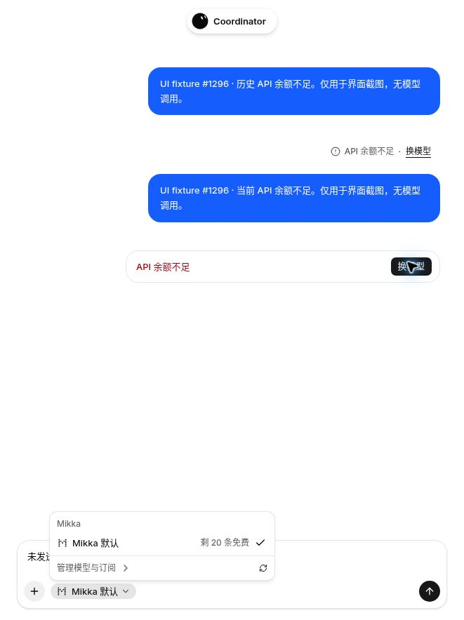

# Issue #1296: API balance refusal recovery

## Observed failure and scope

On 2026-11-05, a new production `deepseek-flash` API-key chat request failed
with the model streaming step's `Insufficient Balance` response. The owner
matched the unique new prompt, stored message and current chat error through
the existing authenticated `GET /api/mobile/chat?bot=…` route. The UI showed
only Reply failed and Retry. This evidence does not reuse an older 402 and
does not establish an HTTP status that this response did not expose.

Occurrence: **10/10 once this confirmed balance refusal occurs**. Impact:
**5/10**: the reply is blocked and the offered retry cannot resolve the known
cause. Product **50**, actionable usability defect; no data loss or permission
change was observed. The population-wide frequency of depleted API balances
was not measured.

The chat contract had no API-balance presentation reason. Its generic fallback
intentionally hid raw step errors, but also offered Retry/Resend for this
non-transient condition. The daemon's structured ProviderFailure is a separate
boundary and is unchanged by this fix.

## Fix

- Recognize only the complete `Insufficient Balance` refusal, optionally with
  its UUID request suffix, or that same refusal wrapped by the known
  `@ai-sdk/workflow@<version>//doStreamStep` route. Tool failures, arbitrary
  credit/quota text, and other errors keep their existing behavior.
- Add the optional safe `reason: balance` to `kind: failed`, preserving the
  discriminator understood by already-installed mobile clients.
- Show API 余额不足 / Insufficient API balance and the existing model picker
  action in current and historical web failures and the mobile failure line.
  Web opens its existing picker, including the normal model/allowance reads;
  iOS uses its existing model-choice action. Expo Web and Android retain their
  existing web-chat recovery route. No action automatically retries, selects
  another model, or changes provider credentials, fallback or health state.
- Keep raw errors, request IDs and step paths out of visible UI. Do not link
  the API balance failure to Mikka's own billing/top-up screen.

## Verification

Source baseline: `b8382fab`. Existing server/mobile failure suites cover the
observed wrapper, other SDK versions, safe fixed copy, generic controls,
working-state suppression and mobile action mapping. Existing web and native
component harnesses exercise the actual current/historical notice and model
picker action and assert zero retry/submission calls for balance failures.
Those are deterministic fixtures, not live provider acceptance.

Actual local production-build verification on 2026-11-05 used the existing
isolated test-account lease and two owned stored messages, each explicitly
marked as synthetic screenshot data. No model prompt was sent. The Chinese
current alert and historical footer both showed the fixed balance copy and
Change model action, with no Retry/Resend, top-up link, wrapper or request ID.
Clicking the current action opened the existing model menu. Escape closed it;
the unsubmitted draft remained unchanged. Deterministic component tests also
assert that the action makes no retry/submission call.

The Next production build and Expo Web export both exited 0. Mobile tests
passed 150/150 and the Web retry/failure suite passed 22/22, all with zero skips.
This isolated deployment intentionally has no external Coordinator service
credentials: its normal enabled=false guard returns failure=null to mobile.
The newly added balance branch therefore has no completed Expo narrow-screen
visual proof in this environment; the component tests are its behavioral
coverage. No fake key, Vercel flag or environment-guard bypass was introduced.
The original audit's broader Expo screenshots remain separate evidence.

The source used for these checks is
`ac8bb2831fae71d4c66f6940e06b4e4207b4d3ea`, tested on the recorded baseline.
The follow-up report and Issue #1296 track integrated PR CI and production
acceptance separately. These synthetic UI checks do not resolve the real
DeepSeek provider-balance blocker.
