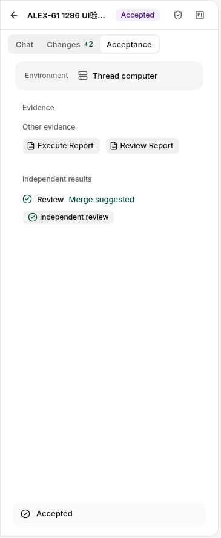
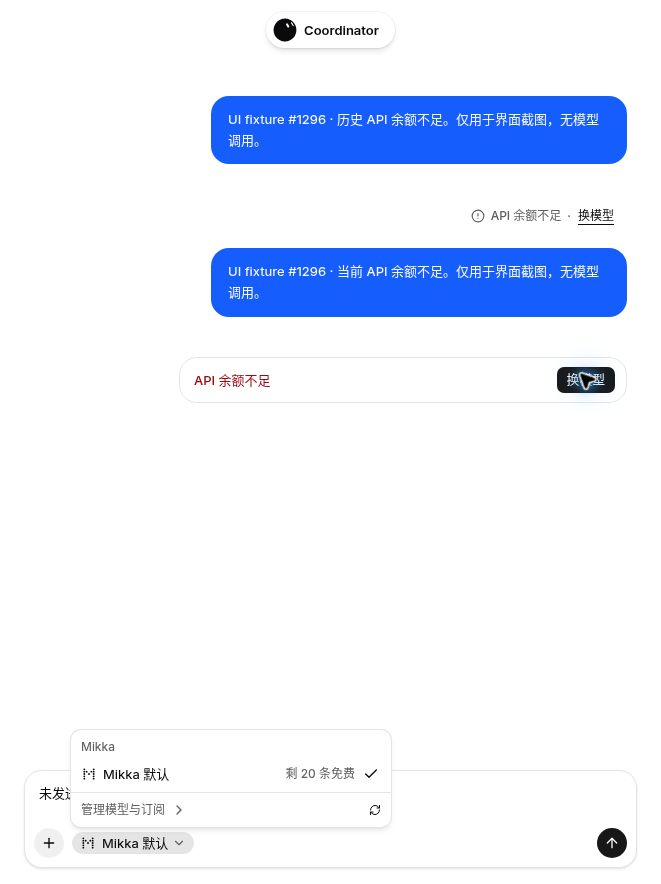
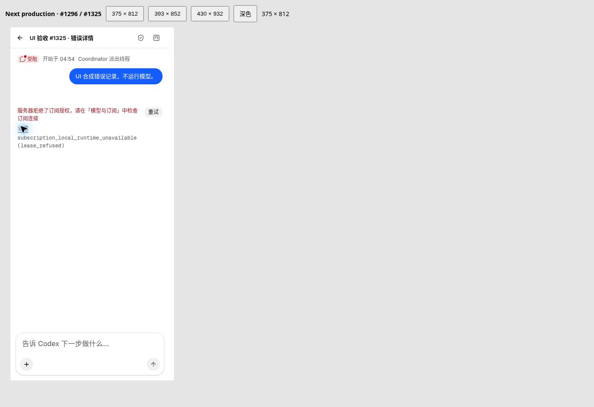
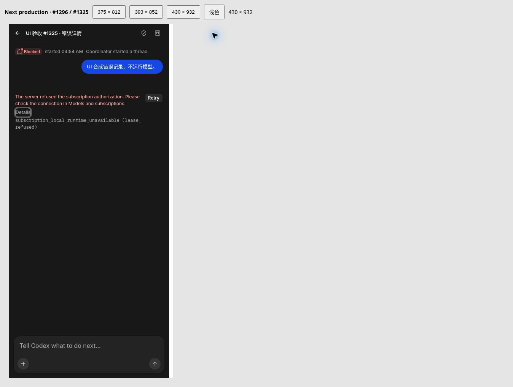

# Issue #1296：生产验收与修复跟进

> 本文保留当次版本的三路模型证据与失败。现行验收使用共享 SMOKE 账号，
> 官方 Claude Code 与 Codex 两条订阅路径独立记录。DeepSeek/API-key 路径
> 已退出合并及验收门槛，后续执行按 [验收指南](../acceptance.md)。

日期：2026-11-05；文中时间均为 UTC。

跟踪：[Mikka #1296](https://github.com/alexj11324/Mikka/issues/1296)。本文补充[主 UI／可用性／motion 审计报告](issue-1296-ui-audit.md)，记录主 PR 上线后的真实生产验收、发现的问题、最小修复与 Docker 回归。本文不修改既有验收规则，也不把模型菜单可选、合成测试、Web 截图或 binary 构建视为其它层次的验收结果。

**提交时的证据快照：主 PR #1308 已完成 CI、Web 生产部署、生产 OTA 和 iOS binary 构建。生产验收发现的五项问题由 [PR #1328](https://github.com/alexj11324/Mikka/pull/1328) 修复；与新主线整合时又复现、修复三项交集问题，一并由 [批次 PR #1336](https://github.com/alexj11324/Mikka/pull/1336) 发布。Docker 回归及本地生产界面证据见第 7、8 节。** 第 1—7 节保留各轮当时的事实；最终 head CI、merge、Web／OTA、生产复验与 iOS 提交状态以 Issue #1296 正文中的实际回执为准。本文不预填后续成功状态。

## 1. 版本与主 PR 发布证据

| 层次 | 精确身份与已确认结果 |
| --- | --- |
| 主 PR | [PR #1308](https://github.com/alexj11324/Mikka/pull/1308)，合并提交 `ec9c2860c7614fef044d883ed2344211818e27e1` |
| PR CI | [41955002136](https://github.com/alexj11324/Mikka/actions/runs/41955002136)，成功 |
| main CI | [41955821708](https://github.com/alexj11324/Mikka/actions/runs/41955821708)，成功；本轮主改动移动端测试 145 项通过 |
| Web 发布 | [41955821672](https://github.com/alexj11324/Mikka/actions/runs/41955821672)，production deployment `dpl_53tiRCnB6kRA1fwzjNJ5aQ6DJMYY` 为 `READY` |
| 生产版本核验 | 2026-11-05 02:38:45，生产 version 接口核对为 `ec9c2860c7614fef044d883ed2344211818e27e1`；其后 main 提交 `b8382fabeec470d1e35e08e256d21686e39fc48f` 也已部署 |
| 生产 OTA | [41955821604](https://github.com/alexj11324/Mikka/actions/runs/41955821604)，channel 为 `production`，update group 为 `1ed14298-6acc-4099-b9ee-a903f181e325` |
| OTA runtime | `0ec11b32ade9dcb4bcf87a751626ec5ba9acaa2d` |
| iOS native workflow | [41955822055](https://github.com/alexj11324/Mikka/actions/runs/41955822055)，构建完成；首次 submit 因缺少 ASC 配置未完成 |
| iOS binary | EAS build `a9b373b6-da29-43f0-9176-25a60eae1985`，状态 `FINISHED`，版本 `1.0.0 (8)`，来源提交 `ec9c2860c7614fef044d883ed2344211818e27e1` |
| binary runtime | `0ec11b32ade9dcb4bcf87a751626ec5ba9acaa2d`，与上述生产 OTA 相同 |

相同 runtime 证明这份 binary 与该 OTA 的运行时身份相符；它不证明 App Store Connect 已接受上传、TestFlight 已处理完成或设备已安装。首次 native workflow 的构建成功与提交失败分别保留，不能将整个原生发布流程写成成功。

本轮验收使用现有已登录 Owner 的正常产品 UI 和既有绑定来源。Docker 隔离测试账户没有订阅或 API key 的事实，不能用来推断生产 Owner 的来源为空。界面中的订阅计划名也不能替代实际运行的模型 ID。

## 2. 三条真实模型路径

三条路径各自保留自己的模型与来源。以下生产结果发生在跟进修复发布之前；不能作为修复提交 `ac8bb2831fae71d4c66f6940e06b4e4207b4d3ea` 已上线的证明。

### 2.1 官方 Codex：执行、独立检查和 Owner 接受均有实际证据

| 字段 | 生产记录 |
| --- | --- |
| 任务 | `ALEX-61` |
| Issue | `b16a840d-783c-415e-bc5b-6f762ad19f6e` |
| Execute run | `030e8f2f-dc0f-4012-8aab-b91a8999669a`，`succeeded` |
| Review run | `b6419ac7-9514-42d5-899d-3d688eb94e1c`，`succeeded` |
| 实际 Harness／模型 | `codex` ／ `gpt-6-luna` |
| 实际来源／route | `subscription` ／ `codex_cli` |
| 产物 | 40 bytes；SHA-256 `f40d6b4dbeae89b0460d8c13eeca7180ca40396b184c449f15a2e1ab401b60bd` |
| Factory task | `fc4a71be-7cad-43e6-914c-a43bfc401760` |
| Owner 接受后的 Factory 状态 | `stage=approval`、`status=passed`、`revision=9` |
| 同时观察到的 Issue 状态 | 仍为 `review`，属于本轮确认的状态同步缺陷 |

Review 实际调用了 `inspect_artifact` 并读到上述 40-byte 产物。Owning agent 查看了两行 diff，随后在正常 Owner UI 执行 **Accept**。这证明该独立案例确实完成了目标模型执行、产物检查和人工接受；不能据此称 Claude 或 DeepSeek 路径通过。

Owner 接受后的截图：



Factory 已接受而 Issue 仍在 `review` 是实际缺陷，不以“Owner 已接受”掩盖。跟进修复针对新的接受事务，未对这份已接受历史记录执行数据库回填；本文也不宣称该历史 Issue 已变为 `done`。

### 2.2 官方 Claude Code：执行成功，独立 review 被准入拒绝

首次 `ALEX-60` 请求返回裸错误 `agentProfileUnavailable`，没有生成 Factory task。随后正常 Settings 中 Haiku 与默认 Profile 均显示 Available；核对首次 Factory 为空后，只重试了一次。

| 字段 | 生产记录 |
| --- | --- |
| 任务 | `ALEX-60` |
| Issue | `1899ee3b-518b-43db-840a-7969a9e8ff55` |
| Execute run | `f9231e85-ae2d-415c-8e68-493582dafac6`，`succeeded` |
| 实际 Harness／模型 | `claude_code` ／ `claude-haiku-5-5` |
| 实际来源／route | `subscription` ／ `claude_code_cli` |
| 产物 | 41 bytes；SHA-256 `d3269305c47a5eee2446b61827578cab75f83a18e809256fe1b4fdbb23936cd8` |
| Factory task | `3b026473-489c-4c1e-b120-e13fd84fee22` |
| Candidate | `0954eb56-77e1-48fc-8826-4229f797d052` |
| 独立 Review run | `9142a4fc-2136-4520-87ad-f4167d058be3`，失败 |
| Review 时间 | 03:04:47.485 至 03:05:14.559 |
| 失败后的 Factory 状态 | `stage=review`、`status=blocked`、`revision=7` |

Review 的真实线程接口返回空 items，summary/error 为：

> The selected Agent Profile changed or is no longer available. Select an available Profile for a new run.

没有观察到期间修改 Profile，目标仍为同一官方 Claude Code 来源上的 Haiku。此结果不能解释为余额耗尽，也不能将 Settings Available 当作 review 执行成功。

源码与数据库回归确认了一条能够产生相同错误的竞态：额度快照在排队时可用，经过运行环境准备后超过 60 秒，原最终 claim 只读取快照而不刷新，于是将来源判为 checking 并拒绝。但是，**该生产 run 的历史 `quota.observedAt` 没有被采集，不能证明这次失败的根因就是 TTL**。27.074 秒的 review 总时长既不能单独证明，也不能单独排除该机制。本文分别记录生产失败事实和经红绿测试确认的代码缺口。

因此，Claude 的执行与产物有真实成功证据，完整的独立 review／接受闭环仍未通过。

### 2.3 DeepSeek API key：独立新请求被余额不足阻断

2026-11-05 03:07:28，对现有 API key 上的 `deepseek-flash` 发送独立新 prompt，标识为 `b69edbf0-0a3f-4509-b02e-5af70b8b0aec`。发送前的精确模型 guard 退出码为 `0`。

本次实际错误是模型流式步骤返回 **`Insufficient Balance`**，包装信息明确为 **`0 retries`**。Owning agent 对照了新 prompt、持久化消息与当前聊天错误；不是复用历史对话中的失败。当前 UI 只显示 Reply failed 和 Retry，不能帮助用户处理已知的余额原因，因而形成下述余额恢复缺陷。

此次证据没有暴露可核实的 HTTP 状态，**不记为 HTTP 402**；也没有成功模型输出或完整任务结果，**不记为真实 API 路径完成**。`deepseek-flash` 按验收规则记录为实际别名，不据此额外证明供应商版本。该阻断不替代其它两条路径的结果，也不阻止修复继续发布。

测试后已恢复原有日常模型选择，未使用其它模型重跑该 DeepSeek case；没有新建 key、改变已有订阅绑定或为取得通过而切换来源。

## 3. 五项跟进修复与风险

发生与影响各按 1–10 评分。发生分数针对已确认的条件路径，不代表所有线上用户的总体发生率；优先级为本轮审计判断。

| 编号／问题 | 步骤、期望与实际 | 根因与最小修复 | 发生 × 影响／优先级 | 源码与测试证据 |
| --- | --- | --- | --- | --- |
| F-01：dispatch 丢失安全诊断 detail | 使用 Profile 发起云任务，准入拒绝时应返回已有的安全恢复提示；实际工具结果只剩 `agentProfileUnavailable`，没有生成 Factory task | 特定 catch 分支手写 `{error}`，绕过既有 `asToolResult` 映射；改为复用该映射。只恢复安全 detail，不暴露原始异常，不重试或改选模型 | 10 × 4 = 40；P2 | `workflows/coordinator/steps.ts`；`tests/cloud-dispatch-startup.test.ts` 新增 2 例，确认无额外 run、机器启动、生命周期调用或换来源 |
| F-02：iOS submit 未接入既有 ASC 配置 | 构建 `1.0.0 (8)` 完成后，应使用现有配置提交；首次 native workflow 在 submit 阶段失败 | 工作流没有正确接入已有 ASC key。增加临时提交 profile 与清理，并支持精确指定既有 build ID 和来源提交，避免为同一提交需求重复 build | 10 × 7 = 70；P1 | `.github/workflows/mobile-native.yml`；`scripts/release/mobile-native.mjs`、`scripts/release/mobile-native.test.mjs`；发布测试已通过，实际修复后 submit 未触发 |
| F-03：Owner Accept 后 Issue 仍在 review | ALEX-61 已由 Owner 接受，Factory 为 approval/passed/rev9；预期对应已审阅 Issue 完成，实际 Issue 仍为 review，线程还可能出现在等待列表 | report／deliverable 接受事务只写接受回执与 Factory 状态，未完成 Issue。现把符合条件的 Issue→done、revision、人工历史记录及 live 通知纳入同一事务，并保护后续任务、活动 run 和人的明确状态修改 | 8 × 5 = 40；P2 | `lib/factory/merge.ts`、`lib/factory/merge.db.test.ts`；真实 PG 覆盖原子回滚、幂等、候选替换、后续工作与状态保护；未回填历史记录 |
| F-04：API 余额拒绝仍提示通用重试 | DeepSeek 新请求返回 Insufficient Balance；预期明确 API 余额原因并提供已有模型恢复动作，实际只显示 Reply failed／Retry | 通用失败投影丢失了可安全展示的余额原因。仅识别完整余额拒绝及已知 SDK 模型流式包装；保留 `kind: failed` 并增加可选 `reason: balance`，显示“API 余额不足／Insufficient API balance”和既有模型恢复入口 | 10 × 5 = 50；P1 | `lib/chat-balance.ts`、`lib/chat-failure.ts`、Web failure/current chat 组件、移动端 failure 投影及现有组件测试；详见 [API 余额拒绝恢复说明](issue-1296-chat-balance.md) |
| F-05：排队至最终 cloud claim 的 quota 时效竞态 | 在真实 PG fixture 中，排队时 Available；60,000 ms 仍可用，60,001 ms 后旧 claim 拒绝。预期对当前冻结订阅重新确认额度，再按原规则领取任务 | 原 claim 在运行环境准备后仅使用过期快照。增加最终事务外、单一冻结来源的现有 usage 查询；原锁内 Profile／权限／模型／binding／epoch／stop 复核完整保留 | 10 × 7 = 70；P1，条件竞态；历史生产归因未证实 | `lib/computer/claim.ts`、`lib/factory/profile-admission.ts`、`lib/model-order.ts`、`lib/factory/profile-dispatch.db.test.ts`；旧代码目标红灯、新代码绿灯均已确认 |

### 3.1 Owner 接受后的完成事务

修复仅在当前接受候选仍有效、Issue 仍为 `review`、不存在更晚的 Factory task 且没有活动 run 时将 Issue 置为 `done`。它与接受回执、Factory 完成状态、revision 和人工操作历史共同提交；历史写入失败时全部回滚。相同接受事件重放返回既有回执，不重复写历史，也不关闭重新打开且已有后续工作的 Issue。

这条路径不需要新增 GitHub 凭证或写入；测试中的 GitHub 边界为 fixture，不把它写成真实 GitHub 操作验收。

### 3.2 余额提示的展示与兼容边界

余额识别只用于聊天展示，不接入 provider fallback、credential health 或自动模型选择。错误字符串、request ID 和 SDK step 路径不进入可见 UI；不把 API 余额错误指向 Mikka 自有账单或充值页面。服务端保留旧移动客户端已经认识的 `failed` 判别字段，旧客户端仍可使用通用失败分支。

Web 当前错误与历史失败 footer、移动端当前失败行均有确定性测试。恢复动作复用现有入口，不自动重发或选模；Expo Web／Android 沿用既有 Web 聊天恢复路径。这些测试没有调用模型。额外 fixture 已在真实本地生产构建中执行。中文当前提示和历史 footer 均显示 API 余额不足，均提供换模型；点击当前恢复动作打开原有菜单，Escape 关闭后未发送的草稿仍保留。图中数据明确标记为合成 UI fixture；这不是 DeepSeek 真实成功验收。



截图来自 `next build` 后的 `next start`，不是替换 API 回复的静态样稿。部署级 Coordinator 在这个无外部服务凭证的隔离环境中保持 `enabled:false`，mobile API 因此按原有守卫返回 `failure:null`；没有为取得 Expo 当前失败截图而设置假 key、伪造 Vercel 标志或修改环境校验。当前余额分支的 Expo 视觉验收未完成，由移动端组件回归提供行为证据；主报告已有的 Expo 多尺寸验收不替代这一新增分支。

### 3.3 Profile claim 刷新不改变准入规则

新增步骤只针对已经合法冻结的当前 queued run：校验 actor、device、workspace、停止状态、harness、model、binding 和现有 execution identity，再只向 `credentialStates` 传入该 run 的唯一 `[entry]`。内部 `probe: 'always'` 复用已有 usage 去重与 worker I/O 的 15 秒取消预算；该预算不是整个数据库／授权过程的总墙钟时限。

API Key、已有 `profileOriginRunId` 的原生续跑、question continuation 不新增这次 probe。刷新报错不主动清空仍新鲜的合法快照；额度仍未知、真正耗尽、来源撤销或停止仍由原有准入拒绝。没有放宽 60 秒 TTL、允许 unknown、变更模型或订阅、新建 run、增加轮询或模型调用。若刷新后又因锁等待而过期，最终检查继续拒绝，不引入额外重试框架。

## 4. 跟进修复的版本与 Docker 验证

| 项目 | 固定身份／结果 |
| --- | --- |
| 分支 | `fix/1296-production-acceptance-20261105` |
| 基线 | `b8382fabeec470d1e35e08e256d21686e39fc48f` |
| Docker 测试对应的源码提交 | `ac8bb2831fae71d4c66f6940e06b4e4207b4d3ea` |
| 已整合部署完成的 main | `2b565c20b4d8af4838d0d37afe4dafece62ea8a8`；整合源码提交 `5982ba022c96c905a55f231c0bd3d5975466931b`，tree `f63697ea5babcc69c319c17741feb9a3e1c6a567` |
| 范围 | 25 个源码、工作流、测试和文档文件，覆盖上述五项问题 |
| 执行环境 | Docker Cloud Sandbox；数据库回归使用 loopback 隔离目标，Profile suite 核验 PostgreSQL 17；外部模型／GitHub／发布边界按各测试 fixture 替换 |
| PR／发布状态 | 已建立 PR #1328；最终精确 head CI、合并与生产回执继续记录于 Issue 正文 |

以下为 owning agent 在 Docker 中核对的最终运行结果，全部为实际执行结果，不沿用主 PR 的 145 项结果替代：

| 检查 | 最终结果 | 覆盖与限制 |
| --- | --- | --- |
| Cloud dispatch startup | 29／29 通过，0 skip | 含安全 detail、拒绝后无新 run／机器启动／换源 |
| Release security | 68／68 通过，0 skip | 含既有 binary 来源验证与 ASC 临时配置；不等于真实提交成功 |
| Factory acceptance DB | 16／16 通过，0 skip | 真实 PG，接受后 Issue 完成、原子性、幂等与后续工作保护 |
| Profile dispatch／claim DB | 16／16 通过，0 skip | 真实 PG，含新增 11 个 claim 子例及既有 Profile／独立 stage 回归 |
| Mobile | 150／150 通过，0 skip | 现有移动端完整测试脚本及余额恢复断言；不等于 iOS 真机验收 |
| Web retry／failure 组件 | 22／22 通过，0 skip | 当前与历史失败展示、模型恢复动作及零重发断言 |
| 仓库根目录 typecheck | 退出码 0 | 当前集成源码 |
| Mobile typecheck | 退出码 0 | 当前集成移动端源码 |
| Lint | 退出码 0 | 当前集成源码 |
| `git diff --check` | 退出码 0 | 当前变更格式 |
| Next 生产构建 | 退出码 0 | `pnpm build`，包括既有构建、迁移与类型检查 |
| Expo Web 导出 | 退出码 0 | 真实 Metro 导出成功 |

Factory acceptance 与 Profile claim 的目标问题均完成旧代码红灯、新代码绿灯验证。Acceptance suite 和 Profile suite 的初次 fixture 分别缺少必填 `factory_attempts.reason` 与设备 `name`；补齐后才获得目标红灯，这些设置错误不计入产品复现证据。

Profile 回归保持原最终 gate，直接证明 60,000／60,001 ms 边界，并验证：单一来源刷新成功后仍领取原 run；尚新快照在刷新失败时保留；刷新错误、仍未知、真实耗尽、disconnect、pause、epoch 改变、Profile 修改、绑定模型改变或 owner stop 均拒绝。测试还核对未创建替代 run、冻结定义不变、只查询选定订阅。usage 写入可以完成，证明异步查询不被放入持有 source 行锁的最终 claim 事务。

可复现的 Profile 数据库命令如下；运行前沿用当前隔离环境已经校验的数据库配置，不能改向共享或生产数据库：

```bash
REQUIRE_DB=1 node \
  --experimental-test-module-mocks \
  --import ./tests/support/server-only.mjs \
  --import tsx \
  --test lib/factory/profile-dispatch.db.test.ts
```

这些是受影响范围的 Docker 验证结果。整合已部署的 main 时，唯一文本冲突是 `test:release-security`：同时保留本次 native-submit 测试和新 main 的 deployment-id 测试，语言文件保留双方新增键，其余改动逐 blob 核对。没有合入未落地主线的其它 PR。新的 PR 必须继续取得精确 head 所关联的 CI 结果；主 PR CI、Docker 回归与后续 PR CI 各自保留其版本身份。

本地生产截图运行曾因 Next 监听 `127.0.0.1` 与已登记 origin `localhost` 不同而发生内部 rewrite 的自重定向。仅将临时启动参数统一到 `localhost` 后，原租约 adapter 的 owner、peer landing 均返回 200，成功取得 lease；未改产品路由、认证或环境 guard。两次初始化失败按原流程隔离处理，不能记为产品修复。

## 5. iOS 既有 binary 的提交修复与当前阻塞

跟进工作流支持成对输入 `existing_build_id` 和 `expected_commit`。它保留实际工作流的 `GITHUB_SHA`，分别核对 driver 提交及旧 binary 来源提交的 CI，确认旧来源属于当前 main 历史，再读取精确 build ID 的元数据。

元数据检查覆盖精确 ID、`FINISHED`、iOS、来源完整提交、Expo app、bundle identifier、production profile、store distribution、非 simulator 以及 runtime／fingerprint。提交只使用已验证的 build ID，不使用 `--latest`，不因重新提交而 rebuild。既有 ASC key 仅在提交步骤中写入临时受限文件，通过临时 profile 引用；结束时恢复原配置并清理，密钥值不进入仓库或报告。

上述源码与回归已完成，但 **EAS build `a9b373b6-da29-43f0-9176-25a60eae1985` 的修复后 submit 尚未触发**。当前可用接口没有执行 `workflow_dispatch` 的能力，浏览器也尚未登录 GitHub；本轮尚未请求用户完成认证。因此没有新的 submit、ASC processing 或 TestFlight 可用回执，不能写成已提交。

## 6. 尚未完成的验收范围与后续记录位置

| 范围 | 当前确定状态／闭环要求 |
| --- | --- |
| 跟进修复发布 | 源码已发布且 Docker 验证通过；还需精确 head 的 PR CI、合并、生产 READY 与 version 核对。实际提交和回执写入 Issue #1296 正文 |
| Owner Accept 的生产复验 | 现有 ALEX-61 是缺陷发生证据；新的正常接受事务需要在修复上线后确认 Factory、Issue、线程列表和人工历史一致，不能以直接改数据库代替 |
| Claude 独立 review | execute 真实成功，review 仍有上述失败事实。修复上线后按正常恢复机制复验既有绑定目标，不换模型／来源；记录实际 review、产物与接受结果 |
| DeepSeek API | 本次独立请求因 Insufficient Balance 阻断，没有成功输出。其阻断独立记录，不用其它模型补成通过；UI 余额恢复需单独核对 |
| 跟进 UI 截图 | 本记录保留已存在的 Codex Owner 接受截图。已附本地生产构建的中文 current／history 与恢复菜单截图，并核对菜单关闭后的草稿保留；新增余额分支的 Expo 窄屏／深色截图未完成，不扩大此图的覆盖范围 |
| App Store Connect／TestFlight | binary 已完成，首次 submit 失败，修复后提交未触发；上传、处理、可安装状态分别核验 |
| 原生 iOS | VoiceOver、Dynamic Type、系统 Reduce Motion、原生键盘和导航没有真机或模拟器验收证据。Expo Web、类型检查、组件测试或 EAS build 均不能代替 |
| 资源清理 | 第一次恢复时限触发停止，04:01:35 管理面确认 stopped；为验证新主线的真实交集再次恢复。已停止旧 UI 服务，核对 environment 身份后完整删除专用临时测试库及账户文件，未复用账户。最终整合回归完成后立即请求停止，最终 stopped 回执写入 Issue 正文 |

若上线后发现新的产品问题，继续返回 Docker 复现、修复、回归，再经 PR／CI／merge 重新部署验收。本文记录的是已取得的证据与当前边界，不将 #1296 的所有 live 和原生完成标准宣告为已满足。


## 7. 第一轮主线整合与 Docker 回归（04:11 UTC 历史快照）

主线又合入 #1326，提交为 `caebc8e6b4f6afb5f3fe3a22b833b32da9c1a7c4`。
两项修复直接合并会在 cloud route 和 claim 函数内连续查询同一订阅。
本次保留 #1326 的 queue 准备／local claim 刷新，仅移除 cloud route 的重复入口，
由 `claimCloudRun` 中冻结 run 的 helper 承担最终刷新。原权限、epoch、stop、
Profile、60 秒时效和 native continuation 规则均未放宽；未引入其它待合 PR 的展示 TTL 改动。

两个独立复核确认此整合。Docker 新建 worktree 从固定基线应用完整补丁后，
`git write-tree` 精确得到 `1f22c38fc6530e99597ae9ab41e25fd1a449a02d`。
以下结果对应此 tree 的代码；从当轮验证结束到 #1328 提交只添加了验证记录。第 8 节是其后的新批次整合，不沿用这句话声明后续产品代码未变。

| 最终集成检查 | 实际结果 |
| --- | --- |
| Profile dispatch／claim DB | 23／23 通过，0 fail／skip |
| Shared subscription／真实 HTTP claim DB | 34／34 通过，0 fail／skip |
| Factory acceptance DB | 16／16 通过，0 fail／skip |
| Release security | 75／75 通过，0 fail／skip |
| Root typecheck、lint | 均退出码 0 |
| Source tree 还原／diff check | 精确 tree 一致，格式检查通过 |

测试合并也保留两种不同的 I/O 边界：七个 queue case 使用真实 service 的额度解析和
revision 限定保存，但 worker I/O 已明确替换；最终 claim case 继续使用受控 usageProbe。
真实 SQL、授权、锁、冻结来源和最终准入均参与回归，没有发起模型请求。

原安全扫描把测试中的固定“缺少环境变量”错误断言标为高熵字符串。
核对后确认仅由错误代码和变量名组成、没有凭证值；改为由明确字段名数组组成同一期望，
十项原生发布测试通过，GitGuardian 在更新 head 上通过。安全检查和生产错误逻辑均保留。

本轮专用 UI 数据库 `mikka_1296_followup_e2e` 已在身份核验后完整移除，
四组自有 UI／租约进程与私密临时账户文件已清理；不将被隔离的测试身份再投入复用。
最终回归使用同一 Docker 沙盒中的既有独立测试 schemas，完成后立即发出停止请求。
新的 PR CI、merge、Web／OTA 和生产模型复验仍需各自独立回执，见 Issue #1296 正文。


## 8. 批次整合、交集修复与本地生产 UI（04:59 UTC）

### 8.1 已发布基线与本批身份

前批 #1335 已以正常 merge commit `89cfb577cecada3087f02222f7a656cae5706977`
合入 main，其 tree 为 `065c96952524e630eda49671887165191ed4bf1f`，
与前批最终 head `e6d6d06abcdc31cefc607f94be3c64c5ebb44488` 相同。
[Web run 41970583732](https://github.com/alexj11324/Mikka/actions/runs/41970583732)
于 04:57:41 成功，04:58 正常 GET 生产 version 为 HTTP 200 且 build 精确匹配该 merge commit。
本批在前批完成部署后才进入自己的最终合并与发布；不移动他人的批次分支。

本批先前已绿 head 为 `10a715931b72faa276ba9bd740265f52f5ad2519`，
tree `8e675cf39909ccbfa5850e11447640247cb34e53`；
[CI 41969341946](https://github.com/alexj11324/Mikka/actions/runs/41969341946)
的四项 required checks 均通过。与前批最终版本合并后的产品 tree 为
`22aafc19edabf19432002d03f4451ca57ae09994`，本次再追加本文和两张 UI 截图。
相对已绿 tree 的 25 个文件是最低 daemon 版本从 `0.0.375` 到 `0.0.456`、
21 个测试文件的对应版本字面量，以及三个 released fixture 的迁移／更新。
最低版本变化属于真实准入行为变化；本批最终提交仍需要自己关联的完整 CI。

前批含独立的 Settings 展示 TTL 调整；最终 claim 的 60 秒准入规则、
`probe: 'always'`、授权与来源冻结仍保留。第 7 节“未合展示 TTL”只描述当时旧基线。
独立复核逐 blob 比较三处交集修复涉及的 11 个文件，确认新 daemon 基线没有覆盖它们。

### 8.2 三项新复现问题及最小修复

| 问题 | 具体失败路径与修复 | 发生概率 × 影响 |
| --- | --- | --- |
| 共享聊天读取丢失 live 元数据 | `getCoordinatorChat` 写入共享 SWR key 的返回值缺少 live scope／请求起点，覆盖版本感知 fetcher 的数据；复用已有 session、inbox 生成完整 view state，并在实际列表读取处记录 observation。缺少 home 时保持空 scope，先授权再解析 owner | 7 × 6 = 42 |
| 反向 duplicate 关系没有更新通知 | 只扫描正向关系会漏掉以当前 Issue 为 `duplicateOfId` 的目标；补齐反向查询，保留 owner 限制、50 条边界，并分别解析各文档的可见 audience | 7 × 4 = 28 |
| Owner Accept 完成子任务后父任务／被阻塞项不刷新 | Issue 更新成功后缺少关系通知；仅在实际更新行存在时，于同一事务登记关系变更。保持 COMMIT 后发送、回滚不发送、重复请求及后继任务 no-op | 8 × 5 = 40 |

三项问题均有具体回归证据，没有以主观清理或低概率假设扩大产品改动。
新测试首次 CI 中，空数组 `assert.deepEqual(sent, [])` 将后续 `sent` 推断为 `never[]`；
改为等价的 `assert.equal(sent.length, 0)`，保留“COMMIT 前没有通知”的原断言，
未删除测试、放宽类型检查或使用 `any` 绕过。

### 8.3 Docker 实际结果与版本边界

全部在获授权的 Docker Cloud Sandbox Large（8 vCPU／16 GiB）执行，
使用 PostgreSQL 17 隔离数据库。以下是实际测试结果，不是从测试文件数量推算。

| 被测版本／范围 | 结果 |
| --- | --- |
| tree `37d450642e236c1db4846cae5536c9a149044a02`，仅还原三处产品实现的目标红灯 | 61 项中 55 pass、6 fail、0 skip；其中四个目标断言失败、两个父 suite 级联失败。不是完整旧版本回归，也不把 fixture 初始化错误计入产品复现 |
| 同一 tree 恢复三处修复后的目标绿灯 | 61／61 pass，0 fail／skip；含共享 action、Factory 接受和真实 PG 关系通知 |
| 同轮 Profile 与 shared subscription／真实 HTTP claim | 57／57 pass（23 + 34），0 fail／skip |
| 同轮 chat-version observation | 2／2 pass |
| 同轮 balance／welcome／idle UI | 36／36 pass |
| 同轮 root typecheck、lint | 退出码均为 0；迁移策略 55／55 |
| 精确 head `10a7159` 的 device／artifact live DB | 7／7 pass，0 fail／skip |
| 精确 head `10a7159` 的 idle budget | 7／7 pass |
| 精确 head `10a7159` 的 typecheck、lint、隔离 QA 初始化、Next production build | 退出码均为 0 |

真实 PG 用例验证了延迟 COMMIT 失败、回滚不泄漏通知、重复接受与 successor no-op。
两轮测试的具体版本分别列出；最终 daemon 基线后的新 CI 结果记录在 PR 和 Issue，
不能将旧 head 的绿灯自动转记给新 head。

### 8.4 #1325 错误详情的实际生产构建截图

截图与交互来自 Docker 中固定 `10a7159` 的 `next build`／`next start`，
专用库 `mikka_1296_batch_e2e`、环境
`local-304a6cff-952b-45dc-b1f2-350fdb46784d`。
普通测试账户通过现有 lease 与正常产品一次性浏览器交接登录，没有改认证 guard。
fixture 只创建本轮 owner 的 terminal failed run，错误为
`subscription_local_runtime_unavailable (lease_refused)`；没有入队、重试或模型调用。

- 中文 375 × 812：固定错误提示自然换行，右侧“重试”未遮挡文字；点击“详情”后原始详情完整显示，按钮 expanded 为 true，按 Enter 后收起为 false。
- 英文深色 430 × 932：固定英文提示完整显示，Enter 展开 Details 后键盘焦点清晰，技术详情可换行阅读，底部输入区未被遮挡。
- 两张图均由 owning agent 实际查看；两图另经独立视觉复核，无裁切、横向溢出或内容重叠。合成失败记录仅支持 UI 外观与操作结论，不证明真实模型恢复、Expo 或原生 iOS 验收。





本轮 lease 与临时数据按独立身份清理；最终 stop 回执、最终 CI／merge／Web／OTA、
Claude 原候选 review 与 Owner Accept 的生产复验，以及 API 余额提示核验，
分别续写 Issue #1296 正文。App Store Connect／TestFlight 和原生设备证据继续单独报告。
