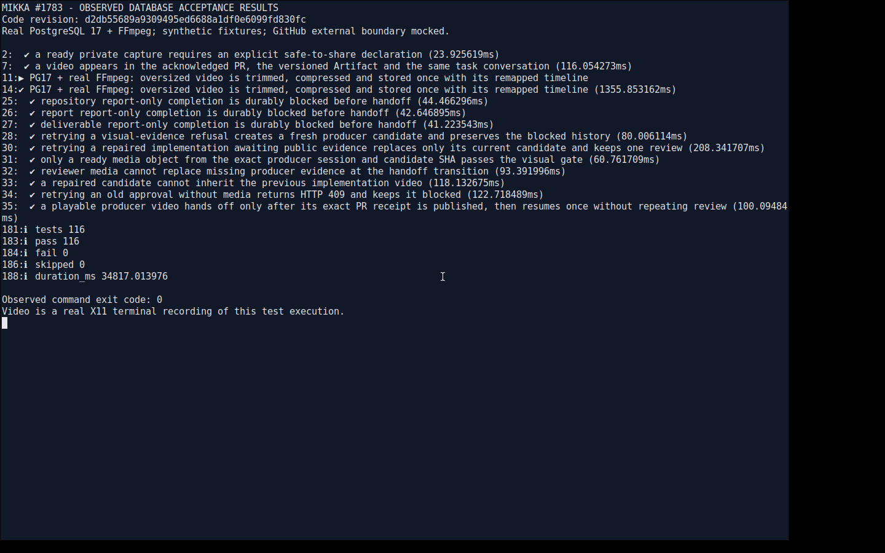

# Factory 可视证据硬门禁：本地验收

关联 [#1783](https://github.com/alexj11324/Mikka/issues/1783)。本报告验证服务端和数据契约；报告／对话播放器和阶段 UI 由 Claude 会话负责。

## 后续验收索引

2026-11-09 的 311 项验收、四段录像、截图、同源读回报告和独立复核见
[2026-11-09 归档](2026-11-09/README.md)。生产真实任务见
[生产验收步骤](production.md)。本页以下保留 2026-11-08 原执行记录。

## 固定版本与结果

- 代码提交：`d2db55689a9309495ed6688a1df0e6099fd830fc`。
- 时间：2026-11-08 23:58:00–23:58:35 UTC。
- 环境：隔离云 Linux，Node 24.22.2、pnpm 10.34.3、真实 PostgreSQL 17.11、FFmpeg 8.0.1；数据库只连接 loopback 的隔离测试库。
- 录制入口：Xvfb X11 的真实终端画面，FFmpeg x11grab；记录实际执行输出，不是动画或预制结果。
- 本次录制的数据库验收：**116 项通过、0 失败、0 跳过，退出码 0**。
- GitHub 外部边界使用 fixture，数据库、应用发布逻辑和 FFmpeg 均实际执行。本地结果不代表真实 GitHub App 生产验收。

[查看录像](acceptance.mp4) · [完整测试输出](test-output.txt) · [时间、大小和 SHA-256 回执](receipt.json)



录像经过本提交的 `capture-video.mjs`：原片 23,295,798 字节，处理后 2,563,447 字节，39.6 秒、1280×800。记录的是一个连续执行的测试动作，因此保留全部时间轴，未人为删掉运行中的等待。下面的专用 FFmpeg 回归另外验证了动作间空白裁剪。

画面及输出使用合成用户、仓库和媒体夹具；已检查起始、执行中及结尾画面和输出，未包含生产账号、密钥、cookie 或私有任务正文。`tests/fixtures/factory-visual-evidence.mp4` 是明确标注的合成单元测试素材，不是这份验收录像。

## 观察到的行为

| 验收要求 | 实际结果 |
| --- | --- |
| repository、report、deliverable 无媒体 | 均持久化 `execute / blocked`，不创建 review／approval；报告或未验证标记不能替代 |
| 当前候选来源 | 只接受同 owner、run、session、candidate SHA 的 ready 媒体对象；reviewer、旧候选、错误 MIME 或未就绪媒体被拒绝 |
| 直接审批入口 | 无媒体返回 HTTP 409，数据库仍保留 blocked 原因 |
| 有视频与 PR 回执 | 当前候选的可播放视频及确认的 PR 正文回执到齐后进入 approval；晚到回执只恢复一次，不重复 review |
| 重新执行 | 缺媒体或缺公开证据导致阻塞后，可建立新候选；旧候选和 attempt 历史不变 |
| PR／报告／对话 | 同一视频出现在 GitHub 正文回读、版本化验收 Artifact 与原任务对话；内部鉴权地址不会写入公开 PR |
| 公开边界 | 未明确声明 `publicSafe:true` 的捕获不公开；分享重试复用回执；撤销后不重新签发；跨 owner／run／SHA 拒绝 |
| 超大录像 | 有效的超过 100 MB MP4 输入经真实 FFmpeg 裁剪压缩；20 秒输入保留 5.5 秒，移除 14.5 秒动作间空白，输出低于既有 100 MB 上限 |
| 时间轴 | 两次动作原偏移 1500／19500 ms，处理后为 1500／5000 ms，动作时长仍为 1000 ms |
| 并发保存 | 同一录像并发完成只调用一次处理；五个不同录像在五连接池中均完成，无重复对象覆盖 |
| 存储中止 | 真实本地 HTTP 收到 PUT 后中止；同一唯一 key 被有界 DELETE 清理，数据库提交 failed，不能读取为有效 capture |

超大输入使用合法 MP4 `free` atom 生成超过上限的文件，保持真实可解码视频并避免无意义的高成本随机画面。另有 FFmpeg 单测验证低大小预算下的两遍编码，以及开始和尾部动作保留。

## 复现命令

以下命令只在按仓库规范配置好真实隔离 PostgreSQL 的云 Linux 环境执行，不包含任何凭证值：

```sh
NODE_ENV=test REQUIRE_DB=1 node \
  --test-force-exit --experimental-test-module-mocks \
  --import ./tests/support/server-only.mjs --import tsx \
  --test --test-reporter=spec \
  lib/captures/video-evidence.db.test.ts \
  lib/captures/publication.db.test.ts \
  lib/factory/checks.db.test.ts
```

此前同一实现的相关回归通过：158 项数据库测试、typecheck、`lint:code`、`lint:runtime`、`test:captures`、`test:run-publication`、协议 run 测试、daemon captures／visual-evidence／supervisor 测试、`test:api` 和 `test:db-runner`。最后的存储取消补丁另跑了 typecheck、存储单测、录像数据库测试及两项 lint，全部通过；本次录像再次覆盖最终提交的主要数据库路径。CI 以 PR 最新 head 的实际 checks 为准。

## 发布与剩余验收

本报告生成时尚未合并，也未声明生产通过。合并遵守 #1503／#1752 发布窗口和已确认队列；后续部署 READY、生产版本、完整 E2B release 和共享账号的真实 GitHub App 任务证据记录在 #1783。产品内 review 仍是建议，交接不等于完成，factory agent 不获得自动合并权限。
