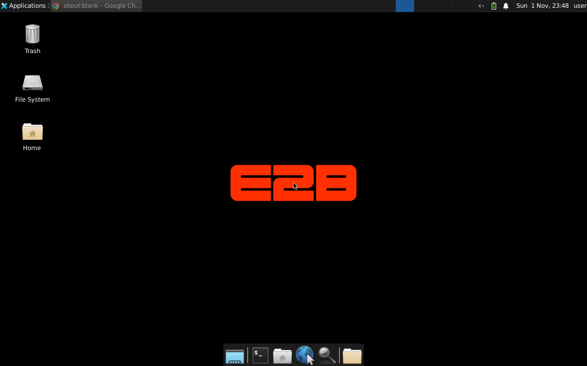
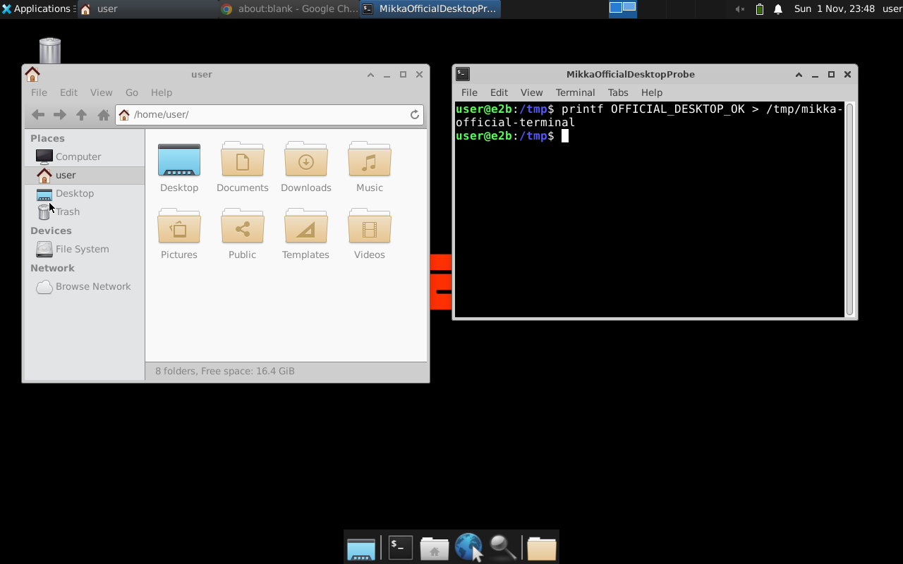

# Official E2B desktop adoption — 2026-11-01

PR: [#883](https://github.com/alexj11324/Mikka/pull/883).
Decision: [reuse the official desktop](../design/decisions/2026-11-01-2331-use-official-e2b-desktop.md).

## Fixed environment

- Branch: `codex/official-e2b-desktop-base`.
- Tested code: `0a1657bef74e2478930470757db5acc73cd7c567`.
- Worker input hash: `4df3b47eb2acbaaecab33639bccc7d5177487a3b`.
- Private template: `wozm39lr1wveq9jvpjse`.
- Build: `160f2753-6de0-46c0-a085-5050b1acda5d`, finished at 23:46:11 UTC.
- Build/driver environment: cloud Linux sandbox `mikka-mvp-847`.
- Runtime environment: fresh disposable E2B VMs from this exact private image.
  No application database or deployed application was involved in these image
  checks. The separate backend CI used isolated PostgreSQL 17.

The build inherits `desktop`, then installs Node 24 and Mikka's worker and
verified CLI pins. Nothing was installed into the disposable acceptance VMs.
The template remained private; no running user computer was changed.

## Desktop and viewer

VM `ib6gypvt8esf1r27e2ch2` was created in 1.36 seconds. Stock XFCE and Chrome
became visible in 5.03 seconds. These are single observations, not latency
benchmarks.

| Person's task | Previous image | Official image result |
| --- | --- | --- |
| Minimize the browser and find the desktop | Custom Openbox desktop and launchers | Found: inherited E2B wallpaper, desktop icons, Applications menu and XFCE panels |
| Open the home folder | Custom file-manager launcher | Found: double-clicking the stock Home icon opened Thunar |
| Open a terminal and enter a command | Custom terminal launcher | Found: XFCE Terminal accepted real X11 keyboard input and wrote the expected disposable marker |
| Resize and close a window | Openbox decorations | Found: XFWM resize and native close control worked |
| Work on another bot's display | Separate X display | Found: a second XFCE session had separate configuration and no first-display browser or file-manager window |
| Observe without controlling; then control and revoke | Signed viewer grants | Found: real RFB pixels, server-side view-only input denial, control input, invalid/foreign grant denial and live revocation passed |

All walked tasks were Found, severity 0. The Mikka application layout, copy,
bot/thread navigation, and existing viewer controls are outside this image
change. The inherited desktop is the approved upstream UI; no new Figma frame
or Mikka-authored desktop copy was introduced.

Checks also passed for frozen worker/startup hashes, anonymous worker/viewer
boot, default runner commands, first fresh-HOME npm command, task-user denial
of sudo and protected signing/worker files, and absence of raw VNC/CDP/X11 TCP
listeners. Versions were Node `24.19.0`, npm `11.17.0`, Codex `0.163.0`, and
Claude Code `2.1.309`; both actual CLI help/initialization paths ran.

## Worker, resume and retained images

- VM `i36eddb64tflx3yz8vea9`: the actual preloaded worker consumed a private
  one-time handoff, retained its process identity, registered the expected
  synthetic credential hash, and discovered both actual installed coding CLIs.
  The task account could not read its credential. Registration used a synthetic
  server; no CLI was replaced, and no provider/model or full user task ran.
- VM `i0ylzqw67ray3d2elu5s8`: full memory pause/resume preserved the worker,
  desktop, marker file and private signing key. Signed viewer pixels,
  view-only/control, invalid-grant denial and revocation passed after resume.
- VM `iq30hb3097p6v5cj4b5a2`, retained e51 template
  `3m11h05fl3r7l5yho8m6`: the actual TypeScript runtime installer transferred
  only `viewer-gateway.py` and `lease-driver.py`. It preserved the image's
  baked startup hash. The current subagent runtime then started real visible
  Chromium through its existing launcher contract.

Every disposable VM above was killed in its probe's cleanup path. Screenshots
contain only disposable fixtures. Credentials, cookies and grant tokens are
excluded from this record.

The official parent's `/home/user` is mode `0750`. A real build and fresh VM
showed that using it as envd's default working directory prevented the separate
runner from starting. The recipe sets `/` as its workdir; the fresh image's
default runner command passed without changing home permissions.

## Checks associated with the tested commit

- Cloud source checks: nine recipe tests, three runtime-install tests, focused
  oxlint, shell syntax and diff checks passed.
- [Cloud computer backend](https://github.com/alexj11324/Mikka/actions/runs/41363677313):
  passed, including remote root typecheck/lint, isolated database checks and
  actual Linux sandbox/driver checks.
- [Main CI](https://github.com/alexj11324/Mikka/actions/runs/41363677593): passed.
- [Template checks](https://github.com/alexj11324/Mikka/actions/runs/41363677307),
  [unattended sandbox](https://github.com/alexj11324/Mikka/actions/runs/41363677474),
  [Analytics SSR](https://github.com/alexj11324/Mikka/actions/runs/41363677539),
  and [browser gate](https://github.com/alexj11324/Mikka/actions/runs/41363677328): passed.

These results prove the private image and retained-image compatibility paths.
Public image publication, deployment selection and a complete user task on the
deployed application remain separate release work.
