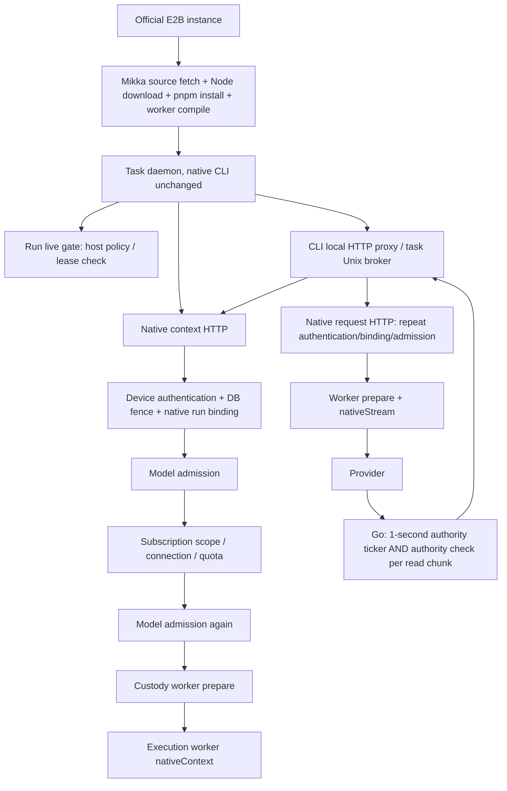

# Independent audit: Mikka native subscription runtime complexity

Date: 2026-11-03 UTC. Read-only source review of `Mikka-runtime-release` at e6d449e78a6751f2310f671d87e0e876c064bd0b and the uncommitted native-context-availability repair. No production API calls, VM connections, model prompts, deployments, project edits or test reruns were made for this audit. This is an architecture/failure review, not evidence that live acceptance passed.

## Finding

**There is demonstrable unnecessary complexity in the Mikka control path.** The official E2B templates do not require our repeated full credential preparation, duplicate model admission/audit writes, multiple independent polling loops, per-stream-chunk SQL checks or compiling Mikka on every fresh task VM. A necessary owner/run/revocation boundary does not justify every implementation of that boundary.

The highest-confidence immediate defects are the loss of error semantics and the uncoalesced repeated liveness queries. Repeated check load and repeated full preparation are real source observations; they are plausible amplifiers of the observed 1–4.6 second lookup latency, **not proof of the underlying infrastructure exception**. The new bounded retry is a reasonable containment fix; by itself it neither identifies that exception nor simplifies the architecture.

## Actual path

The local proxy/socket broker is a deliberate Mikka credential-custody design: the task receives a placeholder and uses only its frozen owner/run binding. It is not E2B's or Warp's required installation recipe. `2026-11-01-2335` explicitly accepts the task's ability to read its own worker device credential and makes the E2B VM the isolation boundary. Therefore the same-user proxy must not be described as an additional secure VM/container boundary.

## Countable work

Definitions: **G** = one `gate.checkLive()` call; **C** = one successful native-context HTTP call; **R** = one native-request HTTP call. A G currently starts a host liveness query, rather than sharing another in-flight G (`agents/tool-approval.ts:32-35`). Counts exclude retries, timeouts, policy snapshot refresh, provider-internal work, SDK-dependent extra initialization and the separately running monitors.

| Operation | Explicit count in the reviewed source |
|---|---|
| Fixed runner startup through broker creation, before adapter-specific authentication | At least 2 C (initial + broker initialization), 7 G. Adapter token/verify/spawn/send add more C/G; no single universal startup total is honest because Claude SDK and Codex app-server initialize differently. Each later subscription `check()` adds 1 C + 2 G. |
| One CLI model request, before its stream | Broker `host.check()` adds 1 C + 2 G; runner's nativeRequest wrapper adds 2 G; actual R adds another HTTP call. Total: **1 C + 1 R + 4 G**, before concurrent monitors. |
| C in the application | Device authentication/ownership, `nativeRun`, two `admitModel` calls, `access`, then Go `prepare` and Go `nativeContext`: **2 Go RPCs/process launches**, plus optional stale/unknown quota preparation/probe. |
| R in the application | Repeat device authentication/nativeRun, two `admitModel` calls and `access`; TS worker client's `nativeRequest()` performs **prepare + nativeStream = 2 Go RPCs/process launches**. |
| Background target cadence | Gate monitor calls G every second; hosted runner's separate monitor calls C + 2 G every second. Thus **C + 3 G per scheduled second per run**, when requests complete fast enough. Both timers already prevent their own reentry; neither coalesces concurrent calls from the other timer or request paths. Slow requests reduce completed ticks, so this is a target cadence, not a measured sustained rate. |
| Active Go native stream | Another 1-second ticker calls `authorizeRuntime`; **every** `response.Body.Read(8192)` also calls it, including EOF. Each run-bound authorization executes **2 explicit SQL queries**. For N reads across T timer ticks, this layer alone performs **2N + 2T SQL queries**, excluding initial authorization, readyAuth, secret-store/DB and host queries. |

Useful conservative SQL floor for C on the normal bound-cloud-device path: 4 route-auth/ownership reads; 7 explicit repository/run reads in `nativeRun` and `nativeContext/access`; at least 2 model-policy reads; 4 explicit Go authorization reads in prepare/nativeContext. **At least 17 SQL statements**, excluding policy hierarchy transactions/membership, DB fence work, credential lookup/readyAuth/cleanup/status, optional quota refresh and provider internals. This is a source lower bound, not a production trace. A request-local `authenticateDevice` memo already prevents the handler from repeating the outer route's token authentication; do not count it twice.

References for counts: `subscription-hosted-runner.ts:386-417,467,511-560,616,670-697,717-730`; `subscription-native-broker.ts:18,47-57`; `subscription-service.ts:32-57,114-170`; `subscription-worker-client.ts:127-131`; `native_broker.go:124-137,164-170`; `runtime_use.go:16-36`.

## What must remain

- Device-token ownership, workspace scope and current revocation. Do not replace these with an indefinitely cached startup verdict.
- Run owner, device, agent/consumer, frozen subscription connection/revision/model/route, live lease and stop state; explicit repository authorization on switching.
- Tenant/member policy at the credential owner and executor boundaries, including current organization model restrictions.
- No provider refresh grant in the task CLI; no API/model/account fallback; only the actual subscription transport.
- A way to terminate an idle CLI and an upstream-silent stream after authoritative revocation. Checking only before a request cannot stop a stream already in progress.
- Complete official CLI installations and their relative resources, plus explicit fresh workspace checkout/setup. The known stripped-companion failure and missing fresh Git workspace are real defects.
- Candidate-fixed independent review/verify and persisted human acceptance. These are requested product behavior, not redundant authentication controls.

## Classification summary

| Category | Items | Decision boundary |
|---|---|---|
| Keep | Stock CLI contents; explicit fresh checkout/setup; device/run/tenant identity; credential custody; fixed candidate review/verify; actual owner acceptance | Real user/product requirements and security boundaries, not optional complexity cleanup. |
| Merge/remove redundant work with narrow tests | In-flight duplicate G calls; admitted-audit writes from context-only probes; repeated build of the same trusted worker | Preserve all current denials and complete official packages; replace duplicated work, not authority. |
| Must measure/prove before removing | Full C idle monitor; pre/post policy checks; Go chunk versus ticker checks; prepare/refresh boundary; preflight broker permanent halt | Each may cover a different timing/revocation case. Count work and demonstrate the exact behavior before deleting a check. |
| Already demonstrated incorrect | Catch-all HTTP409 for unexpected infrastructure failure; swallowed typed device fence error | Correct error ownership/semantics first; do not treat retry as final architecture simplification. |

## Prioritized findings and minimal reviewable simplifications

### 1. Catch-all errors erase the distinction between revocation and unavailable authority — occurrence 7 × impact 8 = 56

Evidence: live Claude run d0169cfc... opened native session 0c5d5892...; at 16:28:29.418 its native HTTP route logged `phase=authorize, operation=null, errorClass=unknown` and returned 409. The runner cancelled. That log proves an unexpected lookup exception, not revoked access. Source: `lib/subscription-native-http.ts:95-109`, runner `:717-724`.

The current repair correctly distinguishes unexpected infrastructure 503 and explicit refusal 409, and bounds a context-only recovery attempt. Audit also found that the inner catch swallowed typed `DeviceAuthorityRevoked` / `DeviceFenceUnavailable`, preventing `withDeviceRoute` from preserving 401/503. Root was notified immediately; the working repair now rethrows `isDeviceAuthorityError`, matching the already-existing native-lease handler and tool-approval route. That is a simplification toward the existing common boundary, not a new authorization layer.

**Remaining gap:** Go `runtime_use.go:25/36` folds arbitrary SQL errors and absent rows into `account_unavailable`; `native_broker.go:38` also folds readyAuth errors into it. TS recognizes these as WorkerRefusal and still returns 409. Thus the repair covers the observed JS failure but not all equivalent availability misclassification. Distinguish `sql.ErrNoRows`/real state mismatch from typed database/store unavailability; retain fixed public error codes without provider/SQL bodies. Test real refusal has one immediate deny, transport error can recover without forwarding before success, and exhaustion stops. Do not make all `account_unavailable` retryable.

### 2. Independent polling plus no shared in-flight liveness check — occurrence 9 × impact 6 = 54

Evidence: two one-second daemon monitors and per-request pre/post G calls invoke the same host liveness endpoint. `ToolApprovalGate.checkLive` creates a fresh `host.isLive` promise each time. The timer-local checking flags only prevent self-overlap; they do not prevent cross-path overlap. The real liveness records show roughly one-second requests taking 1–4.6 seconds.

**Smallest candidate simplification:** one in-flight G promise per gate/run, cleared on settlement, with every waiter still observing abort/revocation after await. This is concurrency coalescing, not a successful-result TTL cache. It does not authorize from stale success or change the polling interval. Verify N concurrent callers cause one host call, revoke wins for all waiters, rejected/false results are not cached, next request performs a fresh check, and an unresolved old promise cannot reauthorize a revoked gate. Then profile whether the remaining full C monitor is needed separately from an idle-session authority monitor.

Do not delete the full native-context monitor yet: the run gate does not check subscription pause/disconnect/revision/quota, and those can change while the CLI is idle. A merged lightweight authority view would have to cover that extra state explicitly.

### 3. Full context preparation and successful-use audit on every monitor tick — occurrence 9 × impact 7 = 63

Evidence: `SubscriptionService.nativeContext:130,132` performs model admission twice; both use the default `auditAllowed=true`. `ModelAdmissionStore.admit:95` writes `model.admitted` whenever a model policy exists. Hence one context tick can record at least **two admitted-generation-looking audit events per scoped workspace without any model request**. Every C also invokes `prepare`; `PrepareRuntime` includes readyAuth, optional credential refresh/projection, cleanup and status. Each TS call spawns a Go process. This is much heavier than checking an unchanged revision/expiry.

**Minimal immediate simplification:** pass `auditAllowed=false` for context/probe admission, using the existing explicit parameter in `assertSubscriptionModelTransport`; retain authorization and denials. Record actual generation admission at the actual request boundary once. Preserve the second admission's safety check until a race test shows its pre-check can be removed; it currently rechecks policy after asynchronous quota work.

**Next bounded design:** separate lightweight current authority/status from credential preparation/refresh. Prepare only when the current credential projection needs it, still followed by current owner/revision checks before use. Do not cache credential validity beyond expiry or bypass a reconnect generation. Measure RPC/SQL/process counts and verify pause/disconnect/reconnect and policy changes during prepare win. No such simplification was implemented in this audit.

### 4. Stream authority checks scale with provider chunking — occurrence 9 × impact 7 = 63

Evidence: Go native stream's one-second ticker and every read both execute the same two-query authorization function. The chunk rate determines database load and introduces DB latency into output delivery. Fast small chunks yield an unbounded-by-time authorization rate; the current code deliberately has no chunk-independent coalescing.

**Candidate simplification requiring behavioral proof:** consolidate ticker and chunk admission into one stream-specific authority monitor/serialized decision path. Concurrent checks can share an in-flight result; do not silently substitute a long success TTL. Retain timely cancellation while upstream is silent, and do not emit a buffered chunk after an observed authoritative revocation. Test many chunks with controlled authority latency, concurrent tick/read, revocation between bytes, silent upstream, cancellation and transport failure; compare emitted bytes and actual SQL count. Deleting the per-chunk check without specifying the revoked-output boundary is not an acceptable shortcut.

### 5. Native broker permanently halts even when no upstream request occurred — occurrence 5 × impact 5 = 25

Evidence: `subscription-native-broker.ts:76` sets `halted=true` for **every** error, including the prior host.check rejection at line47, while the comment justifies this as uncertainty after a provider outcome. A failed preflight before `nativeRequest` has a known zero-provider-effect outcome.

Separate the pre-dispatch denial phase from uncertain post-dispatch/provider failure. This can allow a subsequent explicitly fresh authorization attempt without replaying an already sent generation. Authoritative denial must still revoke the session; no blind provider replay. This is a secondary simplification after the authority/error contract is fixed, not necessary to rush into the immediate retry patch.

### 6. Build and dependency resolution on every fresh task machine — occurrence 10 × impact 6 = 60

Evidence: official instance bootstrap lines22–44 fetch full source, download private Node, run frozen pnpm install and compile the worker. `build-cloud-worker.mjs:1` still says “never on a cold run,” contradicting the new bootstrap. Node and full CLI preservation are sensible; recompiling the same trusted Mikka worker per task is not required by E2B or the preservation decision.

Build **Mikka's own** complete runtime artifact once in CI, attest its source/dependency/worker digest, and expand it only under the private additive prefix on the stock template. Leave every official template/CLI file unchanged. Keep complete external SDK resources, not just a bundle executable. Validate missing/corrupt artifact rejection and a real fresh-instance subscription run. This reduces runtime npm/build-system dependencies without reintroducing template mutation or package stripping. It is a release simplification proposal, not an already tested replacement artifact.

### 7. Worker identity/release coupled to unrelated root test scripts — occurrence 9 × impact 7 = 63

Evidence: `build-template.py:27,122-124` hashes the entire root package.json; official runtime workflow triggers on it. The current session recorded multiple app/test-script-only commits starting new worker releases and requiring manual cancellation to hold live acceptance fixed. This is Mikka release coupling, not E2B behavior.

Separate the built worker artifact version from application revision. Preserve immutable provenance for both and deploy a new worker only when its actual artifact/runtime input changes. Do not blindly omit all root scripts/dependencies: install/build hooks may genuinely affect runtime. An artifact-content hash or explicitly normalized build manifest needs a test that runtime dependency/hook changes alter the digest while unrelated test command edits do not. A stable acceptance deployment should be selected independently of other sessions' application releases; manual cancellation is not a durable design.

## What this audit does not establish

- It does not identify which database/provider/network condition caused the observed unexpected authorize exception. Safe SQL-state/error-class/phase diagnostics are still needed; no raw credentials/messages should be logged.
- It does not prove every repeated read can be removed. Pre/post checks across an asynchronous credential or policy transition may be intentional TOCTOU defenses. Coalesce concurrent work first, and remove a sequential boundary only with its revocation-race test.
- It does not claim Warp cloud harness documentation supports subscription billing. Its documented cloud Codex path uses API balance, not ChatGPT subscription. That cannot substitute for this task's actual subscription acceptance.
- It does not call current official-template preservation or runtime probes final acceptance. Claude execution, Codex final verify, repository switching, continuation and owner UI evidence still need actual results.

## Official versus local requirements

Official E2B documentation supports prebuilt `codex`/`claude` templates and optional custom-template layering; it does not require our wrappers, stripping packages, full source builds on each run or one-second multi-layer probes. Warp documents fresh workspaces with repositories/setup, native harnesses and staged visible verification. Those references support explicit preparation and independent behavioral evidence, not these specific polling/control-plane mechanisms.

Mikka-local requirements: owner/workspace credential custody, frozen model/subscription, team policies, user-requested independent review/verify, autonomous authorized repository switching, official-files preservation and normal UI acceptance. Their implementation is reviewable and may be simplified without discarding the requirement.

Sources already retrieved in this task and reused per read-docs skill:
- https://docs.e2b.dev/agents/codex
- https://docs.e2b.dev/agents/claude-code
- https://docs.e2b.dev/template/quickstart
- https://docs.warp.dev/platform/environments/#what-an-environment-includes
- https://docs.warp.dev/platform/harnesses/#what-stays-the-same
- https://docs.warp.dev/factories/how-factories-work/#stages
- https://docs.warp.dev/platform/harnesses/authentication/#create-an-openai-api-key

## Recommended order

1. Ship the proven error-contract correction and bounded context-only recovery with immediate typed revocation behavior; explicitly retain the unaccepted live status.
2. Coalesce concurrent G calls and remove probe-only admitted audit writes, preserving every existing deny boundary. These have direct source evidence and small testable changes.
3. Measure C/R/worker/SQL counts and classify Go availability separately from true no-row denial.
4. With behavioral tests in place, simplify the duplicated full-context monitor and per-chunk/ticker authority path.
5. Move Mikka compilation to a complete immutable runtime artifact, then decouple artifact release from unrelated app/test-script commits.

No code was changed by this audit.
