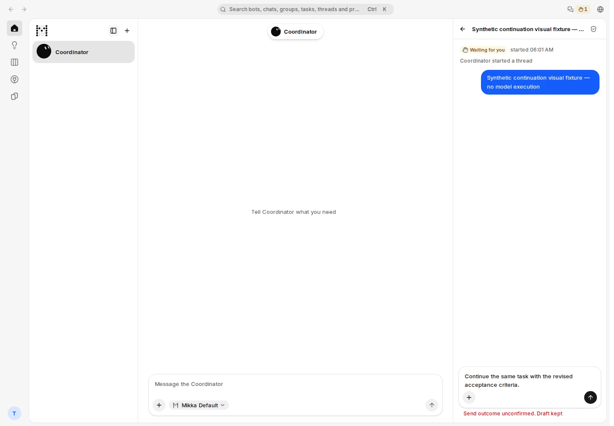
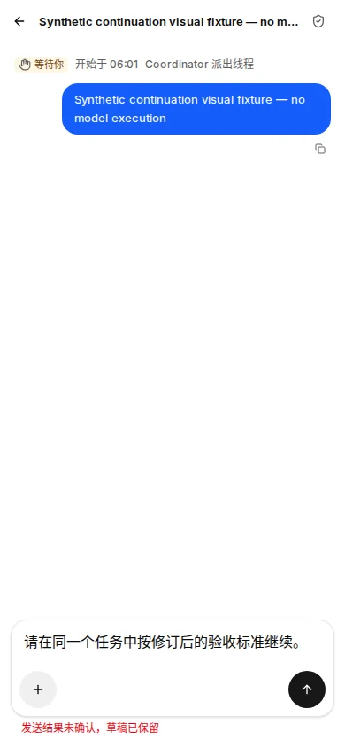
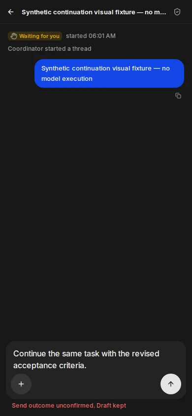

# Thread submission recovery UI — PR #1202

Source: `c2faa3843aae62411b03da505027a1f094bee223`  
Tree: `dac5bee6e7d747c0db8471d350a684707678deab`

## Result

The full local production build passed. Normal TestAccountPool login and owner-scoped reads passed (owner 200; peer 404). Three screenshots passed layout checks and were independently rendered and visually reviewed by the root reviewer: English desktop 1440/light, Chinese 390/light, and English 390/dark.

**The capture driver still exited 1.** Both explicitly registered synthetic fixture rows were removed, the two test sessions were revoked, no active lease remains, the owned server stopped, and port 3124 is closed. The owner account's whole-account fingerprint differs from its baseline; the peer matches. The account pair and lease remain quarantined with `ACCOUNT_DIRTY`. No pool override, post-release application-row deletion, or recapture was used to erase this result. Only a baseline hash is retained, so the exact historical field delta cannot be reconstructed. The raw `review.json` preserves `status: failed`.

## What is shown

These are explicitly synthetic stopped-run and per-window pending-submission fixtures in a real local production build, using normal test-account authentication. They show the retained editable draft and “Send outcome unconfirmed. Draft kept” copy. No continuation was submitted, no provider/model was invoked, and no browser test suite ran.

| User task | Before | After / evidence |
| --- | --- | --- |
| Understand a lost send response | “Send failed” implied that work had not started. | Unknown outcome is stated explicitly; the retained draft and send control remain visible on all three layouts. |
| Retry the same unchanged draft | A new host event could repeat the continuation. | Stable request identity, original thread binding, lost-response recovery, and concurrent replay are covered by the separate source/PostgreSQL contracts. The screenshots do not simulate a real retry. |
| Change the request | No request identity contract. | Changed payload receives a new request identity; reused IDs with another payload or thread are rejected in the focused contracts. |
| Read a thread owned by another account | Existing owner boundary. | Normal peer GET returns 404; no authentication or authorization mechanism changed. |

## Verification

- Full `pnpm build`: command `cmd_4f2f565e06b342149f06a78b8d7f`, exit 0, 101.364 seconds.
- Focused source and real PostgreSQL: **41 passed, 0 skipped**, command `cmd_1f5554f5cc6d409e8eea5b2bc889`.
- Exact-head CI: 22 completed checks, 18 successes and 4 scope-based skips.
- Typecheck, changed-file lint, i18n/copy/UI policy, existing composer DOM contract, and diff checks passed.
- Capture: command `cmd_e796e739e9334e4fa374942a379f`, **exit 1** for the pool fingerprint mismatch described above.
- Root independently reviewed the fixed implementation, the original `runAction` error propagation and locked `expectedRunId` check, and all three images. No code or visual blocker was found.

## Screenshots

The WebP files are faithful format exports of the original captures (Sharp quality 88, effort 6); no content was edited. Original PNG hashes and exported image hashes are in `provenance.json`. Temporary base64 text blobs were used solely to let the independent reviewer render the exact exported bytes without a local filesystem.
