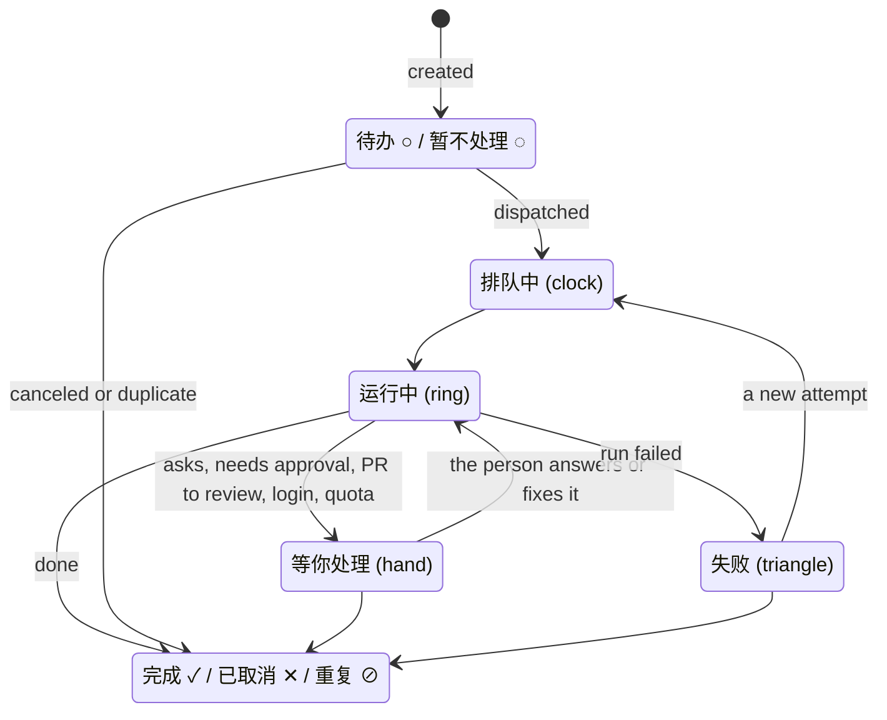

# One icon per task state; the hand is only 等你处理

- Date: 2026-11-07
- Source: Alex, 2026-11-07, on the web build of [2045](2026-11-07-2045-tasks-only-threads-inside.md), where every row under 待处理 showed a raised hand: 「应该是 waiting for you 的时候，需要我处理的时候才会举手」, 「我明确要求过，每一个状态都要有不同的符号」 and 「你有去做过调研吗？……依据是哪一个竞品」. After the research below he approved the seven-state model: 「可以按照你新的这个东西去做」.
- Rule: R-52; `mobile.md` 「Where it lives」
- Superseded in part by: [2026-11-13-1405](2026-11-13-1405-one-task-status.md) (a task row shows its status field's icon; the run states are the Agent mark beside it, and lists are no longer grouped 等待你 · 进行中 · 待办 · 已完成).
- Superseded in part by: [2026-11-08-0130](2026-11-08-0130-task-state-icon-colours.md) (mobile task and attempt glyph colours; shapes and the ban on dots and badges remain).
- Superseded in part by: [2026-11-07-2300](2026-11-07-2300-one-conversation-per-task.md) (受阻 has its own octagon, not the hand; an attempt never shows the hand)
- Replaces, in part: [2045](2026-11-07-2045-tasks-only-threads-inside.md) rules 3 and 4 (the group 待处理 and its icon on every row); the board-blocked tasks in 待处理 from the #1673 mapping
- Superseded in part by: [2026-11-09-0050](2026-11-09-0050-paid-blocks-as-shipped.md): "use semantic tokens (BoardUI on the web…)" applies to Mikka's own UI and BoardUI components; inside an affectUI or beUI block the block's own colours stay.

## What went wrong

- [2026-11-02-0220](2026-11-02-0220-waiting-raises-a-hand.md) gave the raised hand to one state, 等待你, because it looked too much like the others.
- 2045 merged 等待你, 受阻, a failed run and a PR to review into one group, 待处理, and gave the group the hand. It never said which icon a row carries, so the build put the group's hand on every row. A failed task and a task waiting for a reply then looked the same.
- 「待处理」 also reads as "not handled yet", close to 待办.

## Research

| Product | Task or run states | Icons |
| --- | --- | --- |
| LobeHub (source, `src/components/ExecutionStatus.ts`) | 7: backlog, scheduled, running, paused (waiting for a person), failed, completed, canceled | One per state ("one semantic, one visual"). The hand is only for waiting for a person. Its 待审阅 group holds paused and failed; the group header has the hand, and each row its own icon. Inside a task, quota, device offline and timeout share one alert icon, with the reason in words. |
| Warp Oz, Runs ([docs](https://docs.warp.dev/agent-platform/cloud-agents/managing-cloud-agents)) | 5: Working, Blocked (waiting on user input or a required step), Failed, Success, Canceled | One per state; Failed is a triangle. |
| Linear ([relations](https://linear.app/docs/issue-relations)) | Backlog, Todo, In Progress, Done, Canceled, Duplicate | One per status. "Blocked by" is a relation, shown as a flag, not a status. |
| Devin ([API](https://docs.devin.ai/openapi.yaml)) | working, blocked (waiting for the user or an approval), finished | — |

No product has an icon for each reason. They have five to seven states, one icon each, and write the reason as text.

## The model

A task row shows one state. In 等待你 and 进行中 the state comes from the task's current attempt (R-52's judgement). In 待办 and 已完成 it is the task's own board status, so the row shows the board's icon.

| Group | State | Icon (lucide; SF Symbol on iOS) | When |
| --- | --- | --- | --- |
| 等待你 | 等你处理 | raised hand (`Hand`; `hand.raised`) | The task needs the person: a question, an approval, a PR to review. The reason is the row's grey line: 等你回复, 等你确认, 待审阅. |
| 等待你 | 受阻 | octagon (`OctagonAlert`; `exclamationmark.octagon`), added by [2300](2026-11-07-2300-one-conversation-per-task.md) | A login, key or permission to fix, quota used up, a device offline. The grey line says which. |
| 等待你 | 失败 | warning triangle (`TriangleAlert`; `exclamationmark.triangle`) | The attempt failed and nobody took over. The raw error stays inside the attempt (2026-11-05-0330). |
| 进行中 | 运行中 | turning ring (`CircleDot` still, the ring animating; `circle.dotted` or a spinner) | The attempt is preparing, running or finishing. |
| 进行中 | 排队中 | clock (`Clock`; `clock`) | Queued, or waiting for its next scheduled run. |
| 待办 | 待办 / 暂不处理 | the task's board icon: ○ / ◌ (`Circle` / `CircleDashed`), or its other open status | Open, with no active attempt. |
| 已完成 | 完成 / 已取消 / 重复 | the board's ✓ / ✕ / ⊘ (`CircleCheck` / `CircleX` / `CircleSlash2`) | Closed. |

- **Failed is a triangle, not ✕.** On our board ✕ already means 已取消 (`components/workspace/issue-properties.ts`). LobeHub uses the triangle for a failure the person should act on, and Warp uses it for Failed.
- **The lists add no new icons.** 待办 and 已完成 use the board's existing icons, so a task looks the same on the board and in a list ([2026-11-04-2220](2026-11-04-2220-task-circle-thread-bubble.md): a task is its board status circle).
- **Group headers** carry their group's icon: 等待你 the hand, 进行中 the ring, 待办 ◌, 已完成 ✓. A row never borrows its group's icon.
- **Waiting on another task is not waiting for you.** A task blocked by an open task (等 MIK-12) or flagged blocked stays in its own group with its own icon and puts the reason in its grey line. It does not get the hand. The board's 受阻 column ([2026-11-06-1600](2026-11-06-1600-blocked-board-column.md)) is unchanged.
- **The window bar** shows the hand and the count of 等你处理 tasks only, not failed ones.
- **The icons are coloured, as LobeHub colours its status glyphs** (Alex, 2026-11-08: grey-only icons were rejected; 「没有颜色」). 等你处理 blue (info), 受阻 orange (warning), 失败 red (error), 运行中 and 排队中 orange (warning), 完成 green (success), 待办 / 暂不处理 / 已取消 / 重复 grey. Use semantic tokens (BoardUI on the web, iOS system colours on the phone). The text, including the grey reason line, is not coloured.
- **No dots**, no coloured corner marks, no badges (2045 rule 4 still holds). A coloured icon is not a dot.

Groups, top to bottom: **等待你 · 进行中 · 待办 · 已完成**; 已完成 is collapsed.
