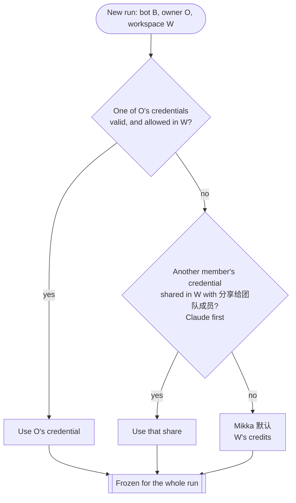

# Orchestration: models, Agents, machines, scheduling, billing

- **Status:** this is the source of truth for these topics from 2026-10-31
  ([decision](decisions/2026-10-31-2300-orchestration-spec.md)). When another
  document, decision or code comment disagrees, this file wins and the other
  one gets fixed. `decisions.md` rows stay as frozen history.
- **Built on:** Alex's rules of 2026-10-31 and his answers to the open
  questions, both relayed by the coordinator. Also
  [personal vs workspace](decisions/2026-10-31-2130-personal-vs-workspace.md)
  and [bots reply on Mikka 默认](decisions/2026-10-31-2110-bots-reply-on-mikka-cloud.md).
- **Scope:** the simplest system consistent with those rules. Where today's
  code differs,
  [the conflict table](research/2026-10-31-orchestration-conflicts.md) names
  the fix and its owner.

## 1. Concepts and names

| Word | What it is |
| --- | --- |
| **Account** | A person. Owns their sign-in, devices, app connections, cards, credits they verified, model credentials and E2B key. |
| **Personal workspace** | One per account, with exactly one member. Every account has one. |
| **Team workspace** | Several members, with the team's policies, secrets, credits and payment method. It has no E2B key of its own. |
| **Bot** | Lives in one workspace and has one owner. Runs on Mikka's own AI SDK on Vercel; when it has work to do, it sends a thread through the daemon to Claude Code or Codex (R-05). |
| **Thread** | The work a bot dispatched (`agent_runs`). Each turn of it is a **run**. |
| **Agent** | The coding worker that runs a thread: Claude Code or Codex. Code may say `harness`; the UI says Agent (R-43). |
| **Model credential** | A Claude or ChatGPT/Codex subscription login, an API key, or a custom provider. Bound to the account and managed on the page 「API 与订阅」. |
| **Share** | A member's opt-in to make one of their credentials usable in one team workspace. Off by default. A share serves only the owner's own bots and runs unless the owner ticks 「分享给团队成员」. |
| **Mikka 默认** | The hosted model, paid from the workspace's credits. It is a **model**, never a machine. |
| **Machine (电脑)** | Where an Agent runs: **Mikka Cloud** (a sandbox on the run owner's own E2B key) or a **device** (a personal computer running the desktop app, or a server running the daemon). Both are **runners** with one contract (§3). |
| **Mikka Cloud** | The cloud machine. It is a **machine**, never a model. Mikka hosts no sandbox of its own. |
| **Environment** | What a thread executes in. One per thread, reused across that thread's runs (§5). |
| **Lease** | A machine's time-limited claim on a run, renewed by heartbeat (ADR 0012). |

Never write 「Mikka Cloud」 for the hosted model, and never write
「Mikka 默认」 for the machine.

## 2. Model resolution

A run's model and credential are decided when the run is created and frozen
for that run. Three things are decided independently: the model (this
section), the machine (§4) and concurrency (§5).



1. **The bot owner's own credential**, when it is valid (connected, not
   revoked or paused, quota left) and allowed in this workspace. In the
   personal workspace it is always allowed. In a team it is allowed when the
   owner shared it there and the admin has not turned off
   「允许成员使用个人订阅和 API Key」. If several qualify, the bot's saved choice wins;
   after that a subscription comes before an API key, and Claude comes before
   ChatGPT/Codex.
2. **Otherwise another member's credential** shared in this workspace with
   「分享给团队成员」 ticked, Claude first.
3. **Otherwise Mikka 默认**, through the usual hosted admission (§7).

Rules that hold everywhere:

- Never refuse with 「未连接账号」 or `binding_required`. A person with no
  credential gets Mikka 默认.
- **No switch mid-run.** A run frozen on a credential that disappears stops,
  with the subscription line and 重试. A credential disappears when it is
  disconnected, revoked, paused, its share is withdrawn, its owner leaves, or
  the admin switch is turned off.
- **Quota exhausted.** The run that hit the limit stops; it never switches.
  - When 「订阅额度用完后，自动改用 API Key」 is on (the default) and the owner has
    an API key of their own, the next run uses that API key. The chat says so
    in one line before the reply: 「Claude Max 额度用完，已改用 DeepSeek API Key
    继续（按 token 计费）· 改回」; 改回 opens the model picker. Before sending,
    the composer names the used-up subscription and the key the next message
    moves to, or when the quota resets.
  - When nothing is left, the stopped run opens a popup. The person picks the
    model or credential themselves, and 重试 runs the turn on that choice.
    重试 never re-resolves on its own.
- Conversation compaction uses the same frozen model and credential as the
  turn.
- The same order serves bot chats and threads. The bot itself runs on
  Mikka's own AI SDK on Vercel; a thread goes through the daemon to the Agent
  mapped to the model (§3).

## 3. Agents and runners

**Model → Agent.** GPT/OpenAI models run on **Codex**. Every other model runs
on **Claude Code**, including Mikka 默认 and models reached through an API
key or a custom provider. In 「API 与订阅」 a person can override which Agent
runs each model; the override is a per-model setting.

「Bot 本身走我们自己的 AI SDK，跑在 Vercel 上。Bot 需要干活时，通过 daemon 把任务派给
Claude Code 或 Codex。」 (Alex, R-05)

**A user's computer or server is a runner, just like E2B.** Every runner meets
the same contract: a clean environment for the thread, Agents that Mikka
installed, and credentials injected at the start of each run and wiped at its
end.

| | Mikka Cloud (E2B) | Device with Docker | Device without Docker (most Macs) |
| --- | --- | --- | --- |
| Environment | A sandbox from the Mikka template | A container from the same image | A worktree plus a temporary Agent config dir (`CLAUDE_CONFIG_DIR` / `CODEX_HOME` style) |
| Agents | Preinstalled in the image | Preinstalled in the image | The daemon's own copies in a private dir (e.g. `~/.mikka/harness`) |
| Isolation | The sandbox | The container | The Agent's own sandbox plus Mikka's approval policy |

- **One image.** One multi-arch Dockerfile builds both the E2B template and
  the device image.
- **Daemon-managed Agents.** The daemon installs and updates its own copies
  of Claude Code and Codex on first use. It never uses, touches or detects
  the person's own Claude Code or Codex installs, logins or config.
- **Device capability check.** This replaces Agent detection. A device
  reports its OS, architecture, free disk, whether Docker is available, and
  its 「允许自动调度」 switch (§4). A sandbox runs only a boot self-check; a
  failed check marks the runner unhealthy, and its runs are placed again.
- **Model slots** come from the daemon's own Agent copies, never from the
  person's CLI settings.
- **Tools.** Tool permissions follow the run's allow / ask / deny policy
  (`packages/daemon/src/agents/tool-approval-policy.ts`). Connected apps reach
  the run as one MCP entry per toolkit, through Mikka, using the run token
  ([apps in device runs](decisions/2026-10-31-1937-apps-in-device-runs.md)).

## 4. Machine selection and fallback

Mikka hosts no sandboxes and offers no free cloud trial. A run's machine is
always the run owner's own: Mikka Cloud on **their** E2B key, or one of
**their** devices. An E2B key is personal and is never shared, because a
sandbox carries its owner's credentials and app access. A member never runs
on another member's E2B. In a team, each member brings their own key.

**Automatic scheduling.** Each device has a 「允许自动调度」 switch. It is on
by default for servers and off by default for personal computers (Mac,
Windows). Automatic placement uses only devices that have it on. A person can
still pick any of their own devices by hand.

**Placing a new run:**

1. A machine the run asks for is used as asked. That means a label rule, a
   thread continuing in its environment, a device-only source event, or a
   device the person picked.
2. Otherwise Mikka Cloud, when the owner has an E2B key. Cloud is the default
   (R-23).
3. Otherwise the owner's online device that has 「允许自动调度」 on and
   passes the capability check, servers first.
4. Otherwise 立即警告: no run is created and the bot at once warns that no
   computer is available, in one action card 「没有可用的电脑」 that says
   先连接或开启一台电脑，或者填入你的 E2B API Key 用云端运行。 It has two rows:
   连接电脑 (Settings › 电脑) and 填入 E2B Key (the person's own key; no row
   offers Mikka's cloud). Answering a row (a computer switched on, the key
   saved) makes the bot dispatch again
   ([run machine fallback](decisions/2026-10-31-2200-run-machine-fallback.md),
   [two rows](decisions/2026-11-01-1215-star-is-the-pin.md)).

**When a machine goes away during a thread:**

- **The E2B sandbox is gone:** start a new one from the template and continue
  the thread from its branch.
- **A server goes offline:**
  1. Move the run to E2B, when the owner has a key.
  2. Otherwise move it to the owner's personal computer that has
     「允许自动调度」 on.
  3. Otherwise end the run and 立即警告 with the same action card.
- **A personal computer goes offline:** apply the same three steps.

This replaces the old 「设备离线时」 setting.

A device runs only its owner's work. A team admin's 「个人设备」 switch can
leave members' devices out of that workspace.

## 5. Scheduling and concurrency

```mermaid
sequenceDiagram
  participant S as Mikka server
  participant M as Runner (sandbox or device daemon)
  S->>S: create run (model + credential + machine frozen), queued
  M->>S: claim (lease)
  S-->>M: assignment + run token + the resolved owner's credential
  loop while running
    M->>S: heartbeat renews the lease
  end
  M->>S: finish
  S->>S: revoke the run token
  M->>M: wipe the credential; the environment pauses without it
```

- **One environment per thread**, reused across the thread's runs. A sandbox
  pauses between runs, and a container or worktree stays. Credentials are
  injected at the start of every run and are absent while the environment is
  paused or idle. The environment ends when the thread ends.
- **Concurrency.** Threads run in parallel. The runs of one thread run one at
  a time. There are no Mikka machine caps: the owner's own E2B account sets
  the limit.
- **Leases.** A claimed run holds a lease that the heartbeat renews. When a
  lease runs out because the machine is gone, the run is placed again by §4,
  keeping its frozen model and credential.
- **No machine.** A run is created only once a machine is chosen; with none,
  the bot warns at once with the action card (§4).
- **Quota exhausted.** For a credential, see §2. For Mikka 默认, the hosted
  refusal line appears with 验证银行卡 / 充值 and 重试. Admission checks only
  that the balance is positive, then charges actual use afterwards.

## 6. Credentials lifecycle

Environments hold software only: the repository, dependencies and
preinstalled Agents. No snapshot or paused environment contains a login,
token or key.

1. **At rest:**
   - Subscriptions, API keys and custom providers live in the subscription
     service's secret bundle, bound to the account.
   - App connections live in Composio and are reached only through Mikka.
   - Saved logins live in the credential vault.
   - The E2B key belongs to the account. Only the server uses it; it is never
     handed to a sandbox or a model.
2. **At run start:** the server resolves the run's credential owner: the bot
   owner, or the share's owner when §2 step 2 applied. It injects only that
   credential, plus a run token for Mikka's MCP and apps. The credential lands
   only inside the run's environment: the sandbox, the container, or the
   temporary Agent config dir. It never comes from, or goes to, the person's
   own CLI config.
   On a device, a subscription run gets only that run's short-lived access
   token, on a pipe or in memory, never on disk; the refresh grant never
   leaves the server. A member's share used on the member's own device works
   the same way. Each lease request is checked again (run, device, binding,
   revocation). Codex asks again when the token expires; a Claude Code run
   ends when its token does.
   A subscription on a device or a sandbox never leaves the server: the
   Agent holds a placeholder and sends its model requests to Mikka, which
   checks the run and adds the token to each one. That holds for a member's
   share used on the member's own device too.
3. **At run end:** the run token is revoked and the injected credential is
   deleted. The environment pauses or idles without it.

When a member leaves a team, their shares, card designation and credit
shares leave that workspace at once, and their bots there are paused (暂停).
An admin may take a bot over. It then runs on the admin's resources or the
workspace's.

## 7. Billing

The workspace where the work happens pays.

| Work | Who pays |
| --- | --- |
| A run on a subscription | The credential owner's own plan quota. 0 credits. |
| A run on an API key or a custom provider | The key owner, billed by their provider. 0 credits. |
| A run on Mikka 默认 | That workspace's credits. |
| Mikka Cloud time | The run owner's own E2B account, billed by E2B. Mikka charges nothing. |
| A device | Nobody. |
| Coordinator, memory extraction and other work with no workspace of its own | The personal workspace, never 「the oldest workspace」. |

- **Verification is per person.** A person verifies a card once, on Stripe's
  page. The one-off USD 1 credit goes to the verifier's personal workspace,
  once per card.
- **The payment method is per workspace.** Each workspace designates the card
  its credits are bought with.
- **Credits can be shared.** As with a card designation, a person may opt in
  to share their credits with a team workspace. Both go away when that member
  leaves.
- **Hosted admission** requires a verified person and a positive balance in
  the workspace.

## 8. MVP vs later

| MVP | Later |
| --- | --- |
| A personal workspace for everyone; team workspaces beside it | — |
| Account-level subscriptions, API keys and custom providers on 「API 与订阅」; per-workspace shares; 「分享给团队成员」; the admin switch | Per-member spend caps |
| Model order of §2; Mikka 默认 when there is nothing else; no mid-run switch; 「订阅额度用完后，自动改用 API Key」; a popup when nothing is left | — |
| Model → Agent mapping with a per-model override | — |
| Mikka Cloud on each person's own E2B key, with no Mikka caps | — |
| Personal computers and daemon servers as runners with the same contract: daemon-managed Agents, a container where Docker exists, otherwise a worktree plus a temporary config dir, one multi-arch image | — |
| A device capability check and 「允许自动调度」 instead of Agent detection and 「设备离线时」 | — |
| 立即警告 (the action card) when there is no machine; the offline flow of §4 | — |
| One environment per thread; leases and heartbeats; credentials injected each run and absent while paused | — |
| Card verification per person; credit and card shares per workspace | — |
| No Mikka-hosted sandboxes and no free cloud trial | (not planned) |
