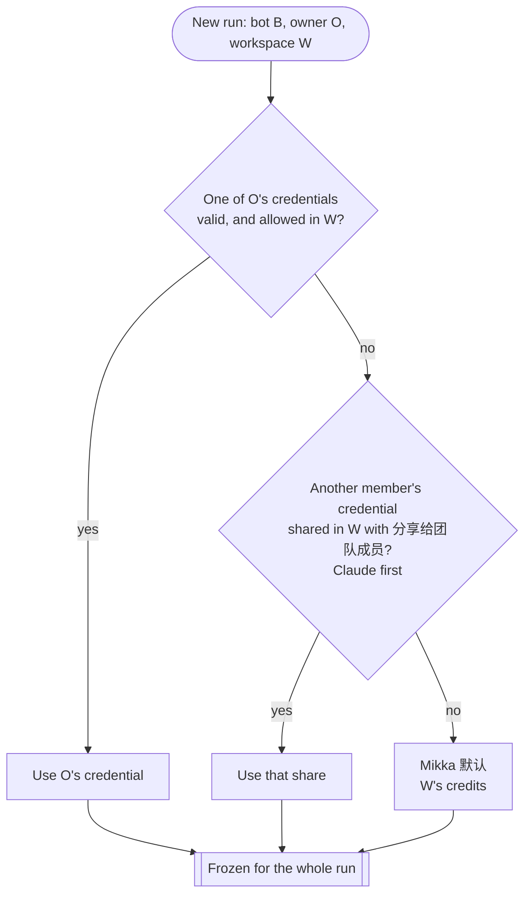

# Orchestration: models, Agents, machines, scheduling, billing

- **Status:** this is the source of truth for these topics from 2026-10-31
  ([decision](decisions/2026-10-31-2300-orchestration-spec.md)). When another
  document, decision or code comment disagrees, this file wins and the other
  one gets fixed. `decisions.md` rows stay as frozen history.
- **Built on:** Alex's rules of 2026-10-31 and his answers to the open
  questions, both relayed by the coordinator. Also
  [personal vs workspace](decisions/2026-10-31-2130-personal-vs-workspace.md)
  and [bots reply on Mikka 默认](decisions/2026-10-31-2110-bots-reply-on-mikka-cloud.md).
- **Scope:** the simplest system consistent with those rules. Where today's
  code differs,
  [the conflict table](research/2026-10-31-orchestration-conflicts.md) names
  the fix and its owner.

## 1. Concepts and names

| Word | What it is |
| --- | --- |
| **Account** | A person. Owns their sign-in, devices, app connections, cards, credits they verified, model credentials and E2B key. |
| **Personal workspace** | One per account, with exactly one member. Every account has one. Only that person's bots, chats, tasks and threads; personal billing; no team settings ([2310](decisions/2026-11-01-2310-personal-and-team-workspaces-apart.md)). |
| **Team workspace** | Several members, with the team's members, policies, shared credits and payment method. Secrets belong to every workspace, personal or team ([0231](decisions/2026-11-02-0231-workspace-is-the-tenant.md)). It has no E2B key of its own. Nothing moves between it and a personal workspace; a personal workspace is never upgraded into one. |
| **Bot** | Lives in one workspace and has one owner. Runs on Mikka's own AI SDK on Vercel; when it has work to do, it sends a thread through the daemon to Claude Code or Codex (R-05). |
| **Thread** | The work a bot dispatched (`agent_runs`). Each turn of it is a **run**. |
| **Agent** | The coding worker that runs a thread: Claude Code or Codex. Code may say `harness`; the UI says Agent (R-43). |
| **Model credential** | A Claude or ChatGPT/Codex subscription login, an API key, or a custom provider. Bound to the account and managed on the page 「模型与订阅」 ([1400](decisions/2026-11-02-1400-model-order-dispatch.md)). |
| **Share** | 「分享给团队成员」: a member's opt-in, in one team workspace, to let other members' bots use one of their credentials. Off by default. The owner's own bots need no share ([2240](decisions/2026-11-01-2240-own-credentials-always-usable.md)). |
| **Mikka 默认** | The hosted model, paid from the workspace's credits. It is a **model**, never a machine. |
| **Machine (电脑)** | Where an Agent runs: **Mikka Cloud** (a sandbox on the run owner's own E2B key) or a **device** (a personal computer running the desktop app, or a server running the daemon). Both are **runners** with one contract (§3). |
| **Mikka Cloud** | The cloud machine. It is a **machine**, never a model. Mikka hosts no sandbox of its own. |
| **Environment** | What a thread executes in. One per thread, reused across that thread's runs (§5). |
| **Lease** | A machine's time-limited claim on a run, renewed by heartbeat (ADR 0012). |

Never write 「Mikka Cloud」 for the hosted model, and never write
「Mikka 默认」 for the machine.

## 2. Model resolution

A run's model and credential are decided when the run is created and frozen
for that run. Three things are decided independently: the model (this
section), the machine (§4) and concurrency (§5).



1. **The bot owner's own credential**, when it is valid (connected, not
   revoked or paused, quota left). It is allowed in every workspace the owner
   belongs to, with no switch and no admin limit ([2026-11-01-2240-own-credentials-always-usable](decisions/2026-11-01-2240-own-credentials-always-usable.md)). If several qualify, the bot's saved choice wins;
   after that a subscription comes before an API key, and Claude comes before
   ChatGPT/Codex.
2. **Otherwise another member's credential** shared in this workspace with
   「分享给团队成员」 ticked, Claude first.
3. **Otherwise Mikka 默认**, through the usual hosted admission (§7).

Rules that hold everywhere:

- Never refuse with 「未连接账号」 or `binding_required`. A person with no
  credential gets Mikka 默认.
- **No switch mid-run.** A run frozen on a credential that disappears stops,
  with the subscription line and 重试. A credential disappears when it is
  disconnected, revoked, paused, its share is withdrawn (for other members'
  bots), its owner leaves, or the admin turns 「分享给团队成员」 off there.
- **Quota exhausted.** The run that hit the limit stops; it never switches.
  - When 「订阅额度用完后，自动改用 API Key」 is on (the default) and the owner has
    a compatible API key for the same frozen model, the next run uses that API key. The chat says so
    in one line before the reply: 「Claude Max 额度用完，已改用 Claude API Key
    继续（按 token 计费）· 改回」; 改回 opens the model picker. Before sending,
    the composer names the used-up subscription and the key the next message
    moves to, or when the quota resets.
  - When nothing is left, the stopped run opens a popup. The person picks the
    model or credential themselves, and 重试 runs the turn on that choice.
    重试 never re-resolves on its own.
- **Allowance observation.** Unknown, stale or scope-ambiguous quota is 待检查,
  not available or exhausted. Dispatch refreshes it without requiring a visit
  to Settings. A failed check offers retry and never silently moves to a paid
  API key. Model-specific windows affect only the requested model.
- Conversation compaction uses the same frozen model and credential as the
  turn.
- This order serves bot chats. A thread uses the person's 优先使用的模型,
  with task-difficulty routing when enabled (§4,
  [1400](decisions/2026-11-02-1400-model-order-dispatch.md)). The bot itself
  runs on Mikka's own AI SDK on Vercel; a thread goes through the daemon to
  the entry's Agent (§3).

The current label is **优先使用的模型** (Preferred models). This is a
priority list, not an authorization whitelist: an explicitly requested model
may still use its authorized credential under decision 1400. The selected
thread model and credential take precedence over the bot's chat preference.
The chooser and dispatch use the same credential and machine availability.

Settings keeps account credentials and the person's defaults in the current
workspace under separate headings. Bot chat choice belongs to that bot.
[The settings flow](subscription-execution-settings.md) records these scopes
and the recovery destinations.

## 3. Agents and runners

**Model → Agent.** Each entry of 优先使用的模型 names its Agent: a
subscription model runs on the Agent of its account (Claude → Claude Code,
ChatGPT → Codex); an API key's model runs on each Agent a protocol of the key
can talk to (OpenAI → Codex, Anthropic → Claude Code). A preset provider
speaks the protocols of its official API, so a DeepSeek or Kimi key runs on
both Agents and its models are entries on each; a custom provider speaks the
one protocol the person picked. Nothing picks an Agent from a model's name
([1400](decisions/2026-11-02-1400-model-order-dispatch.md),
[1620](decisions/2026-11-02-1620-preset-keys-speak-both-protocols.md)).

「Bot 本身走我们自己的 AI SDK，跑在 Vercel 上。Bot 需要干活时，通过 daemon 把任务派给
Claude Code 或 Codex。」 (Alex, R-05)

**A user's computer or server is a runner, just like E2B.** Every runner meets
the same contract: a clean environment for the thread, Agents that Mikka
installed, and credentials injected at the start of each run and wiped at its
end.

| | Mikka Cloud (E2B) | The person's computer or server |
| --- | --- | --- |
| Environment | A machine of its own per task, started from E2B's official `claude` or `codex` template (a Bot's computer: `desktop`), with Mikka's worker added | A worktree plus a temporary Agent config dir (`CLAUDE_CONFIG_DIR` / `CODEX_HOME` style) |
| Agents | The template's own CLI | The daemon's own copies in a private dir (e.g. `~/.mikka/harness`) |
| Isolation | The machine itself: one task, one machine | None beyond the worktree and the run's own config dir; the CLI runs directly as the daemon's user |

- **No Mikka image and no sandbox.** Cloud machines start from E2B's official
  templates with Mikka's worker added. No run uses Docker, `sandbox-runtime`
  or the CLI's own sandbox, on E2B or on a device
  ([2335](decisions/2026-11-01-2335-e2b-official-templates.md)).
  [1430](decisions/2026-11-03-1430-official-e2b-templates-unchanged.md) asks
  that the official template files stay untouched; until #1131 lands,
  `scripts/e2b/bootstrap.sh` still replaces the template's Node.
- **Daemon-managed Agents.** The daemon installs and updates its own copies
  of Claude Code and Codex on first use. It never uses, touches or detects
  the person's own Claude Code or Codex installs, logins or config.
- **Device capability check.** This replaces Agent detection. A device
  reports its OS, architecture, free disk, whether Docker is available, and
  its 参与调度 switch (§4). A cloud machine runs only a boot self-check; a
  failed check marks the runner unhealthy, and its runs are placed again.
- **Model slots** come from the daemon's own Agent copies, never from the
  person's CLI settings.
- **Tools.** Agents ask nothing per tool or destination: Claude Code runs in
  `bypassPermissions`, Codex with approvals `never` (2335). The daemon's live
  gate (`packages/daemon/src/agents/tool-approval.ts`) only stops a run whose
  lease, owner or policy is no longer live. Connected apps reach
  the run as one MCP entry per toolkit, through Mikka, using the run token
  ([apps in device runs](decisions/2026-10-31-1937-apps-in-device-runs.md)).

## 4. Machine selection and fallback

Mikka hosts no sandboxes and offers no free cloud trial. A run's machine is
always the run owner's own: Mikka Cloud on **their** E2B key, or one of
**their** devices. An E2B key is personal and is never shared, because a
sandbox carries its owner's credentials and app access. A member never runs
on another member's E2B. In a team, each member brings their own key.

**Scheduling.** Each device has one switch, 参与调度 (Settings › 设备). Off:
Mikka never sends that device a run. Every online device that has a model's
Agent installed and, for a subscription model, can take a subscription run
(its daemon reports `subscriptionBroker`) joins the pool for it; its CLI need
not report the model ([1400](decisions/2026-11-02-1400-model-order-dispatch.md),
[1500](decisions/2026-11-02-1500-subscription-models-need-no-device-report.md)).

**Placing a new run** (decision
[1400](decisions/2026-11-02-1400-model-order-dispatch.md)):

1. A machine the run asks for is used as asked: a thread continuing in its
   environment, a device-only source event, or a device the person picked.
2. Otherwise the thread's own model, when the person picked one, then
   优先使用的模型. With 按任务难度自动选模型 on (the default), the host
   filters usable credentials, quota and machines before the Decision API
   chooses an enumerated model and supported reasoning effort. An explicit
   model or an Agent 配置 with a fixed model wins; a selected configuration
   that inherits the list uses routing only after the configuration is chosen.
   A low-confidence, invalid or unavailable decision preserves the existing
   list and placement order. Turning the setting off also preserves that order.
   运行位置 decides where, trying places in order and moving on only when
   no allowed model runs in the one before
   ([2330](decisions/2026-11-02-2330-cloud-first-dispatch.md)): 云端 (the
   default) the owner's own E2B cloud, then a server, then a computer; 本地 a
   server, then a computer. Among the devices with 参与调度 on that can run
   the entry, the one with the fewest unfinished runs goes first, then the one
   that joined first ([1530](decisions/2026-11-02-1530-local-server-first.md)).
   A cloud that fails to start the run hands it to a server, then a computer.
   The 运行位置 line in 模型与订阅 writes the order and names where a run
   goes now (会先用 云端 / <设备名>).
3. Otherwise 立即警告: no run is created and the bot at once shows the action
   card 「没有能跑这个任务的模型」 with the reason (no allowed model, no
   device can run any and 云端 has no E2B key, every model unavailable now) and
   rows that fix it: 打开模型与订阅, 连接电脑, 填入 E2B Key. Answering a row makes
   the bot dispatch again.

**Task difficulty (#1329).** Model tiers are metadata for authorized candidates,
never a catalogue: unknown models count as `standard`. The untouched default
list retains its existing leading entries and, while routing is on, includes
the other reported models from those same credentials on the preferred Agent.
It does not silently add a different paid key. A customized list is never
expanded. The run freezes difficulty, selected model, supported effort and a
localized reason code; execution details read that snapshot. Existing failure
and review-repair paths can move an automatically routed run to the next
available tier, without a second retry loop or overriding a fixed choice.
Terminal outcomes enter the existing `factory_events` ledger, scoped to that
owner and task. See [the feature spec](model-difficulty-routing.md).

**Runtime provider failure (#1225).** A thread dispatched from 优先使用的模型
can discover an empty balance, refused credentials or a provider outage only
after a real model request; a successful model-list request does not prove it
can run. That run ends with its original model frozen. The host creates a new
run from the latest allowed preferences, excluding entries already tried for
this task and rechecking credential and machine authority. An explicitly
selected model stays selected and gets the unavailable card. Older quota-only
runs keep the quota recovery in §2.

The sanitized failure in the run report also informs the chooser and later
tasks, scoped to the requester, workspace and frozen credential. Only an
explicit provider-failure stop without a stop request is failure evidence:

- Balance and authentication failures block that credential until the person
  refreshes or replaces the API key, reconnects the subscription with a new
  revision, or a later run succeeds on the credential.
- Temporary provider failures block only that credential's Agent/model entry
  for two minutes; a later success on the same entry clears it sooner. A late
  older completion cannot undo recovery. Missing authority and paused or
  disconnected credentials always take precedence.

The open thread names the failed model and reason, then 「已改用」 and the
replacement only after the host commits the continuation. Pending recovery
keeps polling without displaying an unconfirmed switch; a cancelled or obsolete
recovery stops polling without claiming that no model is available. If no entry can run,
the existing 「没有能跑这个任务的模型」 card lists the reasons and opens 模型与订阅.
Independent review, verification and monitoring runs remain independent: their
switch line requires the host adoption receipt, matching definition and both
attempts on the same owned task. This read-only association does not extend
the conversation's send or stop chain.

**When a machine goes away during a thread:**

- **The E2B sandbox is gone:** start a new one from the template and continue
  the thread from its branch.
- **A server goes offline:**
  1. Move the run to E2B, when the owner has a key.
  2. Otherwise move it to the owner's computer that has 参与调度 on.
  3. Otherwise end the run and 立即警告 with the same action card.
- **A personal computer goes offline:** apply the same three steps.

This replaces the old 「设备离线时」 setting.

A device runs only its owner's work. A team admin's computer policy governs
only sharing with others and the workspace's own resources; it never stops a
member running their own bots on their own device
([2240](decisions/2026-11-01-2240-own-credentials-always-usable.md), which
replaces the 「个人设备」 switch that left members' devices out). Whether it
can stop cloud work on the member's own E2B key is open.

## 5. Scheduling and concurrency

```mermaid
sequenceDiagram
  participant S as Mikka server
  participant M as Runner (sandbox or device daemon)
  S->>S: create run (model + credential + machine frozen), queued
  M->>S: claim (lease)
  S-->>M: assignment + run token + the resolved owner's credential
  loop while running
    M->>S: heartbeat renews the lease
  end
  M->>S: finish
  S->>S: revoke the run token
  M->>M: wipe the credential; the environment pauses without it
```

- **One environment per thread**, reused across the thread's runs. A sandbox
  pauses between runs, and a worktree stays. Credentials are
  injected at the start of every run and are absent while the environment is
  paused or idle. The environment ends when the thread ends.
- **Concurrency.** Threads run in parallel. The runs of one thread run one at
  a time. There are no Mikka machine caps: the owner's own E2B account sets
  the limit.
- **Leases.** A claimed run holds a lease that the heartbeat renews. When a
  lease runs out because the machine is gone, the run is placed again by §4,
  keeping its frozen model and credential.
- **No machine.** A run is created only once a machine is chosen; with none,
  the bot warns at once with the action card (§4).
- **Quota exhausted.** For a credential, see §2. For Mikka 默认, the hosted
  refusal line appears with 验证银行卡 / 充值 and 重试. Admission checks only
  that the balance is positive, then charges actual use afterwards.

## 6. Credentials lifecycle

Environments hold software only: the repository, dependencies and
preinstalled Agents. No snapshot or paused environment contains a login,
token or key.

1. **At rest:**
   - Subscriptions, API keys and custom providers live in the subscription
     service's secret bundle, bound to the account.
   - App connections live in Composio and are reached only through Mikka.
   - Saved logins live in the credential vault.
   - The E2B key belongs to the account. Only the server uses it; it is never
     handed to a sandbox or a model.
2. **At run start:** the server resolves the run requester's selected credential,
   or the credential owner's explicit share when §2 step 2 applied. It injects only that
   credential, plus a run token for Mikka's MCP and apps. The credential lands
   only inside the run's environment: the E2B machine or the
   temporary Agent config dir. It never comes from, or goes to, the person's
   own CLI config.
   On a device, a subscription run gets only that run's short-lived access
   token, on a pipe or in memory, never on disk; the refresh grant never
   leaves the server. A member's own credential used on the member's own
   device works the same way; it needs no share
   ([2240](decisions/2026-11-01-2240-own-credentials-always-usable.md)). Each lease request is checked again (run, device, binding,
   revocation). Codex asks again when the token expires; a Claude Code run
   ends when its token does.
   A subscription on a device or a sandbox never leaves the server: the
   Agent holds a placeholder and sends its model requests to Mikka, which
   checks the run and adds the token to each one. That holds for a member's
   own credential on the member's own device too.
3. **At run end:** the run token is revoked and the injected credential is
   deleted. The environment pauses or idles without it.

When a member leaves a team, their shares, card designation and credit
shares leave that workspace at once, and their bots there are paused (暂停).
An admin may take a bot over. It then runs on the admin's resources or the
workspace's.

### Execution identity and provenance (#1163)

The host freezes the requester, executing Bot owner, execution principal,
selected model and device resource references, billing accounts and output owner
with each new run. A group reporter Bot is separately recorded by the group's
host binding; choosing a reporter never transfers that Bot owner's accounts or
computer. Personal app connections remain the execution requester's connections.

Claim, credential disclosure, run-token authentication, app-tool execution and
lease renewal recheck current authority. A shared subscription or API key needs
both members to remain active, the explicit share and the current workspace
policy. The selected resource and payer cannot change implicitly on retry.
A host-authorized device handoff rechecks the new device's owner and preserves
the requester's identity; a consented quota fallback records the newly selected
API key and its actual owner. Cloud continuation freezes its parent placement
before rebinding to the new thread machine.

Artifact versions retain this provenance without changing the artifact's owner
or sharing rules. Owner-only run details and account usage show the frozen
attribution. Historical rows without a snapshot remain unattributed; current Bot
ownership is never used to reconstruct who paid for a historical run.

## 7. Billing

Mikka-hosted calls use the applicable workspace's credits. Personal subscriptions,
API keys and E2B use the account shown below. External provider amounts remain
unknown unless the provider supplies a receipt; 0 Mikka credits is not a zero
external bill.

| Work | Who pays |
| --- | --- |
| A run on a subscription | The credential owner's own plan quota. 0 credits. |
| A run on an API key or a custom provider | The key owner, billed by their provider. 0 credits. |
| A run on Mikka 默认 | That workspace's credits. |
| Mikka Cloud time | The run owner's own E2B account, billed by E2B. Mikka charges nothing. |
| A device | Nobody. |
| Coordinator, memory extraction and other work with no workspace of its own | The personal workspace, never 「the oldest workspace」. |

- **Verification is per person.** A person verifies a card once, on Stripe's
  page. The one-off USD 1 credit goes to the verifier's personal workspace,
  once per card.
- **The payment method is per workspace.** Each workspace designates the card
  its credits are bought with.
- **Credits can be shared.** As with a card designation, a person may opt in
  to share their credits with a team workspace. Both go away when that member
  leaves.
- **Hosted admission** requires a verified person and a positive balance in
  the workspace.

## 8. MVP vs later

| MVP | Later |
| --- | --- |
| A personal workspace for everyone; team workspaces beside it | — |
| Account-level subscriptions, API keys and custom providers on 「模型与订阅」; own credentials usable in every workspace with no switch; 「分享给团队成员」, which an admin can switch off | Per-member spend caps |
| Model order of §2; Mikka 默认 when there is nothing else; no mid-run switch; 「订阅额度用完后，自动改用 API Key」; a popup when nothing is left | — |
| Model → Agent mapping with a per-model override | — |
| Mikka Cloud on each person's own E2B key, with no Mikka caps | — |
| Personal computers and daemon servers as runners with the same contract: daemon-managed Agents, a worktree plus a temporary config dir, no sandbox; cloud machines on E2B's official templates | — |
| A device capability check and 参与调度 instead of Agent detection and 「设备离线时」; 优先使用的模型 in order instead of label rules and 任务默认 | — |
| 立即警告 (the action card) when there is no machine; the offline flow of §4 | — |
| One environment per thread; leases and heartbeats; credentials injected each run and absent while paused | — |
| Card verification per person; credit and card shares per workspace | — |
| No Mikka-hosted sandboxes and no free cloud trial | (not planned) |
