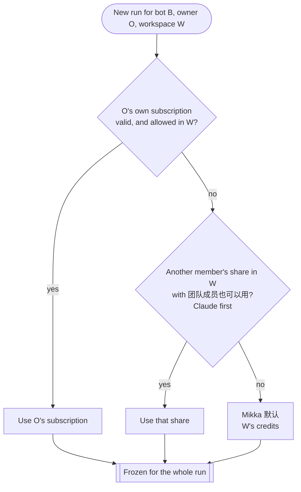
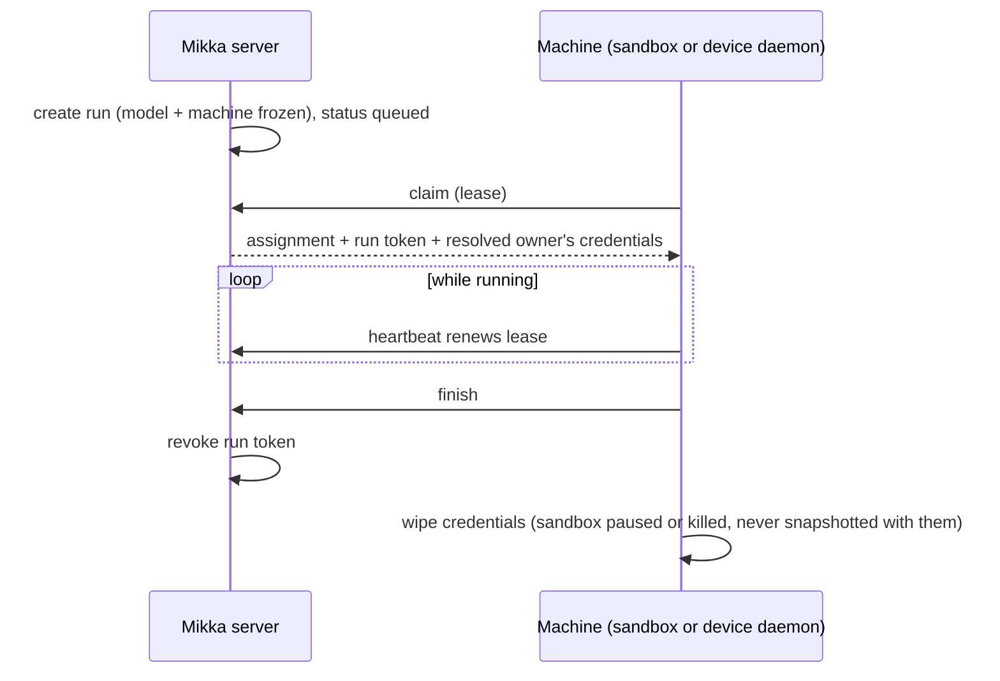

# Orchestration: models, Agents, machines, scheduling, billing

- **Status:** source of truth for these topics from 2026-10-31
  ([decision](decisions/2026-10-31-2300-orchestration-spec.md)). When another
  document, decision or code comment disagrees, this file wins and the other
  one gets fixed. `decisions.md` rows stay as frozen history.
- **Built on:** Alex's rules of 2026-10-31 (relayed by the coordinator),
  [personal vs workspace](decisions/2026-10-31-2130-personal-vs-workspace.md),
  [bots reply on Mikka 默认](decisions/2026-10-31-2110-bots-reply-on-mikka-cloud.md).
- **Scope:** the simplest system consistent with those rules. It adds no new
  machinery; where today's code differs, the
  [conflict table](#conflicts-with-todays-docs-and-code) names the fix.

## 1. Concepts and names

| Word | What it is |
| --- | --- |
| **Account** | A person. Owns their sign-in, devices, app connections, cards and model subscriptions. |
| **Personal workspace** | One per account, exactly one member. Every account has one. |
| **Team workspace** | Several members, with the team's policies, secrets, E2B key, credits and payment method. |
| **Bot** | Lives in one workspace, has one owner, chats on Mikka's own harness (R-05) and dispatches threads. |
| **Thread** | The work a bot dispatched (`agent_runs`). Each turn of it is a **run**. |
| **Agent** | The coding worker that runs a thread: Claude Code, Codex (Cursor where installed). Code may say `harness`; the UI says Agent (R-43). |
| **Subscription** | A Claude or ChatGPT/Codex login, bound to the account. |
| **Share** | A member's opt-in to use their subscription in one team workspace. Off by default; serves only the owner's own bots and runs unless the owner ticks 「团队成员也可以用」 (`allowOthers`). |
| **Mikka 默认** | The hosted model, paid from the workspace's credits. A **model**, never a machine. |
| **Machine (电脑)** | Where an Agent runs: **Mikka Cloud** (a sandbox on the workspace's own E2B key) or a **device** (the Mac desktop app, or a server running the daemon). |
| **Mikka Cloud** | The cloud machine. A **machine**, never a model. Mikka hosts no sandbox of its own. |
| **Environment** | The software a run executes in: one sandbox, or one worktree on a device. One per thread. |
| **Lease** | A machine's time-limited claim on a run, renewed by heartbeat (ADR 0012). |

Never write 「Mikka Cloud」 for the hosted model or 「Mikka 默认」 for the
machine.

## 2. Model resolution

A run's model is decided once, when the run is created, and frozen in the run.
Three things are decided independently: the model (this section), the machine
(§4) and concurrency (§5).

1. **The bot owner's subscription**, when it is valid (connected, not revoked,
   not paused, quota left) and allowed in this workspace: always in the
   personal workspace; in a team, when the owner shared it there and the
   admin has not turned off 「允许成员使用个人订阅」. When the owner has
   several, the bot's saved choice wins, then Claude, then ChatGPT/Codex.
2. **Otherwise another member's share** in this workspace with
   「团队成员也可以用」 ticked, Claude first.
3. **Otherwise Mikka 默认**, through the usual hosted admission (§7).

Rules that hold everywhere:

- Never refuse with 「未连接账号」 or `binding_required`. No subscription
  means Mikka 默认.
- **No switch mid-run.** A run frozen on a subscription that disappears
  (disconnected, revoked, share withdrawn, owner left, admin switch off) or
  runs out of quota **stops** with the subscription line (所选订阅不可用 /
  订阅需要重新连接 / 订阅额度已用完) and 重试. 重试 starts a new run, which
  resolves again from step 1.
- Conversation compaction uses the same frozen model as the turn.
- The same order serves bot chats and threads. A bot chat runs on Mikka's
  harness; a thread runs on the Agent that matches the model (§3).

## 3. Agent (harness)

| Model | Agent for a thread |
| --- | --- |
| Claude subscription | Claude Code |
| ChatGPT/Codex subscription | Codex |
| Mikka 默认 | see open question 1 |

- Bots never run on Claude Code or Codex (R-05); those Agents only run threads.
- **Sandboxes** ship with the Agents preinstalled in the image. The daemon
  only runs a boot self-check; a failed check marks the machine unhealthy and
  the run goes back to the queue.
- **User devices** report what is installed. The daemon detects Claude Code,
  Codex and Cursor and their model slots on register, on 重新检测 and on a
  changed set ([local runtime](../local-runtime.md),
  [execution settings](../execution-rules.md)). A device without the needed
  Agent is not a candidate for that run.
- Tool permissions are the run's allow / ask / deny policy
  (`packages/daemon/src/agents/tool-approval-policy.ts`). Connected apps reach
  the run as one MCP entry per toolkit, through Mikka, with the run token
  ([apps in device runs](decisions/2026-10-31-1937-apps-in-device-runs.md)).

## 4. Machine selection and fallback

Mikka hosts no sandboxes and offers no free cloud trial. A machine is either
Mikka Cloud on the workspace's own E2B key, or one of the owner's devices.

1. **A machine the run asks for** (a label rule, a thread continuing on its
   machine, a device-only source event) is used as asked. If that device is
   offline, the person's 设备离线时 setting applies: 等它上线 (stay queued)
   or 改到云端运行 (only when an E2B key is available).
2. **Otherwise Mikka Cloud** when the workspace has an E2B key (cloud by
   default, R-23).
3. **Otherwise the owner's online device** that has the Agent, servers before
   other devices.
4. **Otherwise queue** the run and show one action card in the chat:
   在这台 Mac 上启用 / 连接我的服务器 / 填入 E2B Key. The run starts on its
   own when any of them becomes available. It never fails for lack of a
   machine.

A device only runs its owner's work. A team admin's 「个人设备」 switch can
leave members' devices out in that workspace.

## 5. Scheduling and concurrency

- **One environment per thread.** A thread gets its own sandbox (Mikka Cloud)
  or its own worktree (device). Runs of one thread are serial and reuse it;
  threads run in parallel up to the machine caps.
- **Leases.** A claimed run holds a lease renewed by the heartbeat. A lease
  that runs out (machine gone) returns the run: a run pinned to a device waits
  per 设备离线时; any other run is placed again by §4, keeping its frozen model.
- **Queueing.** A run with no machine stays `queued` with the action card
  (§4). Hitting a machine cap also queues; it does not fail.
- **Device offline.** Pinned runs follow 设备离线时. Unpinned runs follow §4.
- **Quota exhausted.**
  - A subscription: the frozen run stops (§2). New runs skip that
    subscription until it has quota again.
  - Mikka 默认: the hosted refusal line with 验证银行卡 / 充值 and 重试.
    Admission checks only that the balance is positive and charges actual use
    afterwards.
- **Caps** on running sandboxes (per owner, per workspace) protect the
  person's own E2B account; see open question 3.

## 6. Credentials lifecycle

Environments hold software only: repository, dependencies and preinstalled
Agents. Snapshots never contain a login, token or key.

1. **At rest:** subscriptions in the subscription service's secret bundle,
   bound to the account; app connections in Composio, reached only through
   Mikka; saved logins in the credential vault; the E2B key as a workspace
   secret, used by the server only and never handed to a sandbox or a model.
2. **At run start:** the server resolves the run's owner (the bot owner, or
   the share owner when §2 step 2 applied) and injects only that person's
   credential for the frozen model, plus a run token for Mikka's MCP and
   apps. On a device the daemon passes the login to the Agent through a
   private home or file descriptor, never through the person's own CLI
   config.
3. **At run end:** the run token is revoked, the injected credential is
   deleted, and the sandbox is paused or killed. A device keeps nothing from
   the run outside its worktree.

When a member leaves a team, their shares and card designation leave that
workspace at once and their bots there are archived. An admin may take a bot
over; it then runs on the admin's or the workspace's resources.

## 7. Billing

The workspace where the work happens pays.

| Work | Who pays |
| --- | --- |
| A run on a subscription | The subscription owner's own plan quota. 0 credits. |
| A run on Mikka 默认 | That workspace's credits. |
| Mikka Cloud time | The workspace's E2B account, billed by E2B. Mikka charges nothing. |
| A device | Nobody. |
| Coordinator, memory extraction, other work with no workspace of its own | The personal workspace, never 「the oldest workspace」. |

- **Verification is per person:** a person verifies a card once, on Stripe's
  page.
- **The payment method is per workspace:** each workspace designates the card
  its credits are bought with. The designation goes when that member leaves.
- Hosted admission: the person is verified and the workspace's balance is
  positive. Card verification grants the one-off USD 1 allowance once per
  card (open question 4).

## 8. MVP vs later

| MVP | Later |
| --- | --- |
| Personal workspace for everyone; team workspaces beside it | — |
| Account subscriptions, per-workspace shares, 团队成员也可以用, the admin switch | Per-member spend caps |
| Model order of §2; Mikka 默认 when nothing else; no mid-run switch | — |
| Mikka Cloud on the workspace's E2B key; Mac desktop and daemon servers | Disposable containers on user servers |
| Queue and action card when no machine | — |
| One environment per thread; lease and heartbeat | — |
| Credentials injected per run, wiped at the end | — |
| No Mikka-hosted sandboxes, no free cloud trial | (not planned) |

## Conflicts with today's docs and code

Kept in the pull request that introduced this file and in the coordinator's
report; each row is fixed in the PR or session named there. Doc rows marked
**done** were aligned in the same pull request.

## Open questions

Listed in the decision file
[2026-10-31-2300-orchestration-spec](decisions/2026-10-31-2300-orchestration-spec.md)
until Alex answers them.
