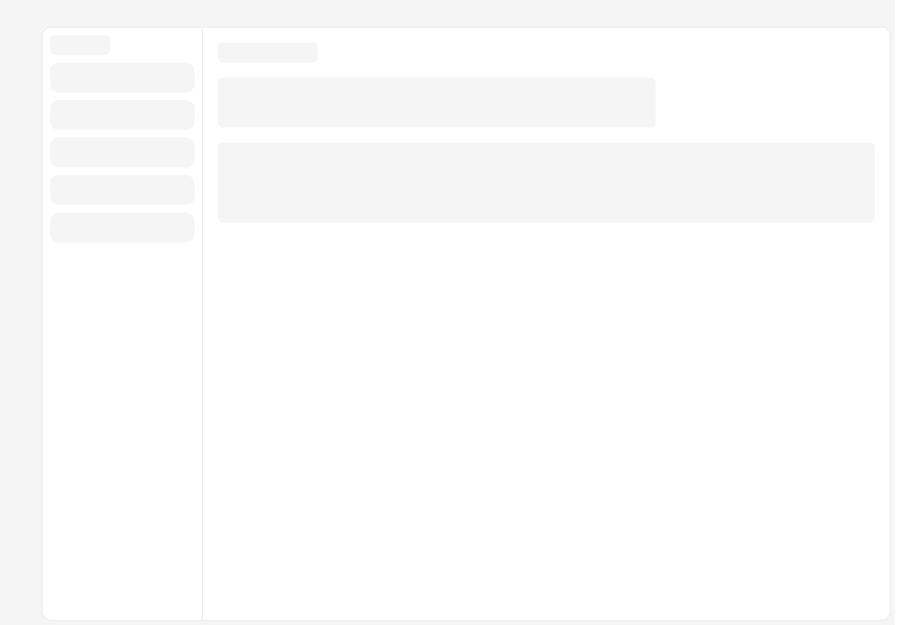
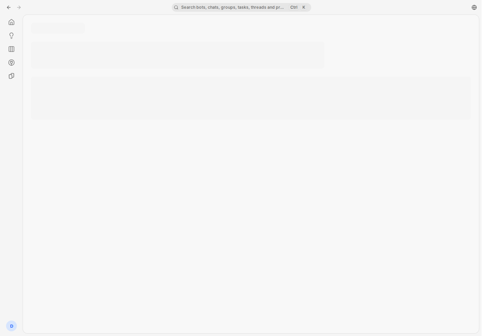
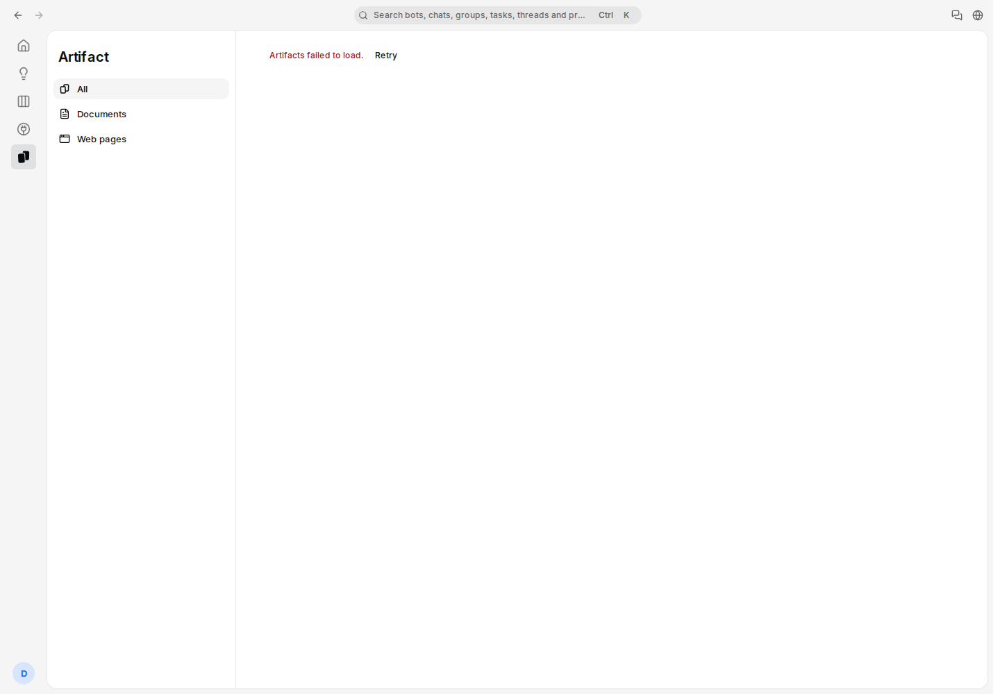
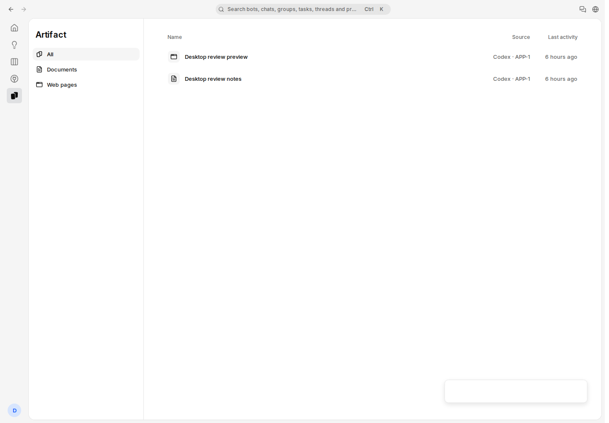

# Issue #1603：交互连续性验收证据

**当前结论：候选 `156b6a27` 已完成类型检查、官方 overlay 生产构建、真实 API 35-read 重跑及适用 CI 门禁；本地整合 `5a752a50`／overlay `ac598069` 已完成本页逐项列出的真实浏览器操作和清理。** 最终运行记录 296 条操作（含 close）与 23 张截图，两个 `9005` 实测失败均已在整合版本复验修复。仍有一项确认的后续缺陷：**workspace switcher 将未知服务端／数据库异常统一误报 403，独立修复 IN_PROGRESS**；部分错误图的全局 toast 遮挡局部控件亦保留为未解决的体验限制。**合并后生产验收 PENDING，不能据此宣告 issue 已完成。** 本地整合提交、CI 合成合并提交和最终 GitHub merge 是不同对象，不能互相改标。

本目录记录本地生产模式应用的实际浏览器操作、截图和 HTTP 验收。截图来自隔离测试数据；它们不代表生产共享账号验收、原生桌面应用验收或 iOS 验收。

## 1. 固定版本与证据范围

| 阶段 | 精确源码版本 | 环境与时间（UTC） | 本目录证据及状态 |
| --- | --- | --- | --- |
| 修改前基线 | `f3ef8f4a5f96909e84a719ab3cd4cf2515d57602` | 本地生产模式，`localhost:3111`；2026-11-07 05:39:05–05:44:03；独立测试数据库 | `before/` 的 5 张截图。确认 Settings 冷加载替换外层框架、Artifact 后台失败替换旧列表；该次人工会话完成清理并释放租约。 |
| 中间版本实际 UI | `9005d8eaea561d42a59768846f6abbf46d4d5f19` | 本地生产模式，`localhost:3110`；2026-11-07 06:00:10–06:16:05；隔离测试数据库 | `9005/` 的 14 张截图、[操作观测摘要](9005-observations.json)及[失败摘录](curated-failures.json)。部分通过，两个明确失败；控制器终止后租约按既有规则进入 `quarantined`，`cleanRelease=false`；其 owned 隔离数据库已退役，详情见[退役记录](9005-runtime-retirement.json)。 |
| 候选源码检查与 API | `156b6a2779d1ee71161b99ab47b3484e2a8b5704` | 官方 overlay `2cbb930e`；精确类型检查与构建通过。API 重跑于 07:07:11.880–07:09:45.956 完成，35 次读取通过并干净释放。关联该 head 的 30 项检查为 23 success、7 skipped。 | [构建证据](156b-build-evidence.json)、[API 证据](156b-api-evidence.json)、[CI 审核](156b-ci-review.json)。首轮连接失败另行保留；这些结果不改标为最终手动 UI。 |
| 本地整合版本与最终手动 UI | `5a752a50eb74c22681cd7dd8511ff6d2e58fc46f` | 本地合并 `ad5e5db5` 与候选 `156b6a27`，树 `977111e65ae6bc8c15b88e01810f2f143512c4dd`；官方 overlay `ac598069`；生产构建 exit 0（128.36 秒）。07:19:14.159 UTC 核实 `localhost:3110` 实际服务该 build。 | [整合构建证据](integration-build-evidence.json)、[运行版本绑定](integration-runtime-binding.json)；最终图库 `integrated/` 共 23 张；07:24:29–07:43:02 完成所列 UI 操作，07:44:17 close 确认 fixture 清理与租约释放，见[脱敏观测](integration-observations.json)。确认的 switcher 错误分类缺陷与视觉限制见下文，不能记为全部要求通过。`5a752a50` 是本地整合提交，不是最终 GitHub merge。 |

基线、`9005` 和候选 `156b` 构建使用官方 overlay `2cbb930e409ccc247f7692abc9e2dd1152a571fe`；本地整合 `5a752a50` 使用更新后的官方 overlay `ac5980696802f188a81124a8a3f2513be2d14e9e`。两组源码／overlay 组合分别记录。已验证的应用路径为 Vite 前端与 Nitro 服务端；“生产模式构建”指本地构建运行方式，不表示访问生产域名。

`156b6a27` 与本地完成评论草稿回归的 `f797671373f7b5b23a9c10ec8a27d77bf9e45da0` 源码树相同：`43ddc1c57eb0fede3db6cad89d406baa02554597`。这允许准确关联源码检查，不能替代新候选的运行时验收。

## 2. A–D 验收矩阵

| 要求 | 最终整合版本实际证据 | 源码／组件证据 | 当前判断与尚待工作 |
| --- | --- | --- | --- |
| **A：固定基线、逐路径检查、真实问题记录** | 基线、`9005`、候选 API、整合 UI 分别绑定 SHA／overlay／时间。整合版本 296 条操作、23 张截图；#296 清理及审计通过。 | 问题登记保留具体根因、最小修复、工程风险估计；新增 switcher 误分类作为待修项目。 | 本地证据闭环已具备；**尚未完成生产验收或新增误分类修复。** |
| **B：稳定外层框架、局部 loading/error** | #15 的 Settings chunk 延迟 8 秒命中一次；#19–20 frame/bar/rail 同节点且各 1 个；Settings 内 Ctrl+K 打开搜索。 | 稳定 AppFrame、局部 SettingsRouteContent 和真实组件回归。 | 所列冷加载与普通导航路径通过；环境误报 403 触发的安全边界退役单独记录。 |
| **B：地址、Back/Forward 与内容保持一致** | #27–36 完整重走 Back/Back/Forward/Back；Ada URL 与输入一致，草稿保留，scrollTop=340，shell 同节点，documentRequests=1。 | `b7a73ab1` 修复 no-op 地址清理提前消费历史查询；两种事件顺序组件回归。 | `9005` 的真实失败已在 `5a752a50` 复验修复。 |
| **C：后台更新与普通失败不破坏在读内容** | 聊天两次合成后台消息到达；任务／线程／群聊／Artifact 列表、文档和 HTML 的受控普通 503 保留相应节点、已读内容和已列出的焦点／选区／位置。 | 对应真实 React／SWR 生命周期与授权拒绝回归。 | 所列操作通过；**switcher 未知异常误报 403 的另一条后台路径仍待修复**，不能泛化为所有网络故障均不重建。 |
| **C：离开／返回时草稿、筛选与局部状态连续** | 评论与回复关闭／重开后恢复；3 次真实提交仅清相应草稿；Plugins 保留 GitHub 搜索；换工作区隔离 Medium／APP-1／草稿，返回原工作区恢复 Medium／List 和任务评论草稿。 | scoped view-state、稳定任务 ID、未授权 cached preview 不恢复 Activity，相关隔离回归。 | 本次同账号两工作区操作通过；跨账号与多标签仅有对应组件／既有 API 证据。 |
| **C：权限、退出与显式升级边界** | 群聊 403→503 继续隐藏历史并禁用输入，成功 Retry 才恢复。removed-action 提示前 documentRequests=1、草稿在；显式 Refresh 后=2、草稿恢复、群聊 POST 未重放。真实 Sign out 后 view keys 68→0。 | 拒绝锁存、provider retirement、退出 helper 与旧 setter 不回填回归。 | 明确安全拒绝与显式刷新按本次范围通过；不能把服务端误报 403 视为理想体验。 |
| **D：局部反馈、减少运动、适配** | reduce 下三处 skeleton animation=none、命令弹窗 scale/transform=none；暗／亮色工具详情截图；最终 390×844 线程图 input／Send 完整无遮挡。 | 既有 motion-reduce 类与提交／错误反馈组件回归。 | 仅所列范围通过；**Artifact 和部分全宽错误画面仍有全局 toast 遮挡局部 Retry／输入角落，未解决**。窄屏 Web 不代表 iOS／原生移动验收。 |

## 3. 基线与中间版本的视觉对照

### Settings 冷加载

基线原始操作 #23–24：延迟 Settings chunk 后，主框架、顶栏与导航均缺席；数量为 `0 / 0 / 0`。`9005` #20–22：加载骨架限制在内容区，原有 frame/bar/rail 保持连接且数量为 `1 / 1 / 1`。

| 基线 `f3ef8f4a` | 中间版本 `9005d8ea` |
| --- | --- |
|  |  |

### Artifact 列表的后台普通失败

基线在已加载列表后注入 503，并通过离线／上线触发读取；旧列表被失败页面替换。`9005` 同类普通后台失败保留列表区域和既有两行。这里确认的是失败时在读内容连续性，不能据此推导权限拒绝也应保留数据。

| 基线 `f3ef8f4a` | 中间版本 `9005d8ea` |
| --- | --- |
|  |  |

## 4. `9005` 已确认的实际通过范围

下列编号为原始 `operations.jsonl` 的 **1-based 操作序号**；公开的 [9005-observations.json](9005-observations.json) 保留对应 `index`。截图呈现外观，DOM 观测用于判断节点身份、焦点、选区和滚动值。

| 路径 | 具体观测 | 操作编号 |
| --- | --- | --- |
| 冷 Settings 与框架 | Settings chunk 延迟 8 秒，frame/bar/rail 同一 DOM、仍连接、各 1 个；加载后 Preferences 可用。 | #17–22、#31、#43 |
| 聊天后台到达与重连 | 加入 owned fixture 消息后离线／上线，新消息读取到达。input、scroller 和框架同节点；草稿、焦点、选区 `[5,15]` 保留；scrollTop `340 → 340`。 | #54–61 |
| 群聊普通失败 | GET 503 后已展开历史仍在，局部 Retry；input/scroller 同节点，草稿与选区 `[5,10]` 保留，scrollTop `240 → 240`。 | #80–86 |
| 群聊拒绝与恢复 | 消息读取 403 后，再次 Retry 得到 503：历史行数 0、输入禁用；撤去注入故障并成功 Retry 后行数 2、输入恢复，同一草稿仍在。 | #87–97 |
| 任务后台失败 | `issues.pollIssue` 503 后 Comment 与 Task description DOM 保留；Comment 草稿、焦点、选区 `[5,14]` 保留。**这不包含关闭后重开。** | #113–121 |
| 线程后台失败 | `agents.getIssueThread` 503 后输入、历史列表、frame2/bar2/rail2 同节点；草稿、焦点及选区 `[7,17]` 保留。 | #132–139 |
| 窄屏 Web | 视口改为 390×844 后线程输入和列表仍为同节点；bar2/rail2 仍连接但尺寸为 0，符合 CSS 隐藏而非重新挂载。 | #143–145 |
| Board 返回 | 关闭任务详情返回 Board，保留 Assignee Me、Priority Medium、List view。此段没有执行账号／工作区切换。 | #147–150 |
| Plugins 返回 | GitHub 详情中 shell 同节点；Back 后 Search apps 仍为 GitHub，workspace 参数保留。未执行插件配置／授权／工具调用。 | #157–163 |
| Artifact 列表 | 普通 503 后列表与 frame2/bar2/rail2 同节点，已有列表可见。 | #166–172 |
| Artifact 文档 | 元数据及正文读取故障后文档、滚动容器同节点；scrollTop 保持 500，选中文本保留；恢复后仍为同节点及同一位置。 | #180–197 |
| Artifact HTML | 元数据后台读取失败后 iframe 与 frame2/bar2/rail2 保持同节点；没有由该失败重新挂载预览 iframe。 | #202–208 |
| 减少运动 | reduce 媒体查询为 true，三个 skeleton 动画名称均为 none；命令弹窗 enterScale=1、transform=none，保留 enter 淡入。没有把截图当作完整动画时序测量。 | #16、#22、#26 |

聊天截图中的测试 bot 显示 unavailable，因此此路径证明读取、草稿和阅读位置连续性，不证明模型发送成功。窄屏线程截图中的 Retry toast 覆盖输入区下部；它不能作为完整窄屏交互质量通过的证据。

### 最终本地整合 `5a752a50` 的实际复验

[整合观测摘要](integration-observations.json)从 **296 条实际记录**中保留 200 条脱敏选摘，编号沿用该运行的 1-based 原始序号；没有把 `9005` 的通过结果改标为新版本。运行从 07:24:29.225 UTC 开始，最后 UI 截图为 07:43:02.835，07:44:17.519 完成 close。

| 路径 | 最终实际观测 | 操作编号 |
| --- | --- | --- |
| 冷 Settings／命令搜索／历史 | 8 秒 chunk 延迟；三个 shell 节点同一且各 1 个。完整 Back/Back/Forward/Back 后 Ada 地址、可见输入和草稿一致，scrollTop=340；普通路径额外 document 请求为 0。 | #15–36 |
| Thinking 与工具详情 | 展开 stored reasoning、工具分组、单工具；Expand all／Collapse all 分别变为 true／false。再次 Expand all 后后台消息到达仍 expanded=true，工具组 DOM 不变。有亮／暗色画面。 | #37–48、#58–73 |
| 聊天后台到达 | 两条 owned fixture 消息最终均可见；input、scroller、工具组仍同节点，草稿与焦点、选区 `[5,15]` 保留，scrollTop `340→340`。 | #55、#65、#68–73 |
| 评论／回复关闭重开 | 普通评论及回复正文／目标均恢复。两次 Send comment 和一次 Send reply 实际写入合成任务；发评论只清评论并保留未发回复，发回复清回复；重开后仅见三段已提交文本，输入为空。 | #87–114 |
| 任务后台 503 | pollIssue 故障命中 8 次；title、comment 与 shell 同节点；草稿、焦点、选区 `[5,14]` 保留。 | #115–125 |
| 线程后台 503／窄屏 | getThreadChanges 故障命中 4 次；input/list/shell 同节点，焦点、草稿和选区 `[7,17]` 保留。390×844 时顶栏／导航仍连接而尺寸为 0；最终窄屏图无 toast 遮挡输入或 Send。 | #129–143 |
| Plugins 返回 | GitHub 详情→Back，搜索词 GitHub 保留；以环境恢复后新登记的 shell 节点比较，均未变化。 | #154–163 |
| Artifact Library | listArtifacts 503 后列表和新 shell 节点保持；原条目仍可见，局部 Retry 存在。 | #167–174 |
| Artifact Markdown | detail/text 503 后文档与滚动容器保持同节点，scrollTop=650、选中文本保留；故障仍启用时用 Enter 操作 Retry，随后移除故障仍保留位置。**移除故障后的成功正文响应没有单独断言。** | #179–195 |
| Artifact HTML | detail 503 后 iframe 和新 shell 保持同节点；没有该错误导致的 iframe 重挂载。 | #199–206 |
| 群聊在途／普通失败 | POST 延迟 5 秒后受控 503，只命中 1 次；发送期间离开到 Ada 再返回，失败消息仍在 DOM。GET503 后草稿、焦点、选区 `[5,10]` 保留，scrollTop=240。 | #212–234 |
| 群聊拒绝／恢复 | GET403 后历史为 0、输入 disabled；改为 GET503 再 Retry 仍不恢复旧历史；移除故障后成功授权 Retry 恢复，画面可见 Not sent／Retry 和保留草稿。 | #236–250 |
| removed-action 升级 | 404 加 `x-nextjs-action-not-found:1` 仅命中 1 次，出现显式更新对话框；点击 Refresh 前 shell 同节点、草稿在、document=1；点击后 document=2、草稿恢复；群聊 POST 仍只有 1 次。 | #252–269 |
| 工作区隔离／返回 | 真实选择 Continuity alternate：Medium 筛选、APP-1 与旧输入不出现，Coordinator 为空。返回 Desktop acceptance：Medium／List 恢复，评论 `Issue 1603 task background draft` 恢复。两次 scope assign／redirect 的 document 计数 `2→4→6`。 | #270–288 |
| 实际退出／回收 | Sign out 到达登录页；view keys `68→0`，draft prefix 原本为空且仍为 `0`。close 返回 browserClosed／fixtureCleanup=true、lease=released，证据审计 passed。 | #289–296 |

**合成内容与真实操作分开。** 认证、HTTP／RPC、生产构建和 UI 操作是真实的；人物、任务、文档、8 条 stored reasoning／tool activity 消息、2 条后台到达消息及备用工作区 Coordinator 的 2 条消息是 owned fixture。stored tool 不执行工具，未调用 live model。人工 UI **确实发生 2 次评论和 1 次回复的业务写入**，所以不能套用 API 35-read 报告的 `businessRequestWrites=false`；群聊 POST 在临时受控边界返回 503，没有触达模型。

**视觉与操作限制保留。** Artifact 列表／Markdown／HTML 图中的全局 “Can't reach Mikka” toast 会遮挡局部 Retry；部分全宽线程画面输入角落也受遮挡。仅最终窄屏线程图支持“输入和 Send 无遮挡”。`group-pending-and-draft` 图停在较早历史位置，失败待重试项在 DOM 底部而未入画；`group-recovered` 图实际展示 Not sent／Retry。期间错误 locator 或被 toast 拦截的 helper 操作属于未完成的操作，不能改写成产品通过；这里依据后续成功执行的精确按钮、DOM 与截图记录给出限定结论。

## 5. 两个必须保留的真实失败

机器可读的精简证据在 [curated-failures.json](curated-failures.json)。摘录省略 fixture UUID、完整地址和长篇正文，保留原始操作序号、时间及判定所需字段。

### 5.1 历史导航：地址与内容错位

步骤为 Ada → Settings → 命令搜索 → 返回 Settings → Back Ada → Forward Settings → Back。第一次 Back 的 #37 正常恢复草稿与 scrollTop=340；但 **#42，2026-11-07 06:02:20.892 UTC** 显示：

- 地址仍指向起初选中的 Ada。
- 主区域开头为 Coordinator，输入框为 `Message the Coordinator`，当前草稿为空。
- #43 的 frame/bar/rail 仍是原节点。因此“框架没有重挂载”与“地址内容同步正确”是两个独立结论。

源码修复在 `b7a73ab1`：只有真正发生 URL 写入时才更新已消费的查询标记，no-op 地址清理不提前吞掉待处理的历史变化。候选及本地整合版本均包含此修复；**`5a752a50` 已在 #27–36 重走完整序列，Ada URL／内容、草稿与 scrollTop=340 均一致，见[新截图](integrated/integrated-history-forward-back-restored.webp)**。

### 5.2 任务评论：保持挂载时保留，关闭再打开时丢失

#114 输入 43 字符的测试评论；#116 和后台失败后的 #120 仍观测到同一草稿、焦点与选区。随后关闭任务详情返回 Board，并重开同一任务。最后 **#215，2026-11-07 06:16:05.862 UTC** 的可访问性快照为：

```text
textbox "Comment":
  /placeholder: Leave a comment…
button "Send comment" [disabled]
```

该快照没有评论内容，发送按钮禁用。#153 的选择器查询只返回空对象，**不把它单独当作测得空字符串的证据**。没有完成一张专用的“丢失后”截图；上面的实际快照与之前保留草稿的截图共同构成修改前证据。

候选 `156b6a27` 将普通评论、回复正文和回复目标放进既有 scoped view-state，通过已验证任务 ID 分区。缓存预览尚未确认当前访问权时不恢复活动区草稿；提交清空已发送草稿，不自动重放。复杂富文本选区评论面板未因本问题扩大修改。**本地整合 `5a752a50` 的 #87–114 已实际验证关闭／重开、回复目标和正文恢复，以及提交分别清空相应草稿，见[评论恢复](integrated/integrated-task-comment-restored.webp)和[评论／回复同时恢复](integrated/integrated-task-reply-and-comment-restored.webp)。**

| 已确认问题 | 出现概率 × 影响（1–10 工程估计） | 证据 |
| --- | --- | --- |
| Settings 冷加载替换框架 | 8 × 5 = 40 | 基线 #15、#23–24；冷 chunk 情况下核心导航缺席 |
| Artifact 后台普通失败替换旧列表 | 4 × 5 = 20 | 基线 #30–38，重连触发 503 后旧列表消失 |
| Back/Forward 地址与主内容错位 | 5 × 5 = 25 | `9005` #37–43，地址与会话内容不一致 |
| 任务未发送评论因普通导航丢失 | 5 × 7 = 35 | `9005` #114、#120、#148、#215，用户输入丢失 |

上述分数与[完整问题登记](defect-register.md)使用同一组工程估计，不是线上发生率统计，也不用于推迟已确认的数据丢失或权限问题。

## 6. “普通 document reload = 0”的精确含义

`9005` 的首次导航记录 `documentRequests=1`。之后全部已记录该计数的截图／状态仍为 1，直到最后一张 Artifact HTML 故障截图。因此在这段已观测的会话里：**初始 document 请求 1 次，后续额外 document 请求 0 次**。

该结果仅覆盖所记录的会话窗口，不包括主动重新打开应用、另一个环境、原生壳、登录／退出、新候选或控制器结束后的时间；也不自动证明所有 React 节点稳定、地址同步正确或页面永不空白。基线存在一次人为 `goto`，计数由 1 变为 2，这是操作者重开页面，不应混算为产品导航缺陷。

**403 安全清理必须与普通路径分开。** 本次群聊拒绝触发既有全局安全／缓存边界清理，原 `frame/bar/rail` 观测点已退役；#120 对旧引用得到 `sameNode=false`、`connected=false`。随后 #124–126 重新登记 `frame2/bar2/rail2`，后续线程、插件、Artifact 普通导航和失败均以这些新观测点比较。不能把安全边界清理归为普通路由无故重建，也不能忽略它并宣称从初次加载到结束始终只有同一组 shell DOM。

这里的 403 来自群聊消息读取，验证的是该会话的消息与输入关闭／恢复；它不是完整生产工作区撤权、换账号或跨标签同步测试。

### 本地整合会话的连续性与连接恢复边界

下列编号属于 `5a752a50`／overlay `ac598069` 的最终运行，与 `9005` 分开。所列普通路径的 document 请求从初始 1 次一直保持 1；显式 Refresh 后为 2，两次真实工作区切换及重定向后分别为 4、6。**这些额外请求是实际计数，不删去也不混称普通导航；document 不增加也不等于 React 子树永不重建。**

| 操作与时间（UTC） | 已确认观测 | 结论边界 |
| --- | --- | --- |
| #136，07:31:04.026；#137 截图 | 线程普通 503 后 frame／bar／rail／input／list 全部 sameNode=true 且连接，输入聚焦、草稿及选区 `[7,17]` 保留。 | 该次已授权线程的普通背景失败保持连续。 |
| #138–140，07:31:05.851–07:31:07.363 | 390×844 后上述节点仍相同，bar／rail 为 CSS 隐藏；实际窄屏图的输入／选区／Send 完整且没有 toast。 | 只验证窄屏 Web，不外推 iOS 或模型发送。 |
| #143，07:31:22.281 的浏览器事件窗口 | 保存了 13 个 `/mikka/api/rpc`／`workspace` HTTP500，documentRequests=1。 | 窗口有限，未包含下述 server403；不能据此声称同期没有授权拒绝响应。 |
| 服务端 07:31:12.114 | `/api/workspace/switcher` 实际返回 403；07:31:12–14 同时有 23 个应用 HTTP500，安全日志提取确认 `Connection terminated unexpectedly`，所检窗口没有 401。 | PG／临时传输异常与 switcher403 同期。没有导出 SQL、参数或凭证；switcher 被 catch 的具体异常未单独留下类型。 |
| #146–147，07:35:36.466–07:35:37.543 | 明确点击全局 Retry now 后，读取旧引用为 sameNode=false／connected=false；#152 仍 documentRequests=1，页面可操作。 | 最后同节点是 #139，首次失效是 #147，中间未连续观测，不能确定精确重建瞬间，更不能说 Retry 必然触发重建。 |

[全局连接提示](../../../../apps/desktop/src/renderer/app.tsx)的 Retry now 调用 `SessionApplication.reload()`→[readBootstrap](../../../../apps/desktop/src/renderer/bootstrap.ts)→`desktop.bootstrap`，不做 document reload；同 owner／workspace 的普通 reload 也不无条件清空 bootstrap。

**已确认但尚未修复：switcher 误分类。** [route](../../../../app/api/workspace/switcher/route.ts) 的 catch-all 把 `getApiSession`／`loadWorkspaceSwitcher` 抛出的任何错误统一返回 403，包括可能的数据库／连接异常。这一实现与基线相同，但仍是可行动缺陷。客户端 [SettingsReadError](../../../../lib/settings-data.ts)保留 403；[readAccessFailure](../../../../lib/swr/persistent-cache.ts)据此按 workspace 拒绝使 provider 失效，[AuthenticatedReadCache](../../../../components/authenticated-read-cache.tsx)增加 generation 并 refresh，从而退役子树。**正确的 403 必须继续拒绝旧私有内容；问题在服务器把未知失败误标成 403，不应放宽客户端安全策略。** 当次服务端 403 与该既有路径相符，普通 500 本身不触发这条失效规则。

最小后续修复应保留无会话 401、明确权限／成员拒绝 403，将数据库／未知异常返回普通 500，并在既有 settings backend 路由入口检验分类。**状态：confirmed follow-up IN_PROGRESS；独立工作区正进行既有 settings-backend 入口的 red→green 最小修复，本批 candidate／整合 UI 没有修复此项。** 因此，本地普通受控 503 的结果可以成立，但不能宣称所有后台网络失败体验已经解决。

环境恢复后重新登记 `frameAfterTransport/barAfterTransport/railAfterTransport`，后续 Plugins／Artifact／群聊普通失败按新基线比较；明确群聊 403 后再登记 `AfterSecurity`。旧 detached 输入对象保留 value 不能单独证明新 live input 已恢复；本页只用后续实际 live input 观测证明 Ada 和任务评论草稿恢复，不把旧对象值冒充新输入验证。

## 7. HTTP 验收与清理账目

[9005-api-evidence.json](9005-api-evidence.json) 记录一次真实 HTTP/RPC 验收：2026-11-07 **05:55:25.339–05:58:03.612 UTC**，版本为 `9005d8ea`，服务为生产模式 Nitro。此处沿用 #1372 读缓存入口，所以报告内 `issue` 为 1372；将它用于 #1603 的数据读取证据，不把它改称 UI 验收。

共 **35 次读取**，涵盖版本／范围检查、6 个 cold、6 个 warm、6 个 reload-restored、2 个 peer-denied、2 个 peer-isolation、4 个单行增量、1 个变更、5 个删除及结束版本检查。报告结果为 pass，包括预期的业务权限拒绝；RPC 的 HTTP 200 不等于所有请求都获得私有数据。

报告明确 `businessRequestWrites=false`、`modelExecution=false`、`browserExecution=false`。它证明对应真实 API 行为，不证明视觉、输入、导航、模型执行或最终候选的 UI 已通过。

**候选 `156b` 已独立完成真实 API 重跑。** [156b-api-evidence.json](156b-api-evidence.json)记录 2026-11-07 **07:07:11.880–07:09:45.956 UTC** 的生产模式 HTTP 验收：`readCount=35`、`status=pass`、进程 exit 0，使用独立 `final3` 数据库；fixture 清理 succeeded，租约 released-clean。该报告同样沿用 #1372 的既有 API 入口，明确没有业务请求写入、模型执行或浏览器执行。传输续接保持同一进程、同一 PostgreSQL 连接，没有 stdin replay。这是 `156b` 的新运行结果，不是把 `9005` 摘要改标，也不属于 `5a752a50` 手动 UI。

| 会话 | 清理证据 | 状态 |
| --- | --- | --- |
| 基线人工 UI | 最后 #43：browserClosed=true、fixtureCleanup=true、lease=released；证据审计 passed | 已完成 |
| `9005` HTTP 35-read 验收 | `cleanup.fixtures=succeeded`，`cleanup.lease=released-clean` | 已干净释放 |
| `9005` 人工 UI | 215 条原始记录没有 close 操作；租约已过期并进入 `quarantined`，`cleanRelease=false`；全部旧 fixture 数据随该 owned 隔离数据库退役移除，见[退役记录](9005-runtime-retirement.json) | **隔离与数据库退役已完成；不是干净释放** |
| `156b` 本地 API 首轮 | [失败记录](156b-local-api-attempt-1.json)：exit 1，PG 连接意外终止，没有生成该次 HTTP 验收摘要 | **失败记录保留；后续成功运行不补写这次的成功或干净释放** |
| `156b` 本地 API 重跑 | [新运行记录](156b-api-evidence.json)：35 reads pass、exit 0；`cleanup.fixtures=succeeded`，`cleanup.lease=released-clean` | **已通过并干净释放** |
| 本地整合 `5a752a50` 人工 UI | [脱敏观测](integration-observations.json) #296：07:44:17.519，browserClosed=true、fixtureCleanup=true、lease=released，证据审计 passed（25 个原始文件） | **实际 close、fixture 清理与租约释放已完成** |

API 会话的 clean release 不能代替之后人工 UI 会话的清理。旧人工会话的数据库退役结束了该隔离环境的数据生命周期，但没有补成一次成功 close 或 clean release。控制器终止后尚未执行的请求不能记为已完成操作，也不能补写成功截图或关闭结果。

## 8. 源码验证与最终整合验收待办

评论补修先用真实 IssueActivity 组件得到 **4 red / 1 pass**；加入边界用例后，既有 `test:issue-readonly-dom` 完整入口 **28/28 通过**，包括 9 项 editor/activity 测试和 19 项 TaskDetail 授权、读取及后台失败测试。四个修改文件 oxlint、全局 UI policy（2815 个业务文件、487 个交互文件）及 diff check 均通过。上述结果对应 `f7976713`，其源码树与候选 `156b6a27` 完全相同；独立代码审查无阻断项。

相关源码与测试：

- [任务活动区](../../../../components/workspace/issue-activity.tsx)、[IssueEditor](../../../../components/workspace/issue-editor.tsx)、[TaskDetail](../../../../components/workspace/task-detail.tsx)、[活动区 DOM 回归](../../../../scripts/issue-readonly-dom.test.tsx)。
- [历史导航](../../../../components/workspace/workspace-navigation.ts)、[导航回归](../../../../components/workspace/workspace-navigation.test.ts)、[真实 Settings 组件回归](../../../../components/workspace/issue-workspace-settings.test.tsx)。
- [view-state 与退出生命周期回归](../../../../lib/hooks/view-state.test.tsx)、[Board 范围回归](../../../../components/workspace/board-view-state.test.tsx)。

精确候选 `156b` 的完整类型检查、官方 overlay 生产构建与真实 API 重跑均已通过，见[构建证据](156b-build-evidence.json)和[API 证据](156b-api-evidence.json)。2026-11-07 07:01:03.187 UTC 的[最终 CI 审核快照](156b-ci-review.json)确认，关联该 head 的检查为 **23 success、7 skipped**，没有失败或仍在运行的检查；其中 Desktop 的真实 Apple Silicon packaged acceptance 已通过。本地另将 main `ad5e5db5` 与候选整合为 `5a752a50`，已完成新 overlay 下的构建、运行绑定及本页限定范围的手动 UI，并实际清理释放。**各版本的检查范围分开记录，均不替代合并后生产验收。**

- [x] **精确候选源码检查与构建。** `pnpm typecheck` 和 `pnpm build:app` 均 exit 0；源码 SHA、renderer build 与官方 overlay 内容已绑定。
- [x] **最终候选 CI。** [主 CI](https://github.com/alexj11324/Mikka/actions/runs/42347352032)、[API/CLI CI](https://github.com/alexj11324/Mikka/actions/runs/42347352010)及[Desktop CI](https://github.com/alexj11324/Mikka/actions/runs/42347352004)均 success；所有关联候选的检查已结束，适用范围见文末。
- [x] **候选本地 API 重跑。** 精确 `156b` 的 35-read 真实验收 pass，exit 0，fixture 与租约干净释放；首轮失败独立保留。
- [x] **本地整合构建。** `5a752a50`（`ad5e5db5` + `156b6a27`）配合官方 overlay `ac598069`，`pnpm build:app` exit 0，用时 128.36 秒。
- [x] **本地整合运行绑定。** 07:19:14.159 UTC 确认 source、compiledBuild、servedBuild 均为 `5a752a50`，renderer 与 overlay 一致；使用独立 `final4` 数据库。
- [x] **旧 `9005` 人工环境处置。** 过期租约保持隔离，owned 数据库已退役；保留 `cleanRelease=false` 的实际结论。
- [x] **整合版本历史导航。** #27–36 完整序列通过；地址／Ada 内容／草稿／scrollTop=340 一致。
- [x] **整合版本评论与回复。** #87–114 关闭重开恢复，真实提交分别清草稿；#278／#287 同账号跨工作区隔离与返回恢复。未宣称手动跨账号验收。
- [x] **整合版本所列普通路径。** 冷 Settings、聊天到达、群聊在途返回和 503、任务／线程 503、Artifact 列表／文档／HTML 连续性、Plugins 和 Board 返回均已有本版本操作证据。
- [x] **整合版本安全与显式升级。** 群聊 403→503 保持拒绝，成功授权 Retry 才恢复；removed-action 只在点击 Refresh 后重载、草稿恢复、没有群聊发送重放；实际 Sign out 清理 view keys。旧 callback 回填仍使用独立组件证据。
- [x] **整合版本界面观察。** 所列减少运动、暗／亮色和最终窄屏输入观察已完成；不据此掩盖全局 toast 遮挡局部控件的未解决限制。
- [x] **整合会话清理。** #296 实际 close，fixtureCleanup=true、lease=released、证据审计 passed。旧 `9005` 仍保持隔离／退役结论，未补成正常 close。
- [ ] **CONFIRMED FOLLOW-UP IN_PROGRESS：switcher 错误分类。** 未知 DB／连接异常被 catch-all 误报 403，可能使普通后台失败触发整棵授权缓存子树退役；只修服务端分类，真实授权拒绝策略保持。
- [ ] **未解决的视觉限制。** 部分全宽错误画面全局连接 toast 遮挡局部 Retry 或输入一角；需要针对实际遮挡处理或后续明确验收，不能标为全错误 UX 通过。
- [ ] **PENDING：GitHub 最终合并门禁。** 合并前复查真实 head、最新 main、适用检查和实际 merge SHA；本地整合提交不代替 GitHub 合并。
- [ ] **PENDING：生产验收。** 合并并确认生产实际服务目标版本后，以已有授权的共享测试账号、正确工作区和真实任务按 issue 验收。本地 fixture 不替代该步骤。

最终手动 UI 图库命名为 `integrated/`，绑定本地整合 `5a752a50` 与 overlay `ac598069`。若源码或 overlay 继续变化，应另记精确版本或明确源码树对应关系，不移动旧图片造成已验收的假象。最终 GitHub merge SHA 与线上实际版本在合并后单独记录。

## 9. 图片索引

图片为原始截图的 lossless WebP 转存，展示内容未改绘；下列链接均相对于本目录。测试人物与内容为合成 fixture。本页与失败摘录省略 fixture UUID、完整地址和长篇页面正文；HTTP 报告保留运行与追踪标识，以便关联实际请求。

### 基线 `before/`：5 张

| 图片 | 用途 |
| --- | --- |
| [before-chat](before/before-chat.webp) | 聊天与未发送草稿的基线画面 |
| [before-settings-loading](before/before-settings-loading.webp) | 冷加载缺少顶栏／导航的失败画面 |
| [before-artifact-list](before/before-artifact-list.webp) | 后台失败前的已读列表 |
| [before-artifact-background-error](before/before-artifact-background-error.webp) | 普通后台失败替换旧列表 |
| [before-artifact-recovered](before/before-artifact-recovered.webp) | 撤去故障、重试后恢复 |

### 中间版本 `9005/`：14 张

| 图片 | 用途与限制 |
| --- | --- |
| [Settings loading](9005/after-settings-loading.webp) | 外层框架保留，局部 skeleton |
| [Settings dark](9005/after-settings-dark.webp) | 暗色媒体下的实际画面 |
| [Settings command search](9005/after-settings-command-search.webp) | Settings 内命令弹窗；历史导航后续仍有失败 |
| [Chat background arrival](9005/after-chat-background-arrival.webp) | 背景到达后草稿、选区、阅读位置保留 |
| [Group background error](9005/after-group-background-error.webp) | 普通 503 时保留旧历史与草稿 |
| [Group denied stays closed](9005/after-group-denied-stays-closed.webp) | 403 后再遇 503，历史仍关闭、输入禁用 |
| [Task background error](9005/after-task-background-error.webp) | 挂载期间后台 503 保留评论；不证明关闭再打开保留 |
| [Board detail return](9005/after-board-detail-return.webp) | 返回 Board 的筛选与 List view 保留 |
| [Plugin details](9005/after-plugin-details.webp) | 插件详情导航；没有执行插件授权或调用 |
| [Thread background error](9005/after-thread-background-error.webp) | 线程普通失败保留历史与回复草稿 |
| [Thread narrow web](9005/after-thread-narrow-web.webp) | 390×844 Web 连续性；非 iOS／原生移动验收 |
| [Artifact library error](9005/after-artifact-library-background-error.webp) | 普通后台失败仍保留列表 |
| [Artifact document error](9005/after-artifact-document-background-error.webp) | 文档读取失败仍保留正文与阅读位置 |
| [Artifact HTML error](9005/after-artifact-html-background-error.webp) | 后台读取失败未重新挂载 iframe |

### 最终手动 UI 图库 `integrated/`：23 张

本地整合 `5a752a50`／overlay `ac598069` 的实际截图；完整时间和原始操作号见[整合观测](integration-observations.json)。图片只证明所示画面，节点、焦点和请求计数以对应观测为准。

| 图片 | 用途与限制 |
| --- | --- |
| [integrated-settings-cold-loading](integrated/integrated-settings-cold-loading.webp) | 冷 Settings 局部 skeleton；框架保留（#21） |
| [integrated-settings-command-search](integrated/integrated-settings-command-search.webp) | Settings 内 Ctrl+K 打开命令搜索（#25） |
| [integrated-history-forward-back-restored](integrated/integrated-history-forward-back-restored.webp) | 完整 Forward／Back 后 Ada、草稿、阅读位置一致（#36） |
| [integrated-thinking-tools-expanded](integrated/integrated-thinking-tools-expanded.webp) | 合成 stored reasoning／工具详情展开；没有 live tool（#41） |
| [integrated-thinking-tools-dark](integrated/integrated-thinking-tools-dark.webp) | 同类工具详情暗色画面（#43） |
| [integrated-chat-background-preserved](integrated/integrated-chat-background-preserved.webp) | 后台消息到达时草稿、焦点、选区、scrollTop 保留（#70） |
| [integrated-task-comment-restored](integrated/integrated-task-comment-restored.webp) | 任务关闭重开后普通评论恢复（#93） |
| [integrated-task-reply-and-comment-restored](integrated/integrated-task-reply-and-comment-restored.webp) | 回复目标／正文与独立普通评论同时恢复（#105） |
| [integrated-task-background-error](integrated/integrated-task-background-error.webp) | 任务后台 503 保留评论与标题节点（#124） |
| [integrated-thread-background-error](integrated/integrated-thread-background-error.webp) | 线程后台 503 保留内容；不据此宣称全部错误 toast 无遮挡（#137） |
| [integrated-thread-narrow-web](integrated/integrated-thread-narrow-web.webp) | 390×844 Web：输入／选区／Send 完整，无 toast 遮挡（#140） |
| [integrated-plugins-return](integrated/integrated-plugins-return.webp) | GitHub 详情返回后搜索词保留（#163） |
| [integrated-artifact-library-error](integrated/integrated-artifact-library-error.webp) | 旧列表保留；全局 toast 遮挡局部 Retry 的限制仍在（#173） |
| [integrated-markdown-background-error](integrated/integrated-markdown-background-error.webp) | 正文／选区／scrollTop=650 保留；toast 有遮挡（#190） |
| [integrated-html-background-error](integrated/integrated-html-background-error.webp) | 同一 iframe 保留；toast 有遮挡（#205） |
| [integrated-group-pending-and-draft](integrated/integrated-group-pending-and-draft.webp) | 较早历史与未发草稿选区；失败 pending 在 DOM 底部、未入画（#228） |
| [integrated-group-access-refused](integrated/integrated-group-access-refused.webp) | 403 后历史隐藏、输入禁用（#241） |
| [integrated-group-recovered](integrated/integrated-group-recovered.webp) | 成功授权读取恢复；实际可见 Not sent／Retry 与保留草稿（#250） |
| [integrated-explicit-update-required](integrated/integrated-explicit-update-required.webp) | removed-action 显式更新对话框；尚未自动重载（#262） |
| [integrated-explicit-update-restored](integrated/integrated-explicit-update-restored.webp) | 主动 Refresh 后 Ada 草稿恢复（#269） |
| [integrated-workspace-isolation](integrated/integrated-workspace-isolation.webp) | 备用工作区无原 Medium／APP-1／草稿（#279） |
| [integrated-workspace-return-draft](integrated/integrated-workspace-return-draft.webp) | 返回原工作区后任务评论草稿恢复（#288） |
| [integrated-signout-cleared](integrated/integrated-signout-cleared.webp) | 真实 Sign out 后登录页；键数量清理另见 DOM 观测（#295） |


## 最终候选当前验证状态

[构建与内容绑定证据](156b-build-evidence.json)：完整 `pnpm typecheck` exit 0（39.67 秒）；`pnpm build:app` exit 0（137.27 秒）。实际 build revision 为 `156b6a2779d1ee71161b99ab47b3484e2a8b5704`，renderer build 为 `a60d2a8a19f33b7588ea5f4572a2b4f2c212b6a4a66843fb0375ddb5d9eb60ac`。166 个官方 overlay 源码、资产和文本 blob 均匹配固定 `2cbb930e409ccc247f7692abc9e2dd1152a571fe` 版本；10 个文档 PNG 不参与构建。

### 最终 CI 事实与适用范围

**审核时间：2026-11-07 07:01:03.187 UTC。** [机器可读审核记录](156b-ci-review.json)中的全部检查 head SHA 均为 `156b6a2779d1ee71161b99ab47b3484e2a8b5704`；30 项检查中 **23 success、7 skipped**，没有 failure、cancelled、queued 或 in-progress。7 个工作流均已完成并返回 success，跳过的 job 仍按 skipped 记录。

| 工作流 | 最终结论 | 实际证明范围 |
| --- | --- | --- |
| [CI](https://github.com/alexj11324/Mikka/actions/runs/42347352032) | success | Source、Core／Integration、Daemon、数据库分片及严格 UI policy 等检查；OIDC job 按路径规则 skipped。 |
| [Read cache API acceptance](https://github.com/alexj11324/Mikka/actions/runs/42347352010) | success | 既有真实 API／CLI 验收；不替代本地人工 UI。 |
| [Desktop shell](https://github.com/alexj11324/Mikka/actions/runs/42347352004) | success | [Apple Silicon packaged acceptance job](https://github.com/alexj11324/Mikka/actions/runs/42347352004/job/128329093859)于 06:52:25 UTC 完成；真实原生打包验收、三个独立 packaged process 的 Keychain 加密、包完整性和证据审计步骤均 success。 |
| [Analytics SSR](https://github.com/alexj11324/Mikka/actions/runs/42347352037) | success | Analytics SSR 的既有检查。 |
| [E2B subscription custody](https://github.com/alexj11324/Mikka/actions/runs/42347352051) | success | 既有 custody 检查。 |
| [E2B additive runtime release](https://github.com/alexj11324/Mikka/actions/runs/42347351973) | success | 本次 test job success，发布相关 6 个 job skipped；不能据此声称已发布新运行时。 |
| [Browser gate](https://github.com/alexj11324/Mikka/actions/runs/42347352027) | success | 占位检查，不是实际浏览器验收。 |

CI 中名为 `Production build and browser interactions` 的 job 是数据库分片汇总门禁，与 Browser gate 一样，均不作为本次实际 UI 证明。Desktop 原生打包验收的成功也不能改写为执行者在本地手动检查了原生桌面或 iOS。

这些检查关联候选 head；已核实 CI 实际检出的 PR 合成合并版本为 `873aaf4b3d1da4a1f78f1d29ba6828c4f143084f`，基于 main `c31ac8cd8824ea4d44d23ba548ef67bd139771bb` 与候选 `156b6a27`。审核时 main 已前移到 `ad5e5db5ed5547ea19644ce2381992d8d1583eb9`（[#1620](https://github.com/alexj11324/Mikka/pull/1620)）；新增提交没有与候选重叠的文件，静态审查未发现 UI、scope、导航或 read-cache 语义交互。随后已在本地整合该 main 与候选、完成下述构建与运行绑定；**不将旧 CI 的结论改标到本地整合提交，也不将本地整合提交称为最终 GitHub merge**。合并前仍须复查最新 main 与实际合并结果。

### 本地整合构建与运行绑定

[integration-build-evidence.json](integration-build-evidence.json)和[integration-runtime-binding.json](integration-runtime-binding.json)记录以下实际结果：

| 项目 | 已确认值 |
| --- | --- |
| 本地整合提交 | `5a752a50eb74c22681cd7dd8511ff6d2e58fc46f` |
| 两个 parent | main `ad5e5db5ed5547ea19644ce2381992d8d1583eb9`；候选 `156b6a2779d1ee71161b99ab47b3484e2a8b5704` |
| 源码树 | `977111e65ae6bc8c15b88e01810f2f143512c4dd` |
| 官方 overlay | `ac5980696802f188a81124a8a3f2513be2d14e9e` |
| Renderer build | `074aadefa5f4b52e647c5e12ffe816c6b1d5cd3873c7481826295b8b529118fb` |
| 生产模式构建 | `pnpm build:app`，exit 0，128.36 秒；Node v24.22.1，Nitro `node-server` |
| 实际服务绑定 | 07:19:14.159 UTC，`http://localhost:3110`；source、compiledBuild、servedBuild 均为上述 `5a752a50`，renderer／overlay 均一致 |
| 隔离数据库 | `mikka_issue1603_final4_e2e`，与 `156b` API 重跑的 `final3` 分开 |
| 手动 UI 总结与清理 | [观测摘要](integration-observations.json)：296 条记录、23 张截图；所列路径复验完成，#296 实际 close／fixture 清理／租约释放；误分类后续缺陷及视觉限制仍未解决 |

新 overlay 的 170 个构建相关官方 tracked blob 均匹配，缺失构建输入为 0、blob 不匹配为 0；10 张文档 PNG 排除在构建输入外。依赖目录沿用已安装副本，未对安装后的依赖字节另行证明。上述事实确认本地实际运行的组合，不表示生产已部署或 GitHub 已合并。

### 本地运行与生产验收仍待完成

[本地 API 首轮失败](156b-local-api-attempt-1.json)与[后续 `156b` API 成功重跑](156b-api-evidence.json)分别保留。临时传输中已确认的官方 WSS 五分钟会话续接缺口已处理，成功重跑保持同一进程、同一 PostgreSQL 连接且不重放 stdin；旧失败日志没有保留 `1008` close code，因此仍不能断言这就是首轮 PG 连接中断的已证实根因。

**最终本地手动 UI：所列操作与清理已完成；switcher 错误分类后续修复 IN_PROGRESS，toast 遮挡限制未解决；合并后生产共享账号验收 PENDING。** 已复现问题、具体根因与修复见[问题登记](defect-register.md)；在全部要求完成前不宣告 issue #1603 关闭。


## 附加机器可读审计

[合并前 GitHub 门禁快照](final-github-gate.json)记录 2026-11-07 07:43 UTC 复核的候选 CI、main `4f0f68e9` 的 CI／部署／迁移步骤，以及该 main 与候选的无冲突预测树；后续主干变化与最终 merge 在 PR／Issue 的合并回执中继续记录，不将此快照改标为未来主干。

[最终截图校验清单](integration-screenshots.json)列出 23 张 PNG 与无损 WebP 的哈希、尺寸、Git blob SHA 和逐像素一致性；原始截图没有经生成式修改。
