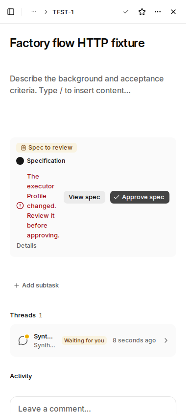
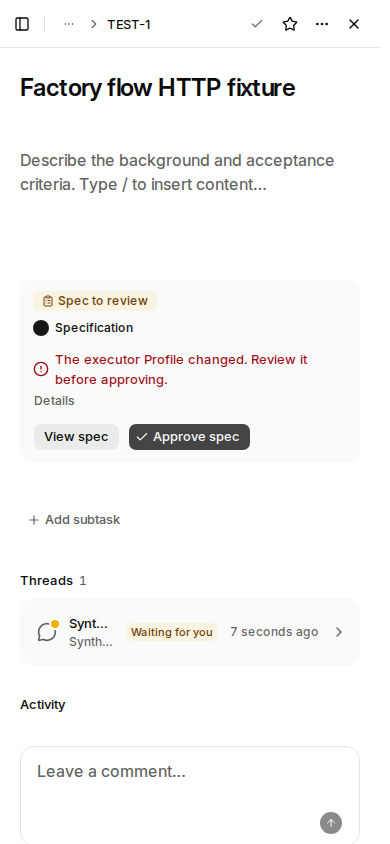
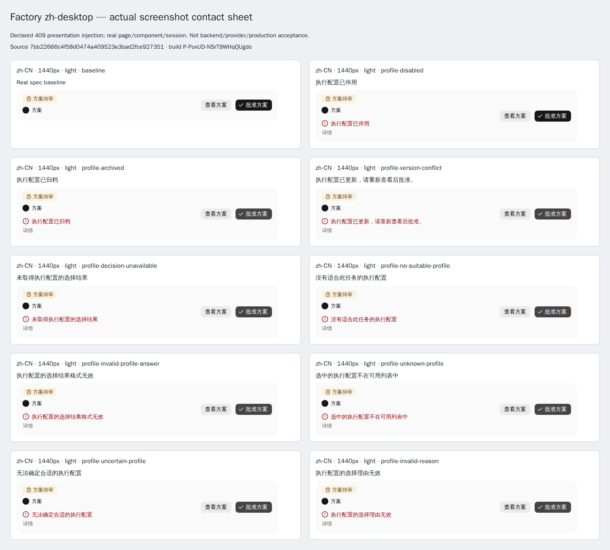
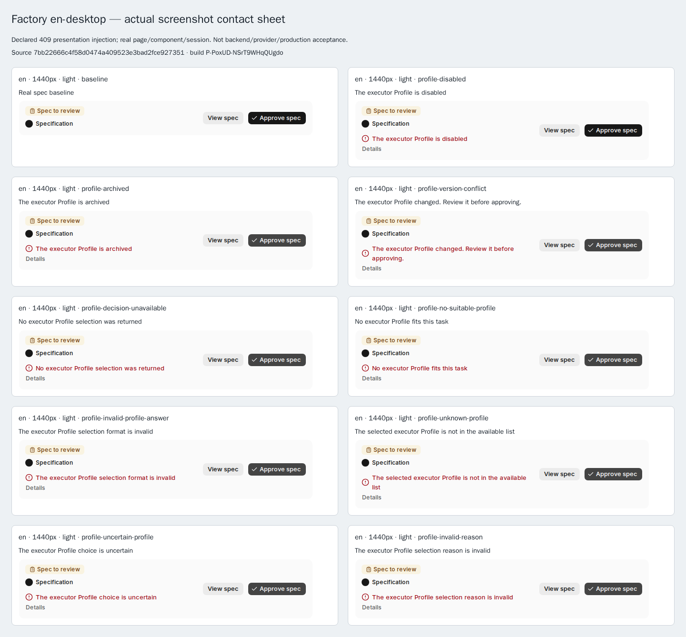
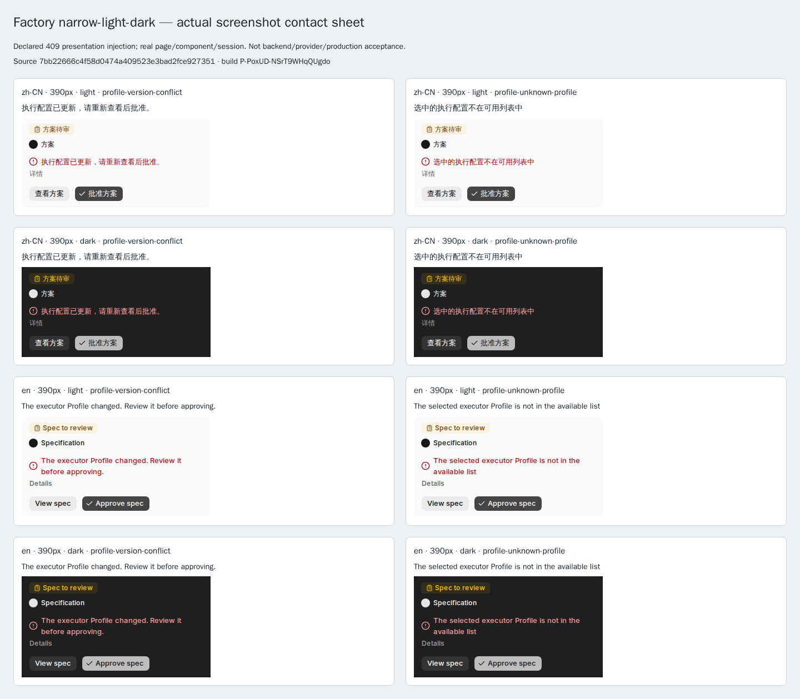

# PR #1439：Factory 批准提示与线程读取审阅页

**7bb 最终组合树的本地生产构建、正常账号 20 HTTP 与 28 个 UI 状态验收已完成。** 本页当前截图、构建和运行回执全部来自真实 7bb 轮次；59e 失败图用于前后对照，a233 仅保留历史说明和原安全回执。材料拟放入独立 evidence 分支，不进入产品 main。

## 用户任务与改前／改后

| 用户正在做什么 | 改前 | 本批次的改后行为 | 证据 |
| --- | --- | --- | --- |
| 批准已经完成的方案，遇到执行配置拒绝 | 停用、归档、版本变化及六种选择失败都显示同一条“执行 Profile 不可用” | 九条原因各自对应文案；保留原后端 code/detail、详情入口、重试和事件逻辑 | [九条文案](#九条原因与桌面卡片)、[源码 PR #1437](https://github.com/alexj11324/Mikka/pull/1437) |
| 在 390px 窄屏读取英文拒绝原因并决定下一步 | 正文被操作区挤成逐词竖排；错误区 client 86px、scroll 88px | 原 Item 自然换行，正文占 314px，两个操作按钮移到下一行；完整原因仍保留 | [真实前后对照](#真实窄屏前后对照) |
| 从线程定位任务或查看改动 | 仅需身份的两入口读取完整线程展示字段后丢弃 | `findThreadIssue` / `getThreadChanges` 使用有限身份投影，原 ACL、joins、limit、成员检查和返回语义保留；补固定读取来源 | [源码 PR #1438](https://github.com/alexj11324/Mikka/pull/1438)、[四个正常 Server Actions](#四个正常-server-actions) |

### 复用现有页面和组件

| 现有组件 | 本次用途 |
| --- | --- |
| [TaskDetail](https://github.com/alexj11324/Mikka/blob/7bb22666c4f58d0474a409523e3bad2fce927351/components/workspace/task-detail.tsx) | 真实任务详情入口；截图来自实际生产构建页面 |
| [FactoryFlowCard](https://github.com/alexj11324/Mikka/blob/7bb22666c4f58d0474a409523e3bad2fce927351/components/workspace/factory-flow.tsx) | 方案阶段、原因提示与批准操作；局部换行修复在这里 |
| [Item / ItemContent](https://github.com/alexj11324/Mikka/blob/7bb22666c4f58d0474a409523e3bad2fce927351/components/ui/item.tsx) | 沿用已有 flex-wrap 与布局；调用处增加 `basis-64`，保留 `min-w-0 gap-2` |
| [Button](https://github.com/alexj11324/Mikka/blob/7bb22666c4f58d0474a409523e3bad2fce927351/components/ui/button.tsx) | 沿用“查看方案 / View spec”“批准方案 / Approve spec”按钮 |
| [RunErrorDetails](https://github.com/alexj11324/Mikka/blob/7bb22666c4f58d0474a409523e3bad2fce927351/components/workspace/run-error-text.tsx) | 保留“详情 / Details”和准确的错误原因代码 |

没有新增产品组件或调试页面；共享 Item、Button 和错误详情组件不作改造。Figma 没有新增设计变更，本次沿用已上线组件。没有提供 Figma frame，因此本页不声称完成了未提供 frame 的逐项比对。

## 真实窄屏前后对照

下面两张都是实际捕获的完整 390×844 视口，未经重绘、缩放写回或内容修改。**改前 59e 已包含本批次的原因文案**，此处单独比较后来发现的布局问题。旧失败截图与失败记录保留，未改成通过。

| 59e：真实失败状态 | 7bb：局部换行修复后 |
| --- | --- |
|  |  |

| 实测指标 | 59e | 7bb |
| --- | ---: | ---: |
| 错误区 clientWidth | 86px | 314px |
| 错误区 scrollWidth | 88px | 314px |
| 卡片高度 | 244px | 182px |
| 英文原因布局 | 逐词竖排 | 正常两行 |
| 两个操作按钮 | 正文右侧，占用正文宽度 | 正文下方 |

最终 8 个窄屏状态都为 **scrollWidth/clientWidth = 314/314px**。英文卡片高 182px，中文高 162px；中英、明暗两种主题均检查了版本变化与未知配置两条原因。完整文案、详情入口、图标和按钮均可见，无遮挡或横向溢出。

## 截图总览与完整素材

[中文桌面截图总览](assets/7bb/contacts/contact-zh-desktop.png) · [英文桌面截图总览](assets/7bb/contacts/contact-en-desktop.png) · [中英窄屏明暗截图总览](assets/7bb/contacts/contact-narrow-light-dark.png)

截图总览仅排列已有原始 PNG；原始卡片和完整视口均单独保留。桌面基线为 1440×1000，窄屏为 390×844。本页共复制 42 张 PNG：3 张截图总览、28 张卡片、8 张窄屏完整视口、2 张桌面基线完整视口、1 张旧版失败完整视口。

### 九条原因与桌面卡片

| 原因 | 中文实际文案 | English 实际文案 | 原始卡片 |
| --- | --- | --- | --- |
| 执行配置已停用 | 执行配置已停用 | The executor Profile is disabled | [中文](assets/7bb/cards/zh-CN-1440-light-profile-disabled-card.png) · [English](assets/7bb/cards/en-1440-light-profile-disabled-card.png) |
| 执行配置已归档 | 执行配置已归档 | The executor Profile is archived | [中文](assets/7bb/cards/zh-CN-1440-light-profile-archived-card.png) · [English](assets/7bb/cards/en-1440-light-profile-archived-card.png) |
| 配置版本变化 | 执行配置已更新，请重新查看后批准。 | The executor Profile changed. Review it before approving. | [中文](assets/7bb/cards/zh-CN-1440-light-profile-version-conflict-card.png) · [English](assets/7bb/cards/en-1440-light-profile-version-conflict-card.png) |
| 未取得配置选择结果 | 未取得执行配置的选择结果 | No executor Profile selection was returned | [中文](assets/7bb/cards/zh-CN-1440-light-profile-decision-unavailable-card.png) · [English](assets/7bb/cards/en-1440-light-profile-decision-unavailable-card.png) |
| 没有合适配置 | 没有适合此任务的执行配置 | No executor Profile fits this task | [中文](assets/7bb/cards/zh-CN-1440-light-profile-no-suitable-profile-card.png) · [English](assets/7bb/cards/en-1440-light-profile-no-suitable-profile-card.png) |
| 选择结果格式无效 | 执行配置的选择结果格式无效 | The executor Profile selection format is invalid | [中文](assets/7bb/cards/zh-CN-1440-light-profile-invalid-profile-answer-card.png) · [English](assets/7bb/cards/en-1440-light-profile-invalid-profile-answer-card.png) |
| 选择不在可用列表 | 选中的执行配置不在可用列表中 | The selected executor Profile is not in the available list | [中文](assets/7bb/cards/zh-CN-1440-light-profile-unknown-profile-card.png) · [English](assets/7bb/cards/en-1440-light-profile-unknown-profile-card.png) |
| 无法确定配置 | 无法确定合适的执行配置 | The executor Profile choice is uncertain | [中文](assets/7bb/cards/zh-CN-1440-light-profile-uncertain-profile-card.png) · [English](assets/7bb/cards/en-1440-light-profile-uncertain-profile-card.png) |
| 选择理由无效 | 执行配置的选择理由无效 | The executor Profile selection reason is invalid | [中文](assets/7bb/cards/zh-CN-1440-light-profile-invalid-reason-card.png) · [English](assets/7bb/cards/en-1440-light-profile-invalid-reason-card.png) |

### 28 个实际状态索引

| 语言 | 视口 | 主题 | 状态 | 原始图片 |
| --- | --- | --- | --- | --- |
| zh-CN | 1440×1000 | 浅色 | 待审方案基线 | [卡片](assets/7bb/cards/zh-CN-1440-light-baseline-card.png) · [完整视口](assets/7bb/viewports/zh-CN-1440-light-baseline-viewport.png) |
| zh-CN | 1440×1000 | 浅色 | 执行配置已停用 | [卡片](assets/7bb/cards/zh-CN-1440-light-profile-disabled-card.png) |
| zh-CN | 1440×1000 | 浅色 | 执行配置已归档 | [卡片](assets/7bb/cards/zh-CN-1440-light-profile-archived-card.png) |
| zh-CN | 1440×1000 | 浅色 | 配置版本变化 | [卡片](assets/7bb/cards/zh-CN-1440-light-profile-version-conflict-card.png) |
| zh-CN | 1440×1000 | 浅色 | 未取得配置选择结果 | [卡片](assets/7bb/cards/zh-CN-1440-light-profile-decision-unavailable-card.png) |
| zh-CN | 1440×1000 | 浅色 | 没有合适配置 | [卡片](assets/7bb/cards/zh-CN-1440-light-profile-no-suitable-profile-card.png) |
| zh-CN | 1440×1000 | 浅色 | 选择结果格式无效 | [卡片](assets/7bb/cards/zh-CN-1440-light-profile-invalid-profile-answer-card.png) |
| zh-CN | 1440×1000 | 浅色 | 选择不在可用列表 | [卡片](assets/7bb/cards/zh-CN-1440-light-profile-unknown-profile-card.png) |
| zh-CN | 1440×1000 | 浅色 | 无法确定配置 | [卡片](assets/7bb/cards/zh-CN-1440-light-profile-uncertain-profile-card.png) |
| zh-CN | 1440×1000 | 浅色 | 选择理由无效 | [卡片](assets/7bb/cards/zh-CN-1440-light-profile-invalid-reason-card.png) |
| zh-CN | 390×844 | 浅色 | 配置版本变化 | [卡片](assets/7bb/cards/zh-CN-390-light-profile-version-conflict-card.png) · [完整视口](assets/7bb/viewports/zh-CN-390-light-profile-version-conflict-viewport.png) |
| zh-CN | 390×844 | 浅色 | 选择不在可用列表 | [卡片](assets/7bb/cards/zh-CN-390-light-profile-unknown-profile-card.png) · [完整视口](assets/7bb/viewports/zh-CN-390-light-profile-unknown-profile-viewport.png) |
| zh-CN | 390×844 | 深色 | 配置版本变化 | [卡片](assets/7bb/cards/zh-CN-390-dark-profile-version-conflict-card.png) · [完整视口](assets/7bb/viewports/zh-CN-390-dark-profile-version-conflict-viewport.png) |
| zh-CN | 390×844 | 深色 | 选择不在可用列表 | [卡片](assets/7bb/cards/zh-CN-390-dark-profile-unknown-profile-card.png) · [完整视口](assets/7bb/viewports/zh-CN-390-dark-profile-unknown-profile-viewport.png) |
| en | 1440×1000 | 浅色 | 待审方案基线 | [卡片](assets/7bb/cards/en-1440-light-baseline-card.png) · [完整视口](assets/7bb/viewports/en-1440-light-baseline-viewport.png) |
| en | 1440×1000 | 浅色 | 执行配置已停用 | [卡片](assets/7bb/cards/en-1440-light-profile-disabled-card.png) |
| en | 1440×1000 | 浅色 | 执行配置已归档 | [卡片](assets/7bb/cards/en-1440-light-profile-archived-card.png) |
| en | 1440×1000 | 浅色 | 配置版本变化 | [卡片](assets/7bb/cards/en-1440-light-profile-version-conflict-card.png) |
| en | 1440×1000 | 浅色 | 未取得配置选择结果 | [卡片](assets/7bb/cards/en-1440-light-profile-decision-unavailable-card.png) |
| en | 1440×1000 | 浅色 | 没有合适配置 | [卡片](assets/7bb/cards/en-1440-light-profile-no-suitable-profile-card.png) |
| en | 1440×1000 | 浅色 | 选择结果格式无效 | [卡片](assets/7bb/cards/en-1440-light-profile-invalid-profile-answer-card.png) |
| en | 1440×1000 | 浅色 | 选择不在可用列表 | [卡片](assets/7bb/cards/en-1440-light-profile-unknown-profile-card.png) |
| en | 1440×1000 | 浅色 | 无法确定配置 | [卡片](assets/7bb/cards/en-1440-light-profile-uncertain-profile-card.png) |
| en | 1440×1000 | 浅色 | 选择理由无效 | [卡片](assets/7bb/cards/en-1440-light-profile-invalid-reason-card.png) |
| en | 390×844 | 浅色 | 配置版本变化 | [卡片](assets/7bb/cards/en-390-light-profile-version-conflict-card.png) · [完整视口](assets/7bb/viewports/en-390-light-profile-version-conflict-viewport.png) |
| en | 390×844 | 浅色 | 选择不在可用列表 | [卡片](assets/7bb/cards/en-390-light-profile-unknown-profile-card.png) · [完整视口](assets/7bb/viewports/en-390-light-profile-unknown-profile-viewport.png) |
| en | 390×844 | 深色 | 配置版本变化 | [卡片](assets/7bb/cards/en-390-dark-profile-version-conflict-card.png) · [完整视口](assets/7bb/viewports/en-390-dark-profile-version-conflict-viewport.png) |
| en | 390×844 | 深色 | 选择不在可用列表 | [卡片](assets/7bb/cards/en-390-dark-profile-unknown-profile-card.png) · [完整视口](assets/7bb/viewports/en-390-dark-profile-unknown-profile-viewport.png) |

## 7bb 精确版本与完整构建

| 项目 | 已观测值 |
| --- | --- |
| PR | [#1439](https://github.com/alexj11324/Mikka/pull/1439) |
| 源码 SHA | `7bb22666c4f58d0474a409523e3bad2fce927351` |
| Tree | `d5a158e0478e5f4f659f92bfdd99f8dc6eae2356` |
| 普通 merge parents | `a233747ca8de4be2963380a5130d1e83dee0b0e9` + `81c05e18bc087c6a08e1dd23bb323bd3f6e7cf55` |
| BUILD_ID | `P-PoxUD-NSrT9WHqQUgdo` |
| 正常生产 build | `pnpm build`，155.976 秒，exit 0 |
| Build 时间（UTC） | 2026-11-05T21:26:30.148881+00:00 — 2026-11-05T21:29:06.124863+00:00 |
| 实际工具版本 | Node v24.22.2 / pnpm 10.34.3 / Next 16.4.1 |
| OOM 观测 | `/proc/vmstat` 的 oom_kill 增量为 0；cgroup 计数不可读，没有推断成 0 |
| HTTP run | `477db554-50c3-4d7b-a6a8-abf13a2a4e28` |
| HTTP 时间（UTC） | 2026-11-05T21:29:09.454Z — 2026-11-05T21:29:19.810Z |
| 独立 UI run | `a36781c1-f37d-4498-9c24-20bf63ff6e45` |
| UI 时间（UTC） | 2026-11-05T21:29:22.089Z — 2026-11-05T21:29:40.838Z |
| 完整步骤收口 | 2026-11-05T21:29:41.421465+00:00，exit 0 |

以下 CI 回执均明确绑定 **7bb 完整 SHA**；3 个 workflow success，4 个 required check 已按名称、App 与 head 核对。条件不适用的 `Cloud credential access (OIDC)` job 为 skipped，没有算成实际运行通过。CI 不替代本页正常 HTTP 和图像审阅。

| 7bb workflow | 回执 |
| --- | --- |
| [Browser gate · 42110968210](https://github.com/alexj11324/Mikka/actions/runs/42110968210) | completed / success |
| [CI · 42110967952](https://github.com/alexj11324/Mikka/actions/runs/42110967952) | completed / success |
| [Analytics SSR · 42110968009](https://github.com/alexj11324/Mikka/actions/runs/42110968009) | completed / success |

## 正常账号 HTTP：16 个 Factory 请求

使用完整生产构建、正常 TestAccountPool 的 Owner / Peer、正常 session 和隔离 loopback PostgreSQL。正向批准实际建立新的本地 queued implementation、Default Profile 与 native binding；同事件重放没有重复 run / attempt / binding / approval，旧 revision 被拒绝。

| # | 操作 | 身份 | Method | HTTP | 解码响应 B |
| ---: | --- | --- | --- | ---: | ---: |
| 1 | `owner-read` | owner | GET | 200 | 319 |
| 2 | `peer-read` | peer | GET | 404 | 27 |
| 3 | `anonymous-read` | anonymous | GET | 401 | 32 |
| 4 | `anonymous-write` | anonymous | POST | 401 | 32 |
| 5 | `peer-write` | peer | POST | 404 | 27 |
| 6 | `cross-origin-write` | leased-context | POST | 403 | 26 |
| 7 | `missing-origin-write` | leased-context | POST | 403 | 26 |
| 8 | `delegated-authorization-write` | leased-context | POST | 401 | 32 |
| 9 | `invalid-operation` | owner | POST | 422 | 26 |
| 10 | `stale-revision` | owner | POST | 409 | 24 |
| 11 | `repeat-stale-revision` | owner | POST | 409 | 24 |
| 12 | `read-after-rejections` | owner | GET | 200 | 319 |
| 13 | `approve-spec-success` | owner | POST | 200 | 230 |
| 14 | `read-queued-implementation` | owner | GET | 200 | 267 |
| 15 | `repeat-same-approval-event` | owner | POST | 200 | 229 |
| 16 | `old-revision-after-success` | owner | POST | 409 | 24 |

### 四个正常 Server Actions

动作 ID 来自实际公开客户端 chunk；调用使用正常 Owner / Peer cookie、同源 Origin 和真实 Flight 响应。没有手工替代会话或绕过 ACL。

| Action | 身份 | HTTP | 解码 Flight 响应 B | 实际结果 |
| --- | --- | ---: | ---: | --- |
| `findThreadIssue` | owner | 200 | 112 | expected-value |
| `findThreadIssue` | peer | 200 | 66 | inaccessible-null |
| `getThreadChanges` | owner | 200 | 78 | expected-value |
| `getThreadChanges` | peer | 500 | 86 | rejected-by-action-error |

Peer 的 `getThreadChanges` 是 production Next 的真实 500 + Flight E 拒绝，没有 Owner 的返回值；具体 `issueNotFound` / `runNotFound` 被生产 Next 隐藏，精确错误原因由固定源码的真实 PG 测试覆盖。500 在此是预期拒绝边界，不能写成 HTTP 直接返回了该原因代码。上表 B 是解码响应体大小，不是 PostgreSQL 读取量或 Neon 账单流量。

## 26 次注入的边界

28 个 UI 状态包含 2 个正常待审基线和 **26 次明确的 409 展示注入**。只拦截本轮确切任务、revision、同源 flow API 的 `approve_spec` POST；页面、GET、正常租约身份与真实组件事件逻辑保留。注入仅验证文案、布局和明确拒绝后的交互，**不证明真实后端产生了这 26 种拒绝，也不计作生产验收**。实际后端批准与拒绝矩阵另由上面的 16 请求承担。

HTTP 中的已完成 planner、subscription catalogue 和 quota 明确为本地 synthetic 夹具；队列、批准、Profile、native binding 与权限约束是真实路径。没有以此声称供应商执行、真实订阅任务完成或生产验收通过。初始 `needsSpec` 云端派发入口也不在这 20 个 HTTP 的覆盖范围内；#1444 的新增入口和云环境交接需要其对应证据。

## 清理、人工审阅与证据完整性

两轮都实际 `passed=true / leaseState=released / lost=false / evidenceAudit=passed`；23 类夹具计数全部归零。Owner 原计数、既有 issue 集合、workspace/model baseline 和完整 pool fingerprint 均恢复。UI 完成后通过原 Owner 正常 `/api/workspace` 请求恢复 locale 所影响的工作区显示，真实比对通过。PostgreSQL stop exit 0，3110 / 5432 均无监听；旧 worktree 和旧 cluster 保留。

**人工审阅：** root 已亲看新 7bb 的 3 张截图总览，以及英文窄屏浅色版本冲突、深色未知配置两张完整视口；独立审阅人 project_map_reads 逐张查看新 7bb 的全部 8 张窄屏原图，并复核完整归档、图片哈希和清理回执。7bb 当前审阅范围内没有剩余 Severity 3/4 问题。此结论仅属于 7bb 图像与行为证据。

- [允许字段整理后的 7bb 回执](metadata/7bb-summary.json)
- [28 状态的图片与尺寸清单](metadata/7bb-screenshots.json)
- [每个交付文件的 SHA256 / Git blob SHA1](manifest.json)

公开素材仅含真实 PNG、中文说明和允许字段整理后的回执；不包含账号邮箱、credentials、sessionState、浏览器 cookie、数据库连接串或原始私密日志。所有 PNG 的来源字节/hash均逐一核对；7bb 原始 ZIP 为 1,289,094 B，SHA256 `8d52b658b2e9542eda99226acca739dd28a3addc672ad6217375182101797c3d`，其中 101 个文件与解压件逐字节一致。原脚本、原 manifest 和旧失败证据没有修改。`manifest.json` 覆盖除自身外的全部 payload 文件；Git blob SHA1 按 `blob <bytes>\0<content>` 计算。

## 历史与受测树边界

此前 a233 `a233747ca8de4be2963380a5130d1e83dee0b0e9`（tree `f2593b18a046eba23b9d010d79cb40407377f9eb`、BUILD_ID `Wh63fF4fa0AKPz-QIIx9L`）已完成其独立 build、20 HTTP 和 28 UI。其 [原安全回执](metadata/a233-summary.json) 保持原字节，所记原始图片路径仅作为历史出处；当前 gallery 不包含 a233 图片，也没有将其 run 或图像改标为 7bb。59e 真实失败图仍单独保留。

后续 main `ca256…` 的独立手机与地图性能改动**不属于本页 7bb 受测树**。root 最终普通 merge 将保留这些主干改动，并负责后续部署和生产验收；本页不把 7bb 的结果冒称为后续合并树的完整验收。
