# PR #1782：98403150 官方 UI 验收

本页只记录固定产品版本的隔离环境 production build（生产构建）验收。生产部署、真实账号、Peer Terminal 权限没有在此轮验证。

- 产品提交：`98403150bd6ac39683539bc278a9bf161e84dabf`；tree：`5bdc75978939051c8eab4ef50b053a59498f6b2d`。
- 官方 UI overlay：`b92b0e1d48f75c92d059ee071162b72455e6af90`。
- 控制提交：`bbf6b105e644168307b78edf1ebff382af2a0ac5`。
- [实际成功运行 42732141834/1](https://github.com/alexj11324/Mikka/actions/runs/42732141834)；artifact `13725546924`，1,139,481 B。
- ZIP SHA256：`b22deb6e662e8f3ca10aef514ababab19ba9be2c306d0dc7534c0be228d6c8d2`。
- 48 个控制器测试、5 个真实 Chromium 测试、12 项语义检查、20 张截图；测试无失败或跳过。
- 23 个工件成员的 CRC、原始字节、PNG SHA/尺寸、source pair 与编译版本一致；5 项清理、运行时关闭及 workspace 名称恢复完成。
- 两个合成身份完成正常 HTTP 认证、会话、workspace/Coordinator 初始化；截图和业务 RPC 由 owner 完成。
- 人工负责人/委派与历史记录是同页两次捕获：20 个文件、16 个不同 digest。保留原有 avatar/time 隐私遮罩；窄屏少量页头和背景被遮住，不作为窄屏全局 hand 的直接视觉证据。
- root 与独立审查者均逐张查看全部 20 张原图；未发现本轮目标语义或窄屏布局阻断。
- [原始 manifest](gallery/manifest.json) · [原始 source pair](gallery/source-pair.json) · [原始 HTML gallery](gallery/index.html) · [root 核验](root-independent-verification.json)

## 宽屏 1440×900 · 浅色

### 任务分组：Waiting / Blocked / Failed / To do / Done

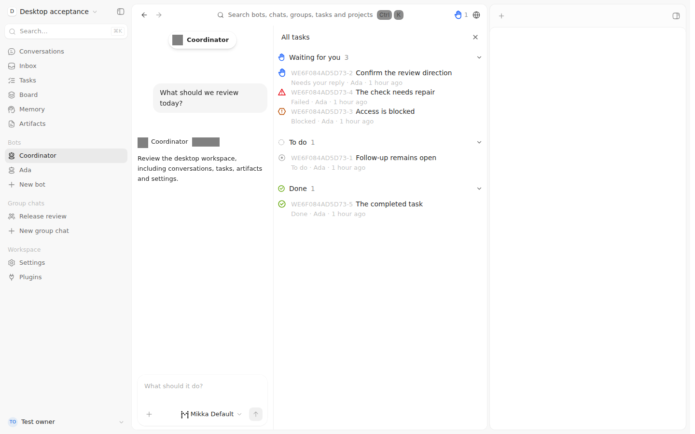

### 空 Coordinator 任务列表

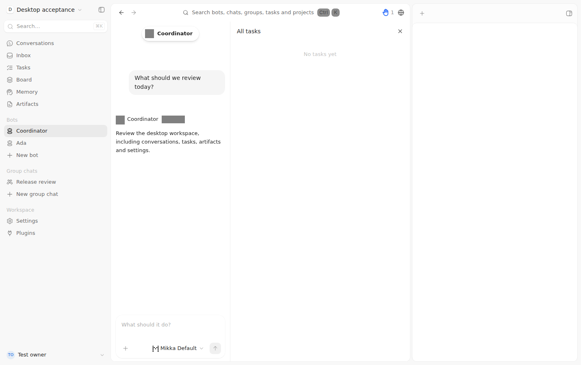

### 人工负责人和独立 Agent 委派

### 委派事件、历史成功记录与仍进行中的任务

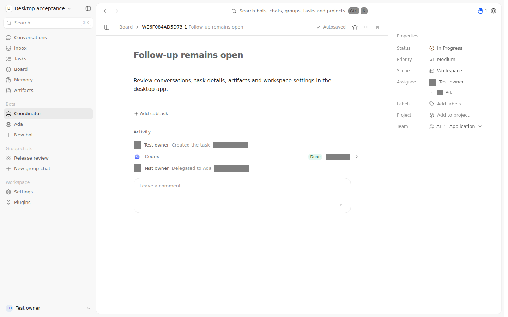

### 保存冲突后保留草稿并继续编辑

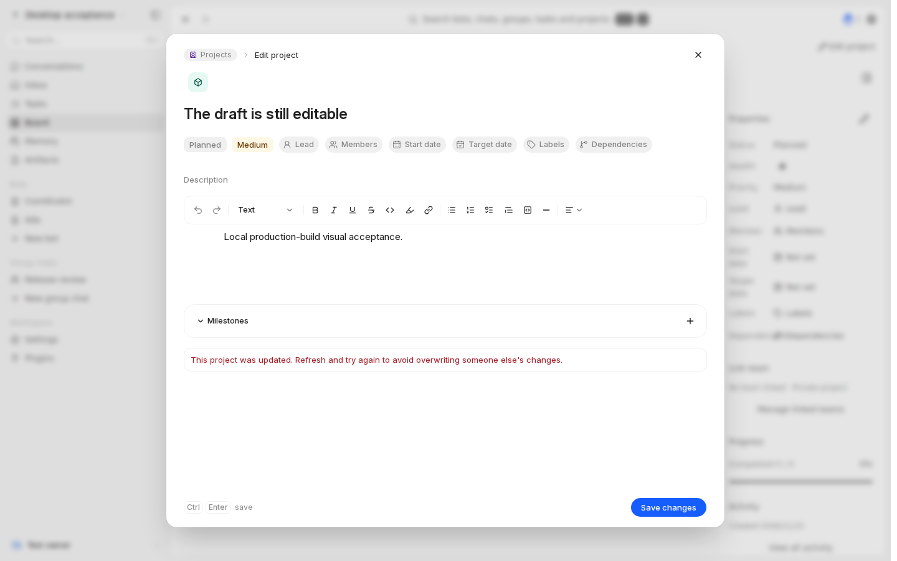

## 宽屏 1440×900 · 深色

### 任务分组：Waiting / Blocked / Failed / To do / Done

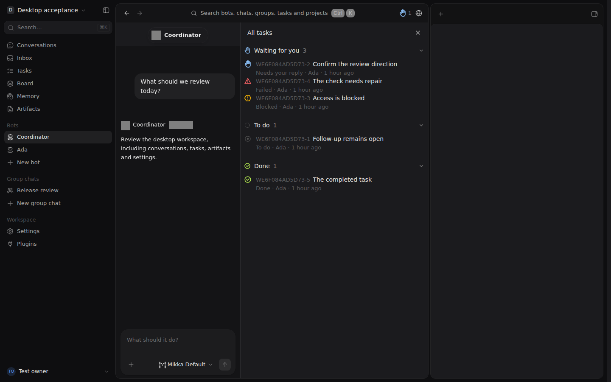

### 空 Coordinator 任务列表

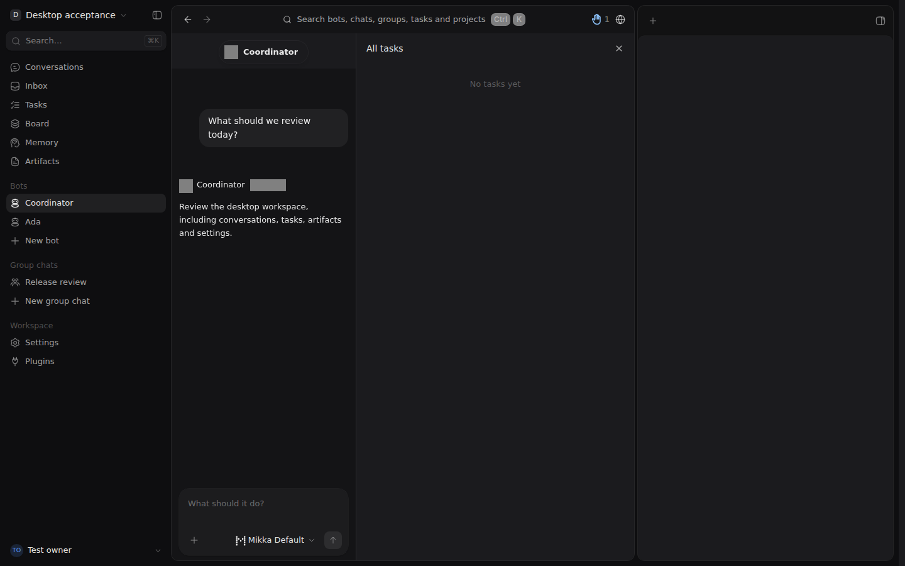

### 人工负责人和独立 Agent 委派

### 委派事件、历史成功记录与仍进行中的任务

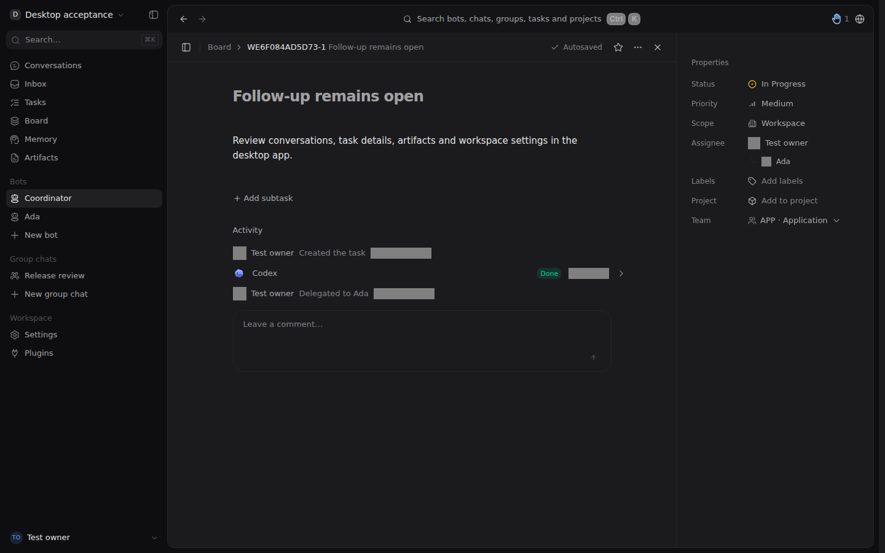

### 保存冲突后保留草稿并继续编辑

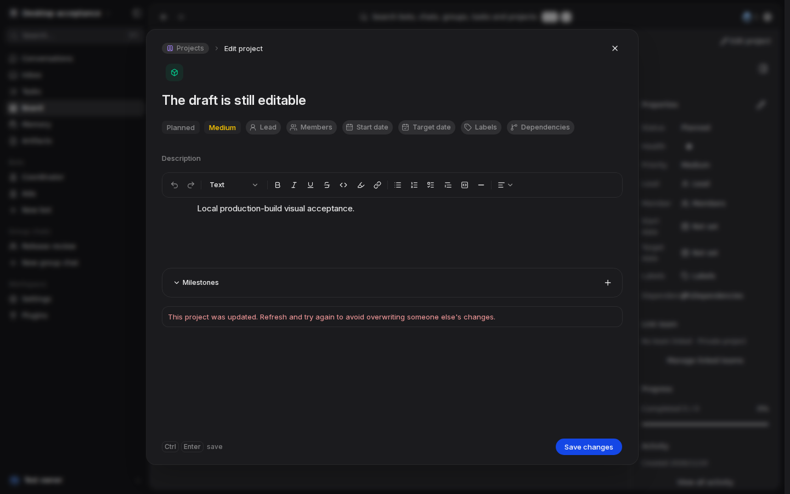

## 窄屏 390×844 · 浅色

### 任务分组：Waiting / Blocked / Failed / To do / Done

### 空 Coordinator 任务列表

### 人工负责人和独立 Agent 委派

### 委派事件、历史成功记录与仍进行中的任务

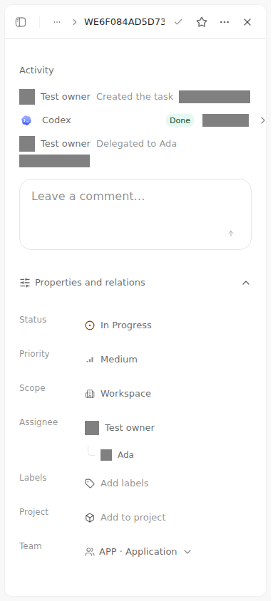

### 保存冲突后保留草稿并继续编辑

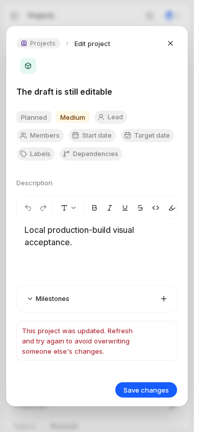

## 窄屏 390×844 · 深色

### 任务分组：Waiting / Blocked / Failed / To do / Done

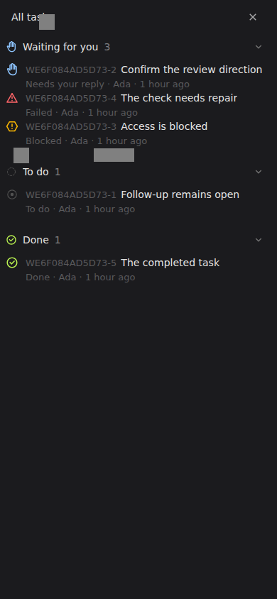

### 空 Coordinator 任务列表

### 人工负责人和独立 Agent 委派

### 委派事件、历史成功记录与仍进行中的任务

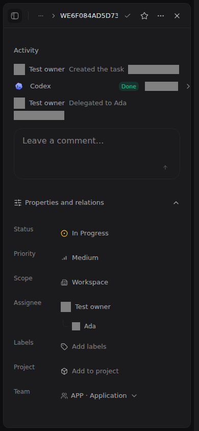

### 保存冲突后保留草稿并继续编辑

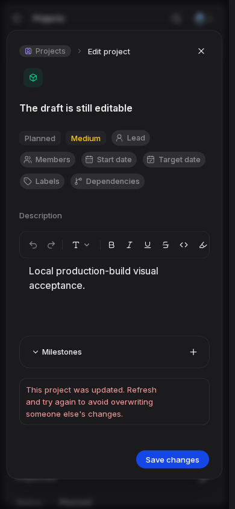
