# PR #1782 官方 UI 验收图库

本页集中展示真实本地生产构建的 20 张原始截图，覆盖 5 个指定场景、明暗主题及宽窄屏。使用固定官方 UI、真实隔离 PostgreSQL 17、普通测试账户 cookie 和正常 RPC；没有替换 UI 响应，没有访问生产数据库或调用模型。

| 来源 | 固定值 |
| --- | --- |
| 产品提交 | `0b598d264e45925bbec8ebc1284ab2ccf17e451d` |
| 产品 tree | `798ac44d8374d80647ab46f757645e492def6f3c` |
| 官方 UI revision | `b92b0e1d48f75c92d059ee071162b72455e6af90` |
| 验收控制器 | `1a9e274f80de650b356fa49cedce109669f92304` |
| Actions run | [42721347883 / attempt 1](https://github.com/alexj11324/Mikka/actions/runs/42721347883) |
| 实际 job / artifact | `129515800356` / `13721520499` |
| 原 ZIP SHA-256 | `d88c3df5133fb46f83597859a17b452f78437ae4c56d1a0a84f8852a85298fde` |
| 浏览器 viewport | 宽屏 1440 × 900；窄屏 390 × 844；device scale factor 1 |

[原始 manifest](gallery/manifest.json) · [实际编译来源对](gallery/source-pair.json) · [原始离线 HTML 图库](gallery/index.html) · [Root 独立核验及逐图审阅回执](root-independent-verification.json)

## 实际结果

- 48 项单元检查和 5 项真实 Chromium 合同回归全部通过，零跳过。旧菜单选择器超时、旧委派文字选择器双匹配均在独立浏览器回归中真实复现。
- 本次完整生产界面捕获通过 20 张截图、12 项语义检查，页面异常为空；五个任务编号和显示标识唯一，原任务编号保持，正常 RPC 读回确认。
- pending 3 / todo 1 / done 1；只有需要回复的任务计入全局手形数量 1。完成分组最初折叠，截图展示主动展开后的五行。
- 同一任务保留真人负责人及独立 Ada 委派；活动中的成功历史尝试不把仍为 In Progress 的任务变成 Done。
- 项目表单遇到正常 `projects.saveProject` 的真实 stale-revision 业务错误后，原草稿保留、仍可编辑；服务端原项目没有被覆盖。
- 浏览器、追加 fixture、基底 fixture、自动本地化的 Workspace 名称及账户 lease 五项清理均通过，外层环境进程正常退出。名称清理只恢复已证明的名称差异，并重新核对两个封存账户基线。

本页原始 20 张 PNG 已由实现者及 Root 分别逐张查看。Root 独立核验回执的 SHA-256 为 `42d7581380b2de9692dc6d30c47c09f4c1e9dccb54dcf64680d0f1c72ae04100`。它证明上述五个既有场景的语义与画面；不声称覆盖新的 Figma 设计验收、所有付费组件 demo 对照，或任何生产外部服务验收。官方 UI 私有源码没有包含在本证据目录中。

### 截图脱敏说明

原有截图工具只遮盖动态头像、时间及合成账户身份，原 manifest 记录了遮盖区域。窄屏全任务与空列表的四张图中，背后页面头像或时间的遮盖框也会落在前景面板上，局部覆盖 All tasks 标题末尾及空白区域。任务标题、状态图标、分组计数和空态文字仍可辨认。这里保留原 PNG 字节，没有事后修改截图。

## 场景索引

| 场景 | 宽屏亮色 | 宽屏暗色 | 窄屏亮色 | 窄屏暗色 |
| --- | --- | --- | --- | --- |
| 任务分组与五种状态 | [原图](gallery/wide-light-task-groups-expanded.png) | [原图](gallery/wide-dark-task-groups-expanded.png) | [原图](gallery/narrow-light-task-groups-expanded.png) | [原图](gallery/narrow-dark-task-groups-expanded.png) |
| Coordinator 空任务列表 | [原图](gallery/wide-light-empty-dispatcher.png) | [原图](gallery/wide-dark-empty-dispatcher.png) | [原图](gallery/narrow-light-empty-dispatcher.png) | [原图](gallery/narrow-dark-empty-dispatcher.png) |
| 负责人和独立委派 | [原图](gallery/wide-light-human-and-delegate.png) | [原图](gallery/wide-dark-human-and-delegate.png) | [原图](gallery/narrow-light-human-and-delegate.png) | [原图](gallery/narrow-dark-human-and-delegate.png) |
| 委派活动及成功历史尝试 | [原图](gallery/wide-light-delegation-and-history.png) | [原图](gallery/wide-dark-delegation-and-history.png) | [原图](gallery/narrow-light-delegation-and-history.png) | [原图](gallery/narrow-dark-delegation-and-history.png) |
| 项目冲突后的可编辑草稿 | [原图](gallery/wide-light-project-error-editable.png) | [原图](gallery/wide-dark-project-error-editable.png) | [原图](gallery/narrow-light-project-error-editable.png) | [原图](gallery/narrow-dark-project-error-editable.png) |

## 宽屏 · 亮色

### 任务分组与五种状态

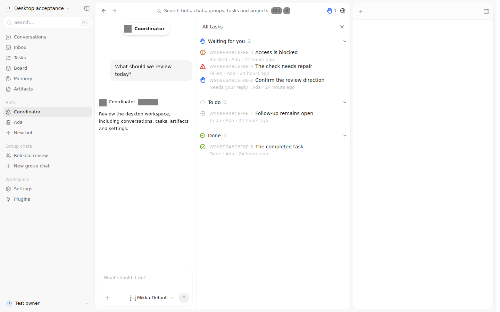

### Coordinator 空任务列表

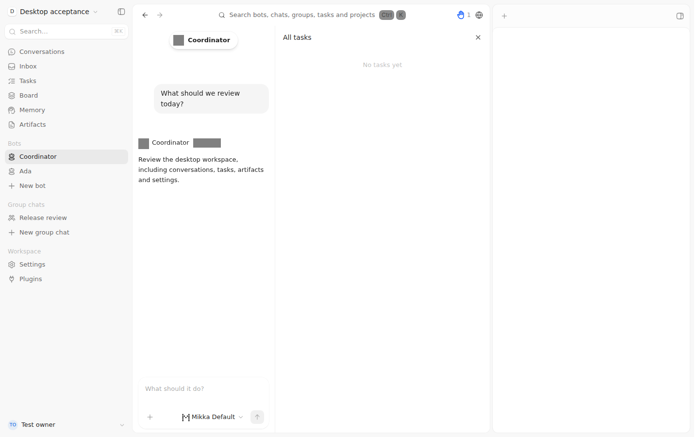

### 负责人和独立委派

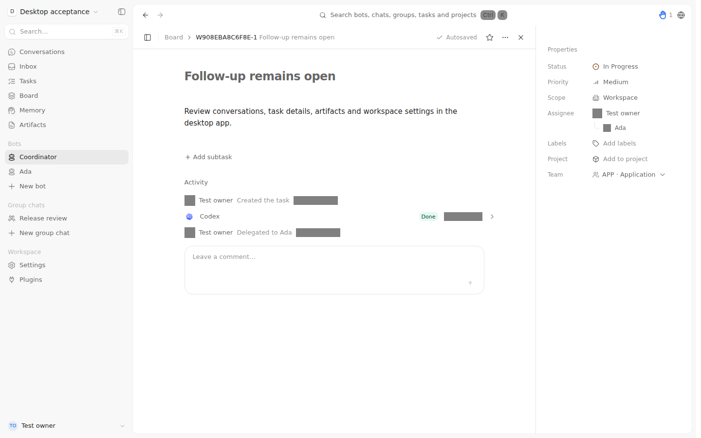

### 委派活动及成功历史尝试

### 项目冲突后的可编辑草稿

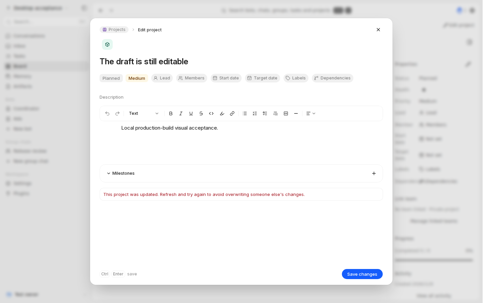

## 宽屏 · 暗色

### 任务分组与五种状态

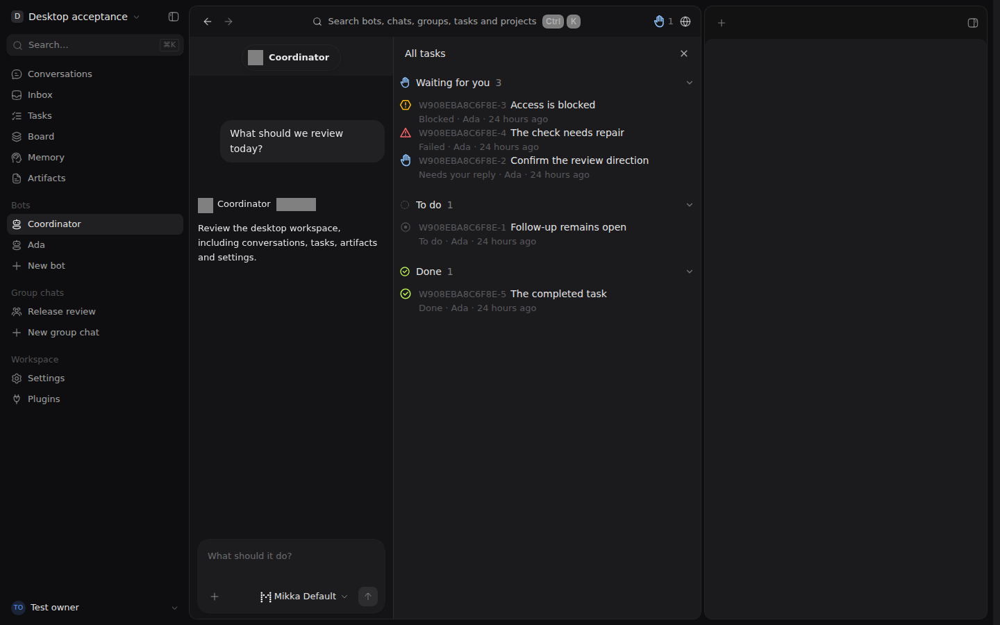

### Coordinator 空任务列表

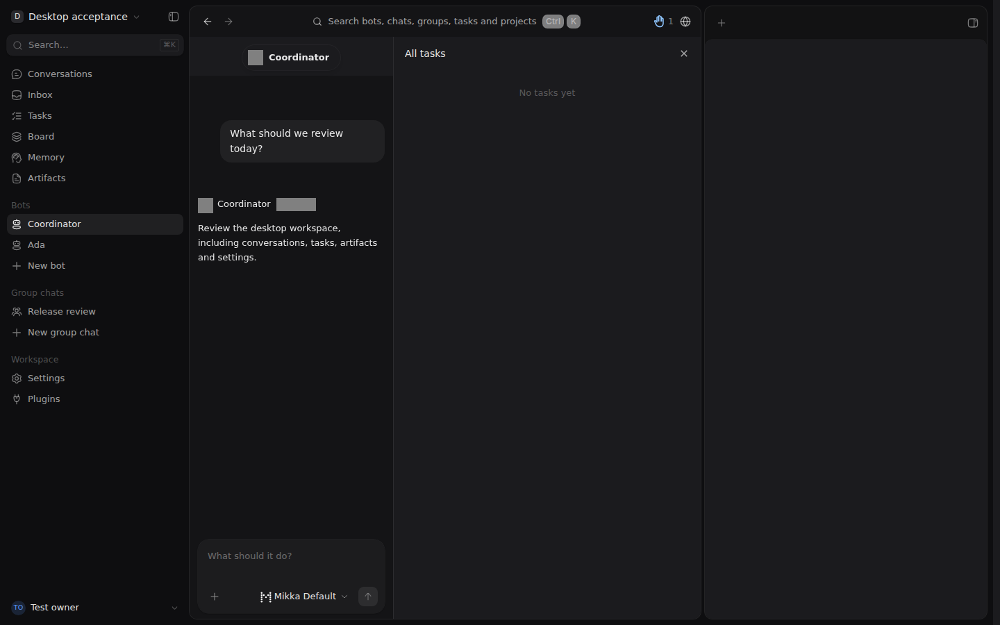

### 负责人和独立委派

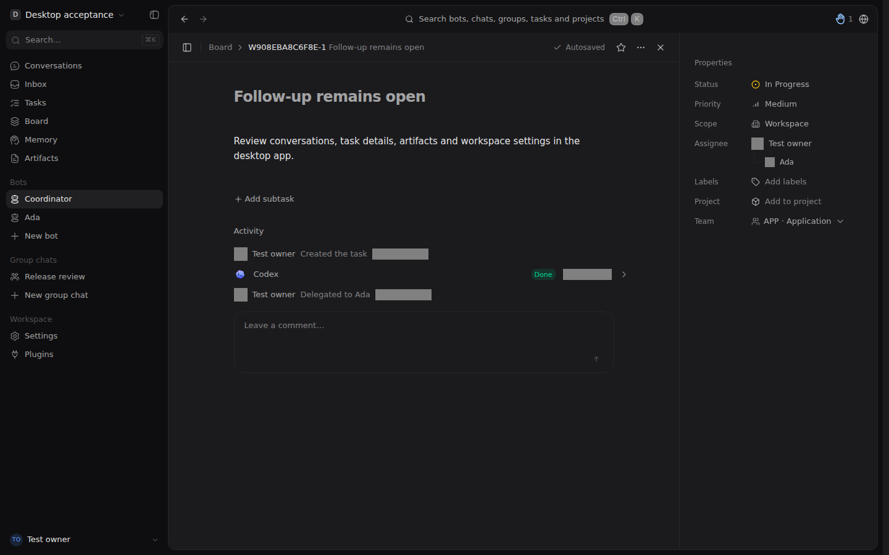

### 委派活动及成功历史尝试

### 项目冲突后的可编辑草稿

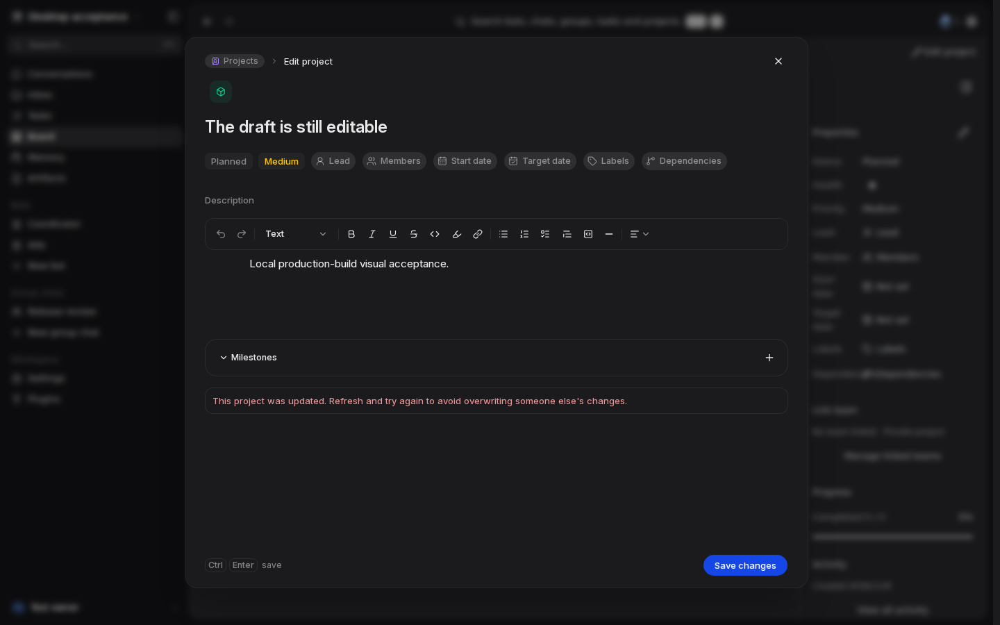

## 窄屏 · 亮色

### 任务分组与五种状态

### Coordinator 空任务列表

### 负责人和独立委派

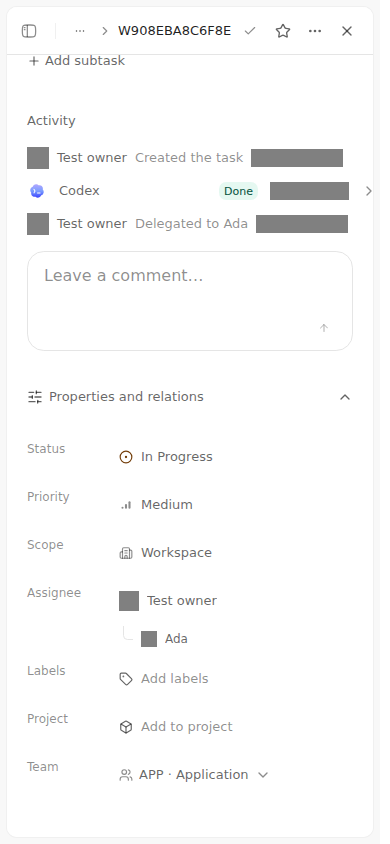

### 委派活动及成功历史尝试

### 项目冲突后的可编辑草稿

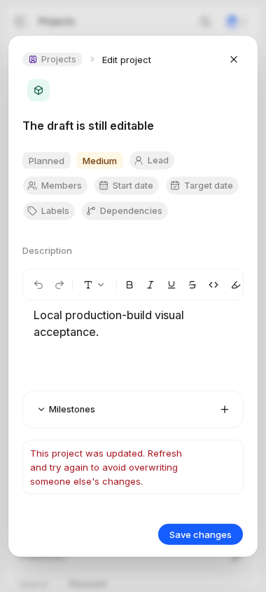

## 窄屏 · 暗色

### 任务分组与五种状态

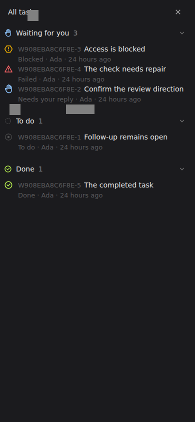

### Coordinator 空任务列表

### 负责人和独立委派

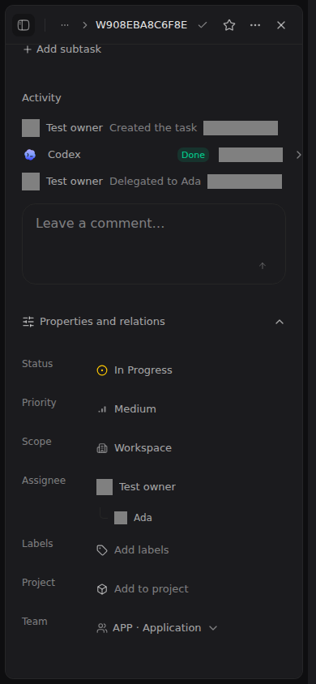

### 委派活动及成功历史尝试

### 项目冲突后的可编辑草稿

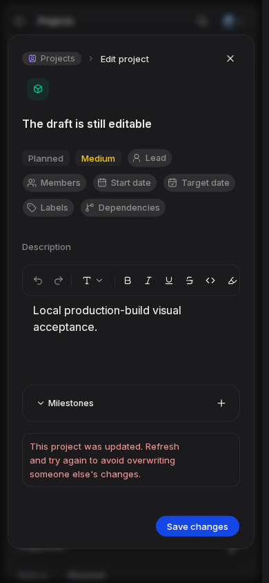

