# PR #1782：ce6 官方 UI 验收图集

供 PR 审阅者核对这次实际生产构建的 UI 行为。产品 `ce6ad923bbb449023783052d0848db22e4360f1d` 与官方 UI `fe20f19bcf82e6541430b62c450920ba42c95fb0` 在隔离 PostgreSQL 17 环境完成验收，58 项单元测试、9 项真实 Chromium 测试、20 张截图、12 项语义检查与全部清理均通过。

## 来源与独立复核

| 记录 | 固定值 |
| --- | --- |
| 产品 tree | `dffda64a4975b22cfc649908a8c5e19749ea8a96` |
| 原始 UI 作业 | [42762093106 / attempt 1](https://github.com/alexj11324/Mikka/actions/runs/42762093106) |
| UI 控制器 | `5ef8e721a0a2fc5f43ef62b710993a8938cb7be2` |
| 原始工件 | [13738795402](https://github.com/alexj11324/Mikka/actions/runs/42762093106/artifacts/13738795402)，1,202,395 B |
| ZIP SHA-256 | `bb69f6e2a1b71da3363d62e97b1284ec69d3452fbdafb9c9ed6b3c7b5d1824eb` |
| 独立读取作业 | [42765207187 / attempt 1](https://github.com/alexj11324/Mikka/actions/runs/42765207187) |
| 读取器提交 | `787455ed555c7bdf26a38d22a39f63fdc29a610a` |
| 原始清单 | [manifest.json](manifest.json)、[source-pair.json](source-pair.json) |
| 独立记录 | [reader-verification.json](reader-verification.json)、[root-review.json](root-review.json) |
| 文件摘要 | [SHA256SUMS](SHA256SUMS) |

读取器只下载这一个已存在的工件，独立核对实际 ZIP 字节、CRC、23 个成员、两份闭集 JSON、20 张 PNG 的字节摘要及尺寸。根从该读取器的日志重组了全部图片和两份原始 JSON，并再次核对各自摘要。原 HTML 的摘要保留在读取记录中，未复制进本图集。

视觉复核覆盖全部 20 张图：14 张变化图在本轮逐张查看；4 张空 Dispatcher 图和两张宽屏项目错误图与[已审 e3 图集](https://github.com/alexj11324/Mikka/blob/b9061119c3c4b7784960069f541b994dc5cd5c65/docs/evidence/pr-1782-official-ui/e3c0b0e0/README.md)的 Git blob 完全相同，因此复用原审阅。原始自动读取记录的 `humanVisualReviewPerformed=false` 保持不变，根的视觉复核结论单独写入根复核记录。

## 验收结果

| 场景 | 本轮证据 |
| --- | --- |
| 任务分组 | 待处理 3、进行中 0、待办 1、完成 1；等待、失败、阻塞的图标与颜色分别可辨 |
| 空 Dispatcher | Coordinator 的任务列表为空，全局 Inbox 计数仍为 1 |
| 人类负责人和 Agent | Assignee（负责人）与 Handed to（委派给 Agent）分别显示 |
| 历史执行与当前 Task | 历史 Codex 执行成功、委派记录可见；当前任务仍为 In Progress（进行中） |
| 项目版本冲突 | 正常 RPC 返回真实过期版本错误；未保存标题、描述仍在，输入可编辑，保存按钮可用 |
| 清理 | 浏览器、extension、base、Workspace 名称、租约五项均确认，外层 runtime shutdown 通过 |

截图的灰块是验收器记录的头像、时间或身份遮罩。窄屏截图没有显示侧栏 Inbox；窄屏计数来自同次真实 DOM 断言。原 module inventory 证明九个公共目标和七个官方插槽进入生产构建，不把模块收录称为逐模块渲染覆盖。

## 图集

### 任务分组

等待、失败、阻塞与待办、完成组按真实 Task 和 Run 状态显示。

| 视口 | 浅色 | 深色 |
| --- | --- | --- |
| 宽屏 1440 × 900 | 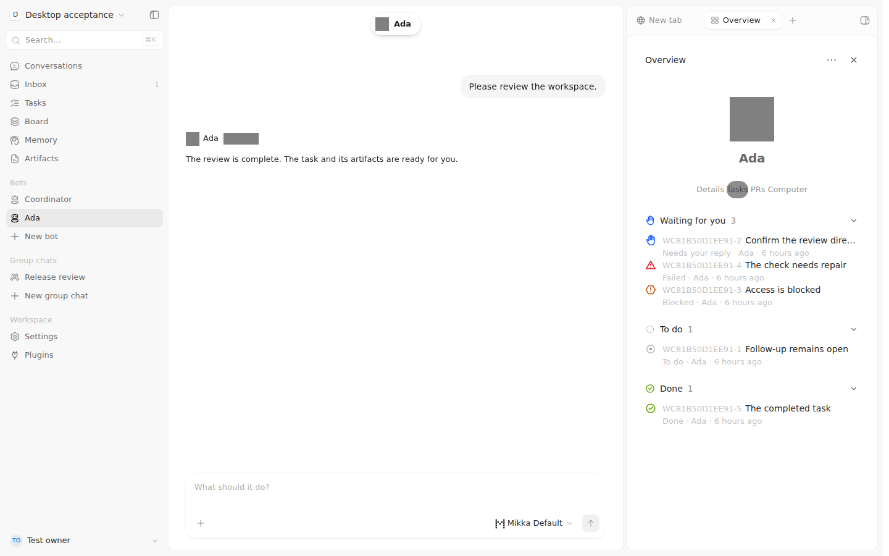 | 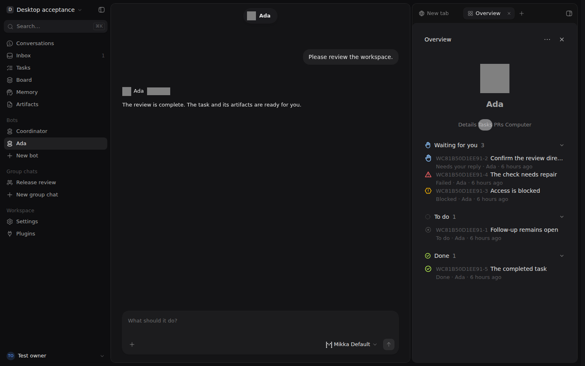 |
| 窄屏 390 × 844 | 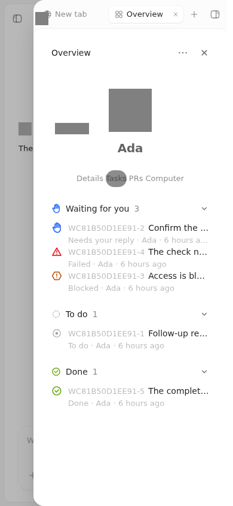 | 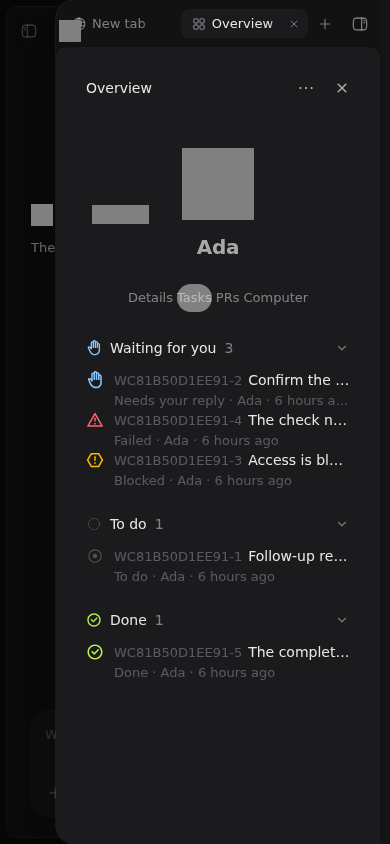 |

### 空 Dispatcher

Coordinator 的当前任务为空；宽屏可见全局 Inbox 仍有一项。

| 视口 | 浅色 | 深色 |
| --- | --- | --- |
| 宽屏 1440 × 900 | 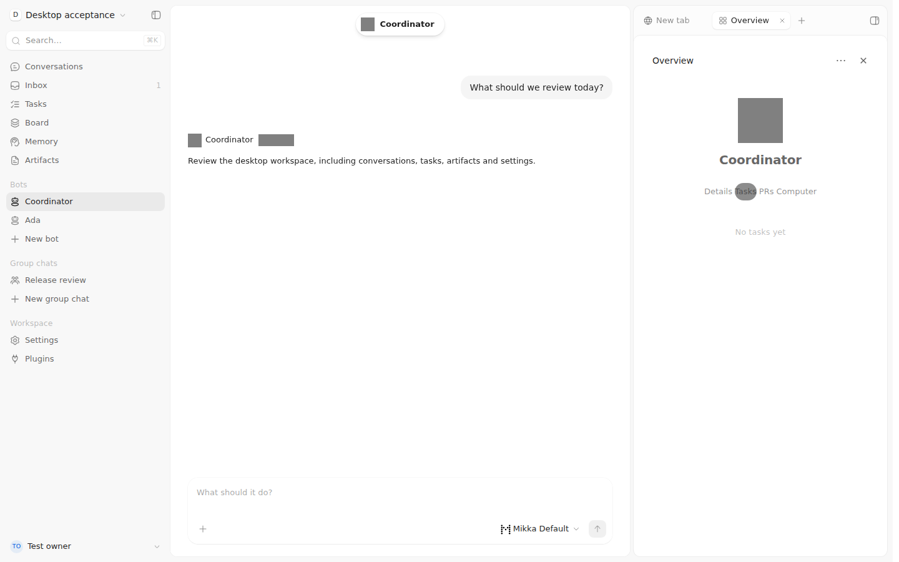 | 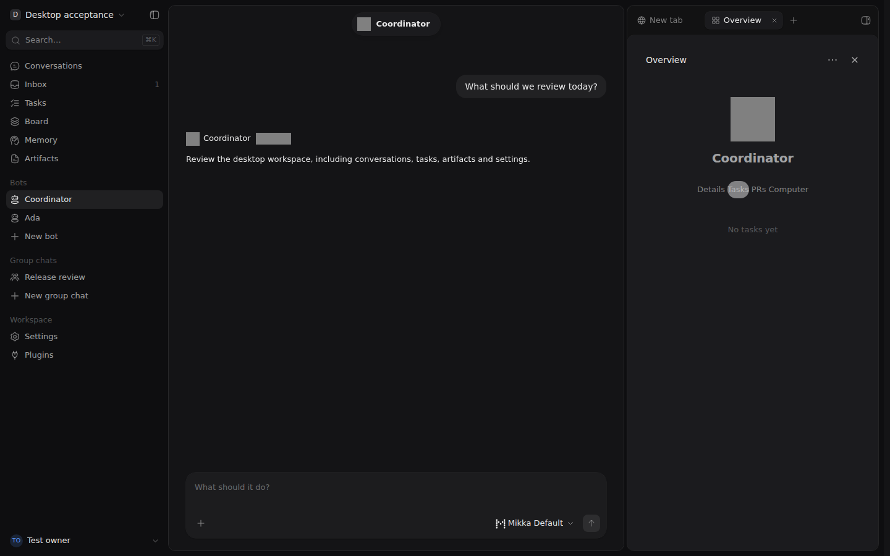 |
| 窄屏 390 × 844 | 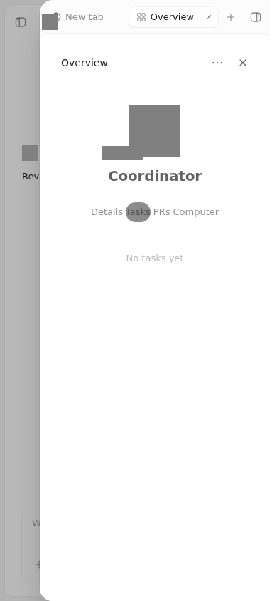 | 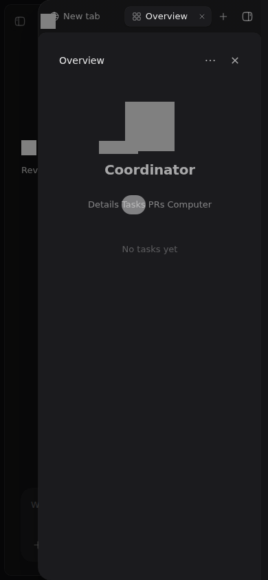 |

### 人类负责人和 Agent 委派

Test owner 是人类负责人，Ada 是独立的 Agent 委派对象。

| 视口 | 浅色 | 深色 |
| --- | --- | --- |
| 宽屏 1440 × 900 |  |  |
| 窄屏 390 × 844 | 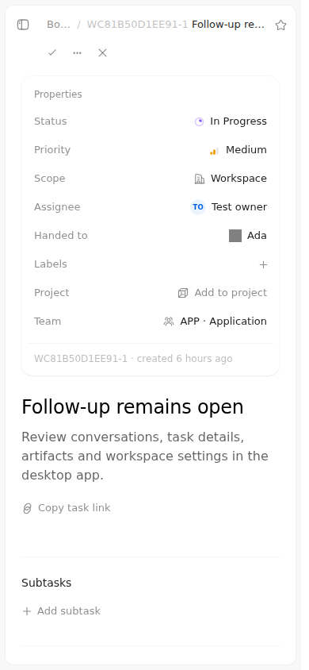 | 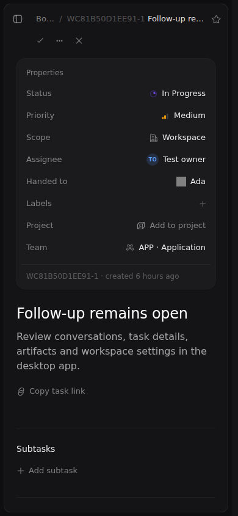 |

### 委派与历史执行

活动区保留创建、历史成功执行与委派事件，Task 状态由当前 Task 决定。

| 视口 | 浅色 | 深色 |
| --- | --- | --- |
| 宽屏 1440 × 900 | 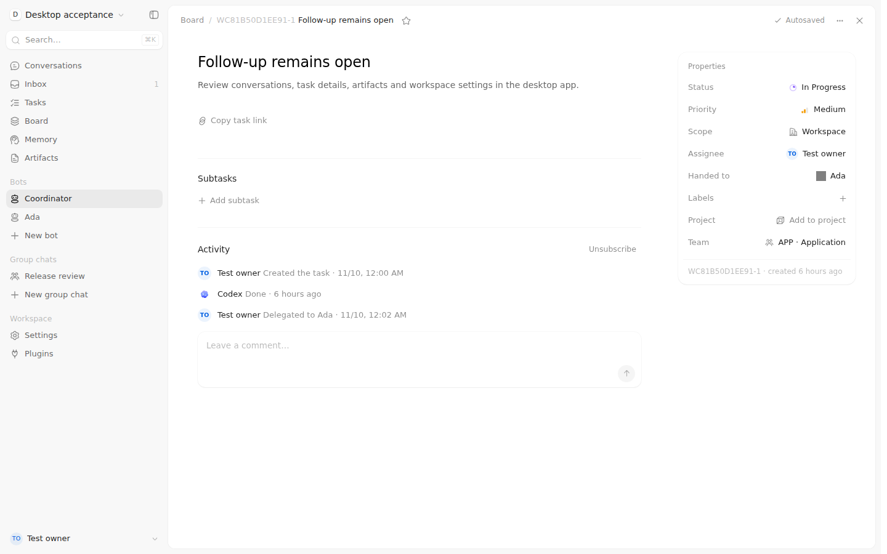 | 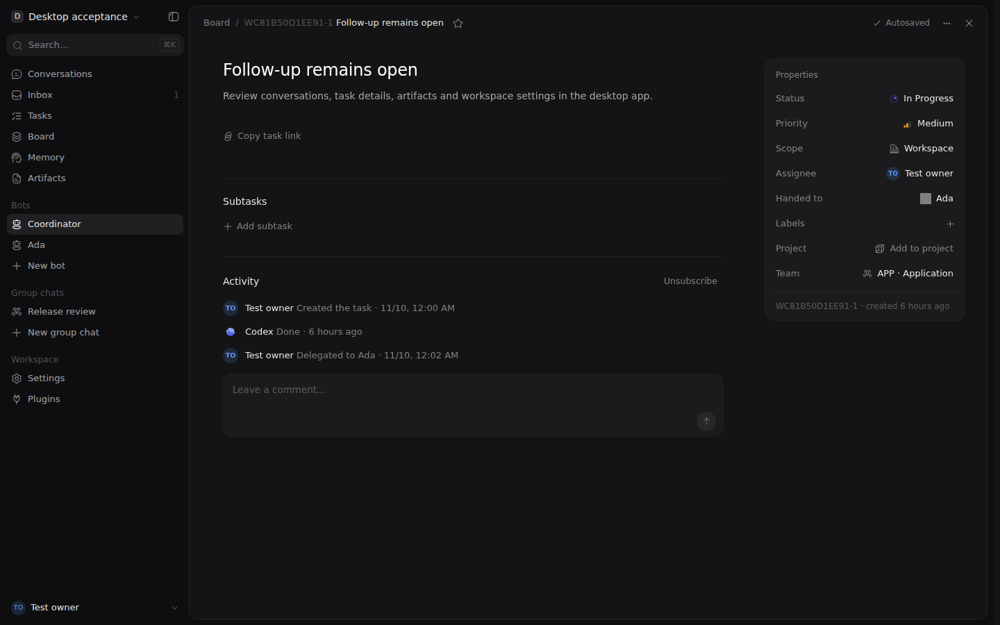 |
| 窄屏 390 × 844 | 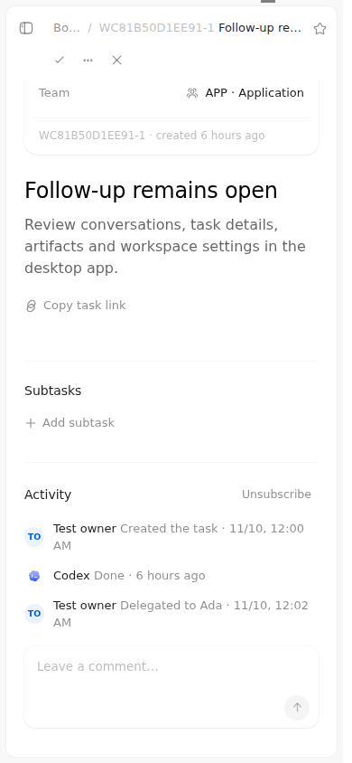 | 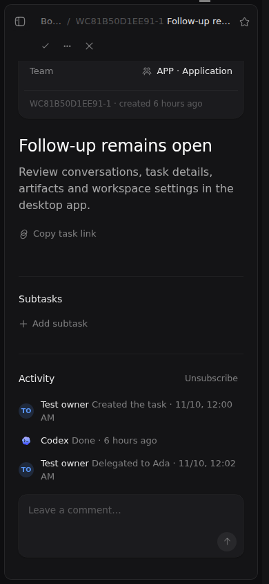 |

### 项目冲突后的草稿

错误消息说明版本已更新；草稿内容、编辑区与保存按钮保持可用。

| 视口 | 浅色 | 深色 |
| --- | --- | --- |
| 宽屏 1440 × 900 | 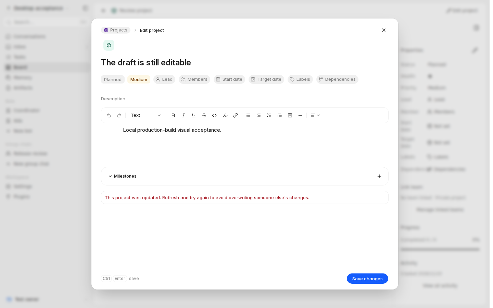 | 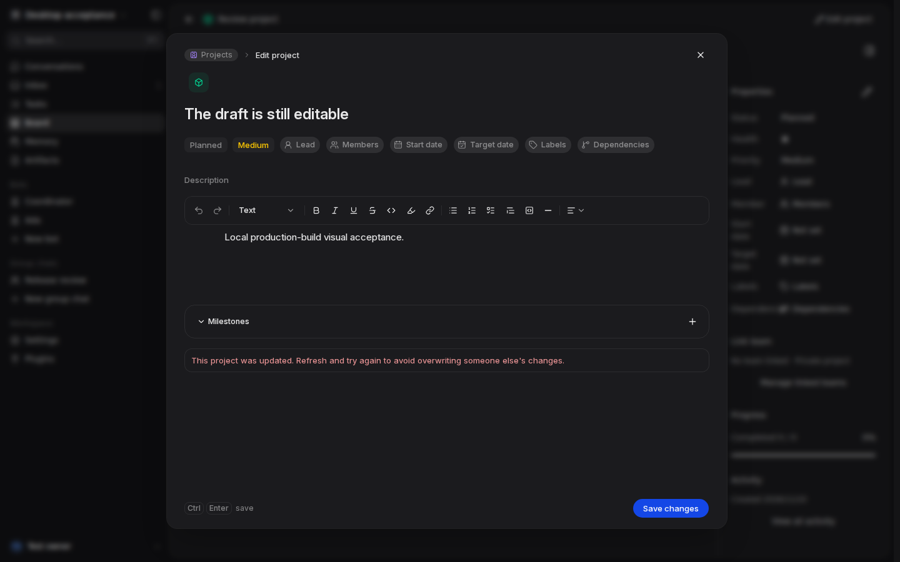 |
| 窄屏 390 × 844 | 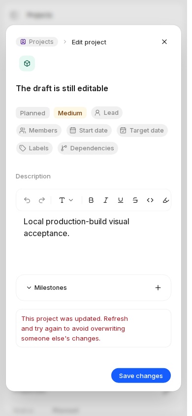 | 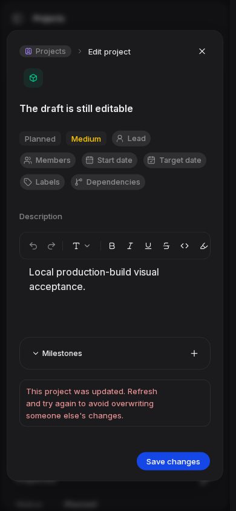 |

## 验收范围

本记录覆盖固定版本的官方 UI、合成业务样本与隔离本地生产构建。生产正常 Task、真实订阅、预览 iframe、跨主体 PTY、完整 Secret 负例及领域历史 before/after 由各自生产验收回执证明；本图集不据此关闭整项 issue。
