# PR #1782：e3c0b0e0 × fe20f19b 官方 UI 核验

这一组证据通过了正式生产构建、真实 Chromium 页面操作和逐图复核。使用隔离 PostgreSQL 17 与两名正常认证的测试账户，页面操作由租用的 owner 完成。它证明下列固定源码组合的 UI 行为；生产发布、真实订阅、双 actor Terminal 权限等验收仍需各自的独立证据。

## 固定来源与结果

| 项目 | 本轮值 |
| --- | --- |
| 实际 run | [42755844953 / attempt 1](https://github.com/alexj11324/Mikka/actions/runs/42755844953) |
| Job | `129629907126`，SUCCESS |
| Controller | `05dcab368eb963393189d8edbe94a6da9e4a6a53` |
| Controller tree / sole parent | `2b154eb043fb1147d314d05dc56a5f22a3a5dcc0` / `6872f4aaa207ebc7036393d87c30224261e002ba` |
| Product | `e3c0b0e050515986a8e42cc15ce0a3de15b8e88c` |
| Product tree | `1e9b0ebbc340aa68096356bd75a9d00a61d88a82` |
| 官方 hosted overlay | `fe20f19bcf82e6541430b62c450920ba42c95fb0` |
| Artifact | `13735816728` / `issue1782-official-ui-e3c0b0e0-fe20f19b` |
| 原 ZIP | 1,205,051 bytes，SHA-256 `1e4db3a0bdd53d23f32693fb10b7c206fba0edd26009c09064fc0453ed5a7c86`，CRC 全部通过 |
| 实际测试 | 58/58 单元、9/9 Chromium；0 failure / skip / cancellation / todo |
| 页面证据 | 20 张原 PNG，12 项语义，宽屏 1440×900 / 窄屏 390×844，明暗各一套 |
| 清理 | browser、extension、base、workspaceName、lease 五项均为 true；外层 runtime shutdown 为 passed |
| 人工复核 | 执行 agent 和 root 分别用 `view_image` 查看全部 20 张原图，无阻断布局问题 |

原始 [manifest](gallery/manifest.json)、[source pair](gallery/source-pair.json)、[HTML gallery](gallery/index.html) 及全部 PNG 逐字保留；[verification.json](verification.json) 提供原件摘要、来源与复核索引。灰色块是原始截图时记录的遮罩，没有后期编辑、裁剪或合成图片。

## 实际覆盖

1. **Ada 的 Overview → Tasks**：5 个 Task 分成 waiting/blocked/failed 共 3 项、To do 1 项、Done 1 项；三种等待状态图标与颜色不同。已成功的旧 attempt 不会把仍开放的 Task 错列为 Done，Done 初始折叠后正常展开。
2. **Coordinator 空列表与全局 Inbox**：Coordinator Overview 显示 No tasks yet，全局 Inbox 的 DOM 计数仍为 1。宽屏截图可见该计数；窄屏响应式导航不在画面内，窄屏 PNG 不单独承担计数证明。
3. **新的 hosted Task frame**：Properties 的人类 Assignee 为 Test owner，独立 Handed to 为 Ada；Activity 保留 Test owner 的委派事件和历史 Codex Done，当前 Task 仍为 In Progress。窄屏先展示 Properties，再滚动至 Activity，各有一张原图。
4. **Project 实际 stale-revision 错误**：正常 RPC 拒绝陈旧版本后，服务端 Project 未被覆盖，用户 draft、可编辑状态和 Save changes 按钮保留。

本轮实际入口是 `dispatcher_overview` / `inbox` 与 `hosted_task_detail_frame`。编译 inventory 核验了 9 个公共模块及 7 个选中且经过转换的私有 slot；这不代表每个 slot 都在本轮页面中实际渲染。页面断言支持 Overview 的 `app-frame` / `thread` / `bot-tasks` 以及 Task 的 `task-detail`。没有沿用旧 AllThreadsToggle 的 hand 控件覆盖声明，也没有把 `task-column` 的源码存在当作窄屏渲染证据。

## 回归与证据边界

新 frame 的真实人类属性按钮包含 aria-hidden 的 `TO` 头像文本。旧 whole-button 文本断言因此不正确；当前控制器仍要求精确命名且唯一、可见的按钮，再对其真实直系文字 span 做精确全文断言。第 9 个真实 Chromium 回归同时验证旧断言失败、新断言通过，并保留错误标签、重复、缺失和不可见字段的拒绝场景。此前失败 run 的结果保留在 [42753519709](https://github.com/alexj11324/Mikka/actions/runs/42753519709) 和 [42755121504](https://github.com/alexj11324/Mikka/actions/runs/42755121504)，未改写为成功。

这次构建使用 synthetic fixture，`responseMocks=0`、`productionAcceptance=false`，没有配置外部 cloud service。两账户基线与恢复验证不等于 peer Terminal authority；这些有历史 attempt 的图片也不单独证明“无旧 Run 的显式 Delegate”场景。固定源码证明不声称 public production 此时已经服务这个 product/overlay 组合。

复核摘要：

- 原 job log SHA-256：`1730f403f0e945adde03e6b0bd4a0ce921a8ae9916074a9cd9aeca419844f428`。
- Agent 独审：`a8f891671484057858ba9e52ff2e8c8593eacfd33cb38b3fcf5693b10e2080e9`；完整本地索引：`bd514b56cfcbc1c64dada411c50812c3eab1f637b0a565f581079303fc78a4c1`。
- Root 独立重放与 20/20 原图复核：`8415edb2c1ac4509deb4932a8e5d263767f38394251bf13045e9addaf100294b`。

## 全部原图

### 1440×900 · 浅色

**Overview：三种等待状态、开放 Task 与已完成 Task**

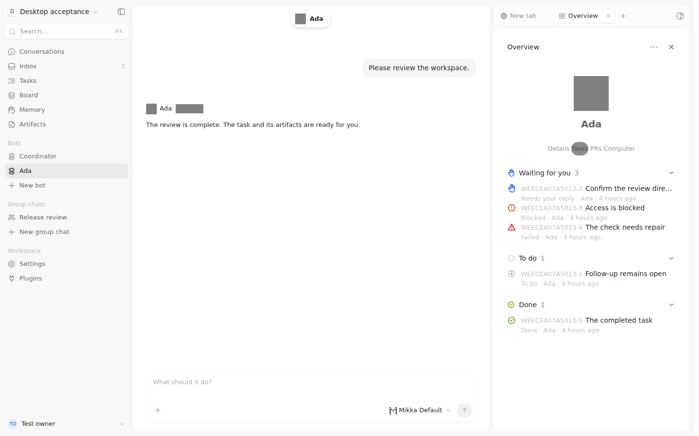

**Coordinator Overview：空 Task 列表**

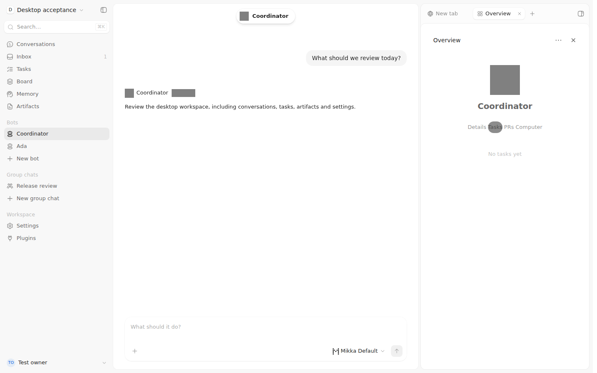

**Properties：人类 Assignee 与独立 Delegate**

**Activity：委派事件与历史 Codex Done**

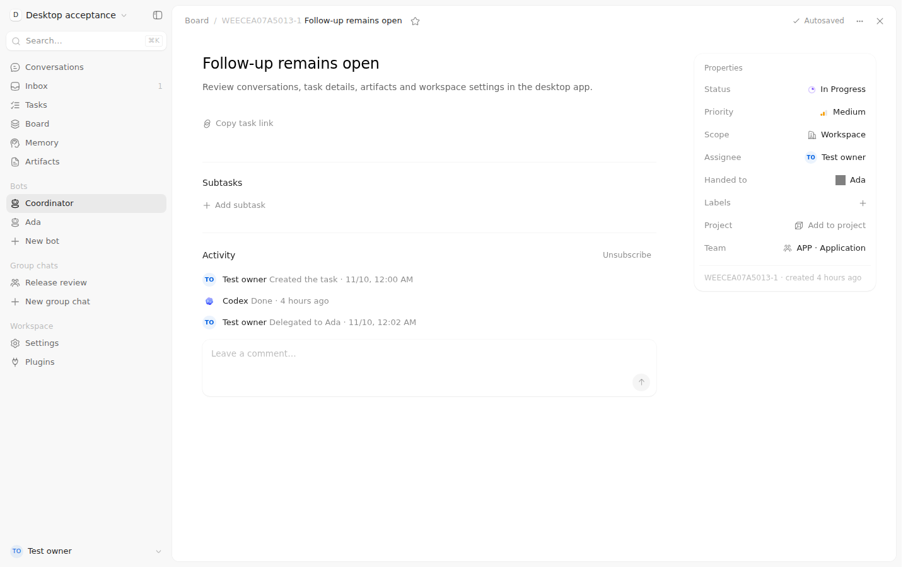

**Project：真实错误后的 draft 与 Save**

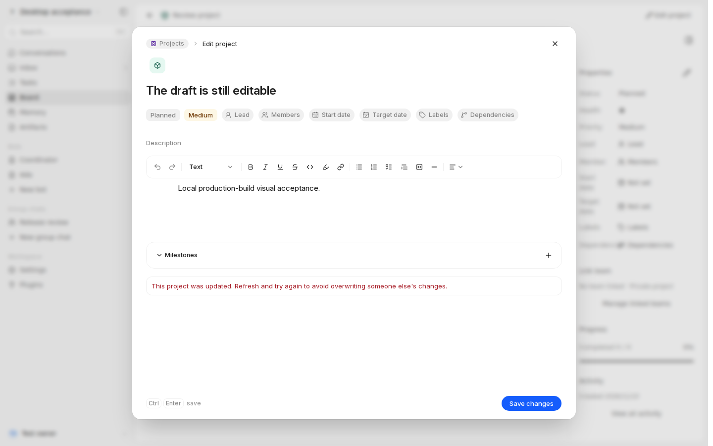

### 1440×900 · 深色

**Overview：三种等待状态、开放 Task 与已完成 Task**

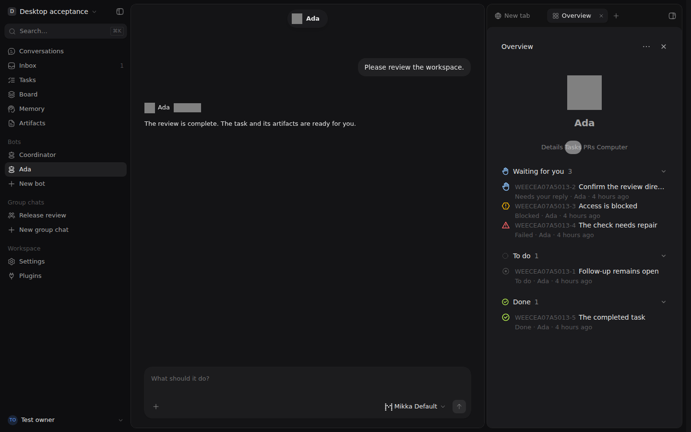

**Coordinator Overview：空 Task 列表**

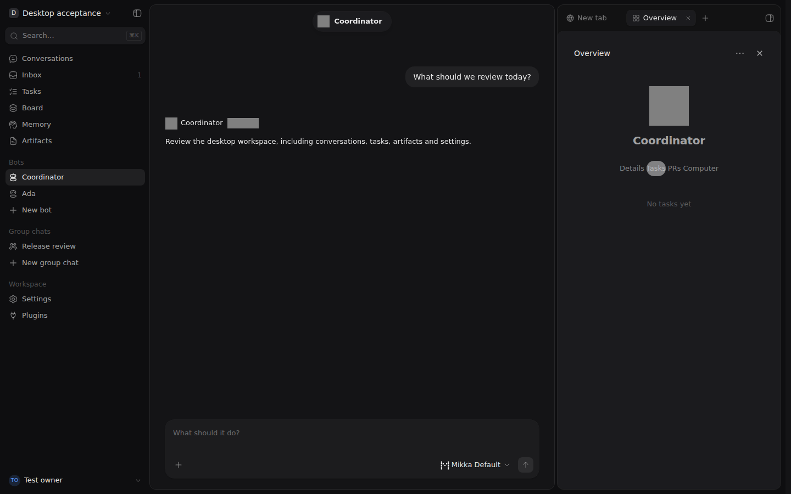

**Properties：人类 Assignee 与独立 Delegate**

**Activity：委派事件与历史 Codex Done**

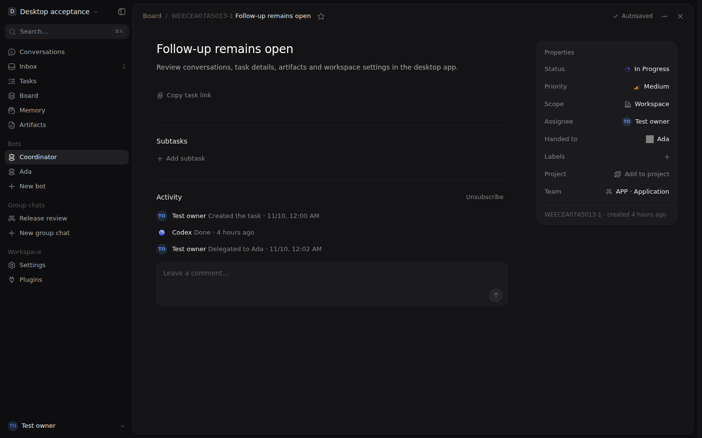

**Project：真实错误后的 draft 与 Save**

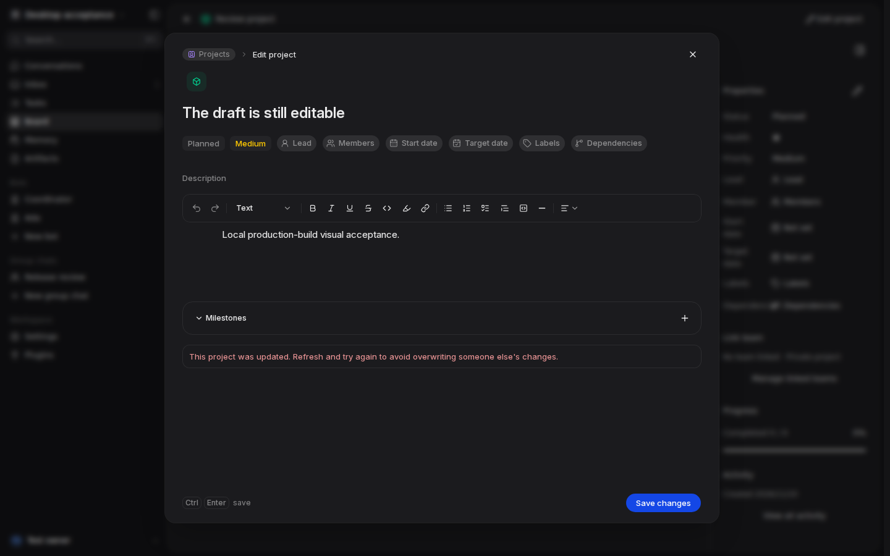

### 390×844 · 浅色

**Overview：三种等待状态、开放 Task 与已完成 Task**

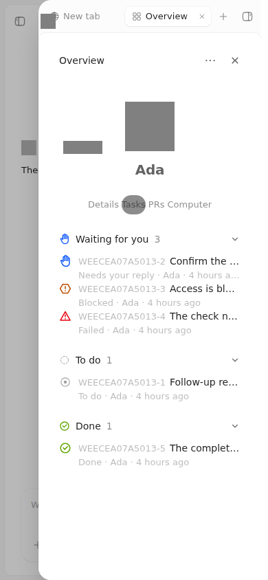

**Coordinator Overview：空 Task 列表**

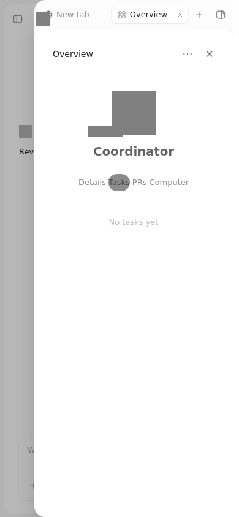

**Properties：人类 Assignee 与独立 Delegate**

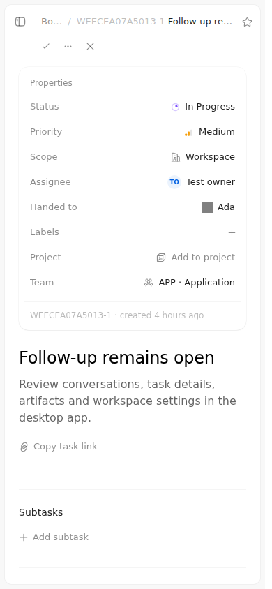

**Activity：委派事件与历史 Codex Done**

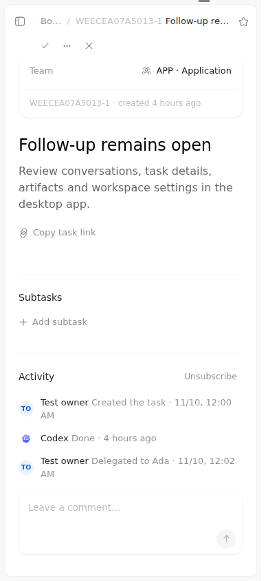

**Project：真实错误后的 draft 与 Save**

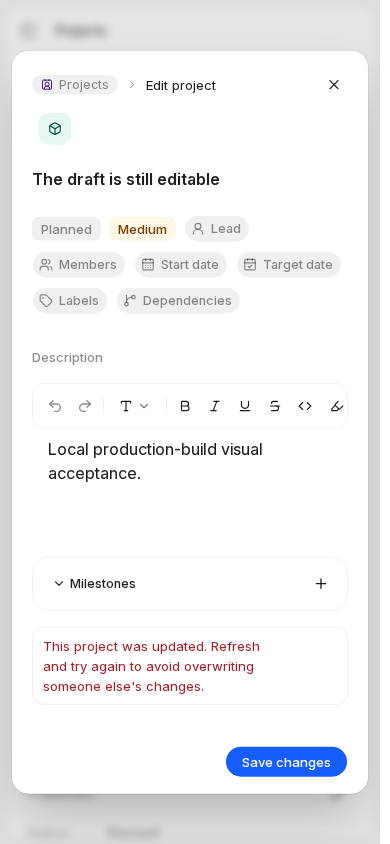

### 390×844 · 深色

**Overview：三种等待状态、开放 Task 与已完成 Task**

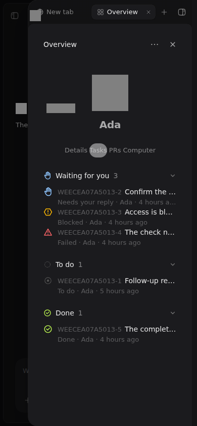

**Coordinator Overview：空 Task 列表**

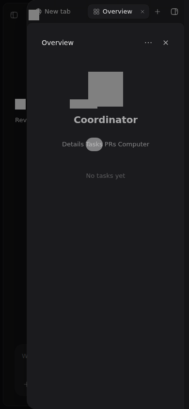

**Properties：人类 Assignee 与独立 Delegate**

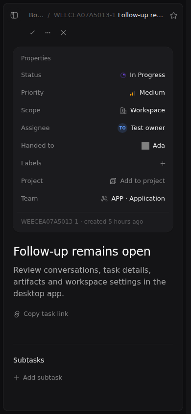

**Activity：委派事件与历史 Codex Done**

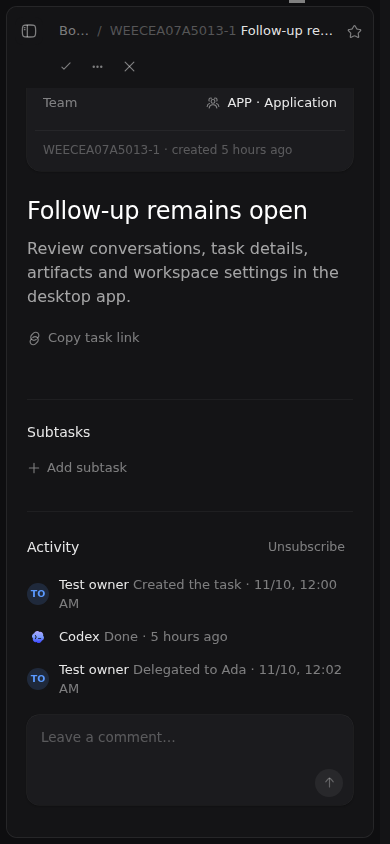

**Project：真实错误后的 draft 与 Save**

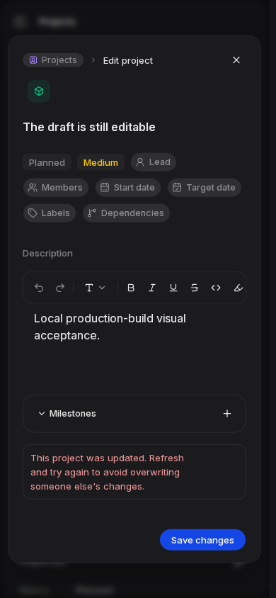

