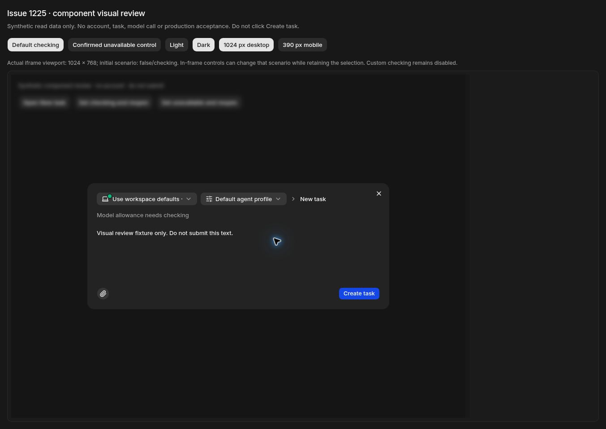
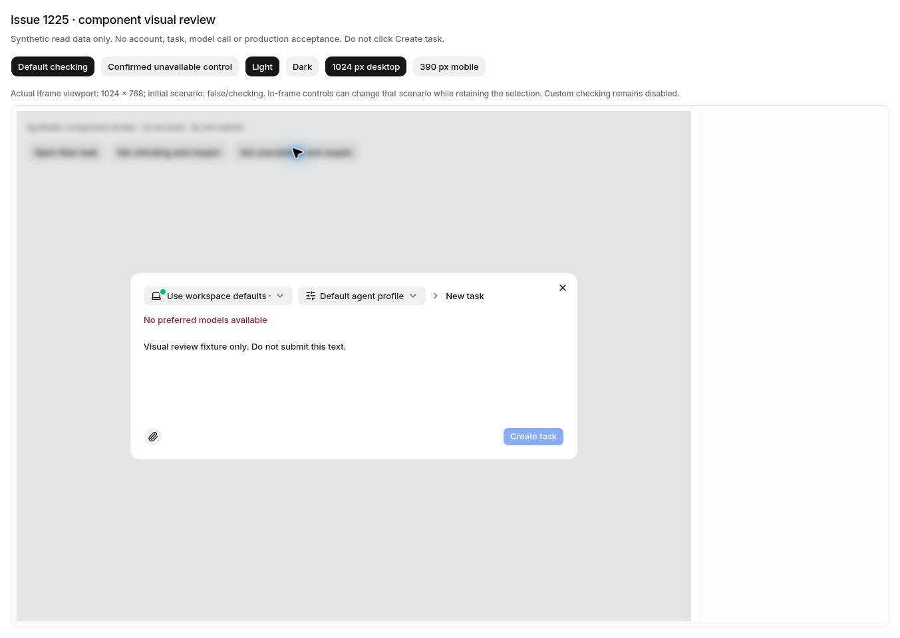
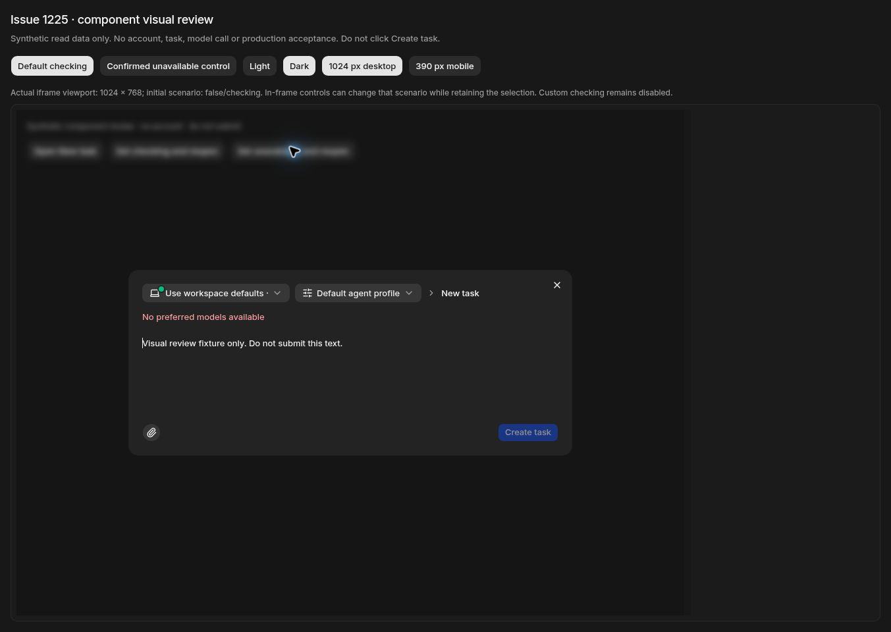
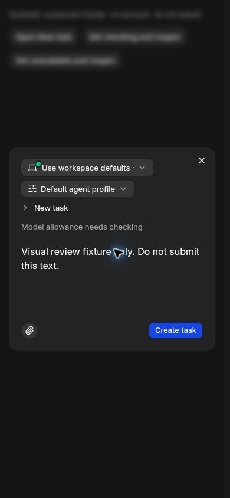

# #1225 / PR #1376 — 本地生产构建图审

本页记录 Default 待核实状态的入口修复。负责该 issue 的 agent 已手工操作并审阅真实组件；这份图审使用合成读取数据，不是生产任务验收。

## 版本与方法

| 项目 | 实际值 |
| --- | --- |
| 产品分支 | `fix/1225-acceptance-entry-and-check-context-20261105` |
| 产品 head | `8bb281f74aebb99cd8b9606ee7c03e7d6cede3b2` |
| 产品完整树 | `c5842a306e503689313b34cf211367fca0e75464` |
| 本地 BUILD_ID | `26lUik0zKaSVYH9sISTy7` |
| 编译版本与公共 version | `8bb281f74aebb99cd8b9606ee7c03e7d6cede3b2` |
| 含临时 wrapper 的实际树 | `b48007f7cf9af76573bf13faa5699bd4e29a4263` |
| 环境 | Docker Cloud Linux，Node 24.22.1，真实隔离 PostgreSQL 17 |
| 完整构建 | `pnpm build`，2026-11-05 12:18:16–12:18:56 UTC，exit 0 |
| 视觉操作 | Cua 手工操作；桌面 iframe 1024×768，窄屏 iframe 390×844 |
| CI | [42023303423](https://github.com/alexj11324/Mikka/actions/runs/42023303423)；六条工作流成功 |

CI 实际 checkout 是 `3f3d1c7245e0aa05e0218280eadbdb3ec315dbab`；已独立核对其完整树与产品 head 的树相同。26 checks 为 21 success、5 正常条件 skip。Browser gate 是汇总门禁，未用它代替本地构建或截图。

真实导入的组件是 `NewTaskDialog`、`TaskProfilePicker`、`TaskProfileNotice`，以及现有 Select、Dialog、Button、翻译和样式。仅在临时 preview leaf 的读取边界提供闭集合成数据；未知 key 拒绝且不调用原 fetcher。Default 的 `available` 始终为 false，分别观察 `checking` 与 `noModels`。三份受保护产品文件和本 PR 全部 11 个产品文件在构建前后的 hash 均一致。

临时 wrapper 的完整源码差异见 [fixture-wrapper.patch](fixture-wrapper.patch)，构建及截图 hash 见 [evidence.json](evidence.json)。只有其中的 page/harness 两文件加入临时构建；gateway 在产品源码树外。没有账号、会话、真实模型调用或 Create task 提交。GET/HEAD 网关的 16 项边界检查通过；未修改认证校验或使用假 CI 标记。临时页面不进入产品 PR。

## 用户任务与审查结果

| 用户任务 | 原问题 / 对照 | 本次实际观察 |
| --- | --- | --- |
| 用 Default 发起正常任务 | 已知额度预览 checking 时选项/提交被禁用，严重度 3 | Default 可选，保持“Model allowance needs checking”；选中后 Create task 可用 |
| 识别尚未确认的额度 | 不能把 pending 显示成 available | 原 checking 文案保留，状态呈中性；没有写成可用或改写 availability |
| 处理已确认不可用 | 仍需阻止提交 | 同一个已选 Default 切到 noModels 后显示“No preferred models available”，Create task 禁用 |
| 选择自定义 Profile | checking 不应获得 Default 的例外 | 菜单中的 synthetic custom checking 项仍禁用 |
| 在窄屏操作 | 选择、反馈及提交控件应在可视区域 | 390×844 中控件正常换行，提示与按钮可见，无本次改动造成的横向溢出 |
| 键盘操作 | 保留既有 Select 行为 | Enter 展开，Escape 关闭，`aria-expanded=false`，选择保持不变 |
| 缺失/失败读取、其他拒绝原因 | 不得借 pending 意图放宽门禁 | Node 组件回归与真实 PG/CI 保留这些拒绝；本页不把合成数据作为生产授权证据 |

复用 R-90：没有新增产品布局组件。R-40 / R-42：没有新增产品文案，沿用已有翻译；截图外侧说明属于临时图审工具，不是产品界面。深色边缘未出现白线；状态和灰阶沿用现有令牌。未新增轮询、quota probe 或管理页刷新。没有新增 Figma 布局，本次以现有组件实际渲染为基准，不提供虚构的 Figma frame。

## 保留的原始截图

以下四张是成功同步并保留的原始浏览器 JPEG。其余已观察截图未能通过浏览器文件同步保留，因此不链接，也不声称已附齐。窄屏图片由浏览器按真实 iframe 页面坐标直接截图；所有图片均未编辑、重绘或修饰。

### 深色：Default checking 仍可提交

实际选中 Default，checking 状态保留，Create task 可用；没有点击提交。

### 浅色：已选 Default 确认不可用

关闭对话框，通过夹具改变读取状态，再打开同一个组件实例；Default 的选择保留，错误可见，提交被禁用。

### 深色：确认不可用的对照

### 390×844：待核实状态的窄屏布局

## 独立图审

另一名未编写本次 UI 的 agent 逐张审阅了这四张原始 JPEG，并核对 evidence.json：相关视觉项通过，未见阻止合并的缺陷。其结论限于截图的可见内容；菜单选择与按钮实际禁用引用负责人的手工操作记录，不从静态图像推断真实派发。

## 验证边界

本页证明真实组件的视觉与意图选择行为。管理预览只读、正式 dispatch/queue/claim 的额度与授权校验另有真实 PG 和 Git-linked CI 证据；生产中的 Codex、Claude、自动接续与故障记忆必须继续用正常 Owner UI 独立验收。

首次本地构建因临时脚本多设 HTTP auth origin 被正常校验拒绝；第二次因未提交 wrapper 的 SWR 泛型类型失败。分别删除多余环境配置、只修夹具 fetcher 的泛型边界后，第三次完整构建实际通过。失败记录保留，没有改产品 guard 或把仅编译成功冒充完整构建成功。
