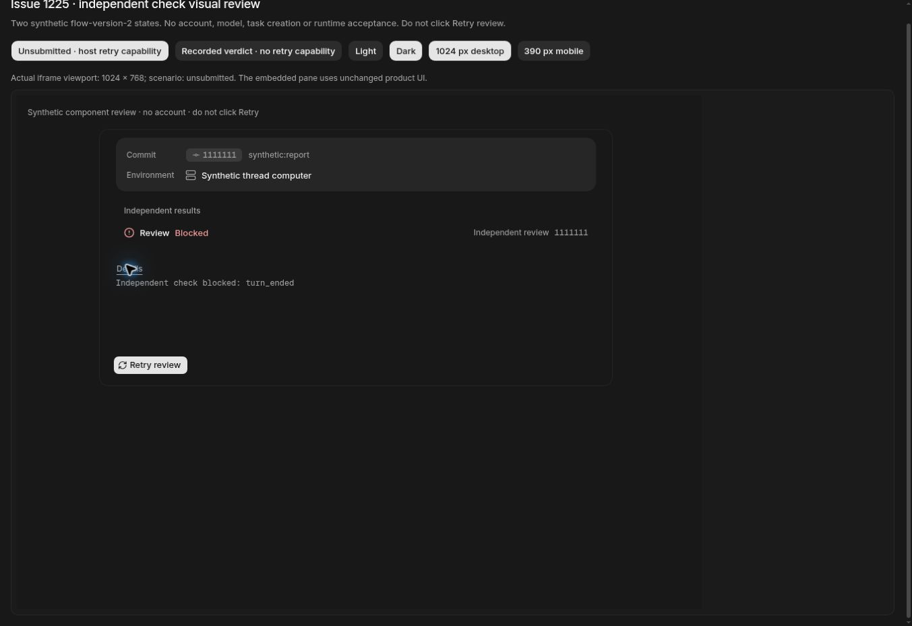

# #1225 / PR #1403 — 未提交 Review 的恢复入口图审

本页记录正常 Owner 补完未提交 Review 的恢复入口图审。负责本 issue 的 agent 已在 Docker 中的本地生产构建上手工操作并审阅真实组件；读取数据为合成夹具，不能代替生产验收。

## 版本与环境

| 项目 | 实际值 |
| --- | --- |
| 产品 head | `a6b0a0e06061d6250ee2aff69d2de0a04355d101` |
| 产品 tree | `4cd12c56bed507e8cc47ae679e6605b2d54c6aca` |
| 含临时页面的实际构建 tree | `12e36474a051b6fae739abbcce48fcdcab227f8c` |
| BUILD_ID | `SZBuCAxRdSQLI3NCvepK9` |
| 编译版本 / version 读回 | `a6b0a0e06061d6250ee2aff69d2de0a04355d101` |
| 完整构建 | `pnpm build`，2026-11-05 14:48:46–14:51:49 UTC，exit 0，包含 Workflow 编译 |
| 环境 | Docker Cloud Linux，Node 24.22.1，隔离 PostgreSQL 17 |
| 手工图审 | Cua；1024×768 与 390×844 的真实 iframe |
| 对应 CI | [42047228124](https://github.com/alexj11324/Mikka/actions/runs/42047228124)，状态以 PR 最终门禁为准 |

使用实际 `FactoryAcceptancePane`，以及原有 Button、折叠详情、翻译和样式，没有克隆 UI。两份临时页面只在已列明的 SWR 读取边界返回合成数据；未知读取拒绝。未使用任何账号、会话、生产凭证或模型；未点击 Retry、创建任务或发起提交。页面不进入产品 PR。

17 个产品文件在构建前后的 hash 一致。真实 pane 的 SHA256 为 `0ecf4b3ad995ce888bd14938ce60284daea92631527db60f9cbbada68b086ee2`；acceptance view 为 `b70818ba232208e0cc4aa7fed3eb2d223c6296a9bfd194b4dd8ee77835eca784`。临时 wrapper 完整差异见 [fixture-wrapper.patch](fixture-wrapper.patch)，精确构建与截图元数据见 [evidence.json](evidence.json)。

## 用户任务与实际观察

| 用户任务 | 修改前 / 对照 | 修改后的实际观察 |
| --- | --- | --- |
| 补完已经结束但没有提交结果的 Review | 原候选停在 blocked，无正常 Owner 恢复入口；严重度 3 | 在 host 资格能力存在时，原 Retry review 按钮可见；Found，严重度 0 |
| 理解为什么检查停止 | 原因需要可见且不能冒充结果 | Details 展示 `Independent check blocked: turn_ended`，状态仍为 Blocked |
| 保留已有正式审阅结果 | flow2 不能重新获取第二份意见 | verdict 对照显示 Changes needed 与评论数，没有 Retry review |
| 在窄屏查看并恢复 | 状态、原因和按钮应能完整显示 | 390×844 下正常换行，恢复按钮与失败原因可见，没有本次变更导致的横向溢出 |
| 键盘读取详情 | 保留既有按钮语义 | Enter 打开 Details，expanded 状态和内容实际出现 |
| 成功响应与后续刷新失败 | 不应将已经成功的恢复误报为未确认 | 真实组件交互回归 31/31；数据库 / Owner HTTP 回归 66/66，非截图推断 |
| 未授权、停止或已有结果 | 不应获得恢复能力 | 真实 PG 负例拒绝；截图不承担权限证明 |

只补完无结果的当前 Review。完整条件由服务器核对，不由合成页面授予。新 checker 保持原候选、来源、模型、Profile 与只读策略，旧 run 的终态和可信标记保留；本页没有改变这些数据。

## 视觉与规则检查

浅色和深色的两个状态均手工审阅；窄屏也检查了未提交和正式 verdict 两种状态。深色没有白色边线，灰阶和状态色沿用现有 token；没有新增产品文案、模型选择器、组件或轮询。复用 R-90，文案沿用现有翻译（R-40/R-42）。这是既有组件恢复能力的修复，没有新增布局或 Figma 设计决策，因此没有另绘一套 frame。

下面是**成功同步并保留的原始 JPEG**。负责 agent 已审阅；图片没有编辑、重绘或修饰。其他已观察状态的截图文件在文档规定的五秒同步等待后仍不可用，因此没有伪造附件、复用已发出的图片链接或声称它们已附齐。这个限制涉及文件同步，不代表未检查相应状态。

### 深色：未提交 Review 的恢复入口

Blocked、原失败原因与 Retry review 同时可见。没有点击恢复按钮。

## 验证范围

此图审证明真实组件的呈现和详情交互。服务器资格、并发幂等与一次补完预算由真实隔离 PG / API 回归证明；正式点击及反馈逻辑由真实组件回归证明。原生产任务的重新检查、正式提交与 Owner 接受仍必须在最终部署及 worker 发布核对之后完成。

