# #1225 — Default Profile 正常入口视觉复核

本页对应 [PR #1355](https://github.com/alexj11324/Mikka/pull/1355)。修复让已有自定义 Profile 的用户，也能在正常 **New task → Agent profile** 菜单中明确选择内置 Default，继承「优先使用的模型」。

## 证据来源与范围

- 产品源码：`7b400985672274f1f3b867a78802cc5e272f1284`；树 `20df1fdbed977e661455cdee6ad970b62a0d87d8`。
- Docker Cloud Sandbox，Linux / Node 24.22.1 / PostgreSQL 17；`next build` 后以 `next start` 服务本地生产构建。
- 构建在 2026-11-05 07:45:48–07:46:44 UTC 的完整采集流程内通过，构建耗时 32,947 ms；BUILD_ID `AghXZJ9s2hY5Cl3KHoTYn`。
- 最终截图复用上述不可变构建；复用前按原守卫核对源码、BUILD_ID 哈希与时间、构建证明、上次清理及证据审计。账号、隔离数据库和租约重新按正常测试流程创建。
- 最终采集时间：**2026-11-05 07:55:03.132–07:55:28.895 UTC**，实际退出 0。12 张图已由负责人和独立审查者逐张复核通过；桌面 1440×1000、手机 390×844，菜单残影和宽度扩张均未出现。7 项清理、租约释放、账号残留检查和证据审计全部通过。逐图哈希见 [evidence.json](evidence.json)。
- 图中账号、Profile、模型来源、额度和设备状态均为隔离环境合成夹具。使用仓库规定的隔离测试账号初始化和租约，Owner/peer 授权校验保留；没有调用外部模型，也没有点击 Create task。这组图证明入口和可用性展示，不证明真实生产派单、claim、模型调用或完成结果。
- 最终整合保留上述 23 个产品/测试文件的 Git blob；主线 `f793f3d40b3ed167b26d8ab1d30c2bbdf4903418` 的 12 个改动路径与之没有重叠，也没有前端截图组件改动。图片始终归属上面的实际构建提交。

## 用户任务复核

| 用户任务 | 修改前 | 修改后 |
| --- | --- | --- |
| Owner 已有自定义 Profile，想按偏好模型运行新任务 | 内置 Default 在 Settings 可用，但新建菜单缺少明确选择入口；Missing，严重度 3 | 同一菜单提供 Default；Found，严重度 0 |
| 查看任务当前选择并提交 | 只能选择 Automatic 或自定义角色 | Default 名称保留在选择器；有任务文本且来源可用时 Create task 可用 |
| 选到没有可用模型的电脑 | 缺少明确 Default 选择，无法走完相应操作 | 正常设备选择触发真实可用性读取；保留 Default 选择，显示原因并禁用 Create task |
| 手机上完成相同选择 | 同样缺少入口 | 390 px 宽度下菜单、已选状态、错误原因与提交控制可见 |
| 另一个隔离账号读取 Owner 的 Profile | 不应获权 | 实际 Owner HTTP 200；隔离 peer HTTP 404，授权边界不变 |

## 桌面 · 1440 × 1000

| 状态 | 浅色 | 深色 |
| --- | --- | --- |
| 菜单中同时提供 Automatic、Default 和自定义 Review | 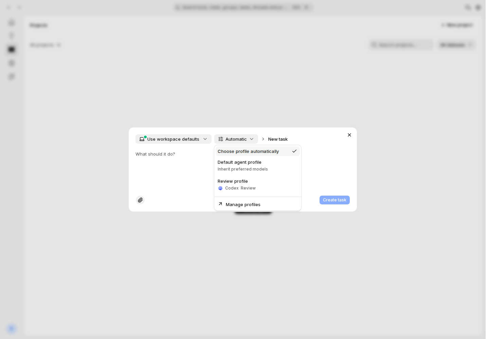 | 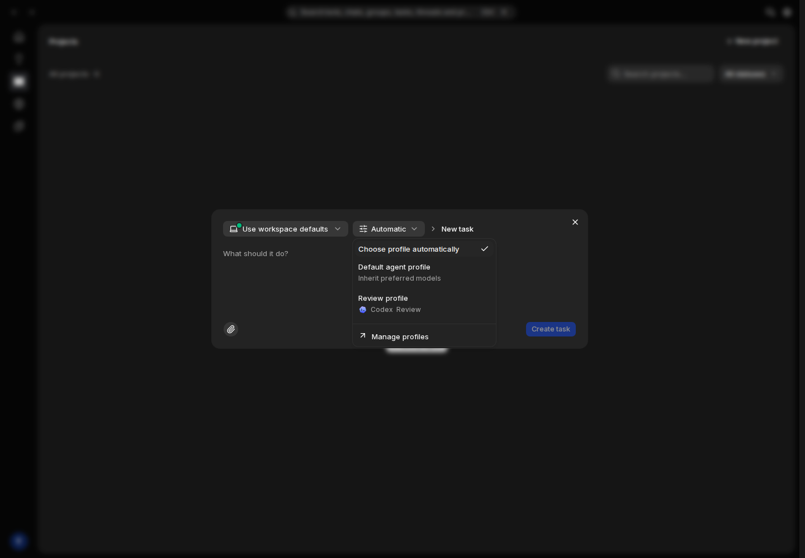 |
| 选中 Default，文本非空，Create task 可用 | 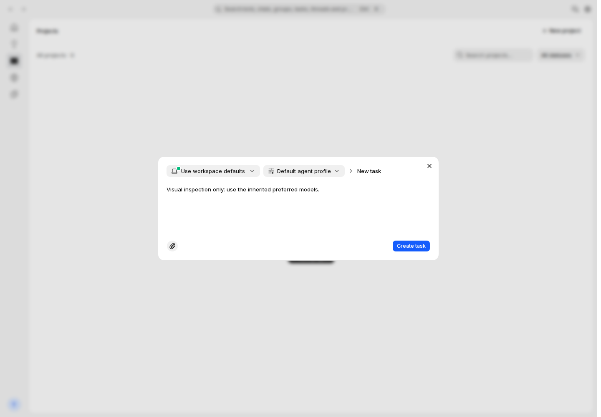 | 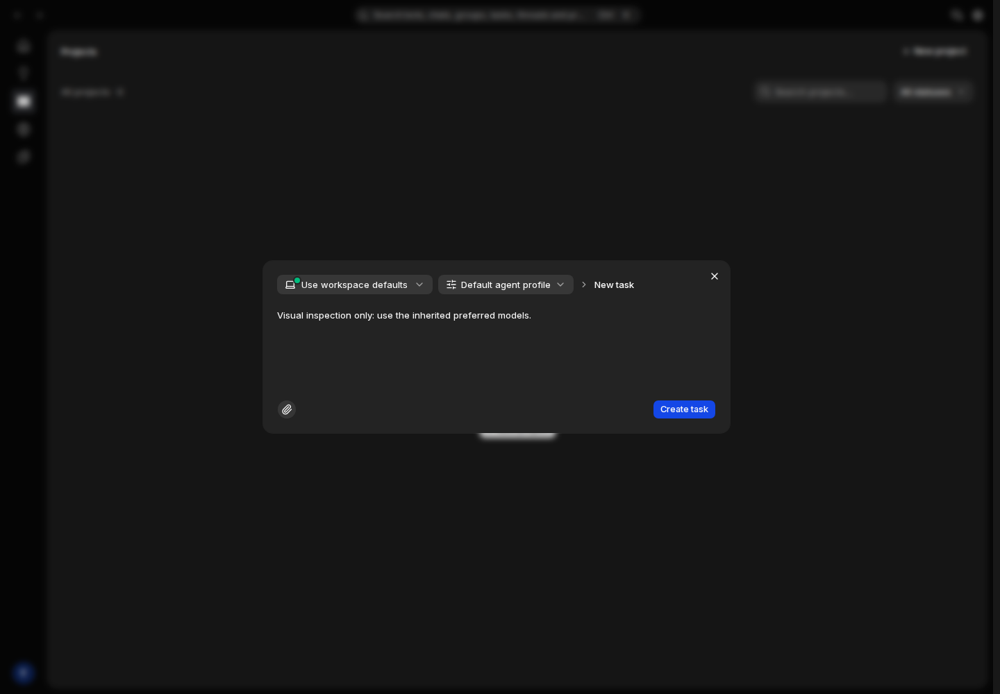 |
| 正常选择无模型电脑后，原因可见且提交禁用 | 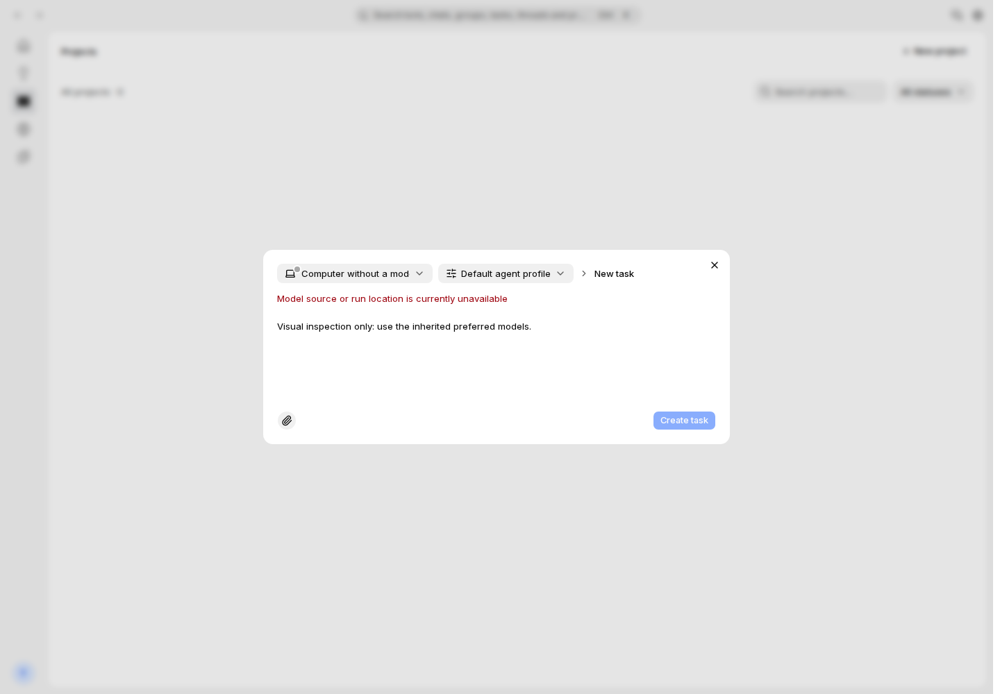 | 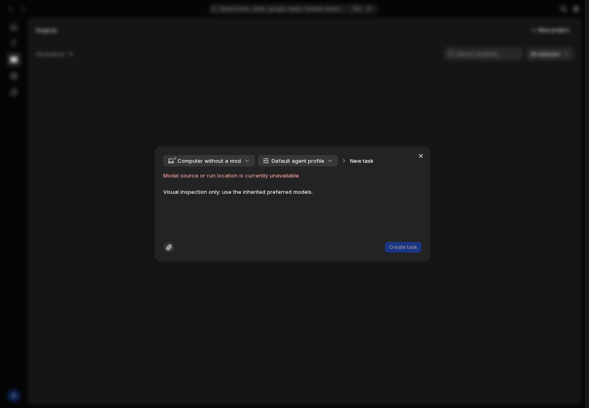 |

## 手机 · 390 × 844

| 状态 | 浅色 | 深色 |
| --- | --- | --- |
| 菜单中同时提供 Automatic、Default 和自定义 Review | 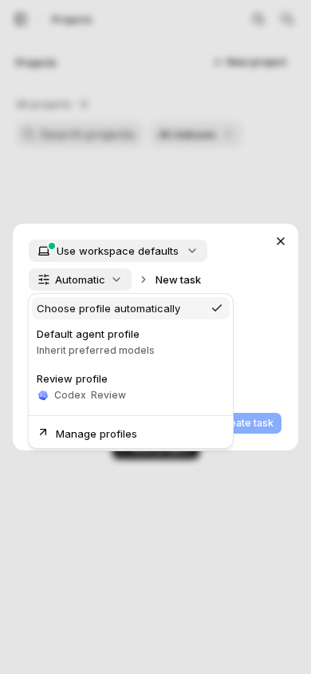 | 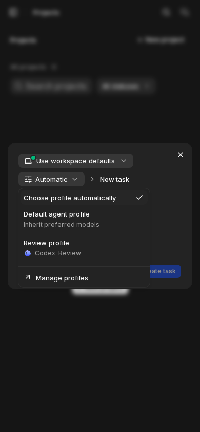 |
| 选中 Default，文本非空，Create task 可用 | 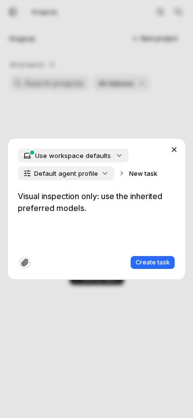 | 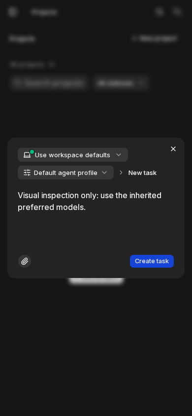 |
| 正常选择无模型电脑后，原因可见且提交禁用 | 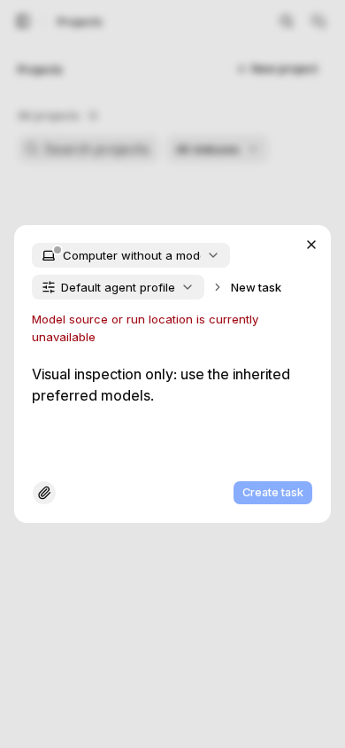 | 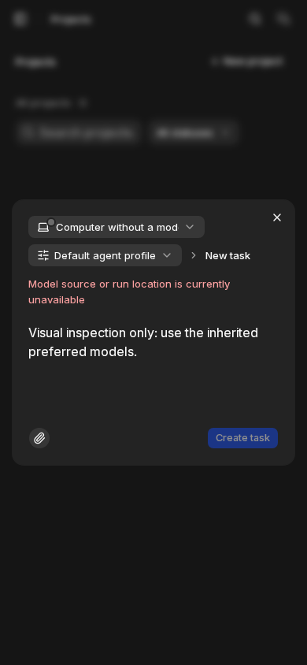 |

## 组件与设计依据

沿用 `NewTaskDialog`、`TaskProfilePicker`、`TaskProfileNotice`，以及既有 `Dialog`、`Field`、`Textarea`、`Button`、Base UI `Select`、`InlineLoadError`、`HarnessLabel`、`MachineLabel` / `DeviceIcon`。没有新增视觉组件。Default 名称、继承提示和不可用原因均复用已有国际化文案。

布局依据为 `docs/design/components.md` 中的 Factory Agent Profiles / New task，以及 `docs/design/factory-agent-profiles.md` 的入口、状态与组件约定；按 `docs/design/README.md` 沿用现有主线 UI 的设备、Bot、Profile 选择布局。本修复没有新的已接受 Figma frame，不将截图表述为新的 Figma 对照结果。

复核范围包括 R-22 正常 New task 入口、R-90 组件复用、原有中性色和圆角、浅/深主题、窄屏换行、可见错误原因及提交控制。加载和读取错误的 fail-closed 分支做了源码审查；这 12 张图没有人为制造接口错误，不将其声称为已截图覆盖。

## 验证边界与历史

实际 PostgreSQL 回归 74/74、typecheck、lint 和 diff 检查已通过；来源投影、不可伪造的 Default pin、显式模型与原线程接续有针对性回归。完整外部模型 `pnpm test:local-loop` 未运行。真实 Owner 生产验收与恢复/清理证据单独记录在 [#1225](https://github.com/alexj11324/Mikka/issues/1225)。

此前 8 GiB 构建 OOM、首轮临时截图脚本未处理超时，以及第二轮菜单关闭动画残影的记录均保留；没有将失败改写为首次通过。最终图片仅在正常菜单收起、布局稳定后采集，不使用强制点击，也不修改产品源码或授权守卫。
