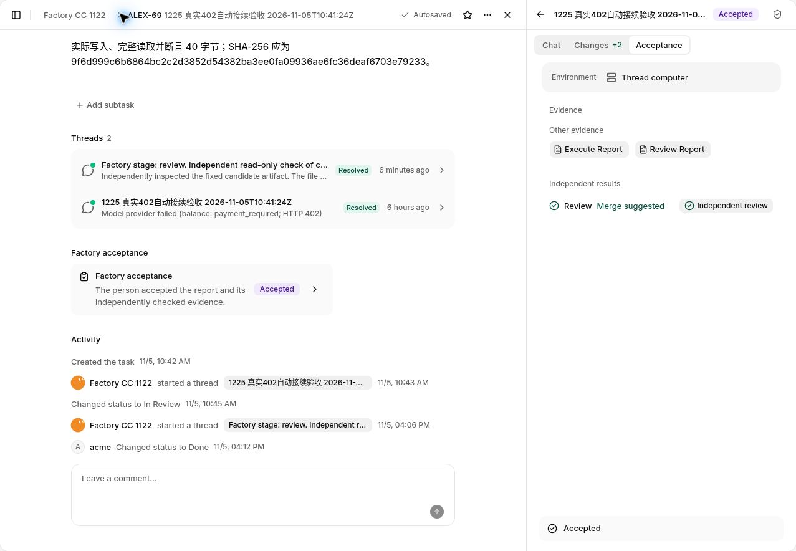

# Issue #1225：生产验收证据

证据日期：2026-11-05，文中时间均为 UTC；生产验收记录更新至 17:33:22.159，最后任务清理回读完成于 17:42:00.216。范围仅为 [#1225](https://github.com/alexj11324/Mikka/issues/1225)，使用现有 Owner 的正常生产 UI；未新建账号或修改账号、订阅本身。

**所有必要验收及清理已完成。ALEX68 的 Codex 原会话接续、ALEX69 的真实 402 自动接续与 ALEX70 的后续故障记忆路径均已正常 Owner Accepted；四个当前测试任务均已通过正常 UI 软删除并确认 30 天内可恢复。** #1424 已完成自身生产发布与版本核对，ALEX68 在该版本用原候选和原独立 Review 正常完成 Accept。DeepSeek API key 路径按实际余额不足记为 blocked，按用户授权不阻断本次验收及关闭；没有把 API 成功调用算作通过。负责人附上本证据后关闭 issue，本文不声称关闭动作已经执行。

## 三条模型来源路径

| 路径 | Run | 实际执行 / claim 证据 | 结果 |
|---|---|---|---|
| DeepSeek API key：`deepseek-flash` | 本轮 ALEX69 原 run：`2aa61c53-f20b-4fe9-81fa-b5392e078c15`；历史独立显式 API 文件任务 ALEX49：`488aefa9-4a2c-4375-8aba-c29d40b8f243`（2026-11-04，非最终版本重跑） | 本轮调用前 `node scripts/assert-test-model.mjs deepseek-flash` 退出 0，原运行出现 Agent start 并记录 `balance: payment_required; HTTP 402`。历史 ALEX49 于 23:09 预检退出 0，23:18:16–23:18:35 实际运行，Agent start 3491 ms，同样返回余额不足 402 | **Blocked：余额不足，按用户授权非阻断**。历史独立显式任务没有 replacement/continuation；本轮 ALEX69 随后自动接续。两次时间窗分别记录，没有把 API 成功调用算作通过。 |
| Claude Code 官方订阅：`claude-haiku-5-5` | ALEX69 自动 child：`25d60d83-c14b-4465-8ff1-912ff30c1e69`；ALEX70 独立任务：`81dfd01b-22cf-494e-8239-fe3fd57a608a` | 真实 Agent start、原生工具写入及读取文件、正常 submit；分别形成 40 字节与 37 字节产物 | **通过并 Accepted**。ALEX69 接受读回时间为 16:13:12 UTC；ALEX70 为 16:10:35 UTC。 |
| Codex 官方订阅：`gpt-6-luna` | ALEX68 原 run：`8b524fdf-0463-44dd-890e-237c5b521a42`；正常线程答复后的 child：`71431232-b430-49b7-bdda-21a1cdd0484c` | 正常 Owner 答复一次，原会话继续读取并追加文件，形成 47 字节产物并 submit；后续独立 Review 已正式 passed | **通过并 Accepted**。#1424 自身生产版本核对后，Owner 正常点击一次 Accept；17:33:22.159 UTC 读回 Factory Accepted、右侧 Accepted 及任务 Done，保留原候选和原 Review，没有新 producer 或 Review。 |

这里的 claim 证据是实际 Agent start、后续原生工具执行及提交，不能用 queued、handoff 或按钮成功返回替代。当前协议与 UI 没有独立 claim ID；本记录没有编造 claim ID，也没有独立测量 claim HTTP 响应状态。

## ALEX69：首项真实失败后自动完成

生产链路为：

`2aa61c53-f20b-4fe9-81fa-b5392e078c15`（DeepSeek API key / `deepseek-flash` / HTTP 402）

→ `25d60d83-c14b-4465-8ff1-912ff30c1e69`（官方 Claude Code 订阅 / `claude-haiku-5-5`）。

页面及运行链展示了原来源、余额失败原因和接续来源；服务端记录确认这是 provider continuation。自动换源期间没有手动重试或额外派发生产者。接续 child 真实完成 40 字节产物并提交。

后续接受流程曾遇到独立 Review 恢复问题。在 #1403 完整发布后，Owner 于 16:05:45 UTC 对原候选正常点击一次 **Retry review**，没有重派生产者或再次触发 DeepSeek。新 Review run `cec728cc-a72f-4ca2-8e52-46550f7b1990` 实际执行 `inspect_artifact` 与 `submit`，正式结果为 2 项通过、0 项失败；Owner Accept 后已读回 **Accepted**。

- 固定候选：`e1e1a309-8eba-4222-9825-b9c2e69babe6`。
- 固定工作树 HEAD：`9a7f3c0e20dc4fe9408b8ed11c039279e1a12515`。
- 产物 SHA-256：`9f6d999c6b6864bc2c2d3852d54382ba3ee0fa09936ae6fc36deaf6703e79233`。

图中同时可见原运行的 HTTP 402、独立 Review、Factory acceptance 的 Accepted 和任务 Done。截图不包含邮箱、用户 ID、订阅连接详情或凭证。

**重试次数边界：**生产记录证明一个失败 origin 接续到同一个自动 child。多个 handoff 事件不能当成多个模型调用；本次没有采集底层 HTTP 请求次数，因此不声称“生产实测只发送了一次 HTTP 请求”。“402 不做同源重试”的代码机制与回归证据应和这里的生产链路观察分别表述。

## ALEX70：后续任务记住失败来源，正常独立检查后 Accepted

在 ALEX69 之后保持同一优先设置，ALEX70 没有手动指定模型。第一个 run `81dfd01b-22cf-494e-8239-fe3fd57a608a` 已选择 `claude-haiku-5-5`，未观察到先撞 DeepSeek 的 run。真实原生执行完成 37 字节产物，支持本次后续任务的故障记忆行为；不把这一例扩展成无限期健康状态保证。

原独立 Review `cbd8f121-7b93-4d07-8621-2d87181b8ebc` 检查了候选，但以 `turn_ended` 结束且未 submit。修复保留旧运行和旧证据，没有改写为通过。Owner 于 16:06:28 UTC 正常点击一次 Retry review，产生新独立 Review `47a3c32a-9345-4cb5-825c-7f0849e86dad`，真实检查并提交 2 项通过、0 项失败，随后正常 Accept 并读回 **Accepted**。

全过程保留原候选 `92f13117-a2e1-4de2-8e17-2c1aba39a038` 与固定工作树 HEAD `47d6b9adffaad9e64a6abcb9f85a73cc2473fc35`，没有重派生产者。当前 flowVersion 2 走 **Review → Owner Accept**，没有额外 Verify 阶段。

37 字节产物的 SHA-256 为 `2bba4080a5d887244d1ee9010c7254480bc5bc854f15d64ab6d04ef7bed9c8e8`。

## 手动指定模型：历史真实 402、本轮派发前负例与运行期守卫

[2026-11-04 23:22 UTC 的既有生产记录](https://github.com/alexj11324/Mikka/issues/1225#issuecomment-6644911946) 还保留了 ALEX49 的真实运行期负例：明确指定 `deepseek-flash / API Key`，run `488aefa9-4a2c-4375-8aba-c29d40b8f243` 于 23:18:16–23:18:35 UTC 实际运行，Agent start 3491 ms，返回 `balance: payment_required; HTTP 402`。页面显示 `Selected model unavailable; no automatic switch`；当时只读核对全部 runs 仅一条，没有 replacement/continuation，也没有手动 Retry。

这条记录可作为**历史真实运行期 402、不自动换源**的证据。它绑定到当时的运行时间和已保存的 Owner UI 观察，没有逐 run 的精确部署 SHA；不把它重写为 #1424 最终版本的新运行。本轮没有恢复这个已删除对象、刷新来源健康状态或追加付费请求。

本轮 ALEX71 正常显式选择 `deepseek-flash` 后，派发工具返回 `machineUnavailable`。实际任务仍为 Todo，没有线程、run、claim、产物或自动接续，也没有手动重试。

这证明本次**派发前拒绝时没有静默换到其他来源**。它不等同于“手动指定模型已经启动、收到运行期 402 后未切换”。按仓库验收规则，本轮不再为此重复发送付费 API 测试请求。

运行期行为另有现成的实现与自动化回归。下表为源码定点核对；相关整组在最新 CI 中通过，但本记录未提取 manual 单个用例的执行日志，不作单叶日志已核验的声明：

| 层次 | 现有守卫或断言 |
|---|---|
| 宿主运行期恢复 | [recoverProviderFailure](https://github.com/alexj11324/Mikka/blob/06564b0699b948e33bbd0a961453e9ef9afa76d5/lib/run-provider-fallback.ts#L301-L330) 对非 `preference` 运行在寻找下一个模型之前返回，将失败保存为 `picked` 提示，不进入自动选模及创建 child 的循环。 |
| 隔离 PostgreSQL 回归 | [an explicit model pick never switches automatically](https://github.com/alexj11324/Mikka/blob/06564b0699b948e33bbd0a961453e9ef9afa76d5/tests/run-provider-fallback.db.test.ts#L565-L579) 通过真实选择与入队服务建立显式运行，在完成边界注入模拟终态 402；断言 `modelFallback.state === 'picked'`、原 API key 不变、child 数量为 0、重复恢复返回 `null`，且提示卡包含设置入口与原模型余额失败原因。该用例从 [#1232 的合并版本](https://github.com/alexj11324/Mikka/blob/72d30d6179e1e844e8da74edce4523611d200ccc/tests/run-provider-fallback.db.test.ts#L252-L266) 起已存在。 |
| UI 回归 | [an explicit model stays identified as unswitched with setup and the existing retry control](https://github.com/alexj11324/Mikka/blob/06564b0699b948e33bbd0a961453e9ef9afa76d5/components/workspace/thread-quota.test.tsx#L52-L62) 断言显式模型和失败提示可见、设置入口存在、没有 `data-thread-model-switch` 标记，且没有自动触发 Retry。 |

因此，本项证据组合是**历史真实运行期 402 + 本轮生产派发前负例 + 现有 PG/UI 运行期守卫回归**；没有把模拟 provider 失败或源码断言算成新的生产 manual 402 请求。

## ALEX68：原会话接续、独立 Review 与正常 Owner Accept 均完成

新 Review run `7f879daa-91c1-4987-8c9e-a84a6a16b2b2` 已真实执行 `inspect_artifact` 和 `submit`，正式结果为 1 项通过、0 项失败。正常读取确认 Review 与生产者的原生会话不同。

- 当前候选：`d73ba3b6-e0e3-4981-9b2d-842701d68a09`，类型为 deliverable。
- 候选记录的 `sha` 为 `null`；实际固定工作树 HEAD 为 `12528d1ff419d9daa36efca868736ea5583e2ec9`。两者没有混写。
- 47 字节产物的 SHA-256 为 `5fd095aa33b346d3a3350dd081b59b2b083c71d08c43ce68ca1e27549d01e340`。
- 补丁发布前的最后一次读取中，接受页面显示 “Could not load the acceptance”，正常只读 approval 请求返回 `factoryIndependentEvidenceRequired`。

最小修复已通过隔离回归和合并前 CI，并随 [#1424](https://github.com/alexj11324/Mikka/pull/1424) 合并。它仅补充读取可信完成恢复回执中的 `review/blocked` 状态，原成功执行、候选、会话、回执和独立 Review 守卫保持不变。

合并版本 `de423e7bee07f8240193408a19a5a3bb8c9bc6df` 自己的生产发布及版本核对完成后，ALEX68 的 Acceptance 正常加载。Owner 于 **17:32:57.179 UTC** 正常点击一次 **Accept**，于 **17:33:22.159 UTC** 从正常 UI 读回 **Factory Accepted、右侧 Accepted**，Activity 显示 **Changed status to Done（05:32 PM）**。

本次 Accept 保留上述原候选和原独立 Review，没有新 producer 或 Review。这是实际生产读回，与隔离测试中的 Accept/Done 结果分别记录。后续正常软删除及 30 天可恢复状态也已回读确认，具体时间见清理表。

## 已完成的版本与设置门禁

[#1403](https://github.com/alexj11324/Mikka/pull/1403) 已合并为 `ebd822e9c3b8af2b6dfb0967064438642761f59b`。

- [合并后主 CI](https://github.com/alexj11324/Mikka/actions/runs/42058500793) 成功。
- [首次 Web deploy](https://github.com/alexj11324/Mikka/actions/runs/42058500973) 成功。
- [官方 runtime 发布链](https://github.com/alexj11324/Mikka/actions/runs/42058501015) 的 check、validate、await-web、复用 Web publish 均成功；实际发布的 worker 为 `553c1aa18500bb63bd6a3fc0e37a69f3f48ccaf9`。最终生产部署 READY，生产别名匹配。
- 16:01:22.717 UTC，正常浏览器读取生产 `/mikka/api/version`，可见 `build` 精确等于上述合并 SHA。这是浏览器实际读回，不附加未测得的 HTTP 状态。

这份门禁记录包含实际 worker 发布后的第二次 Web 部署，没有把第一次 Web 的相同 app SHA 当成 runtime 已更新。条件跳过的自动验收 workflow 也没有当成模型验收通过。

### #1424：回归、合并、自身生产发布与验收均完成

2026-11-05 约 17:21 UTC，[#1424](https://github.com/alexj11324/Mikka/pull/1424) 已 squash 合并为 `de423e7bee07f8240193408a19a5a3bb8c9bc6df`。

- Docker 两组真实 PostgreSQL 回归 **63/63 通过、0 skip/fail/cancel**，typecheck、lint:code 与 diff 检查均退出 0；正常 GET、八项拒绝负例、Accept、Done、重放和唯一验收回执断言全部执行。这组实测仍绑定 `c0f73f30fb329dc1fa978c9ec10f2f2fc150c7e2` / tree `4dbb5a6ac2135cdee05a33168bc763f0d70f3897`。
- 合并前 head `a546090024f0e09ff52eb9d8de34857e19ca2a02` 的 [CI](https://github.com/alexj11324/Mikka/actions/runs/42071354229)、[Analytics SSR](https://github.com/alexj11324/Mikka/actions/runs/42071354108)、[Browser gate](https://github.com/alexj11324/Mikka/actions/runs/42071354106) 均成功；检查合计 **16 success、1 个正常 OIDC 条件 skip**，其中 GitGuardian 于 17:18:04 UTC success。实际 CI checkout 为合成提交 `17a1069790b249992f7f7e4c14fa1eaabf31eefa`，整树与该 head 同为 `e19efbbd4a932389014dfda81ce35d534510930a`；目标完成恢复回归在 CI 日志中实际通过。
- 合并前 main 后续推进到 `a1b633178cd029c5023f138bf6057920eb3990f8`。定点源码核对确认本补丁两文件及证据、approval、merge、完成事务和 DB 主链未变，按相关性复用上述验证。上述 Docker 与合并前 CI 仍分别绑定各自的实际测试树，没有把源码定点核对写成对 a1b 整树重新执行 Docker 测试；最终 squash 后新执行的 CI 与发布证据单独列在下方。
- 最终合并版本自己的 [push CI](https://github.com/alexj11324/Mikka/actions/runs/42073744369) **12 个 jobs 全部 success**；自己的 [Web deploy](https://github.com/alexj11324/Mikka/actions/runs/42073744489) **success**。
- Vercel 部署 `dpl_TP8UHzXzUabZa2pYicybzkrCBMCP` 为 **READY**，生产别名为 `app.aspectlylabs.com`。
- **17:30:59.799 UTC**，正常浏览器读取生产 `/mikka/api/version`，`build` 精确等于 `de423e7bee07f8240193408a19a5a3bb8c9bc6df`。这里只记录实际读回的版本，不附加未采集的 HTTP 状态、缓存命中或 age 值。
- 随后 ALEX68 正常加载 Acceptance，并用原候选、原 Review 完成一次 Owner Accept；17:33:22.159 UTC 的生产 UI 读回为 Accepted / Done。

**设置恢复已确证：**16:22:30.987 UTC，经正常 Owner UI 重载读回，运行位置恢复 Cloud、优先 harness 恢复 Claude Code、原优先列表恢复仅 `claude-haiku-5-5`，自动难度选模恢复 `true`；本轮临时 DeepSeek 与 Luna 项已移除。恢复后的语义 SHA-256 与测试前一致：

`dcb926a6f40986b2686c4561b0de5e09ccd5ef3873f93e6686c987362d59d32e`

没有修改账号、订阅或 Profile 本身。公开材料只保留恢复结果和指纹，不发布原始设置对象或连接标识。

## 已完成的可恢复清理

以下四项均通过正常 Owner UI 的 Delete 操作软删除，并在后续正常 UI 回读确认可在 30 天内 Restore。没有永久删除或清除运行审计记录。

| 测试任务 | 正常 UI Delete 时间 | 正常 UI 回读时间 | 结果 |
|---|---|---|---|
| ALEX68 | 17:41:01.039 | 17:42:00.216 | 已软删除，30 天内可 Restore |
| ALEX69 | 16:23:41.788 | 16:37:50.497 | 已软删除，30 天内可 Restore |
| ALEX70 | 16:24:20.996 | 16:39:02.732 | 已软删除，30 天内可 Restore |
| ALEX71 | 16:35:33.537 | 16:36:50.910 | 已软删除，30 天内可 Restore |

ALEX68 正常点击一次 Delete task 后，从原任务 URL 读回 `This task was deleted`、内容和讨论保留 30 天，以及 `Restore task` 入口。该记录证明正常软删除和可恢复状态，没有执行 Restore 或永久删除。

**自有 Docker 已停止：**Large 于 17:07:17 UTC、Medium 于 17:07:32 UTC 确认 stopped；17:07:35 UTC 公开端口列表为空。此为最终补丁验证结束后的实际状态，不以早先停止记录替代。

## 验收与收尾状态

| 项目 | 状态 |
|---|---|
| ALEX69：402 → 自动 child → 产物 → Review → Accepted | **完成** |
| ALEX70：后续跳过失败来源 → 产物 → 同候选独立 Review → Accepted | **完成** |
| ALEX68：原生执行与原会话接续、独立 Review、Owner Accept | **完成**：17:33:22.159 UTC 正常 UI 读回 Accepted / Done，未新建 producer 或 Review |
| ALEX68 接受证据补丁 #1424 | **完成**：回归、合并前 CI、合并、自身 push CI / Web 发布、精确生产版本核对及正常 Owner Accept 均有对应证据 |
| API key 的成功调用 | **Blocked，按用户授权非阻断**：真实余额不足 402，未宣称调用成功 |
| 手动指定模型的负例 | 历史 ALEX49 真实 402 后未换源；本轮 ALEX71 派发前拒绝且无自动换源；已有 PG/UI 回归覆盖运行期守卫。未追加付费请求，历史时间窗不冒充最新版本运行 |
| 原设置恢复 | **完成**：正常 UI 读回及语义指纹匹配 |
| 本轮测试对象清理 | **完成**：ALEX68、69、70、71 均已正常软删除并回读 30 天 Restore |
| 最终沙盒停机 | **完成**：Large 17:07:17、Medium 17:07:32 stopped；17:07:35 公开端口为空 |
| Issue 总结发布与关闭 | 所有必要验收及清理已完成，负责人附证据后关闭 issue；本文不声称关闭动作已经执行 |
