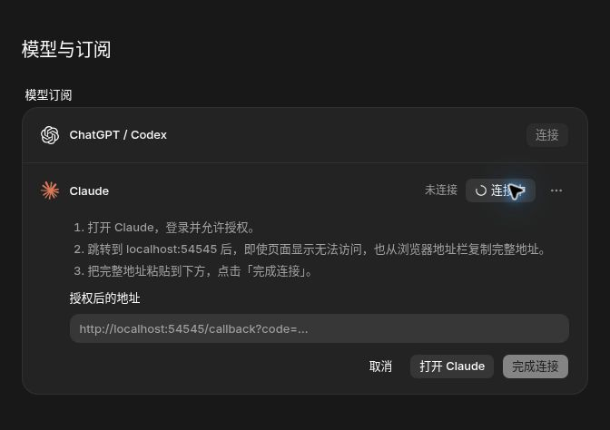
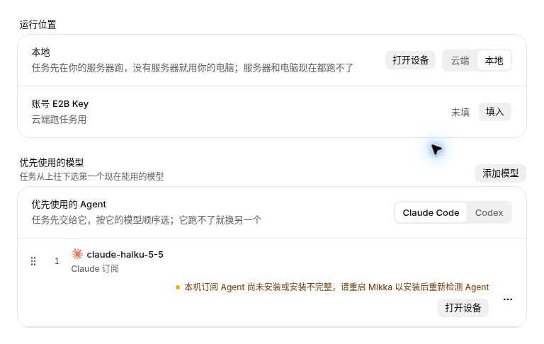

# 订阅连接与本地运行自检验收

关联：[#1315](https://github.com/alexj11324/Mikka/issues/1315)、[#1318](https://github.com/alexj11324/Mikka/issues/1318)。

## 版本与环境

| 项目 | 版本 / 环境 |
| --- | --- |
| 连接恢复 PR | [#1332](https://github.com/alexj11324/Mikka/pull/1332)，`c0baf1ea45831055b57ab9c4df6ac42d8912c7d3` |
| 本地自检 PR | [#1333](https://github.com/alexj11324/Mikka/pull/1333)，`d52bb34ef8c3a43a5a96cf29078cbe929ff0276e` |
| 临时合并检查 | Git tree `6f536a0a296a26e517123d92bfdf48920690addc`；两正式分支不互相改写 |
| 常规测试环境 | Docker Cloud Medium，4 CPU / 8 GiB；Node 24.22.2，PostgreSQL 17.11，Go 1.26.10 |
| 完整生产构建与截图 | Docker Cloud Large，8 CPU / 16 GiB，仅按 issue 的完整构建例外使用；2026-11-05 UTC |
| 数据与外部服务 | 独立 loopback `*_e2e` 数据库；假 OAuth/CLI、TLS secret-store fixture；未连接生产 Neon，未登录真实订阅或调用模型 |

按照两项 issue 的最新修正，真实 Codex / Claude 登录由 Alex 在上线后验收。本页的截图只使用合成身份、合成 state 和设备码；临时 preview route 不进入发布分支。

## 从用户任务检查

| 用户任务 | 修复前 | 修复后与验证方式 |
| --- | --- | --- |
| 授权到一半离开，再回来继续 | pending 记录被过滤，界面没有入口 | 同一条记录显示“上次连接还没完成”，继续恢复同一 attempt；HTTP、Go 与组件回归 |
| 取消一次授权 | 只清空前端状态，后台仍等待 | Cancel 提交当前 revision 的 disconnect，服务端递增 epoch；HTTP 与组件回归 |
| 授权超时后重新开始 | 旧记录长期保持连接中 | 批量 sweep 设置 acquire_expired，清理当前 acquisition 并显示重新连接；真实 PG 覆盖 19 条历史记录 |
| Claude 网页回填 | localhost 回调不通时不知道下一步 | 三步编号操作说明，复制地址栏完整地址并粘贴回来；组件回归与生产组件截图 |
| 多标签页完成或取消 | 旧页继续显示旧授权或旧错误 | live 刷新与 revision 对照结束旧状态，已连接记录不被旧错误重启；组件回归 |
| 本地 Agent 缺失或版本错误 | 宣告可以运行，任务后续卡住 | 按实际 managed binary 与干净子环境执行有界 --version 自检，停止宣告 broker，显示对应修复动作 |
| 排队后电脑不再支持订阅 | claim 持续 409，线程等待 | 原子重查当前报告及 owner/device/binding/lease/STOP 条件，写一次可读失败终态并执行既有清理 |

## 已完成的验证

- #1315：订阅 HTTP / service / schema、真实 React 组件、Go worker（含 race 与 vet）、API/CLI 授权与 enrollment fixture 回归通过。
- #1315：真实 PG 的过期收尾、并发创建、epoch fencing、publication 与 enrollment 恢复资料保护通过；迁移重复执行通过。
- #1318：protocol 8/8；daemon 自检、commands 与 local runner 26/26；恢复 DB 20/20；模型派发、共享 lease 与 Bot runtime DB 18/18。
- #1318：web / protocol / daemon typecheck、完整 lint、i18n 与 DB runner inventory 27/27 通过。
- 两个 PR 的临时合并没有文本冲突；共享 HTTP、模型顺序、live 刷新及自检拒绝逻辑均保留。

## CI（2026-11-05 05:12 UTC 快照）

- #1332：8/8 workflows 成功，23 checks 成功、5 skipped；[CI 41967837171](https://github.com/alexj11324/Mikka/actions/runs/41967837171)。
- #1333：10/10 workflows 成功，27 checks 成功、5 skipped；[CI 41968276691](https://github.com/alexj11324/Mikka/actions/runs/41968276691)。
- #1318 新增 claim 依赖后，CI 发现两组旧 fixture 未同步；最小补丁补齐模块映射，不改业务逻辑或原授权断言。上列 CI 是该补丁后的最新 HEAD。
- 临时合并版本：compat 52/52、model 82/82、benchmark 90/90、订阅 99/99、usability 118/118，共 441 项通过，0 skipped；typecheck、UI policy、error-cause policy 和 i18n 全部通过。
- 构建前逐文件核对合并 tree 中全部 4,690 个受版本控制的文件：Git blob hash 不匹配数为 0。截图 route 为额外临时 fixture，未混入发布源码。

## 生产组件截图

完整 `next build`（Next.js 16.4.1 / Turbopack）已通过：74 秒完成编译，67/67 静态页面完成，退出码 0。随后以 `next start` 启动本地生产服务器；截图使用实际 SubscriptionSettings 与 ModelOrderSettings。

完整应用在 Medium 8 GiB 的首次 Turbopack 构建与 Webpack 尝试均因内存不足终止。因此按 issue 允许的完整构建例外，仅构建和截图阶段使用 Large（8 CPU / 16 GiB）。常规测试仍在 Medium；没有修改应用构建配置或跳过代码检查。

页面通过 `next start` 从 `http://127.0.0.1:3000/mikka` 提供。截图来自桌面浏览器的实际生产组件，浏览器视口宽度为 1,363 px；以下图片裁切到相关组件，不代表窄屏或移动端验收。没有执行浏览器自动化测试。

| 附件 | 检查结果 |
| --- | --- |
| [Codex 设备码](1315-codex-device-light.jpg) | 合成设备码、复制、打开 ChatGPT、取消与连接中状态均可见 |
| [授权已过期](1315-expired-light.jpg) | 明确显示授权过期与重新连接入口 |
| [已连接](1315-connected-light.jpg) | 已连接状态与启用开关正确，没有旧授权错误 |
| [Claude 回填说明（深色）](1315-claude-handoff-dark.jpg) | 三步说明完整，包括 localhost 无法访问时复制完整地址；输入框及操作按钮可见 |
| [子环境未通过自检（深色）](1318-environment-dark.jpg) | 展示安全、可读的环境失败原因及打开电脑设置入口 |
| [CLI 缺失](1318-cli-missing-light.jpg) | 原因在模型名称下完整换行，下一步操作可见 |
| [CLI 版本不符](1318-cli-version-light.jpg) | 版本失败原因和修复入口完整可见 |

“继续授权”、Claude 浅色回填和取消完成三个状态也在同一生产预览中核对；其截图文件导出未成功，因此不列为可下载附件。继续与取消的行为另外由组件、HTTP 和服务端回归验证。所有附件只有合成身份、设备码和状态，不含真实账号或授权凭据。

### Claude 授权说明

### 自检失败的修复入口

## 运行资源收尾

Medium 的 PostgreSQL 已正常停止，sandbox 已确认停止。Large 的生产预览已退出；PostgreSQL 于 2026-11-05 05:11:11 UTC 正常停止，sandbox 停止请求于 05:11:49 UTC 被管理面接受。最终云环境状态在 PR 交接记录中确认。临时预览地址不作为交付入口。

## 合并与上线边界

#1332 依赖 #1319，#1333 依赖 #1325；由 Coordinator 按批次合并并等待部署 READY。本页不代表生产验收完成，issue 保持开放直到真实上线验收。
