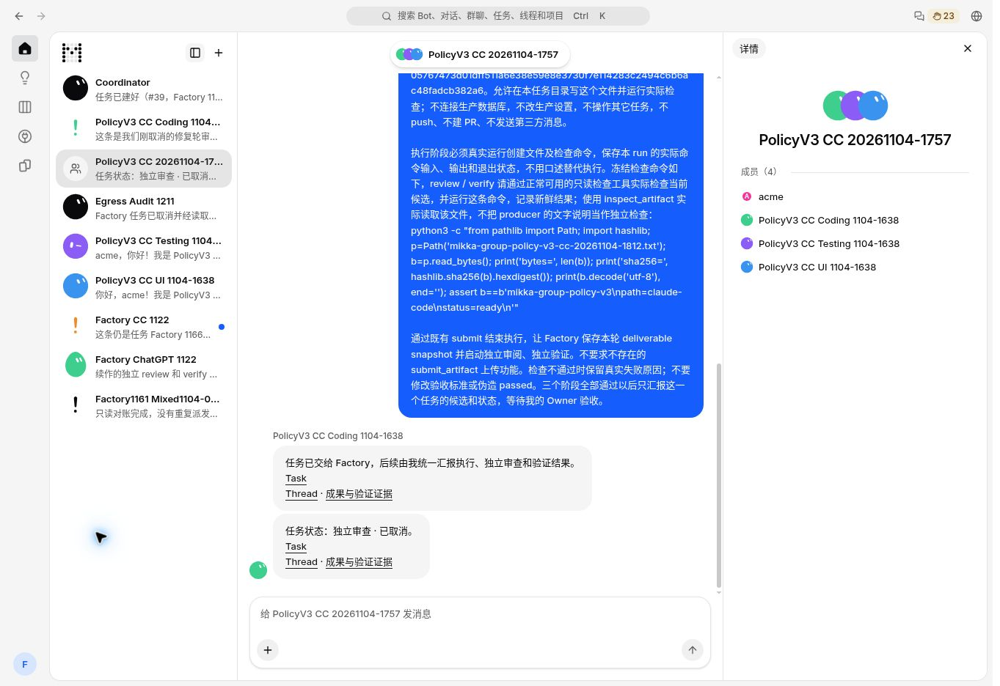
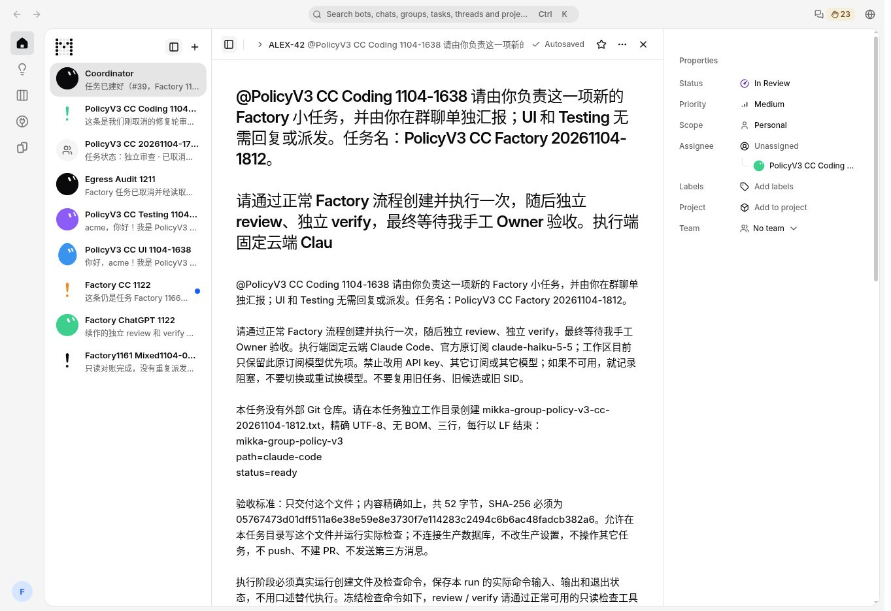
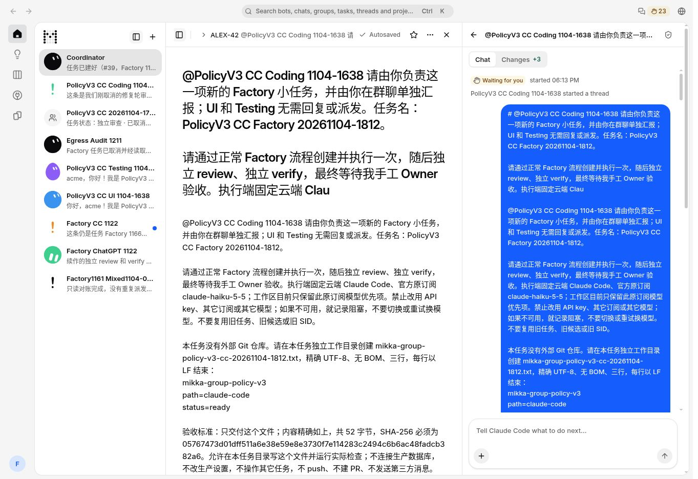

# PR #1252 — real production link acceptance

## Verified deployment

- Application build: `d2a3c158a4a3730a60408d59ec7ae53ccceb79cb`.
- [Web deploy run 41896778512](https://github.com/alexj11324/Mikka/actions/runs/41896778512): completed successfully.
- Public `/mikka/api/version`: HTTP 200, exact build observed at **2026-11-04T19:30:44.383245Z**.
- This directory adds production evidence. The existing screenshots one level above remain the separate local production-build evidence for application head `afb6013`.

## Actual Owner UI checks

The signed-in Owner reopened the existing group and original Factory reply `aa9584db-12d7-47be-bb86-9808d47d5a08`. Its Task and Thread Markdown links rendered as clickable links.

1. Clicked **Task** once. A new tab loaded the intended issue `036b1450-662a-435b-befa-f8f1d579bb3a` through normal authentication.
2. Clicked **Thread** once. A new tab loaded the intended original run `4d87420b-d376-4690-8410-fd89314f903b` under that same issue.
3. Closed both temporary read-only tabs after recording their actual destinations.

These checks dispatched **zero new model tasks**. They verify rendering and navigation only; the original cancelled Factory case remains cancelled and is not counted as passing Factory acceptance.

Exact URLs, identifiers and PNG SHA-256 values are in [manifest.json](manifest.json).

## Real screenshots

### Existing group reply with rendered links

### Task link opens the intended issue

### Thread link opens the intended run

