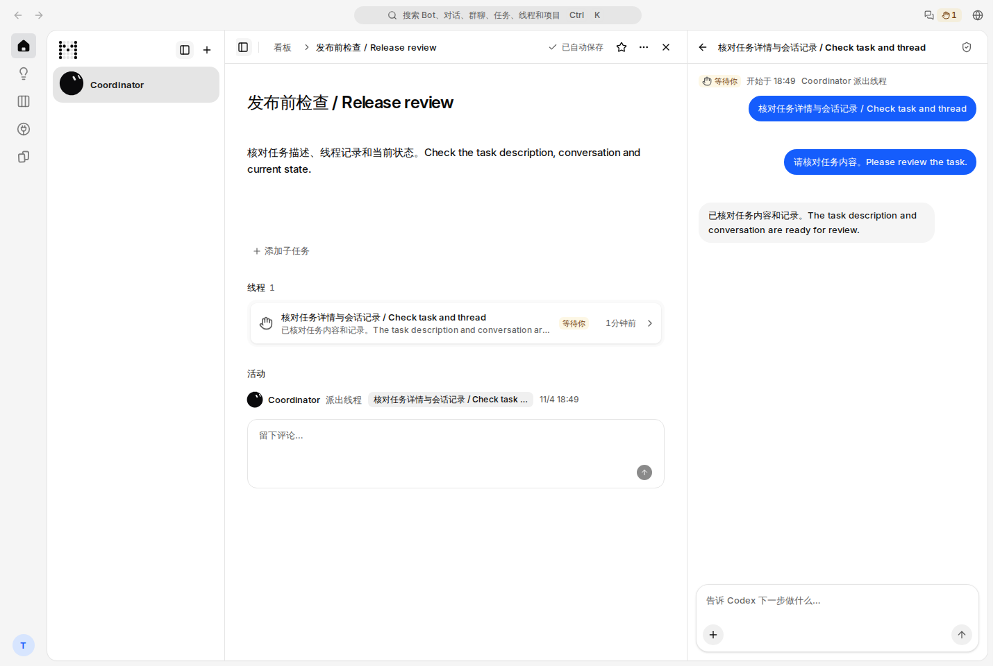
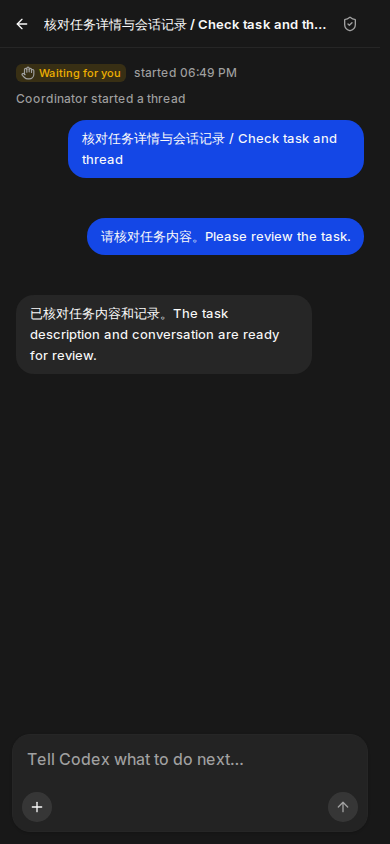

# Task details and thread panels — final integrated visual evidence

## Exact source

- PR: [#1236](https://github.com/alexj11324/Mikka/pull/1236).
- Source commit: `3f42627321479e9d9071143dc7ca133c2034c56d`.
- Git tree: `1517b1ac176e126b78045f18f72ac4f6fcb065dd`.
- Includes main `2ab9649b14b75b530172bfe51933e4f3b51f949e`, including provider fallback, the shared live foundation, the egress batches and the new diff viewer.
- [Exact-head CI](https://github.com/alexj11324/Mikka/actions/runs/41889293372) completed successfully. All nine workflows associated with this head completed successfully.

## What was exercised

The existing Docker Cloud Sandbox ran a clean checkout, the real production build, PostgreSQL 17 on loopback and the ordinary TestAccountPool sign-up/sign-in flow. The screenshots were captured from the running production HTTP application at `http://localhost:3321`, not a component mock or intercepted route.

All twelve images were opened and visually reviewed: task title and body, thread list, activity, conversation messages, composer, navigation and localized controls remain legible in Chinese/English, desktop/mobile and light/dark mode. Mobile task and thread are separate views; existing long labels use their normal ellipsis. The capture reported zero browser console errors and zero HTTP failures.

The task, run and messages are **synthetic display fixtures** in the isolated test database. There was no model execution. These images do not establish production acceptance, healthy-WebSocket delivery or production traffic reduction. Those remain separate deployment checks.

## Capture matrix

| Locale | View | Size | Light | Dark |
| --- | --- | --- | --- | --- |
| Chinese | Task + thread | 1440 × 960 | [image](zh-task-1440-light.png) | [image](zh-task-1440-dark.png) |
| Chinese | Task | 390 × 844 | [image](zh-task-390-light.png) | [image](zh-task-390-dark.png) |
| Chinese | Thread | 390 × 844 | [image](zh-thread-390-light.png) | [image](zh-thread-390-dark.png) |
| English | Task + thread | 1440 × 960 | [image](en-task-1440-light.png) | [image](en-task-1440-dark.png) |
| English | Task | 390 × 844 | [image](en-task-390-light.png) | [image](en-task-390-dark.png) |
| English | Thread | 390 × 844 | [image](en-thread-390-light.png) | [image](en-thread-390-dark.png) |

## Integrity and cleanup

[manifest.json](manifest.json) records the immutable source, isolated environment ID, capture timestamps, PNG SHA-256 hashes, limits, errors, artifact audit and cleanup. [verification.json](verification.json) records the independent export/hash verification and visual review.

The final captures ran on 2026-11-04 between 18:53:37.777 and 18:53:45.847 UTC. All twelve exported image digests matched the manifest. The artifact scan passed. Synthetic task/run resources were removed and the dirty account pair was quarantined at 18:53:45.957 UTC.

The first build attempt on the sandbox's RAM-backed `/tmp` compiled but was killed with exit 137 while collecting page data. Kernel output identified a global OOM. Its log and result were retained. The same source was moved to the same sandbox's disk-backed `/home/agent`, and only this task's obsolete build cache was removed. The full build, typecheck and isolated migration then exited 0. No source or test gate was changed to obtain the build result.

Earlier 238da19 screenshots remain historical evidence only; this directory is bound to the final integrated 3f42627 source.
