# #1236 任务详情与会话面板：本地实屏证据

本页固定到产品提交 **`238da19ca6b465c258ffe69a953092835119d8ef`**，源码树 **`8d52cedc17719053f618604d8847ab296c74a2fa`**。截图来自原 Large Docker Cloud Sandbox 中的真实 production build、HTTP 服务和独立 PostgreSQL 17 数据库，使用正常 TestAccountPool 注册、登录与会话。截图时间为 **2026-11-04 18:01:26–18:01:39 UTC**。

产品变更见 [PR #1236](https://github.com/alexj11324/Mikka/pull/1236)。本证据分支只增加资料，未修改或替换该 PR 的源码提交。

## 已核对

12 张截图均已打开检查：中英文界面、1440 × 960 桌面、390 × 844 手机、浅色和深色模式。任务正文、已加载的线程列表和会话消息可读；桌面两面板边界明确；手机标题沿用既有截断，输入区和操作按钮没有重叠。

用于显示的任务、run 和消息是隔离数据库中的合成记录，没有执行模型或启动真实工作线程。界面上的 Codex 字样来自显示 fixture，不能作为 Codex 订阅调用证明。本次无浏览器测试 runner、无路由拦截。截图只证明该固定版本的真实页面呈现；生产部署、健康 WebSocket 推送及整体流量变化仍需对应验收。

首轮截图 driver 在三张桌面图中没有等到独立线程列表首次加载；原记录保留。本组最终截图增加了对真实列表和唯一线程行的等待，没有修改产品源码。最终 console errors 与 HTTP failures 均为 0。

## 验证与清理

同一版本的本地生产构建、typecheck、lint 均退出 0；真实数据库通知回归 31/31，设备网关相关 9 + 39 + 9 全部通过。GitHub 当前提交的 29 项检查已完成：24 项成功，5 项按原 workflow 条件跳过，完整链接见 [verification.json](verification.json)。

图片 SHA-256、真实页面尺寸、时间、合成资源 ID 和证据扫描结果见 [manifest.json](manifest.json)。证据扫描未发现凭证或会话 cookie。截图后的任务、run 等保留资源已按所属账号删除，账号对以 dirty 状态释放并隔离，未重标为干净基线。没有访问生产数据库或留下生产测试数据。

## 桌面：任务与会话

| 界面 | 浅色 | 深色 |
| --- | --- | --- |
| 中文 | [原图](zh-task-1440-light.png) | [原图](zh-task-1440-dark.png) |
| English | [Original](en-task-1440-light.png) | [Original](en-task-1440-dark.png) |

### 中文 · 浅色

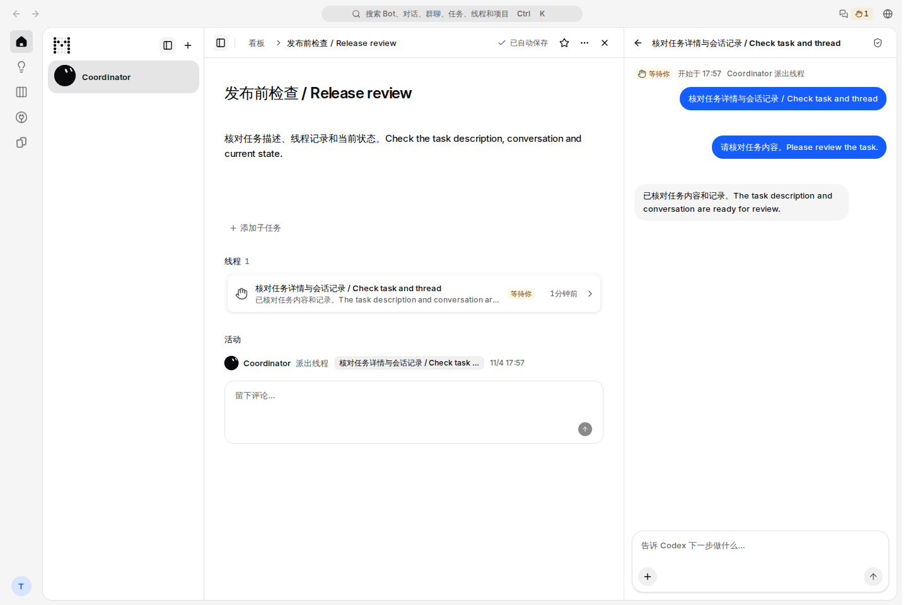

### 中文 · 深色

### English · Light

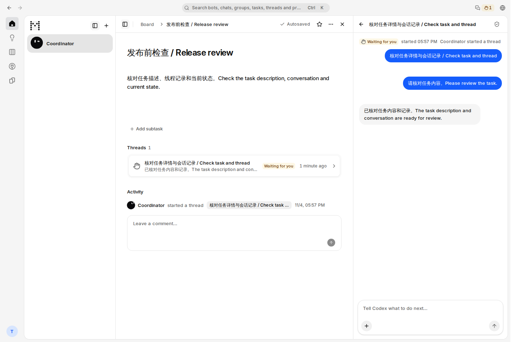

### English · Dark

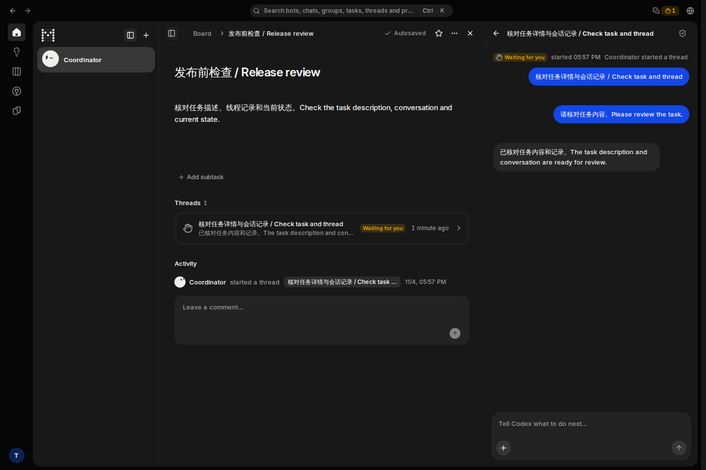

## 手机：任务详情

| 中文浅色 | 中文深色 | English Light | English Dark |
| --- | --- | --- | --- |
| 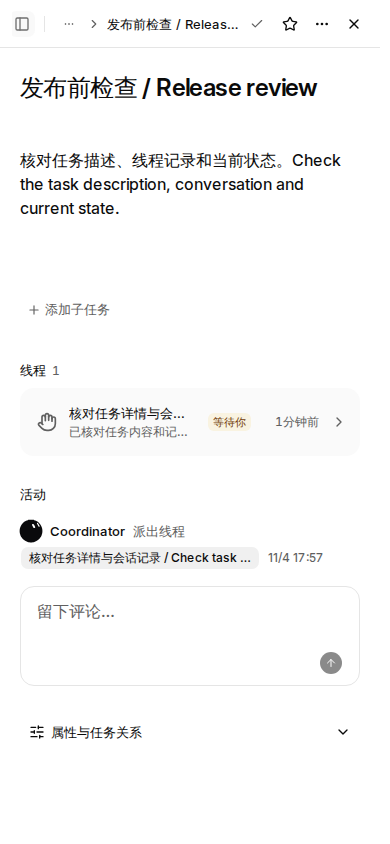 | 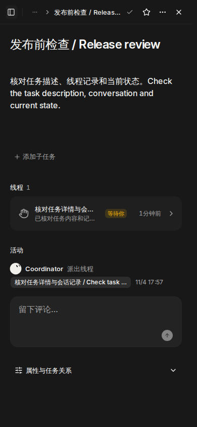 | 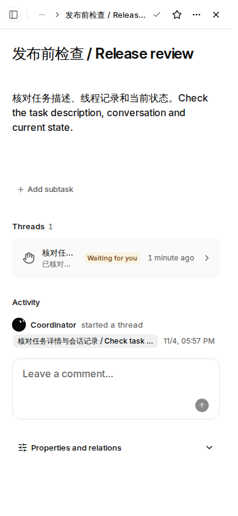 | 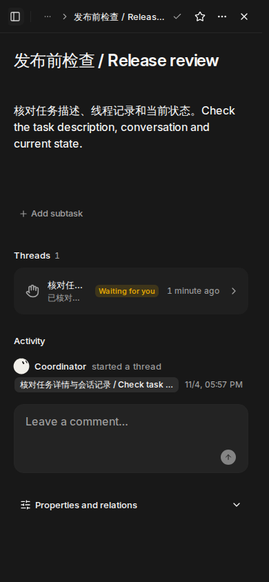 |

## 手机：会话面板

| 中文浅色 | 中文深色 | English Light | English Dark |
| --- | --- | --- | --- |
| 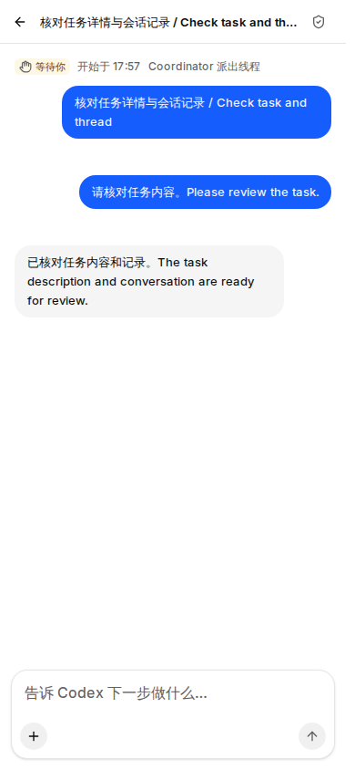 | 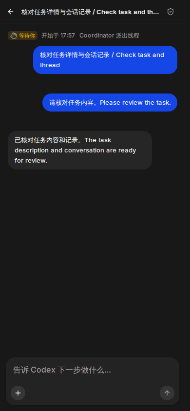 | 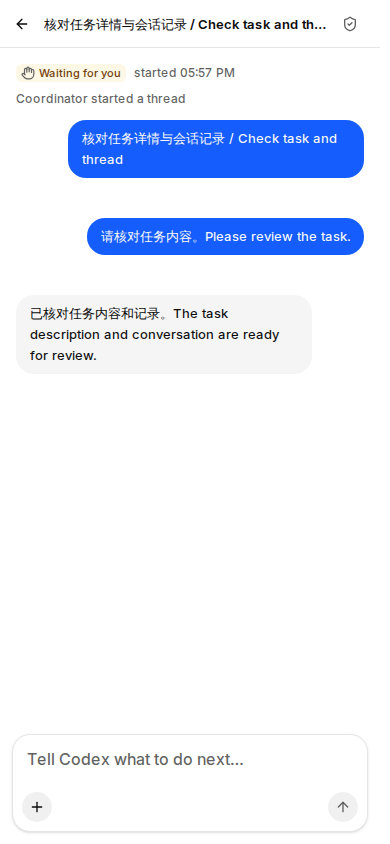 | 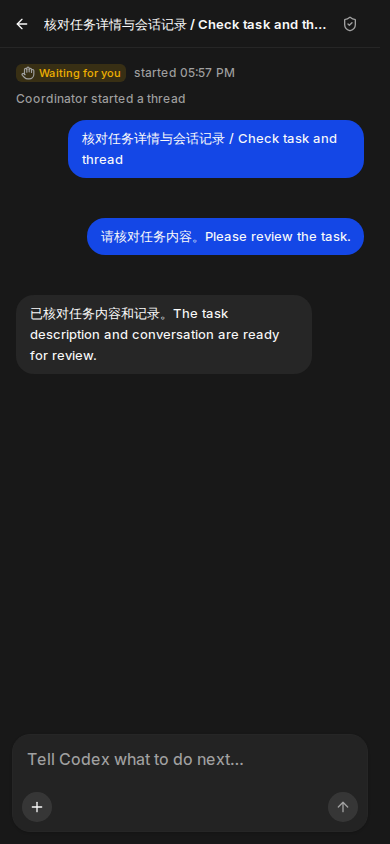 |

