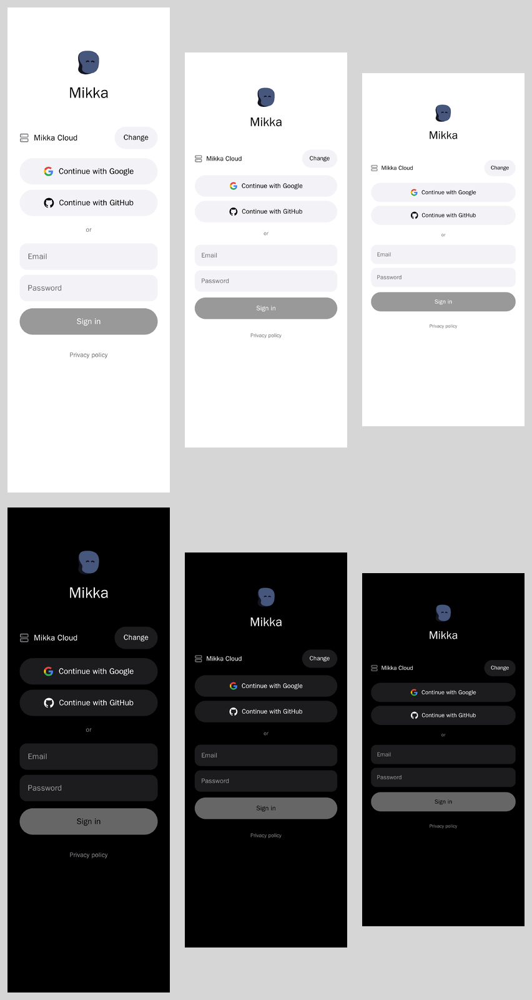

# English sign-in review

The six frames use the cloud Linux Expo Web production export with the real
anonymous sign-in entry. The API responses come from the deployed application.

- UI source revision `348cf8f1322d555f3584b40b0198c7392b4c08df`.
- Official UI revision `c34b3adf07240afebae725b2af599cfbc69c4f42`.
- Backend revision stayed at `9bcdefc5fe0c047393d581eea867ffa801f53dbe` throughout capture.
- Widths are 320, 393 and 440 points, in light and dark appearances.
- The owner reviewed all six frames for clipping, overlap and English labels.

[Capture manifest](manifest.json) records each full-resolution image and hash.
The source change from this UI revision to `55355a2ed2403387a7bd4431d95f10251e471812`
changes the archive validator and its test. These rendered controls keep the
same source bytes.

## Native checks

Apple owns the native sign-in button and authorization sheet on iOS. Its native
availability gate omits that control in Expo Web. A compatible iOS binary still
needs Apple authorization, Keychain persistence, revocation, VoiceOver and
Dynamic Type acceptance. The native screenshot workflow records the App Store
image provenance separately.

## EAS archive preflight

The real EAS CLI 27.2.0 source inspection used revision `348cf8f` with the
complete 365-path official UI checkout. The revised validator accepted all 291
allowed private files byte for byte. The 74 excluded paths follow the existing
archive policy. The archive contains 6,139 files and preserves empty `docs` and
`.hosted-ui/docs` directory placeholders. Excluded files and symlinks remain
rejected. [Preflight provenance](archive-preflight.json) records its digest.

The main release workflow repeats the inspection against its exact source
commit before it builds or uploads the native binary.
